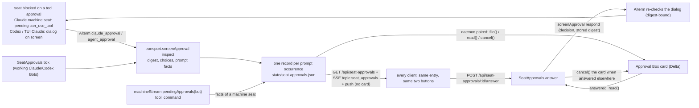
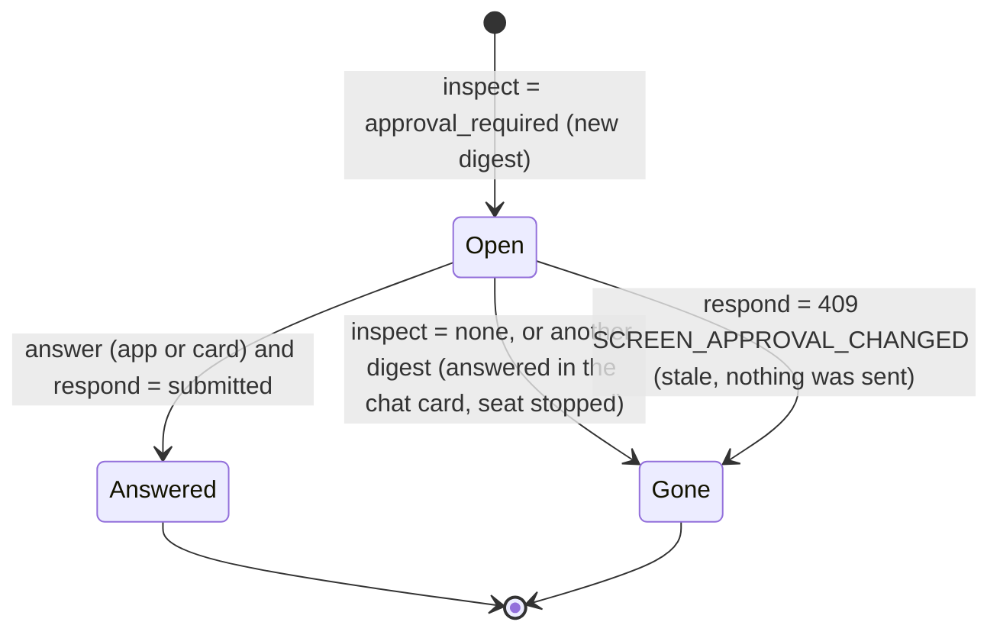

# Seat tool-approval prompts reach the Owner (seat-approval-to-abx, Owner 2026-11-24)

Owner: Kiro (execution). Card contract: Delta, [seat-approval-card.md](../approval-box-extension/seat-approval-card.md). Owner words: 「決裁箱に飛んでくればいいだけなんだけどな。」 and 「決裁箱が使えるユーザーならね。」 A seat that stopped on a tool-approval prompt (Bready sat 3.5 h on Claude Code's "Dangerous rm operation") must reach the Owner: as an Approval Box card when he has Approval Box connected, otherwise as the same entry inside BellTeam, the same on every client. His answer approves that one prompt once or denies it, and goes back to that same prompt.

## Function diagram

## Data flow and state (one record = one prompt occurrence)

`id = sa-<botId>-<digest first 16 hex>-<firstSeen seconds>`; fields: `botId, harness, digest, firstSeen, facts{tool, command, reason}, status open|answered|gone, answeredBy app|card|elsewhere, decisionId|null`. The file survives a body restart; Delta's `file()` re-adopts the card by its `session_label`, so a restart files nothing twice.

Every state leaves by the next tick or by a prompt change; nothing waits for the Owner. A card still unanswered when the prompt is gone is cancelled.

## Server contract (the clients' rows follow this; Owner session only, the internal Bot port gets 403 `SEAT_APPROVAL_OWNER_REQUIRED`)

| Route | Answer |
| --- | --- |
| `GET /api/seat-approvals` | `{"approvals":[{"id","botId","botName","harness","tool","command","reason","since","choices":[{"decision":"approve_once","label":"1回だけ許可する"},{"decision":"deny","label":"許可しない"}],"card":"none"\|"filed"}]}`: the open entries, oldest first. `command` is secret-masked and cut at 2000 characters; for a TUI Claude seat Aiterm gives no text, so `tool` and `command` are `null` and the client says "see the Bot's screen". `card: "filed"` = an Approval Box card exists for it (the in-app entry stays; no push was sent). |
| `POST /api/seat-approvals/:id/answer` `{"decision":"approve_once"\|"deny"}` | `200 {"id","status":"answered","decision"}`. `400 SEAT_APPROVAL_INVALID`, `404 SEAT_APPROVAL_NOT_FOUND`, `409 SEAT_APPROVAL_CLOSED` (answered by another front, stale, or the prompt is gone: the first answer wins), `502 SCREEN_INPUT_FAILED`. |
| SSE `/api/events` | topic `seat_approvals` with the `botIds` of the changed entries: a client re-reads the list. |
| Push | One push per new entry only when no card was filed (the card brings its own push). The existing `owner_question` push (title = the Bot's name, the same generic body as a machine seat's question); tapping it opens the Bot, where the entry is. |

The Bot screen keeps `GET/POST /api/bots/:id/screen/approval` ([screen-input.md](screen-input.md)) and Claude machine seats keep the chat `approval` row (conversation machine-stream.md): all fronts end in the same Aiterm respond with the same digest, so the first answer wins and the others see the prompt gone.

## Rules

- Detection: every tick, for each Bot of harness claude or codex whose current work is working: `screenApproval inspect`. Claude machine seats cost no tmux read (Aiterm reads the stream files). Grok, Cursor and Antigravity have no Aiterm approval tool: no detection until Aiterm offers one (asked of Elegg).
- Facts: machine seat = the Bot's first pending `approval` row of the machine stream (tool name, command); Codex = `agent_approval`'s `prompt` and `kind` (cut at 2000); the harness's reason is a fixed sentence per harness plus, for a Claude machine seat, Claude Code's own `decision_reason` of the `can_use_tool` request (measured on Bready's seat 11/24: `Dangerous rm operation on working directory or its ancestor: <path>`, `classifier_approvable: false`; the request line also carries `decision_reason_type` and `description`). Secrets in the command (tokens, keys, `*=…` of secret-looking names, private key blocks) are masked before the record or the card holds the text.
- Card: only when the hosted daemon is paired (`daemon.status().daemon.mode === 'pc'`); otherwise or when `file()` fails the entry stays in-app only. No token path, no new secret request.
- Answer: always `screenApproval respond` with the digest stored at filing; a changed or gone dialog never receives an old answer. A free-text answer on the card counts as deny.
- No new guard: nothing is refused or held; a failed tick is retried by the next one.
