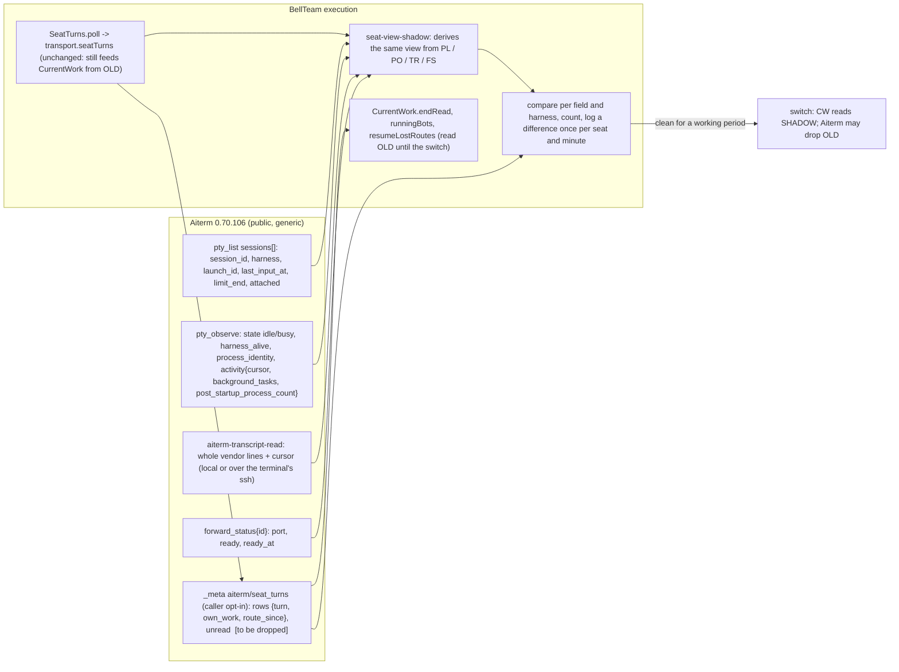

# Seat view from generic Aiterm facts: shadow run (a532b2 stage 3, 2026-11-23)

Owner: execution (Kiro). Order: Tronie 2026-11-23 (stage 3 starts now as a shadow run in production; it switches in the first train after a clean run). Aiterm drops its BellTeam-shaped fields (`_meta["aiterm/seat_turns"]`, `own_work`, `route_since`, `unread`) only in Elegg's one final release, after stages 2, 3 and 5 ran in production for a working period. Related: [aiterm-boundary-move.md](aiterm-boundary-move.md) row 3, [current-work.md](current-work.md), [remote-seat.md](remote-seat.md).

## Function and data flow

The shadow never changes what BellTeam does: it only reads and compares. A shadow failure (a generic read refused, a transcript unreadable) is counted as `shadow_unavailable` and never reaches the Owner or any delivery.

## Fields and their generic source

| Field BellTeam reads today | Generic source | Phase | Open |
| --- | --- | --- | --- |
| `listed` (a row for the session, or the session in `unread`) | the session is in `pty_list` `sessions[]` of that terminal | A | none; `unread` stays an Aiterm-side relay fact, so for a terminal seat the shadow asks the terminal's own `pty_list` through the same relay and counts a failed ask as unread |
| `route_since` (terminal seat) | `forward_status({id})` `ready_at` (Aiterm 0.70.101; id = the binding ref); null while not `ready` | A | none (Elegg: same lock time) |
| `limit_end` per Claude seat | `pty_list` `sessions[].limit_end` (already generic, read today) | A | none |
| `turn.state` running / idle | `pty_observe.state` (the seat's own idle/busy reading) cross-checked with the last vendor transcript line | B | does `state` equal the transcript's "turn open" for all five harnesses? the shadow measures it |
| `turn.turn_id`, `started_at` | derived from the vendor transcript (turn start line) + `launch_id`; opaque, compared for equality only | B | today's id is an Aiterm-observed span, not vendor birth; the shadow compares only running/idle and that the id is stable inside one turn, not equal to Aiterm's string |
| `turn.interim_from` | transcript position (cursor) at the seat's last settled idle | B | needs `aiterm-transcript-read` cursor stability across files (Elegg) |
| `own_work.child_results`, `own_work.tasks` | `pty_observe.pending_child_deliveries`, `activity.background_tasks` | C | exact meaning of `background_tasks` against today's `tasks` (Elegg) |
| `own_work.processes` (post-startup, not plumbing, not excluded) | `pty_observe.activity.post_startup_process_count`, `process_identity` | C | the Owner-approved exclusion list needs the process list (exe, args); `pty_observe` gives a count and an identity, not the list. Ask Elegg for a generic process read, or BellTeam keeps asking Aiterm for this one field |

## Shadow rule and what "clean" means

- Phases ship in order A, B, C, each as its own diagram-first change; each is clean on its own and switches on its own. A phase that cannot become clean for a field (the open items above) leaves that field on Aiterm and tells Tronie and Elegg: Aiterm then keeps that one field generic instead of dropping it.
- A comparison counts only when both reads were taken in the same poll and the seat's session, launch and stop generation did not change in between (the same `current()` guard as `beginRead`).
- A difference is logged as `SEAT_VIEW_SHADOW_DIFF {field, harness, kind: terminal|local}` once per seat and field per minute, with counters per field and harness kept in memory and read by the diagnostics module (no new store). No Owner message, no delivery refusal.
- Clean = at least 200 compared reads per field and harness that appear in production, over one working day, and zero differences that are not explained by a read taken at a turn boundary (a difference present in one poll and gone in the next poll counts as boundary jitter and is reported separately, not as a difference).
- The switch is one flag in the BellTeam change that also keeps the Aiterm-shaped read as a fallback for an Aiterm that lacks a generic fact; the fallback goes with Elegg's final release.

## Self-exit and protection

The shadow holds nothing and refuses nothing: no guard, so no state to leave. Its only protection is the Owner-facing active lamp and current work, which keep reading Aiterm's rows until the switch (named protection: a wrong turn state shows the Owner a lamp that lies, and `after_turn` schedules fire on it).

## Order inside the stage

1. This design (diagram first) and Elegg's answers to the open items.
2. Phase A code, shadow only; live; one working day of counters.
3. Phase A switch together with stage 2 if clean by then (Tronie), otherwise in the first later train.
4. Phases B and C the same way.
