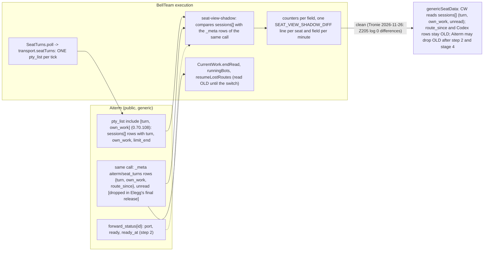

# Seat view from generic Aiterm facts: shadow run (a532b2 stage 3, 2026-11-23)

Owner: execution (Kiro). Order: Tronie 2026-11-23 (stage 3 starts now as a shadow run in production; it switches in the first train after a clean run). Aiterm drops its BellTeam-shaped fields (`_meta["aiterm/seat_turns"]`, `own_work`, `route_since`, `unread`) only in Elegg's one final release, after stages 2, 3 and 5 ran in production for a working period. Related: [aiterm-boundary-move.md](aiterm-boundary-move.md) row 3, [current-work.md](current-work.md), [remote-seat.md](remote-seat.md).

## Function and data flow

The shadow never changes what BellTeam does: it only reads and compares. A shadow failure (a generic read refused, a transcript unreadable) is counted as `shadow_unavailable` and never reaches the Owner or any delivery.

## Fields and their generic source (Elegg's decisions, 2026-11-23)

Elegg keeps `interim_from` and `own_work` in Aiterm as generic facts (only Aiterm knows each vendor's file layout and the process argv; raw argv never leaves the machine), and offers them with the turn in the plain `pty_list` argument `include: ["turn", "own_work"]` from Aiterm 0.70.108: every agent row of `sessions[]` gains `turn` ({state "running", turn_id, started_at, event_cursor, interim_from} | {state "idle"} | null) and `own_work`. `turn: null` means "not readable now, or another reader holds the seat" and replaces `unread`. `aiterm-transcript-read` is Claude-only, so BellTeam builds no transcript reader. One `pty_list` call carries both the old `_meta` rows and `include` (one read; two overlapping calls would leave one reader without the span lock).

| Field BellTeam reads today | Generic source | Step |
| --- | --- | --- |
| `turn` (state, turn_id, started_at, interim_from) | `sessions[].turn` of the same call | 1: shadow compares with the `_meta` row; switch reads `sessions[]` |
| `own_work` | `sessions[].own_work`; the exclusion list stays the input `_meta["aiterm/own_work_exclusions"]` | 1: same |
| `unread` | `sessions[].turn === null` for that seat (a terminal older than 0.70.108 returns no `turn` field: not returned = unread) | 1: same |
| `listed` | the session is in `sessions[]` (a row, or turn null) | 1 (follows from the three above) |
| `route_since` (terminal seat) | `forward_status({id})` `ready_at` (Aiterm 0.70.101; null while not `ready`) | 2: done 2026-11-26 without a second read: `ready_at` of the `ensure_forward` answers (remote-route.md open item 1) |
| `limit_end` per Claude seat | `sessions[].limit_end`, already generic and read today | none |

The old `seat_turns` meta, `route_since` and `unread` are removed by Elegg's final release only, after the switch has run one working period. Until the switch, the Aiterm-shaped rows feed CurrentWork as today.

## Shadow rule and what "clean" means

- Steps ship in order, each as its own diagram-first change; each is clean on its own and switches on its own.
- A comparison counts only when both reads were taken in the same poll and the seat's session, launch and stop generation did not change in between (the same `current()` guard as `beginRead`).
- A difference is logged as `SEAT_VIEW_SHADOW_DIFF {field, harness, kind: terminal|local}` once per seat and field per minute, with counters per field and harness kept in memory and read by the diagnostics module (no new store). No Owner message, no delivery refusal.
- Sink: the execution module runs inside the body process, so the lines land on the body's own stderr (the container log; not module-stderr, not diagnostics, which has no code for this and is another module's registry). Evidence of a clean day is the `SEAT_VIEW_SHADOW_SUMMARY` line every ten minutes (differed/compared per field, plus unavailable) together with no `SEAT_VIEW_SHADOW_DIFF` line; the production owner (Tronie) reads the container log for both.
- Clean = at least 200 compared reads per field and harness that appear in production, over one working day, and zero differences that are not explained by a read taken at a turn boundary (a difference present in one poll and gone in the next poll counts as boundary jitter and is reported separately, not as a difference).
- The switch is one flag in the BellTeam change that also keeps the Aiterm-shaped read as a fallback for an Aiterm that lacks a generic fact; the fallback goes with Elegg's final release.

## Self-exit and protection

The shadow holds nothing and refuses nothing: no guard, so no state to leave. Its only protection is the Owner-facing active lamp and current work, which keep reading Aiterm's rows until the switch (named protection: a wrong turn state shows the Owner a lamp that lies, and `after_turn` schedules fire on it).

## Order inside the stage

1. This design and Elegg's answers (done 2026-11-23: decisions above; Aiterm 0.70.108 carries `include`).
2. Step 1 code, shadow only (PR "a532b2 stage 3 step 1"): the shadow adds `include` to the existing `pty_list` read when the connected Aiterm's tool schema lists it (older Aiterm: the call is unchanged), compares `turn`, `own_work` and unread against the `_meta` rows, counts per field, reports one `SEAT_VIEW_SHADOW_DIFF` line per seat and field per minute. Adoptable on its own: additive, no behaviour change.
3. One working day of counters on Aiterm 0.70.108 (container and terminals): clean, ruled by Tronie 2026-11-26 from the Z205 log (0 `SEAT_VIEW_SHADOW_DIFF`; latest summary turn=0/81536 own_work=0/81536 unread=0/51). Switch (#2612, live Z206): `genericSeatData` in `seat-view-shadow.mjs` is applied to the `_meta` data in `AitermTransport.#seatTurns` before `CurrentWork.endRead`; the shadow keeps comparing the unswitched data. Seat list (this change, a532b2s3c): the seats are now the `sessions[]` rows themselves (`harness`, `launch_id`, `turn`, `own_work`; `viewRows` shapes them like the terminal rows); a row with `turn` null joins `unread`; a seat that is not in `sessions[]` is absent (a valid read without it). Aiterm's seat_turns meta supplies only what a generic row cannot yet: `route_since` of an old `terminal`-bound seat (remote seats get it from the keeper, step 2) and a running Codex turn until the generic turn carries `wait_process` (Aiterm >= 0.70.118, Elegg 2026-11-26; then the generic Codex turn is used as it is). No meta at all is enough. An Aiterm without the generic fields (< 0.70.108, no `turn` key on the rows) leaves the data as it is. No flag; to go back, revert. Elegg's final release drops the meta only after this and #2671 are live.
4. Step 2 (`route_since`): the keeper's `ready_at` from the `ensure_forward` answers goes on the rows of `remote` seats (`RemoteRoutes.readyAt`, `views`); terminal-bound rows of the old `terminal` input keep Aiterm's `route_since` until Elegg's final release.
