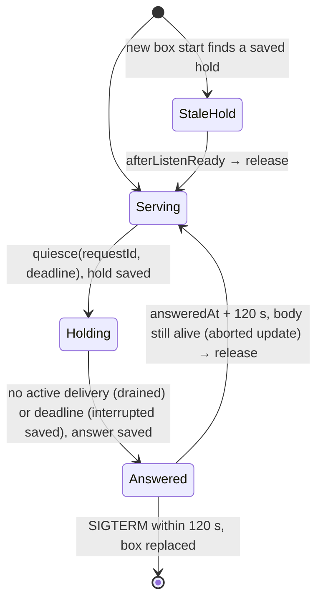

# Body update hold (Z-c, execution side)

Owner: Kiro. Design record: Kiro docs/z-c-seat-survival-design-20261107.md (section 5, 6.1). Contacts: Molly `src/body-quiesce.mjs` and the `application-runtime.mjs` lifecycle contacts; N102 room held rows (bot-c4a34a0b docs/z-c-room-hold-agreement-20261108.md).

## Functions

| ID | Function: input → output | Code |
| --- | --- | --- |
| H1 | quiesce `{requestId, deadline}` → durable hold → wait until no active delivery or deadline → durable answer (+ interrupted markers on deadline) → `{result:'drained'\|'deadline'}`. The same requestId returns the saved answer | `UpdateHold.quiesce` (execution assembly, parent-resident) |
| H2 | New input while held → `BOT_UPDATE_HOLD` (503, effect `not_started`), no native input. The gate is the deliver `check()`, which runs only before input is typed (`ports.access.assertInput`). That port is passed only to engines exporting `EXECUTION_UPDATE_HOLD_GATE` (loader `supportsUpdateHold`), because older engines reject unknown port keys. A facade guard on turn/notify/notifyReport also covers older engines; jobs already inside an older engine are not gated | `UpdateHold.assertInput`; `AitermTransport` `check()`; `createExecutionFacade` |
| H3 | Lease exit: after the answer, the hold expires at answeredAt + 120 s (installer answer→SIGTERM ≤ 30 s). A body still alive then = aborted update → release | `UpdateHold` timer |
| H4 | Body start: a hold saved by the previous box is active from `initialize()` until `afterListenReady`; that releases it after the controller is running (R-resume reconnect already ran in `controller.start`) | `UpdateHold.initialize` / `lifecycle.afterListenReady` |
| H5 | Release → hold file removed → listeners get `{released:true}` once, only after input is admitted again. Execution `onState` → direct receipts drain; N102 drains held room rows | `UpdateHold.release` / `hold.watch` |
| H6 | SIGTERM/SIGINT first step: if a hold exists and has no answer yet, persist the interrupted markers for still-active deliveries | `lifecycle.onShutdownSignal` |

## Data

`<state>/execution-update-hold.json` (next to `configuration-intents`, written with `writeAtomic`): `{schema:"bellteam.update-hold.v1", requestId, deadline, startedAt, answeredAt|null, result|null, interrupted:[{botId, deliveryId, startedAt}]}`. The file exists only while holding. Removing it is the release.

DFD: installer → body-quiesce socket → `lifecycle.quiesce` → hold file → admission refusal → durable receipts back to `queued` (direct/user/call/scheduler; existing `not_started` rule) and room held rows (N102) → release → `onState`/`hold.watch` → existing drains redeliver in saved order.

## Guards

| Guard | Protects | Exit |
| --- | --- | --- |
| Hold refuses new input | duplicate or lost input across the box replacement | release at new-box `afterListenReady`, or answeredAt + 120 s in a body that was not stopped (aborted update) |

Limits: an active delivery is a queue item of the selected engine (`transport.queueItems`). A CLI turn that the CLI started by itself, with no delivery, is not counted as running.
