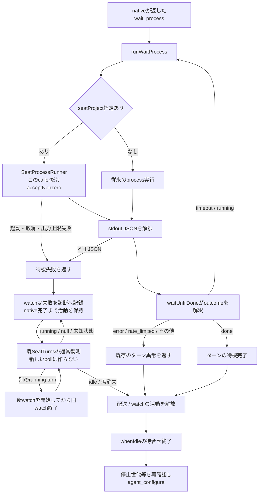
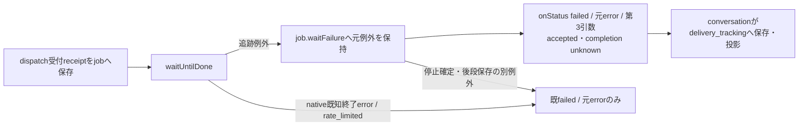
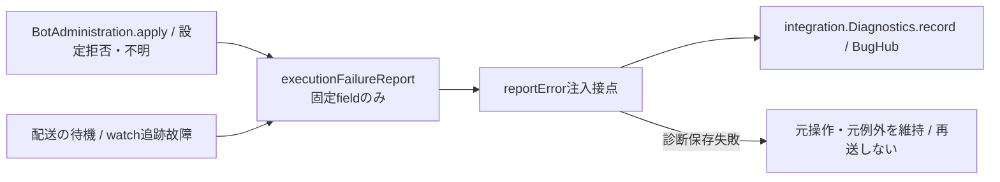
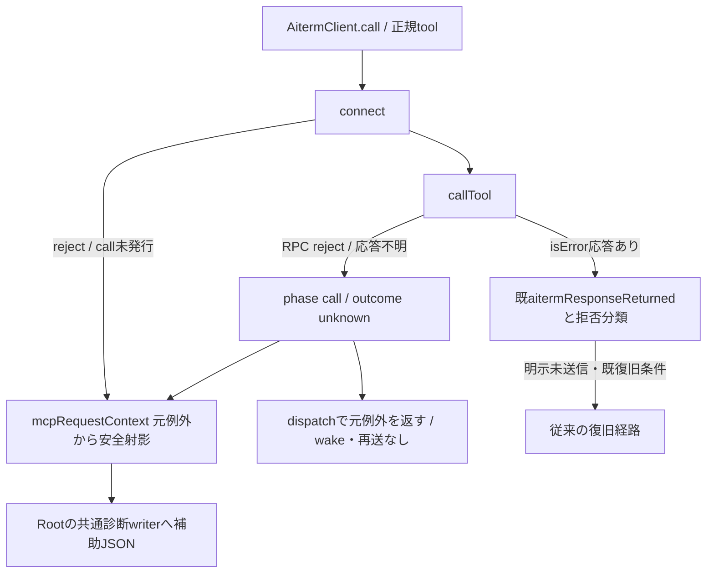

# 待機outcomeと設定適用の契約

所有者：キロ。接続先は[runtimeのseat-process](../runtime/README.md)、[Aitermのnative](../aiterm/README.md)。設定保存と完了観測を含む全体は[制御詳細](../../control-details.md)、[配送詳細](../../delivery-details.md)、[観測詳細](../../observation-details.md)を参照する。

## 席と非席で同じ待機結果を返す

| 境界 | 入力・出力と失敗の責任 |
| --- | --- |
| `runWaitProcess(waitProcess, signal, {seatProject})` | native公開返却のexecutable/argsを実行し、stdoutのJSONをそのまま返す。終了値だけでJSONのoutcomeを捨てない。席での実行方式・環境・UID・取消はruntimeの機構へ委譲する |
| `createSeatProcessRunner` | 既定のnonzero拒否を維持する。wait callerだけが既存のacceptNonzeroを使う。起動・入力・取消・合計出力上限の失敗はJSONへ置換しない |
| `waitUntilDone` | `timeout/running`なら同じreceiptの待機を続ける。`done`でだけ正常完了。`closed/error/rate_limited/not_taken`等は既存の終了異常へ写す |
| `watchTurn` / `SeatActivity.whenIdle` | timeout/runningと追跡の実故障ではwatchを活動として保持する。実故障後は既SeatTurnsが現在turnのidle/消失を観測するまでconfigureへ進めない。別running turnには活動の隙間なく引き継ぎ、古いwatchのfinallyで新watchを除かない |
| `BotAdministration` / `reconfigure` | 保存希望値・pending・accepted・failedを区別する。acceptedは設定受付であり新turnの実modelを測った証明ではない |

直接callerはapplication-servicesのseatProject付き注入、AitermTransportの既定値、waitForTurnCompletionとwatchTurn。`aiterm-transport.mjs`からの既存再exportを保持する。会話callbackと既例外messageは維持する。

## 受付後の追跡失敗を会話へ渡す

`onStatus(status, error, tracking?)`の第3引数は、receiptのあるjobのwaitUntilDoneが例外終了し、その同一例外がjob.failureを通って返る場合だけ、`{schema:'bellteam.delivery-tracking.v1', admission:'accepted', completion:'unknown'}`を渡す。元failed/stopped・元例外の同一性と伝播は保持する。native既知終了error/rate_limited、停止確定、受付前拒否、runningや途中経過・回答の保存失敗には付けない。timeout/runningは既待機継続のまま。本文・生receipt・process出力を第3引数へ含めない。

第3引数は入力受付の根拠と最終完了不明を表し、完了成功や再送許可ではない。直接user/Bot/通話/復旧・部屋のcallback転送、許可field保存・履歴投影はconversationが所有し、保存/public field名は`delivery_tracking`。既存履歴へ後付けしない。2引数callerは互換で、会話側の接続差分は同担当と統合する。関連fixtureは`test/delivery-tracking-status.test.mjs`。watch/設定適用/診断の既契約を変更せず、新timerや再送は作らない。

## 設定適用失敗と待機故障の診断

reportErrorは任意constructor引数。設定失敗は`SERVER_MODEL_CONFIGURATION_FAILED`/bots、待機追跡故障は`SERVER_TURN_TRACKING_FAILED`/queueとして{code,module,diagnostic_log}を提供する。JSONは`bellteam.execution-failure.v1`の対象/工程、許可した元code、存在するexitCode/signal、既知waitOutcome（未対応値は固定unknown）、適用outcome/effectだけ。生message/stack/stdio/env/本文は含めない。不正JSONでも取得済みのprocess終了値とsignalを例外に残す。正常timeout/runningとnativeが返す既知の終了error/rate_limitedは、追跡機構の故障として報告しない。診断callbackの例外は操作結果を変えない。

共通code登録・writerとapplication組立ては統合担当が持つ。executionは既共通writerを使う診断公開接点をmodule.jsonへ登録する。新しい常駐処理・再試行loop・入力待ちの追加承認gateは作らない。

限定回帰は `test/aiterm-wait-process.test.mjs`。正常/nonzero JSONの両経路、汎用runnerの既定nonzero拒否、不正JSON・起動・取消・出力上限、timeout→running→doneのwatchとconfigure順を確認する。固定の権限entryだけを試験内で置換し、実際のNode子processのstdioと終了・取消を使う。native Aiterm・実席・本番設定は操作しない。

## 修理の適用範囲と別の未実装機能

元の各設定拒否ではwaiterのexitCodeが保存されていない。この不良との一意相関、Cinderella08:40とエレグ08:51の利用復旧を、このsource修理の成功から補完しない。実故障後に現在状態がnullのままなら未完了として保持する。明示watch終了・close/restartの既取消経路は保持し、完了を推測して待機を解放しない。配送jobそのものの失敗結果は従来どおり失敗として返し、同じ本文を再送しない。

現在ターンを自動で区切り、同会話に適用して続きを一回起こす機能は別途設計する。必要な接点はMCP応答完了後の対象ターン限定終了、native完了の観測、通常配送による一回再開と全体停止・並行入力との整合。今回の修理は自動終了・自動再送・再開の仕組みを追加しない。

## MCP要求の応答欠測と再送抑止

`src/mcp-request-context.mjs`の`mcpRequestContext(error)`は固定tool列挙と厳密key検証を持ち、`{phase:'connect',tool}`または`{phase:'call',tool,outcome:'unknown'}`の新object、無効ならnullを返す。call rejectでは元Error/code/stackと同一性を維持し、補助`error.mcp_request`だけを付ける。frozen例外やsetter失敗でもWeakMapの文脈で再送を抑止し、診断field付与の失敗で元例外を置換しない。返却済isErrorには付けず、`aitermResponseReturned`を保持する。短命`run-seat-aiterm-launch`のプロセス境界も同じ安全射影だけ転送する（プロセスを越えた例外object同一性は主張しない）。

本文・args/meta・自由message・IDは文脈に含めない。Rootは同じexportをimportし、既diagnosticRequestContextへ検証済JSONのみ追加する。既failure_stage/HTTP status/集約キーをこの補助fieldで変えない。module接続構造は既execution→integration.diagnostics/Aiterm.native/runtime.seat-process内で不変なので全体図の接続追加は不要。直接fixtureは`test/mcp-request-context.test.mjs`。元27bbのcall名/受付欠測、775e29の未保存ready理由は補完しない。
