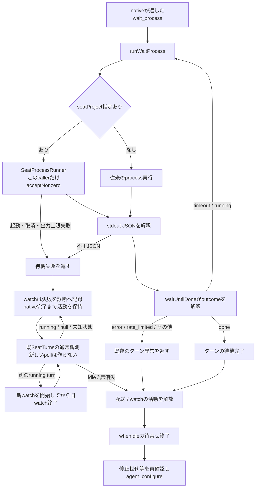
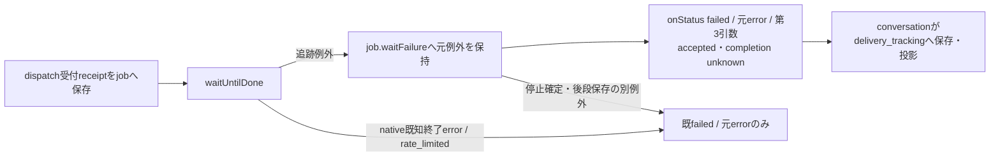
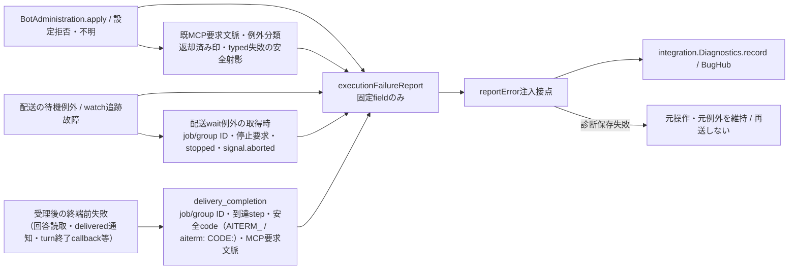
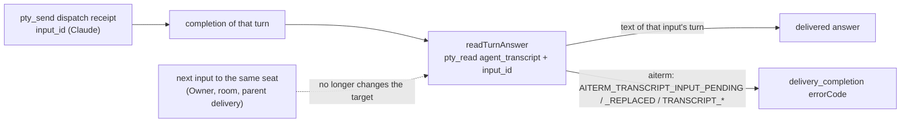
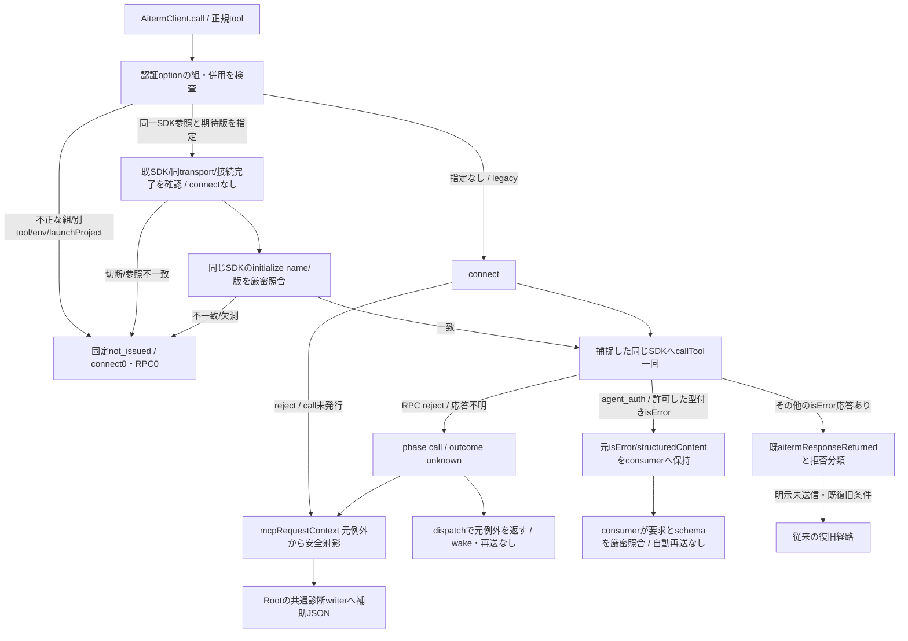

# 待機outcomeと設定適用の契約

所有者：キロ。接続先は[runtimeのseat-process](../runtime/README.md)、[Aitermのnative](../aiterm/README.md)。設定保存と完了観測を含む全体は[制御詳細](../../control-details.md)、[配送詳細](../../delivery-details.md)、[観測詳細](../../observation-details.md)を参照する。

## 席と非席で同じ待機結果を返す

`wait_process`はreceiptを返したAiterm世代のもの。待つ間、その配送jobか席ターンのwatchがその世代をpinする（[aiterm-generation-pin.md](aiterm-generation-pin.md)）。

| 境界 | 入力・出力と失敗の責任 |
| --- | --- |
| `runWaitProcess(waitProcess, signal, {seatProject})` | native公開返却のexecutable/argsを実行し、stdoutのJSONをそのまま返す。終了値だけでJSONのoutcomeを捨てない。席での実行方式・環境・UID・取消はruntimeの機構へ委譲する |
| `createSeatProcessRunner` | 既定のnonzero拒否を維持する。wait callerだけが既存のacceptNonzeroを使う。起動・入力・取消・合計出力上限の失敗はJSONへ置換しない |
| `waitUntilDone` | `timeout/running`なら同じreceiptの待機を続ける。`done`でだけ正常完了。`closed/error/rate_limited/not_taken`等は既存の終了異常へ写す |
| `watchTurn` / `SeatActivity.whenIdle` | timeout/runningと追跡の実故障ではwatchを活動として保持する。実故障後は既SeatTurnsが現在turnのidle/消失を観測するまでconfigureへ進めない。別running turnには活動の隙間なく引き継ぎ、古いwatchのfinallyで新watchを除かない |
| `BotAdministration` / `reconfigure` | 保存希望値・pending・accepted・failedを区別する。acceptedは設定受付であり新turnの実modelを測った証明ではない |

直接callerはapplication-servicesのseatProject付き注入、AitermTransportの既定値、waitForTurnCompletionとwatchTurn。`aiterm-transport.mjs`からの既存再exportを保持する。会話callbackと既例外messageは維持する。

## 受付後の追跡失敗を会話へ渡す

`onStatus(status, error, tracking?)`の第3引数は、receiptのあるjobのwaitUntilDoneが例外終了し、その同一例外がjob.failureを通って返る場合だけ、`{schema:'bellteam.delivery-tracking.v1', admission:'accepted', completion:'unknown'}`を渡す。元failed/stopped・元例外の同一性と伝播は保持する。native既知終了error/rate_limited、停止確定、受付前拒否、runningや途中経過・回答の保存失敗には付けない。timeout/runningは既待機継続のまま。本文・生receipt・process出力を第3引数へ含めない。

第3引数は入力受付の根拠と最終完了不明を表し、完了成功や再送許可ではない。直接user/Bot/通話/復旧・部屋のcallback転送、許可field保存・履歴投影はconversationが所有し、保存/public field名は`delivery_tracking`。既存履歴へ後付けしない。2引数callerは互換で、会話側の接続差分は同担当と統合する。関連fixtureは`test/delivery-tracking-status.test.mjs`。watch/設定適用/診断の既契約を変更せず、新timerや再送は作らない。

## 設定適用失敗と待機故障の診断

reportErrorは任意constructor引数。設定失敗は`SERVER_MODEL_CONFIGURATION_FAILED`/bots、待機追跡故障は`SERVER_TURN_TRACKING_FAILED`/queueとして{code,module,diagnostic_log}を提供する。JSONは`bellteam.execution-failure.v1`の対象/工程、許可した元code、存在するexitCode/signal、既知waitOutcome（未対応値は固定unknown）、適用outcome/effectと下記の配送wait文脈だけ。生message/stack/stdio/env/本文は含めない。不正JSONでも取得済みのprocess終了値とsignalを例外に残す。正常timeout/runningとnativeが返す既知の終了error/rate_limitedは、追跡機構の故障として報告しない。診断callbackの例外は操作結果を変えない。

### Turn-end failure (public error fields, 2026-11-09)

A turn that the transport followed to its terminal and that ended with a harness error rejects with an Error that carries:
- `turnCompleted: true`;
- `waitOutcome: 'error' | 'rate_limited'`;
- `failureCategory: 'rate_limited' | 'capacity' | 'transient' | 'other' | null` (Aiterm `failure.category`);
- `recoveryFailure`, only when continuation may run;
- message `AITERM_TURN_ERROR: …` / `AITERM_TURN_RATE_LIMITED: …` and `limitText`. These are raw vendor text: diagnostics never keep them.

There is no `code`. The same object reaches the delivery's `onStatus('failed', error)` in the parent by reference. A genuine tracking failure never has `turnCompleted: true`, so a consumer that reports tracking failures excludes it. Report classification of direct deliveries belongs to the conversation owner (N102, BugHub 95f155b7).

`delivery_wait`だけ、例外を取得した時点の`jobId`・`groupId`（UUID表記のみ）、`stopRequested`・`stopped`・`waitAborted`（booleanのみ）を任意fieldとして加える。groupIdはjob.info.groupIdで、直接配送のdelivery ID、部屋では共有メッセージID。jobIdとbotIdで部屋の対象を区別する。欠測値を作らず、job全体・receipt・signal.reasonは渡さない。値はinterim停止やjob.failureのawait前に取得し、後からの停止状態へ置換しない。watch/設定には文脈を加えない。既caller・export・設定・会話保存schemaは不変で、共通writerは従来のdiagnostic_log JSONを保存する。

`delivery_completion`（2026-11-08追加）は、受理済みの配送が終端前に失敗した時だけ一件出す（待機自体の失敗は既`delivery_wait`が出すので重ねない）。`jobId`・`groupId`、到達した`step`（`answer`/`delivered`/`turn_end`/`other`の固定値）、`errorCode`（大文字snake形式の元code、または`AITERM_`で始まる例外messageの先頭token）、存在する`mcp_request`（既`mcpRequestContext`の射影）だけを持つ。`turnCompleted`でも省かない。理由: 会話側の`status`段の診断は配送stage（BOT_SEND_FAILED等）しか受け取らず、12:47 JSTのOwner配送（turnは正常終了）が原因欠測のnullだけで残ったため。分類・再送・会話保存は変えない。

Aiterm returns tool errors as text `aiterm: <message>`. A code token in the form `aiterm: <CODE>: …` (e.g. `AGENT_SEND_BUSY`, and the transcript codes below) is also taken as `errorCode`. Free text is still excluded (2026-11-08 7681ba25: the first natural output had `step answer` with `errorCode UNKNOWN` because Aiterm's refusal carried no code).

### Answer read bound to the delivered input (2026-11-08)

Cause (7681ba25 / 95f155b7, bot-d0c6b7d9 14:34 JST): the unbound read means "the seat's latest turn". The Owner's next message started a new Claude turn 0.5 s after the answered turn ended (done 05:34:45.509Z, next input 05:34:45.988Z). Aiterm refused the read because the new turn was still active, although the answer existed. The delivery became BOT_SEND_FAILED. The read now passes the dispatch receipt's `input_id` when it is a 32-hex Claude input ID. Steer and non-Claude receipts carry none and keep today's read (Codex already binds by `turn_id`). The bound read and its codes are an Aiterm public addition requested from Elegg (`AITERM_TRANSCRIPT_INPUT_PENDING`, `AITERM_TRANSCRIPT_INPUT_REPLACED`). An Aiterm without it strips the unknown argument and behaves as before. No retry, wait or new guard is added. Fixture: `test/answer-input-bound.test.mjs`.

`stopped`はBellTeam jobの扱い、`waitAborted`は待機signalの状態であり、nativeの停止完了証明ではない。停止操作の正規返却後に待機をabortすると、その例外も最終job.failureより前にこの診断へ届く。診断のcode・重大度・集約key・保存件数・再送抑止をこの識別追加では変えない。旧診断の原因や操作相関は遡って補完しない。合成の直接fixtureは`test/delivery-wait-diagnostic-context.test.mjs`。

共通code登録・writerとapplication組立ては統合担当が持つ。executionは既共通writerを使う診断公開接点をmodule.jsonへ登録する。新しい常駐処理・再試行loop・入力待ちの追加承認gateは作らない。

限定回帰は `test/aiterm-wait-process.test.mjs`。正常/nonzero JSONの両経路、汎用runnerの既定nonzero拒否、不正JSON・起動・取消・出力上限、timeout→running→doneのwatchとconfigure順を確認する。固定の権限entryだけを試験内で置換し、実際のNode子processのstdioと終了・取消を使う。native Aiterm・実席・本番設定は操作しない。

`configuration`だけ、`failure`へ既`diagnosticFailureDetails`の固定error_type/error_code/cause_code、存在する`mcp_request`へ既`mcpRequestContext`の検証済み射影を残す。`responseReturned=true`は既Clientの返却済み印がtrueの時だけ。`configureFailure`はClientが対象sessionと完全schemaを検証して保持した4field receiptを、再度形を確認してoutcome/effectだけに縮める。欠測からfalseやnative受理を作らない。生message/stack/args/設定値/IDは追加しない。

RPC/connect失敗、typed失敗、untyped isErrorを識別する補助観測で、適用結果の分類・再送判断は変更しない。診断のcode/重大度/集約keyも不変。新要求の原ID照合とlocal終端は[設定要求の正本](configuration-requests.md)を参照し、旧原ID/launch欠測を補完しない。configurationだけ固定`CONFIGURATION_INTENT_SAVE_UNCONFIRMED`/`CONFIGURATION_STORAGE_INVALID`をfailureのcode/causeに許可し、加えて共通whitelist外でも大文字snake形式（`^[A-Z][A-Z0-9_]{0,99}$`）の元code/cause codeはそのまま残す（2026-11-08 b5159a79: Centiの設定失敗がerror_code unknownだけで原因が残らなかったため。code tokenは内部の分類名で本文・秘密を含まない）。新prepare未返却の安全な段階を記録する。任意messageや保存設定は記録しない。全体の接続は既execution→integration.diagnostics内。限定fixtureは`test/configuration-diagnostic-provenance.test.mjs`と`test/configuration-requests.test.mjs`。

## 修理の適用範囲と別の未実装機能

自動継続の親同期guardは内部options.admissionCheckを通常Messenger.sendmessage→transport.notify→submit→sendToSession→Client.pty_sendへ捕捉し、fresh await後と接続await後のSDK発行直前に再検査する。callbackは親の同operationだけに保持しchild DTO/履歴へ関数を出さない。別tool/launch/env/認証設定option併用は発行前拒否、guardの拒否をRPC応答不明へ変えない。元AI停止世代又は保存設定が変わった古い自動継続を発行しない。通常callerの未指定時の挙動は不変。

元の各設定拒否ではwaiterのexitCodeが保存されていない。この不良との一意相関、Cinderella08:40とエレグ08:51の利用復旧を、このsource修理の成功から補完しない。実故障後に現在状態がnullのままなら未完了として保持する。明示watch終了・close/restartの既取消経路は保持し、完了を推測して待機を解放しない。配送jobそのものの失敗結果は従来どおり失敗として返し、同じ本文を再送しない。

現在ターンを自動で区切り、同会話に適用して続きを一回起こす機能は別途設計する。必要な接点はMCP応答完了後の対象ターン限定終了、native完了の観測、通常配送による一回再開と全体停止・並行入力との整合。今回の修理は自動終了・自動再送・再開の仕組みを追加しない。

## MCP要求の応答欠測と再送抑止

`src/mcp-request-context.mjs`の`mcpRequestContext(error)`は固定tool列挙と厳密key検証を持ち、`{phase:'connect',tool}`または`{phase:'call',tool,outcome:'unknown'}`の新object、無効ならnullを返す。call rejectでは元Error/code/stackと同一性を維持し、補助`error.mcp_request`だけを付ける。frozen例外やsetter失敗でもWeakMapの文脈で再送を抑止し、診断field付与の失敗で元例外を置換しない。返却済isErrorには付けず、下記auth例外を除く一般例外では`aitermResponseReturned`を保持する。短命`run-seat-aiterm-launch`のプロセス境界も同じ安全射影だけ転送する（プロセスを越えた例外object同一性は主張しない）。

本文・args/meta・自由message・IDは文脈に含めない。Rootは同じexportをimportし、既diagnosticRequestContextへ検証済JSONのみ追加する。既failure_stage/HTTP status/集約キーをこの補助fieldで変えない。module接続構造は既execution→integration.diagnostics/Aiterm.native/runtime.seat-process内で不変なので全体図の接続追加は不要。直接fixtureは`test/mcp-request-context.test.mjs`。元27bbのcall名/受付欠測、775e29の未保存ready理由は補完しない。

## 認証の型付き失敗保持

`AitermClient.call('agent_auth', ...)`は`aiterm.auth-response-error.v1`と`aiterm.auth-operation-error.v1`のisError結果だけを元objectのまま返す。前者はrespondの既契約、後者はstatus/cancelを追加した未公開native候補50588a973236ec85923c40fe1d107224a500fa1fの接点。Clientは値を成功へ変換せず、未知schema/別tool/一般拒否の既例外経路を維持する。RPC拒否は元例外とunknown文脈を維持し、再試行しない。

Rootの固定Rabbit adapterとusage consumerは、許可schemaの厳密key・要求action・harness・session_id・code/effectの対応を検証する。response-errorにはaction fieldが無いためrespond要求にだけ対応付ける。operation-errorはstatus/cancelと要求actionの一致を必須にする。全named status/cancelへ保存済みexpected_bindingを必ず渡す。単なるschema名一致で入力や再試行を許さず、不正な形や別対象は拒否/unknown停止として扱う。このClient差分自体はconsumerの厳密検証やnative修理の配布を完了させない。

既Onboarding/HarnessAuthのauthReceiptは新operation-errorを正常receiptへ採用しない。両callerを新管理consumerへ置換せず、元の認証入力検証・ログ非露出・一般失敗を保持する。保存データ・設定・export・module接続は不変。直接fixtureは`test/aiterm-auth-errors.test.mjs`、既response consumerの回帰は`test/auth-flow.test.mjs`を使う。

## Bound auth connection and structural capability

Function map: `OlrwRabbitAuth.prepare` → `AitermClient.prepareAuthConnection` → existing initialize → captured SDK/transport/PID → same-connection `tools/list` → binding-aware `agent_auth` declaration → process-local capability cache for that exact SDK/transport/PID. No server release/version comparison, host-controller routing capability, or authentication operation is used for negotiation. The SDK remains the return value for the existing management metadata reader.

Data flow: fixed approved profile → one connection → bounded paginated discovery → validate input action/harness/session/relogin, strict nine-field binding (including nullable launch and positive integer PIDs), digest and closed response alternatives, success v1 and auth_ui v1 declarations → cache connection only → existing asynchronous preparation completes → synchronous usage/Owner gate → synchronous cached SDK/transport/PID identity check → captured SDK.callTool once. Replacement/closed transport or changed PID cannot inherit the cached capability. No await/discovery occurs between the final gate and auth issuance. No reconnect/replay on failure.

`expectedAuthConnection` binds `agent_auth` only; env/launchProject/other-tool combinations are rejected. The retired `expectedAuthServerVersion` argument is rejected, never compared to a release. Errors `AITERM_AUTH_CONNECTION_ARGUMENTS`, `AITERM_AUTH_CONNECTION_UNCONFIRMED`, and `AITERM_AUTH_CAPABILITY_UNCONFIRMED` have effect `not_issued` before an auth RPC. Declaration reads are not auth issuance. Existing native result/binding validation is still required; an SDK error masking a typed native response stays uncertain with no replay.

Native ownership confirmation: Elegg `auth-contract-06311.json` (host-controller-generalization-20261106), no native contract change. Only respond atomically enforces expected_binding/digest; status/cancel do not acquire that property from schema advertisement. Authenticated/session:null may legitimately have null binding. Existing Owner/actor/lease/secret/budget checks remain with their current owners. Management plan target.version is retained as legacy profile metadata, not a compatibility gate. No SSH/credential/production authority is added.

Packaging closure: capability helpers and the process-local cache live inside the already packaged src/aiterm-client.mjs. No new runtime import/module inventory is required; the existing execution manifest and fixed source collector already include that file. Test-only schema fixtures are not product payload inputs.
