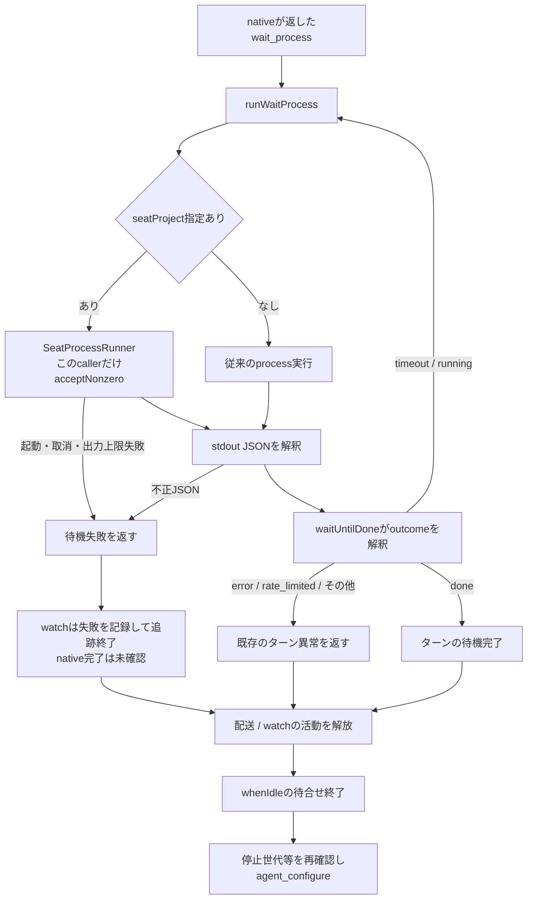

# 待機outcomeと設定適用の契約

所有者：キロ。接続先は[runtimeのseat-process](../runtime/README.md)、[Aitermのnative](../aiterm/README.md)。設定保存と完了観測を含む全体は[制御詳細](../../control-details.md)、[配送詳細](../../delivery-details.md)、[観測詳細](../../observation-details.md)を参照する。

## 席と非席で同じ待機結果を返す

| 境界 | 入力・出力と失敗の責任 |
| --- | --- |
| `runWaitProcess(waitProcess, signal, {seatProject})` | native公開返却のexecutable/argsを実行し、stdoutのJSONをそのまま返す。終了値だけでJSONのoutcomeを捨てない。席での実行方式・環境・UID・取消はruntimeの機構へ委譲する |
| `createSeatProcessRunner` | 既定のnonzero拒否を維持する。wait callerだけが既存のacceptNonzeroを使う。起動・入力・取消・合計出力上限の失敗はJSONへ置換しない |
| `waitUntilDone` | `timeout/running`なら同じreceiptの待機を続ける。`done`でだけ正常完了。`closed/error/rate_limited/not_taken`等は既存の終了異常へ写す |
| `watchTurn` / `SeatActivity.whenIdle` | timeout/runningの待機中はwatchを活動として保持し、設定適用を進めない。正常timeoutを監視の故障へ変換してfinallyで活動を外す不良をcallerで修理した。追跡の実故障では既存finallyが活動を外すため、whenIdle自体をnative完了の証明にしない |
| `BotAdministration` / `reconfigure` | 保存希望値・pending・accepted・failedを区別する。acceptedは設定受付であり新turnの実modelを測った証明ではない |

直接callerはapplication-servicesのseatProject付き注入、AitermTransportの既定値、waitForTurnCompletionとwatchTurn。`aiterm-transport.mjs`からの既存再exportを保持する。callback・会話履歴形式・module間のportに変更はないため、module.jsonと生成される全体接続図は不変。

限定回帰は `test/aiterm-wait-process.test.mjs`。正常/nonzero JSONの両経路、汎用runnerの既定nonzero拒否、不正JSON・起動・取消・出力上限、timeout→running→doneのwatchとconfigure順を確認する。固定の権限entryだけを試験内で置換し、実際のNode子processのstdioと終了・取消を使う。native Aiterm・実席・本番設定は操作しない。

## 修理の適用範囲と別の未実装機能

元の各設定拒否ではwaiterのexitCodeが保存されていない。この不良との一意相関、Cinderella08:40とエレグ08:51の利用復旧を、このsource修理の成功から補完しない。追跡processの実故障や不正JSONでは既存watchが終了し、native完了前にconfigureへ進む可能性が残る。今回の修理は正常nonzero JSONを復元する範囲であり、この異常系の完了判定は別途確定が必要。

現在ターンを自動で区切り、同会話に適用して続きを一回起こす機能は別途設計する。必要な接点はMCP応答完了後の対象ターン限定終了、native完了の観測、通常配送による一回再開と全体停止・並行入力との整合。今回の修理は自動終了・自動再送・再開の仕組みを追加しない。
