# 共通入口・結合実装

実装と通常main統合の責任者：モリー。全体設計・公開契約裁定・優先順位・本番・Owner判断はトロニー。機能内部と配布は各担当。

既公開契約内の作者成果照合、必要な結合、図合成、競合解消、通常main push・CI/source bindingと作者への採用SHA返却までを持つ。毎回Root採否を追加条件にせず、契約変更・責任境界の衝突だけ具体差分をトロニーへ返す。既自動candidateはセンチの通常image受入へ接続し、共通導入caller・保持戻し・停止影響・具体image参照を本番判断用に用意する。手動追加buildや本番導入の権限は含めない。

Rabbit認証の一件管理caller候補は[固定契機と許可原本の接続](olrw-auth-caller.md)。実行readyや本番反映を示さない。

共通HTTP/MCP入口、サービス組立て、共通エラーと診断、機能間接続と必要な結合試験を持つ。内部成功群の重複再走を採用の追加条件にしない。

接続の正本は[module.json](module.json)。全体の[機能図](../../feature-map.md)と[担当・変更手順](../../module-ownership.md)から、呼出元と依存先を辿る。

## 現行図と移管工程

- [entrypoints.md](../../entrypoints.md)
- [boundary-details.md](../../boundary-details.md)

上の既存詳細図は現行実装の読取資料。複数担当が含まれる章は最初の分離で当moduleへ移し、元の章を参照リンクへ置換する。内容を二つの現行図へ複製しない。図とコードの分離完了はまだ宣言していない。

## 最初の成果

公開入出力、所有データ、実装・全caller・関連試験、他担当との接点を図で確定する。自分の内部変更が他担当の内部コードや保存データの直接変更を要求しない形へ分離する。共有入口は登録/呼出だけにして、業務処理を自分のmoduleへ移す。変更した図とコード・限定検証結果を一つの差分にする。

## 初回の公開入口接続

HTTPは共通認証・エラー変換の後で各機能の公開handlerへ渡す。MCPは共通の引数key・caller本人確認の後で、各機能の説明/schema/handlerへ渡す。初回抽出で同じ入口に生じた競合は、この登録と呼出だけで合わせる。

```mermaid
flowchart TD
  HTTP["http-server / 共通認証・失敗応答"] --> App["http-application-api"]
  App --> Usage["usage.createUsageApi"]
  App --> Owner["members.createOwnerApi"]
  HTTP --> Delete["members.createMemberDeletionApi"]
  HTTP --> Bot["http-bot-api"]
  Bot --> Profiles["members.createMemberProfileApi"]
  Bot --> Conversation["http-conversation-api"]
  HTTP --> Schedules["members.createScheduleApi"]
  HTTP --> Assets["http-assets"]
  Assets --> Web["web.assets"]
  MCP["mcp-tools / 本人・引数確認"] --> TalkTools["mcp-conversation-tools"]
  MCP --> UsageTools["usageTools / usageToolHandlers"]
  MCP --> DeleteTool["members.deleteBotTool / runDeleteBotTool"]
  MCP --> ProfileTools["members.memberReadTools/memberWriteTools/callMemberTool"]
  MCP --> ScheduleTools["members.botScheduleTools/roomScheduleTools/scheduleToolHandlers"]
  Assembly["application-services / 同じservice実体を接続"] --> TalkFactory["conversation-services"]
  Assembly --> Runtime["同じSeatRuntimeのCLI登録"]
  Features["application-features / 互換export"] --> Apply["usage.createApplicationFeatures"]
```

登録順、同じAdministration/service実体、会話と秘密・質問の保存後の部分失敗、MCP公開schemaを統合境界で確認する。membersの削除/予定/プロフィール/画像/Owner個別受付は各公開窓口へ渡し、共通整形・認証・エラー変換と登録をここが持つ。削除の既pending受付とCLI同期失敗の独立はmembersの意図した契約変更。モデル適用等の残る業務分離は各担当の継続範囲で、全機能の分離完了とは扱わない。

共通MCP全体説明は対象範囲と、設定された設置のSEC所見をBugHubへ記録する案内を持つ。道具の引数・既定値・効果・返却は各description、道具を持ち出す場面・順序はcommon-agents.mdへ置く。v4の共通規範を先に採用してから説明の重複を除き、schema/handler/保存と公開接続は変えない。

内部の実装・図は各moduleだけに置き、この図は接続に限る。商用更新通知は各担当の設計案で、新しい更新API/UI/Host実行は実装していない。本番と一般配布はOwner保留中。

## 実行失敗の診断接続

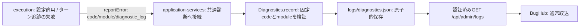

executionは`SERVER_MODEL_CONFIGURATION_FAILED`（bots）と`SERVER_TURN_TRACKING_FAILED`（queue）を報告する。固定fieldの`bellteam.execution-failure.v1` JSONに対象・工程・許可した元code・存在する終了値・wait結果・適用outcome/effectを含め、本文・stack・stdout/stderr・環境値を渡さない。正常timeout/runningは報告しない。発生判定と診断失敗で元操作を変えない責任はexecution、code登録・保存・管理GETと同じサービス実体への接続（HTTP既定Administrationも含む）はintegration。executionの接続情報へ既存のintegration.diagnostics窓口を登録し、新しい公開APIや保存先は追加しない。

この接続の本番反映と中央への実取込は未実施。隔離された保存・管理GETの確認を、本番BugHub登録済みの証明にしない。

通常deployとcleanup結果保存の接続は[担当と保存契約](deploy-cleanup.md)へ。

## 型付きHTTP503の受動診断

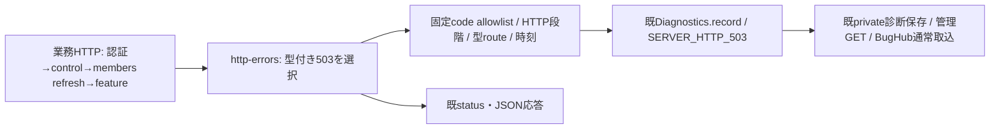

早期returnしていた型付き503だけを既writerへ記録する。任意のerror.message/stack/header/body/queryや対象IDは記録せず、未知codeはunknown、routeは固定型又は`/api/other`。HTTP段階はhandlerの進行位置で、members内部の失敗phaseではない。親拒否分類・live数・失敗phaseを同一判定へ結び付ける既公開口が無いためunknown/nullを保持し、catch直後のcapture/snapshotから補完しない。既集約はSERVER_HTTP_503/serverの1行でcountと最新診断を保持し、旧500/Apple診断の集約・状態を変えない。診断保存失敗は固定文だけをstderrへ残し元HTTP応答を返す。認可・入場8枠・既処理・status/JSON・再送方針は不変。自然再発や実席probeは検証条件にしない。

## 本番更新入口の旧profile保存

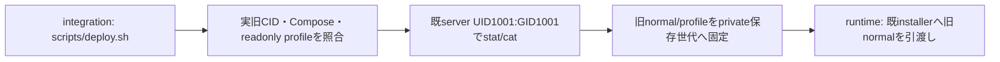

更新前の旧profileはmode644の同じ公開fileだけを読む。Docker execが継承する本体の鍵環境を席UID1000のprocessへ渡さないため、既本体serverのUID/GIDを明示する。旧CID・開始時刻・Compose hash・profile mount/保存modeの照合は維持し、保存後にmainを取り込む。runtime内部の移行・復旧・停止条件は変更しない。範囲はこの非定期deploy入口の2読取で、Host全体の監査や過去の漏出有無を断定しない。

## 応答不明のMCP要求文脈

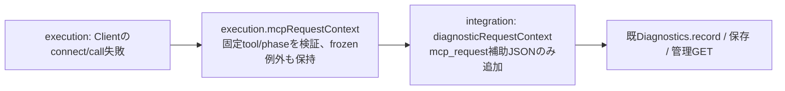

`src/mcp-request-context.mjs:mcpRequestContext(error)`から返る安全な新objectだけを保存する。phaseはconnect/call、toolは実行担当が列挙した正規名、call失敗だけoutcome=unknown。本文・args・meta・自由message・IDは含めず、不正/未知metadataはnullとして省略する。既failure_stageの判定、HTTP返却、診断集約キーは変えない。Client/Transportの再送判断やWeakMap保持はexecutionが所有し、共通writerは例外propertyを直接読まない。元の過去診断の欠測を後付けせず、補助情報から本文未送信や成功を推測しない。

## 共通Update状態と受付（段階接続）

`update-center`が現在のWeb受付/通知controller一実体から稼働情報を合成し、正式catalogと耐久更新executorの供給を区別する。厳密JSON schema/null/有限例は`src/update-center-contract.mjs`を正本とする。Owner用GET `/api/updates`、POST `/api/updates/plans`、POST `/api/updates/operations`、GET `/api/updates/operations/:requestId`を既認証/HTTPへ登録し、内部Bot HTTPは403。未供給catalogはpublished:null、耐久executor未供給はcapability:false/plans:[]/操作503を返す。メモリだけの受付を永続acceptedへ見せ替えない。

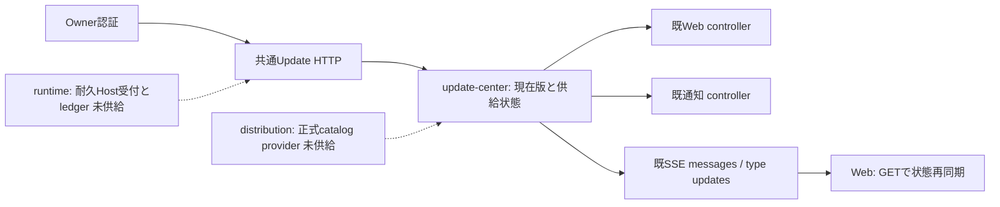

container以外の機能を停止する副作用はGETにない。各moduleの個別更新未対応は理由付きで返す。公開版や稼働source不明を架空versionで埋めず、通知providerの利用不可と版採用を分ける。既moduleの更新窓口からは同じUpdate変更通知を発行する。正式providerとHost設置の実受入が残り、この段階を全体更新完成とはしない。

## 通知processの共通接続（実装中）

通知内部はusage、起動・交換・排他はruntime、署名資材はdistributionを正本とする。共通assemblyはruntimeの`createNotificationsProcess`とusage facadeを各一実体だけ生成し、親の旧PushNotifications writerを作らない。診断は既Diagnostics一writerへ接続し、子の終了まで応答窓口を残す。親のbots/環境/会話やカードの本文は子へ渡さない。

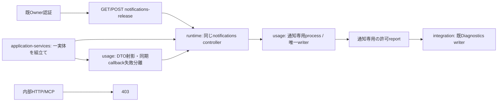

公開GETはcontrollerのsnapshot（採用版/更新結果/通知利用可否）をそのまま返す。POSTはSHA64又はimage内の既知版を表す固定literal `builtin` のversionIdだけを受け、reserveで重複/設定適用中を409・停止中を503とし、202応答finish後にstartする。finish前断線はcancelし、acceptedを交換成功へ読み替えない。固定資材配置や任意path/UID/commandをHTTPから受けない。通知だけの交換・失敗から親runtime.close/transport.closeへ到達せず、本文を再送しない。

公開schemaと保存責任はRootの通知契約v1に従う。独立UIDのOS隔離や実AI保持はこの共通接続から成立しない。直接確認は認証/内部403/入力400/二重409/202finishと断線/GET結果、共有factoryと診断接続に絞る。

## 公開Web受付の二プロセス化（初回差分）

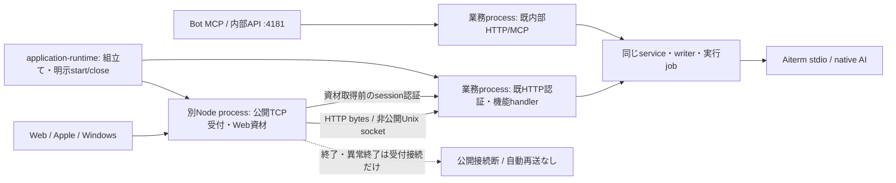

初回は公開Web/APIのnetwork受付と静的資材を別processへ移す。機能handlerと認証判断、内部MCP/HTTP、SSEのwatch、全writer/実行job/Aiterm接続は既業務processへ残す。全API業務の独立更新や内部MCP受付の分離を完了したとは扱わない。

`application-runtime`はprivate0700の一時directoryでUnix socketを作り、同じUIDの受付子を起動する。子へ渡すのはsocket/port/固定appRootに由来する引数だけで、親の環境・FD3/4・IPC以外の参照を渡さない。UID1000の席はsocketへ直接接続できない。初回は同UID1001内の寿命分離で、業務間の権限分離ではない。supervisor/server-start/installerの変更はこの差分に含めない。

公開method/path/query/body、Host/認証header、status/業務headerとJSON bytesを既handlerへ渡す。接続固有headerだけ除く。Web資材は既web.assets公開登録とstaticFileを再利用し、既session認証成功後だけ子の固定資材から配信する。新しい公開API/ID/queue/再試行を追加しない。

SSEは業務側からstreamで中継。受付停止時はSSE接続を切断し、正常EOFへ変換しない。更新後は既Webの再接続・履歴GETへ戻る。受付済み操作は接続断で再発行せず、返却前断線は結果不明のまま。非stream要求は通常終了でdrainする。5秒以内に受付子が終了しなければ、その子だけをSIGKILLし、stdioの回収後にGATEWAY_DRAIN_TIMEOUTを返す。業務側の実行jobは取消さない。親全体closeはこの失敗も集めて後続資源の終了を続ける。子の異常終了は自動で業務closeへ接続しない。

全体closeだけが受付子→既loop/HTTP/features/transportの終了を持つ。受付子のclose/startは業務graphの再生成を伴わない。同じ受付二重起動をせず、終了を確認して次を起動する。子起動失敗・port競合は元例外を返し、実行中業務を停止しない。独立配布物の署名/配置/版切替と実席保持は後続工程で、このsource分離の成功へ補完しない。

影響範囲：application-runtimeと新HTTP gateway/entry/process、application-runtime直接試験とgateway process直接試験。HTTP handler、MCP schema、service、writer、各担当内部と保存形式は変更しない。packagerはsrc/web全体を収録するため新fileの個別追加不要。app factoryの既server戻り値は非公開listenerとなり、公開addressはgatewayが返すため、その唯一の直接callerである試験を合わせる。現行公開HTTP/MCPの利用者にはaddress形式を露出しない。

## Web受付の固定版切替（親接続）

Owner向け既認証のGET/POST `/api/web-gateway-release`はversionIdのSHA64又は固定literal `builtin`を受ける。内部HTTP/MCPは403、同時要求は409、応答finish後だけ同gateway.replaceを開始し、finish前断線はnot_started。受付202を交換成功へ置き換えず、GETの実結果を使う。この既個別入口のメモリ受付と、共通Updateの耐久plan/start/get/UUIDは別に保持する。

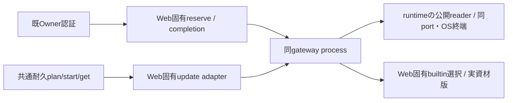

source確認と共通登録は下の[親接点](#web受付の既知内蔵版への戻し)、builtinの選択/採用null/予約と固有adapterは[Web正本](../web/gateway-builtin.md)、署名descriptor/root配置・子起動停止/close-drain/同port交換は[runtime正本](../runtime/web-gateway-release.md)へ辿る。親は固定appRootと既prepareGatewayReleaseを使い、HTTP bodyへ任意path/command/UIDを追加しない。業務writer/job/native/親は対象module交換のために停止せず、初回親imageの導入や本番操作は別の既条件を保持する。

## 実装所有の境界（2026-11-03）

共通入口の認可・承認原本/profileと観測の接続・assembly、既契約内の通常main統合はモリーが持つ。公開契約の用途制限と裁定、全体設計・本番はRootが持つ。`src/http-gateway-process.mjs`の共通子起動停止/ready/同port交換はruntime、同fileのbuiltin選択/戻しとweb-gateway-control/固有update adapterはWeb（アドミ）が所有する。OLRW固定root記録writer/有限watch/取消/OS observerはruntime（エピネル）の実装所有。Root候補1775fa5とruntime所有移管19fad7fの既成功証跡を引き継ぎ、未採用候補のsourceや実供給・実権限はこの移管から成立しない。

## Host Update adapterの接続

共通Updateはruntimeの固定Unix client一実体から正式catalogの選択とcurrent/previous requestIdを読み、既Owner認証と厳密schemaの後で同じHost plan/start/getへ委譲する。共通publicplan（current/target/期限/影響）はHost plan作成後にstate/update-plansへfsyncして保存し、停止後の同ID結果に結ぶ。Host ledgerの代わりに成功や202を作らず、結果不明を再発行しない。catalogの署名受入/期限とpublication feedの確認状態は別fieldで返す。未供給/未設置は既null/false/503。独立moduleの耐久executorと全体step計画が未供給ならそれぞれ理由付き無効を維持する。

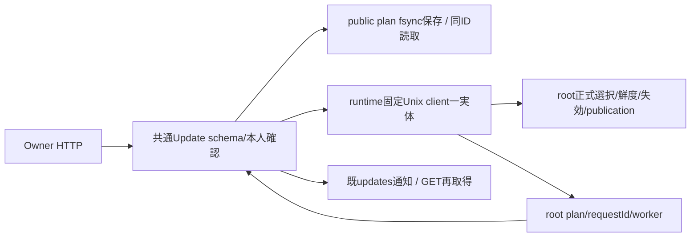

本段階ではcontainer個別plan/start/getだけがHost durable受付へ接続する。全体step計画と独立moduleの耐久操作ledgerはまだ未接続で、scope=allと各moduleの共通実行は理由付き503/無効を維持する。既個別module APIのcontrollerは複製しない。publicplanはHostのcurrent/target/期限をそのまま保存し、再構築した共通serviceでも同requestId結果へ結ぶ。publication.catalogは検証済catalogの識別/期限、publication.checkは直近feed確認であり、取得失敗を更新無しへ変えない。

## membersの親Owner権限と初回画像gate（結合候補）

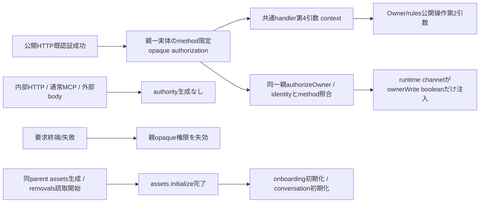

Owner権限は公開HTTPの既authorize成功後だけ、PATCH ownerとPUT user-rulesの許可methodへ束縛して捕捉する。親WeakMapのobject同一性で検証し、body/actor/owner自己申告・別object・別methodを拒否する。要求終了時は失効する。既Owner/rules公開操作へcontextを渡すが、grant/bearerは子へ送らない。初期専用grant空/unknownで専用proxyだけをfail closedとし、Owner HTTPは同controllerへ接続する。既internal互換callerは権限objectを得ない。

初回画像gate復元のPromiseをonboarding.initializeより前に待つ。親assetsは一度だけ構築し、module交換では再生成しない。N102の初回読取失敗を空一覧へ変換しない。Kiroのtransport.membersAdmissionは同じ親controllerへ注入する公開口で、既session/fast/onboarding contextを保持する。Host Update client一実体とpublicplan保存の接続も保持する。

## members投影の原子的採用（結合候補）

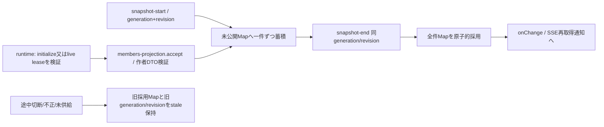

親投影は`createMembersProjection`の一実体。beginで次generationを固定するが表示中の旧generation/revisionは採用まで変更しない。画像本文・重複ID・異世代・revision不一致・再送を拒否し、件数の新上限は作らない。get/values/snapshotはcopyを返しcaller変更で正本を変えない。contextのinitialize/live lease・相関の実検証はruntime channelの公開責任であり、投影helperだけを本人確認に使わない。onChangeは全件採用後、世代・可用性・metadata内容が変わった場合だけ呼ぶ。同じ内容のrevision更新は通知せず、SSE→GET→snapshotの読取ループを作らない。controller/facade/SSEへ接続済みで、実交換の実物受入は別工程。

## members facade：fresh readと旧lease callback（結合候補）

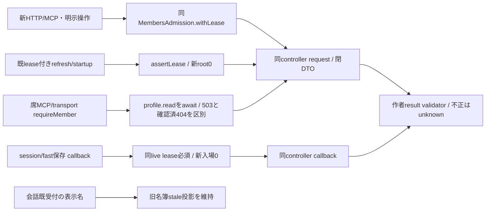

`createMembersFacade({request,callback,admission,projection})`は親の同controller/channelを注入する。refreshは同leaseでfresh profiles.readのACK付き全件snapshotと小さいrevisionを受け、同generation/確定revision以上の投影を採用する。listForClientは同leaseの個別profile.read includeDeleting:trueを逐次呼んで画像を復元し、認可readMemberはactiveだけのprofile.readを使う。get/has/valuesは表示投影で認可ではない。既context.membersLeaseは新入場もfinish追加もせず、context無しだけ所有leaseを実終端でfinish要請する。channelが送信前登録する実completionはcaller unknown後もliveに残り、再送せず旧callbackを終端まで通す。session/fast保存はcallback専用、lease無し/偽object/終了済みを拒否する。

Owner/rules更新ではcapturedAuthorizationを同channelへ渡し、子に値は送らない。未公開profile.remove/run/prepareResumeを推測で公開しない。通常bootstrapの初回移行後、application-servicesは同controllerをfeatures前にstartして全callerへ一facadeを渡す。初回bootstrapの旧BotRegistry/OwnerProfile/UserRulesは以後参照せず、専用Owner MCPもwriterを作らない。実物の独立交換受入は配布工程で確認する。

席MCP入口はreadMemberがある場合にfresh本人確認をawaitし、503を未登録400へ丸めない。Map型の既builtinは既本人確認を保つ。HTTP上限16MiB/席MCP4MiBは変更しない。assembly requireMemberもfresh結果を取得し表示投影を本人性の代用にしない。

## 予定claimの共通組立て（結合候補）

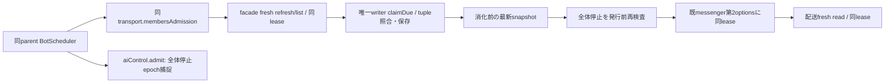

application-servicesはschedulerへ同transport.membersAdmissionとadmitWork:()=>aiControl.admit()を明示注入する。Bot claim/skipはfacadeでownerKind bot/ownerIdへ写像し同contextを転送、Roomは同parent writerへ渡す。claim後の全体停止は発行0/消化巻戻し0。commandJobs/03時/長時間commandは同parent schedulerに保持する。新結合試験は実scheduler+facade+MembersAdmissionで同lease継続とclaim後停止を確認し、native/実IPC/実予定発行の証明にはしない。作者715a79の成功群は再走しない。

削除とCLI実開始時のfresh読取：facade.removeは作者profile.removeへ同leaseを渡し、pending判定はremovals.readの明示receipt/intentだけを使う（失敗を不在にしない）。readCurrentBotIds(context)はprofiles.cli専用callbackであり、新rootに折り返さない。EpiのcreateMembersRuntimeEffectsへこの口を渡し、同唯一CLI Promise実開始時に最新botIdsから親固定projectを解決する。古いchild送信snapshotやCLI JSONを使わない。membersEffectの同一objectを保ちcallback creditも継承する。作者startMemberRemovalのstop引数位置衝突は本人へ修理依頼、未修理のまま通常採用しない。

members contextは作者4d7211a4の固定5field（generation/leaseId/rootId/ownerWrite/continuation）を使う。親channelだけがassertLease後のepoch差からcontinuationを注入する。共通projectionは同作者validatorを再利用し、initializeのleaseId:nullはcontinuation:falseだけを許す。既live leaseはtrueを保持し、channelによるlive/相関検証を投影helperで代替しない。facadeにcontinuationのcaller optionを追加せず、外部body/actorから継続権限を作らない。

## members assembly固定adapter（組立て候補）

`createMembersAssembly`は同MembersAdmission/同controller/同facade/同projectionを一組作る。onGeneration→begin、onProjection→accept、unavailable→stale、同親Owner authorityをchannelへ注入する。固定onEffectはlive lease/generationを確認し、wire5項目だけで作者DTO検証、元opaqueのmembersLease/membersEffectはruntimeへ保持。モデル・Room予定・画像gateは各所有者の公開methodへ、任意method/path/commandは拒否する。memory.ensureScopeは既HTTP/MCP callerだけが作成後に行い、childから追加しない。CLIqueue実開始時は専用callbackで最新IDsを読み、callBridgeはeffect実行時の保存済み設定を親だけが使う。

watchは確定投影の変更を既bots/owner/schedules SSEへ渡す口。表示名簿のsizeとprojectPathは親固定rootから解決する。application-servicesは初回bootstrap後に本組へ切り替えて旧writer参照を廃止する。初回read-only restoreの後だけ他servicesを作り、同parent assets/Room/transport/jobは交換で再生成しない。初期案内bot-guideだけは作者専用literal optionをfacadeのprofile.create top-levelへ保持する。

## members通常組立てと終了の接続

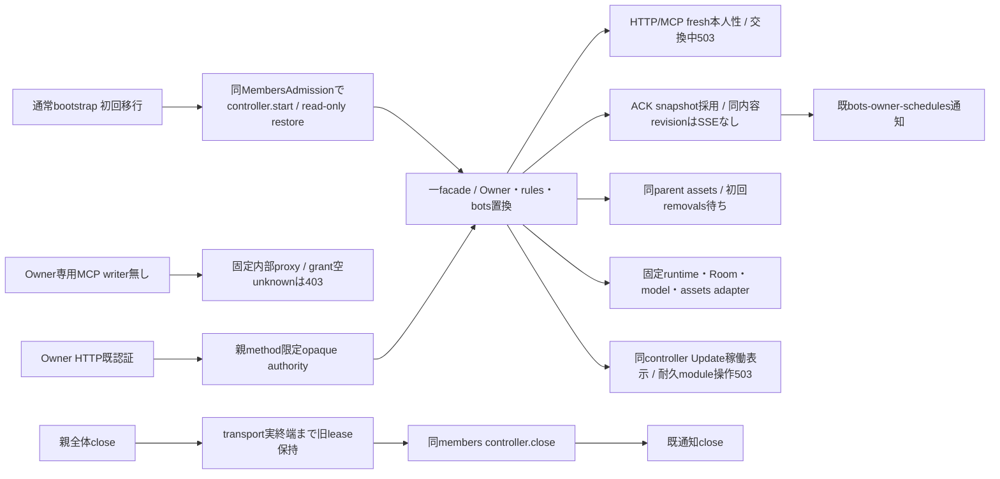

profile一覧は単一巨大resultを作らず、fresh snapshotのreceipt確認後、画像だけ同leaseの単一profile読取を逐次行う。確認済404の競合消失だけ除外し、503/unknownを空一覧にしない。表示pendingは認可Mapから除く。初回read失敗/構築失敗では子controllerを閉じ、正常稼働を偽装しない。runtimeの設定CLIqueueは同live leaseのprofiles.cli callbackで実開始時に最新IDsを得る。callback/session/fast/初期案内は旧opaqueを保持する。

初期専用Owner grantが未確認なので固定内部proxyはMEMBERS_OWNER_GRANT_UNKNOWNで拒否する。通常席MCPのOwner更新権限を増やさず、任意body/role/comment/CLI JSONからgrantを作らない。Update inventoryは同controllerのcurrent/availableを読むが、共通module/all耐久executorは未接続のため理由付き無効を維持する。

同じ通常sourceの新tracked設定consumerには、同execution clientと固定state/configuration-intentsを注入し、公開受付前に保存済みpendingを復元する。親UID1001/0700/0600・非上書き・TTL無しを保ち、membersのwriterや交換cleanupへ移さない。親gateとconfigurationRequestsを同transportへ同時注入する。正式0.63.6 pinと同source-imageで配布し、旧席の不明解除や本番回復は別工程。原要求の公開契約は[execution正本](../execution/configuration-requests.md)。

## 正式module catalogの読取接続

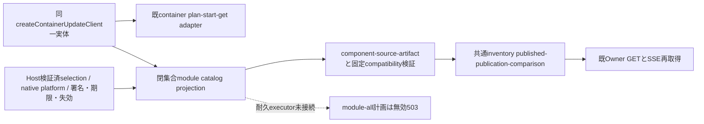

Hostの同read-only catalog窓口からweb-gateway/notifications/membersの正式選択だけを読む。発行元/署名/期限/失効はHost readerの責任で、共通側は閉じた選択schema・component/source/digest/immutable archive URL・platform・互換metadataを検証し公開JSONへ写像する。membersは厳密5keyと作者6値exact、旧moduleは厳密4keyを保持する。archiveの実bytesや現state検査をこのmetadata比較で代用しない。

source不明/current nullはunknown、正式公開未供給/取得不能はpublished null、署名catalogの受入と直近publication確認失敗を分離する。各componentの障害は他moduleの正式情報や実availabilityを消さない。比較可能なbuiltin source又はrelease digestの一致だけをup_to_dateとし、module executor/all coordinatorの未接続は理由付きcapability falseのまま。GETは実行plan/worker/署名を作らない。既containerの耐久plan/start/getと同Host clientを共有し、controllerを複製しない。

## currentWorkの共通一覧と本人MCP

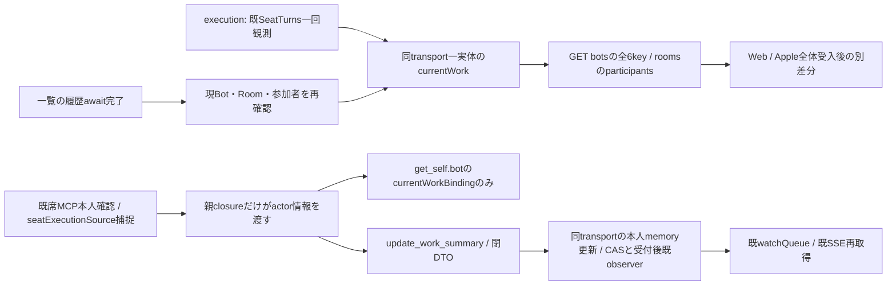

公開schemaはsrc/current-work-contract.mjs一正本。HTTP一覧は最後の履歴await後に現登録Botを使い、退役を除き、Roomは現memberIdsの重複/非在席を除いた参加者だけを同snapshot cacheから返す。Room自身のsummary/working stateを生成しない。DTOはsource/summary・更新時刻・観測時刻を分離し、未供給/不正projectionはunknown全6key、本文やGoalから補完しない。既online取得以外のnative/AI呼出を加えない。

同transport.currentWorkBinding/updateWorkSummaryへ、既HTTP ingressが捕捉したsourceをtoolsForSource closureからだけ渡す。モデル引数のbotId/path/sourceは受けず、共通await後に本人退役なら更新前403。get_selfだけbot.currentWorkBindingを付け、他Bot読取やHTTP一覧へprivate bindingを出さない。更新の固定400/403/409/503はMCP isError/structuredContentの安全code/statusだけへ投影、自由message/stackやsummaryをエラーへ反射しない。実行所有者のmemory/UUID/CAS/15秒・10分/160文字正規化は同公開transportの責任で、共通が第二writerや追加observerを作らない。

既watchQueueのSSE接続を再利用し二重watch無し。summaryを新たに読むことで正規AI/auth/Goalや設定発行へ到達しない。Apple実装の順序はOwner指定の全体受入後で、本schema供給から先行実装の許可へ拡張しない。

## Web Pushのtrusted originと固定SW

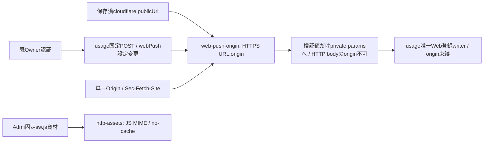

Root Web Push契約v1.1に従う。`createWebPushOrigin({settings})`が返す`assertWebPushOrigin(request)`は毎要求の保存済みcloudflare.publicUrlだけからcanonical HTTPS originを生成する。公開URL欠測/不正はWEB_PUSH_ORIGIN_UNAVAILABLE/503、Origin欠測/null/重複/不一致・path/資格・cross-siteはWEB_PUSH_ORIGIN_FORBIDDEN/403。Sec-Fetch-Site有りならsame-originだけを通す。request Host/Forwarded、body、endpointからtrusted originを補わない。Owner認証自体は既HTTP入口、内部403と閉bodyはusage handlerが検査する。GET公開状態と他feature/Apple APIの条件は変えない。

`createBellTeamServer`が同じ親FeatureSettingsから検証関数を一つ構築し、`createControlApi`→`createUsageApi`へ注入する。既Owner認証の後、登録照会/登録/解除のprivate originへこの返却だけを渡す。provider/configureへoriginを足さず、別origin登録の操作を同等権限にしない。固定sw.jsは版付置換の有無によらずJS MIME/no-cache、他immutable資材を維持。SW本文/公開asset mapはAdmi固定作者sourceへ接続する。

`application-services`は同じ設定一実体のAPNs/Web二設定をcontrollerへ供給する。onStateの両provider applyErrorは各featureへ分けて投影し、ready/statusのnullで保存済み適用失敗を消さない。成功した明示設定適用は既FeatureSettingsのonChange結果で更新する。子/controllerのconfig epoch・復帰後差分適用と実署名nativeはruntime/配布の固定成果へ結合するまで未成立。実送信/資格/Host本番の証明にはしない。

## 薄い親と全module共通の耐久更新

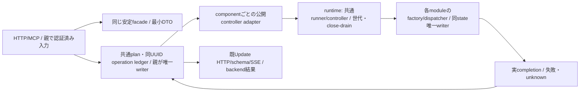

親は業務データを直接書かず、安定facadeと公開controllerを組み立てる。共通ledgerはplan/同UUID・step/再開・結果を停止跨ぎ保持し、unknownから新要求を自動再送しない。runnerが旧世代の新入場を閉じ実root/effect/保存・OS子終端をdrainし、業務moduleが同state restore/唯一writerと入力検証を所有する。adapterはその既公開結果だけを親ledgerへ投影する。現container耐久接続は成立、module/all共通executorは実装中。既web/notifications/members controllerから先行し、全moduleの納品待ちへ戻さない。diagnostics内部は[Signalの正本](../diagnostics/README.md)へ移し、親の既diagnostics窓口は同facadeで維持する。

### 通常UIと連絡のreadonly入場

AIのlogical8leaseと、固定6methodのreadonly世代pinを分ける。pinは同gateのopaque identity/単一method/generationに束縛し、readもclose/drain/実completionへ参加する。既IPC root8は増やさず、projectionはprofiles.read、readonly effectはschedules.listの同roomだけ。facadeは既AIleaseの操作を同leaseのまま、通常fresh readをread pinへ渡す。listForClientはprofiles.read/profile.readの別pinを同generation/epochで同期捕捉して再利用する。mutation/callbackへpinを転用しない。

Owner GETの一覧/Owner/個別profile・画像・設定画・会話/queueは自身のfresh窓口を使い、不要な全profile snapshotを先に要求しない。会話/queueは対象をfresh readMemberで確認し、確定404と拒否/unknownを分ける。MCP/POSTの既fresh本人/対象認可は保持する。保存済み大画像の再取得でMEMBERS_NOT_ACCEPTEDを表示したOwner症状もこの読取経路へ含め、画像保存成功を取消したりnative故障と扱ったりしない。

### module/all更新の実行と耐久結果

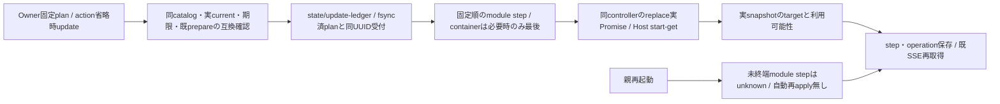

共通ledgerがplan/operation/stepの唯一writer。既web/通知/members controllerとroot所有資材の公開prepareを再利用し、子writer・新版資材配置を追加しない。未配置はplan前のprepareで拒否する。catalogは通知protocol/state 2、members状態指紋、Web protocol 1を照合する。全体planは同catalogの更新対象を固定し、必要なcontainer stepだけ既Host計画を末尾へ付ける。個別旧container計画/結果照会を維持する。

戻しはplan入力のaction=rollbackで明示し、省略はupdate。operationは保存planのactionを使い、別action/targetをbodyへ受けない。個別moduleの直前に当ledgerが成功確認した交換だけ、元のbuiltin又は検証済archiveへ現データのまま戻す。全体/container戻しは未対応として拒否し、業務データ/Owner設定/unknownを巻き戻さない。途中のmodule実行が未確定ならunknown、Hostへ発行済みの最後stepは同requestId照会だけで追う。親終了は新受付を閉じ、既実Promiseを回収してからcontrollerを閉じる。

### memoryの同controller組立

既SeatRuntime.memoryModule一実体をmemoryの安定facade・Update inventory/adapter/ledgerへ渡す。親終了は共通更新の実終端を待った後、同memoryModule.closeで全短命席子のOS/結果終端を回収する。別MemoryService/SeatRuntimeを生成しない。memoryはP1/Node26、stateSchema:nullと業務の実7field完全一致。builtinSourceCommitが公開されない版はcurrent:nullを保持し、実generationをprivate plan前提へ束縛する。現版不明を通知のsourceで埋めず、最初のbuiltin戻し計画も作らない。DB/本文/索引は移送せず、同DBを読む固定版runnerのcodeだけ交換する。通常初回mountのruntime/配布差分と同sourceにする。

通知のUpdate利用可否はP2のAPNs/Web両status・applyErrorから単一の公開reasonへ投影する。旧P1のscalarだけを読んでP2のerror objectをreasonへ入れず、通知未設定でも更新inventory/planを読めるようにする。

初回の機能登録（親factory/controller・安定facade/effect・catalog・固定Cとmount）は通常imageへ組み立てて導入する。未登録moduleを既imageへ動的追加する機構は提供しない。この初回導入後の、登録済みcontrollerが対応するコード版交換/戻しだけを親再起動無しで実行する。共通ledger→実3controllerの公開HTTP交換と個別戻しは、人工公開catalog/C代替Node子で親PID・同port・保存bytes保持まで確認し、署名/実C/本番の既配布成果とは分ける。

既typed503の安全なroute正規化にroom/bot avatarを加え、queueと同じ固定code/HTTP段階/timeだけを既診断writerへ保存する。原request ID/本文/query/header/例外自由文は保存しない。22:50新room-avatar/全体queue事象は原code欠測のため根因未確定、PR287の前段profiles.read pin適用範囲と後段rooms/queueの担当確認を分け、過去の別scopeへ同根因を補完しない。

Owner GET /api/queueはexecutionの同期queueItems投影だけを使い、不要な全members refreshを先行させない。Owner認証は既入口のまま、内部Bot APIの既fresh処理は保持する。room avatarはRoomRegistry.refreshの全room/member正規化に依存するため、前段freshを投影認可へ置き換えずPR287のprofiles.read pinを保持する。

### diagnosticsの親facadeと同controller

通常本体はSignalの閉5操作をEpi createDiagnosticsProcess一実体へ注入し、recordの保存ACK/row・listのasync配列と既管理APIを同じ安定facadeで渡す。undefinedの任意note/statusをDTOへ載せず、raw rowsの親cache/第二writerを作らない。先にdiagnostics writerを起動し、members/通知/HTTPの既report callbackを同facadeへ束ねる。親終了では他の業務とHTTPを終えてから同診断controllerを閉じ、起動失敗時も取得済みcontrollerを回収する。

同controllerのsnapshot/実generationをUpdate inventoryと共通ledgerへ渡し、固定stateCompatibility2fieldをcatalog/readerへ完全一致させる。初回親組立と固定C導入は通常image、登録後の子版交換/戻しだけ親無再起動。未登録版/reader不足/不明currentは推測で成功にしない。

通常supervisorはbootstrap namespaceのcreateDiagnosticsProcessをapplication-runtime→servicesへ渡し、独立writerを実起動する。factory未指定の既fixtureだけ旧classを保ち、通常本体がfallbackへ残らない。installed readerはEpi prepareModuleReleaseを同adapterへ注入する。

### usage段階組立の親接点

`usage-assembly.mjs`は同controller・private ACK投影・method限定親authorityを一組だけ生成する。settings seed→subscriptions seed→既graph構築→services snapshot/activateの順で初回を結ぶ。親の認証済みHTTP/席入口だけがactorをcaptureし、bodyのbotIdは権限へ転用しない。呼出元のPromise期限後も実completionまでauthorityとleaseを保持する。設定applyのsystem callbackはAsyncLocalStorage内の元usageLease/usageEffectを同identityで渡し、別rootへ作り直さない。

通常bootstrapはこのcontrollerから設定seedを先に受け、subscriptions→members等の既graph→services snapshot/activateの順で起動する。通常経路では旧6serviceを別生成せず、明示factory未注入のfixtureだけ旧経路を残す。Owner HTTPは既authorize後、席HTTPは既名札をfresh解決した後にmethod限定actorをcaptureし、bodyのbotIdを権限にしない。秘密/質問GETはfresh readをawaitし、settings更新と各書込へ同contextを渡す。MCPから既内部HTTPへは捕捉済みseat名札を引渡す。

固定12effectsは業務担当のusage-parent-effectsへ委譲し、設定applyは同settings.onChange参照と保存epochを保持する。親通知snapshotから最新epochを推測して過去applyErrorを注入しない。update inventory/catalog/installed reader/adapter/耐久ledgerと親終了は同controllerを参照する。HTTP/実席MCP→内部HTTP→実Node子→保存/更新・個別戻しで親PID/portとカード保持を確認し、実C/署名/native/本番の成立とは分ける。

### Web受付の既知内蔵版への戻し

Web固有の[内蔵版戻し](../web/gateway-builtin.md)がprocess/control/adapterを所有し、共通台帳は同adapterを登録する。通常runtimeは固定/app/distribution.jsonをno-follow・root所有/単一link/書込不可・4096B以内・既schema/SHA40で確認し、同imageのbuiltinSourceCommitを一度だけDIする。controller snapshotやHTTP bodyからsourceを補完しない。確認不能はnull/current不明とし内蔵戻しを拒否する。共通catalog/plan/start/get/UUID/排他は従来のまま、個別module直前成功からのcode戻しだけ。SHAとliteral builtinは既Owner入口へ、all/container戻しとデータ巻戻しは提供しない。

### executionの実engineと親公開口

通常bootstrapはKiroのcreateExecutionAssemblyを注入する。親はEpi adoption storeのreadした2scalarと同store.saveを直接使い、検証済loadExecutionFactory・同native client・members gate・queue listener・requestStopを固定liveportsへ結ぶ。rooms/onboarding/messenger/authの遅い依存は固定method closureへ渡し、全graphとusage初期化後に同controllerをstartする。旧外側Transport/Goals/Admin/SeatTurns/IdleSessionsを通常経路へ別生成せず、会話SelfTurnsは保持する。

同期currentWork/session/queue等とasync dispatchは固有facadeのまま、親の同Update inventory/catalog/prepare/耐久ledgerへcontrollerを一つ登録する。保存compatibilityは本人export文字列bellteam.execution-state.v1とNode26/P1/stateSchema:nullのまま。交換は旧actual zero→退役→新initialize→file/dir fsync保存ACK後だけ受付を開き、親PID・SDK・native PTYを交換のために閉じない。アプリ全終了時だけ、engine close後に親が共有clientを一度closeする。

新Owner HTTP→台帳→実reader選択/実engine交換・builtin戻しと同期投影/採用0600/同parent-portを検査し、C/root署名配置/実SDK/本番をこの人工I/O fixtureで補完しない。署名artifact/公開catalogの実物は配布担当の同source受入へ結ぶ。

executionのcapacity継続は既Messenger.sendmessage(input,options)へ親固定portを直結し、admissionCheckと返却delivery_id/実Promiseを同identityで保持する。user.turn用enqueueへ置換せず、継続対象や本文を親が再生成しない。
