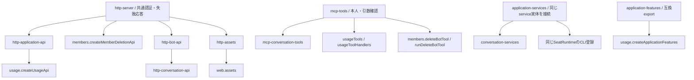

# 全体設計・統合

責任者：トロニー。

共通HTTP/MCP入口、サービス組立て、共通エラーと診断、全体接続、統合・本番反映。

接続の正本は[module.json](module.json)。全体の[機能図](../../feature-map.md)と[担当・変更手順](../../module-ownership.md)から、呼出元と依存先を辿る。

## 現行図と移管工程

- [entrypoints.md](../../entrypoints.md)
- [boundary-details.md](../../boundary-details.md)

上の既存詳細図は現行実装の読取資料。複数担当が含まれる章は最初の分離で当moduleへ移し、元の章を参照リンクへ置換する。内容を二つの現行図へ複製しない。図とコードの分離完了はまだ宣言していない。

## 最初の成果

公開入出力、所有データ、実装・全caller・関連試験、他担当との接点を図で確定する。自分の内部変更が他担当の内部コードや保存データの直接変更を要求しない形へ分離する。共有入口は登録/呼出だけにして、業務処理を自分のmoduleへ移す。変更した図とコード・限定検証結果を一つの差分にする。

## 初回の公開入口接続

HTTPは共通認証・エラー変換の後で各機能の公開handlerへ渡す。MCPは共通の引数key・caller本人確認の後で、各機能の説明/schema/handlerへ渡す。初回抽出で同じ入口に生じた競合は、この登録と呼出だけで合わせる。

登録順、同じAdministration/service実体、会話と秘密・質問の保存後の部分失敗、MCP公開schemaを統合境界で確認する。削除の既pending受付とCLI同期失敗の独立はmembersの意図した契約変更。モデル適用の業務処理・残るメンバー/予定MCPの抽出は各担当の継続範囲で、全入口の分離完了とは扱わない。

内部の実装・図は各moduleだけに置き、この図は接続に限る。商用更新通知は各担当の設計案で、新しい更新API/UI/Host実行は実装していない。本番と一般配布はOwner保留中。
