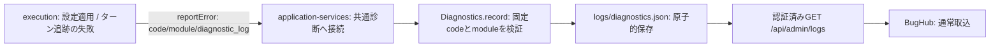

# 全体設計・統合

責任者：トロニー。

共通HTTP/MCP入口、サービス組立て、共通エラーと診断、全体接続、統合・本番反映。

接続の正本は[module.json](module.json)。全体の[機能図](../../feature-map.md)と[担当・変更手順](../../module-ownership.md)から、呼出元と依存先を辿る。

## 現行図と移管工程

- [entrypoints.md](../../entrypoints.md)
- [boundary-details.md](../../boundary-details.md)

上の既存詳細図は現行実装の読取資料。複数担当が含まれる章は最初の分離で当moduleへ移し、元の章を参照リンクへ置換する。内容を二つの現行図へ複製しない。図とコードの分離完了はまだ宣言していない。

## 最初の成果

公開入出力、所有データ、実装・全caller・関連試験、他担当との接点を図で確定する。自分の内部変更が他担当の内部コードや保存データの直接変更を要求しない形へ分離する。共有入口は登録/呼出だけにして、業務処理を自分のmoduleへ移す。変更した図とコード・限定検証結果を一つの差分にする。

## 初回の公開入口接続

HTTPは共通認証・エラー変換の後で各機能の公開handlerへ渡す。MCPは共通の引数key・caller本人確認の後で、各機能の説明/schema/handlerへ渡す。初回抽出で同じ入口に生じた競合は、この登録と呼出だけで合わせる。

```mermaid
flowchart TD
  HTTP["http-server / 共通認証・失敗応答"] --> App["http-application-api"]
  App --> Usage["usage.createUsageApi"]
  App --> Owner["members.createOwnerApi"]
  HTTP --> Delete["members.createMemberDeletionApi"]
  HTTP --> Bot["http-bot-api"]
  Bot --> Profiles["members.createMemberProfileApi"]
  Bot --> Conversation["http-conversation-api"]
  HTTP --> Schedules["members.createScheduleApi"]
  HTTP --> Assets["http-assets"]
  Assets --> Web["web.assets"]
  MCP["mcp-tools / 本人・引数確認"] --> TalkTools["mcp-conversation-tools"]
  MCP --> UsageTools["usageTools / usageToolHandlers"]
  MCP --> DeleteTool["members.deleteBotTool / runDeleteBotTool"]
  MCP --> ProfileTools["members.memberReadTools/memberWriteTools/callMemberTool"]
  MCP --> ScheduleTools["members.botScheduleTools/roomScheduleTools/scheduleToolHandlers"]
  Assembly["application-services / 同じservice実体を接続"] --> TalkFactory["conversation-services"]
  Assembly --> Runtime["同じSeatRuntimeのCLI登録"]
  Features["application-features / 互換export"] --> Apply["usage.createApplicationFeatures"]
```

登録順、同じAdministration/service実体、会話と秘密・質問の保存後の部分失敗、MCP公開schemaを統合境界で確認する。membersの削除/予定/プロフィール/画像/Owner個別受付は各公開窓口へ渡し、共通整形・認証・エラー変換と登録をここが持つ。削除の既pending受付とCLI同期失敗の独立はmembersの意図した契約変更。モデル適用等の残る業務分離は各担当の継続範囲で、全機能の分離完了とは扱わない。

内部の実装・図は各moduleだけに置き、この図は接続に限る。商用更新通知は各担当の設計案で、新しい更新API/UI/Host実行は実装していない。本番と一般配布はOwner保留中。

## 実行失敗の診断接続

executionは`SERVER_MODEL_CONFIGURATION_FAILED`（bots）と`SERVER_TURN_TRACKING_FAILED`（queue）を報告する。固定fieldの`bellteam.execution-failure.v1` JSONに対象・工程・許可した元code・存在する終了値・wait結果・適用outcome/effectを含め、本文・stack・stdout/stderr・環境値を渡さない。正常timeout/runningは報告しない。発生判定と診断失敗で元操作を変えない責任はexecution、code登録・保存・管理GETと同じサービス実体への接続（HTTP既定Administrationも含む）はintegration。executionの接続情報へ既存のintegration.diagnostics窓口を登録し、新しい公開APIや保存先は追加しない。

この接続の本番反映と中央への実取込は未実施。隔離された保存・管理GETの確認を、本番BugHub登録済みの証明にしない。
