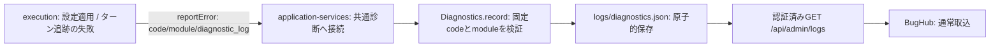
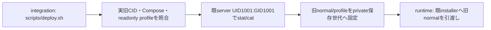
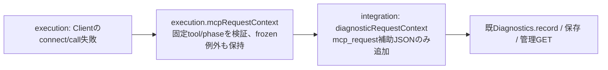
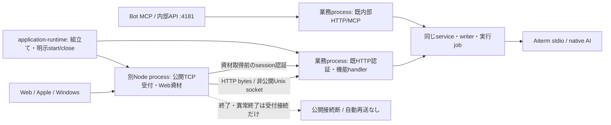
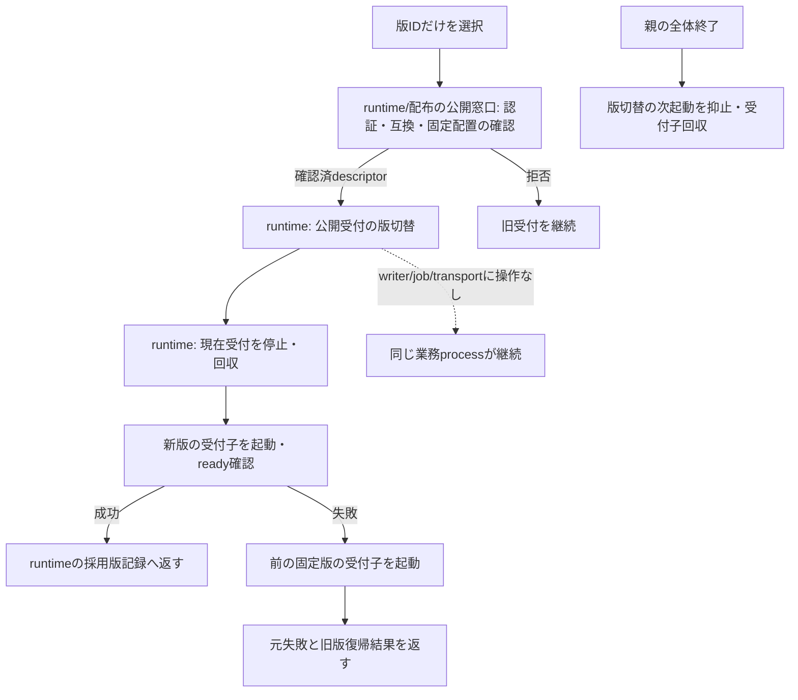

# 共通入口・結合実装

実装責任者：モリー。全体設計・公開契約裁定・統合採否・main・本番はトロニー。機能内部と配布は各担当。

Rabbit認証の一件管理caller候補は[固定契機と許可原本の接続](olrw-auth-caller.md)。実行readyや本番反映を示さない。

共通HTTP/MCP入口、サービス組立て、共通エラーと診断、機能間接続と必要な結合試験を持つ。内部成功群の重複再走を採用の追加条件にしない。

接続の正本は[module.json](module.json)。全体の[機能図](../../feature-map.md)と[担当・変更手順](../../module-ownership.md)から、呼出元と依存先を辿る。

## 現行図と移管工程

- [entrypoints.md](../../entrypoints.md)
- [boundary-details.md](../../boundary-details.md)

上の既存詳細図は現行実装の読取資料。複数担当が含まれる章は最初の分離で当moduleへ移し、元の章を参照リンクへ置換する。内容を二つの現行図へ複製しない。図とコードの分離完了はまだ宣言していない。

## 最初の成果

公開入出力、所有データ、実装・全caller・関連試験、他担当との接点を図で確定する。自分の内部変更が他担当の内部コードや保存データの直接変更を要求しない形へ分離する。共有入口は登録/呼出だけにして、業務処理を自分のmoduleへ移す。変更した図とコード・限定検証結果を一つの差分にする。

## 初回の公開入口接続

HTTPは共通認証・エラー変換の後で各機能の公開handlerへ渡す。MCPは共通の引数key・caller本人確認の後で、各機能の説明/schema/handlerへ渡す。初回抽出で同じ入口に生じた競合は、この登録と呼出だけで合わせる。

```mermaid
flowchart TD
  HTTP["http-server / 共通認証・失敗応答"] --> App["http-application-api"]
  App --> Usage["usage.createUsageApi"]
  App --> Owner["members.createOwnerApi"]
  HTTP --> Delete["members.createMemberDeletionApi"]
  HTTP --> Bot["http-bot-api"]
  Bot --> Profiles["members.createMemberProfileApi"]
  Bot --> Conversation["http-conversation-api"]
  HTTP --> Schedules["members.createScheduleApi"]
  HTTP --> Assets["http-assets"]
  Assets --> Web["web.assets"]
  MCP["mcp-tools / 本人・引数確認"] --> TalkTools["mcp-conversation-tools"]
  MCP --> UsageTools["usageTools / usageToolHandlers"]
  MCP --> DeleteTool["members.deleteBotTool / runDeleteBotTool"]
  MCP --> ProfileTools["members.memberReadTools/memberWriteTools/callMemberTool"]
  MCP --> ScheduleTools["members.botScheduleTools/roomScheduleTools/scheduleToolHandlers"]
  Assembly["application-services / 同じservice実体を接続"] --> TalkFactory["conversation-services"]
  Assembly --> Runtime["同じSeatRuntimeのCLI登録"]
  Features["application-features / 互換export"] --> Apply["usage.createApplicationFeatures"]
```

登録順、同じAdministration/service実体、会話と秘密・質問の保存後の部分失敗、MCP公開schemaを統合境界で確認する。membersの削除/予定/プロフィール/画像/Owner個別受付は各公開窓口へ渡し、共通整形・認証・エラー変換と登録をここが持つ。削除の既pending受付とCLI同期失敗の独立はmembersの意図した契約変更。モデル適用等の残る業務分離は各担当の継続範囲で、全機能の分離完了とは扱わない。

内部の実装・図は各moduleだけに置き、この図は接続に限る。商用更新通知は各担当の設計案で、新しい更新API/UI/Host実行は実装していない。本番と一般配布はOwner保留中。

## 実行失敗の診断接続

executionは`SERVER_MODEL_CONFIGURATION_FAILED`（bots）と`SERVER_TURN_TRACKING_FAILED`（queue）を報告する。固定fieldの`bellteam.execution-failure.v1` JSONに対象・工程・許可した元code・存在する終了値・wait結果・適用outcome/effectを含め、本文・stack・stdout/stderr・環境値を渡さない。正常timeout/runningは報告しない。発生判定と診断失敗で元操作を変えない責任はexecution、code登録・保存・管理GETと同じサービス実体への接続（HTTP既定Administrationも含む）はintegration。executionの接続情報へ既存のintegration.diagnostics窓口を登録し、新しい公開APIや保存先は追加しない。

この接続の本番反映と中央への実取込は未実施。隔離された保存・管理GETの確認を、本番BugHub登録済みの証明にしない。

通常deployとcleanup結果保存の接続は[担当と保存契約](deploy-cleanup.md)へ。

## 本番更新入口の旧profile保存

更新前の旧profileはmode644の同じ公開fileだけを読む。Docker execが継承する本体の鍵環境を席UID1000のprocessへ渡さないため、既本体serverのUID/GIDを明示する。旧CID・開始時刻・Compose hash・profile mount/保存modeの照合は維持し、保存後にmainを取り込む。runtime内部の移行・復旧・停止条件は変更しない。範囲はこの非定期deploy入口の2読取で、Host全体の監査や過去の漏出有無を断定しない。

## 応答不明のMCP要求文脈

`src/mcp-request-context.mjs:mcpRequestContext(error)`から返る安全な新objectだけを保存する。phaseはconnect/call、toolは実行担当が列挙した正規名、call失敗だけoutcome=unknown。本文・args・meta・自由message・IDは含めず、不正/未知metadataはnullとして省略する。既failure_stageの判定、HTTP返却、診断集約キーは変えない。Client/Transportの再送判断やWeakMap保持はexecutionが所有し、共通writerは例外propertyを直接読まない。元の過去診断の欠測を後付けせず、補助情報から本文未送信や成功を推測しない。

## 公開Web受付の二プロセス化（初回差分）

初回は公開Web/APIのnetwork受付と静的資材を別processへ移す。機能handlerと認証判断、内部MCP/HTTP、SSEのwatch、全writer/実行job/Aiterm接続は既業務processへ残す。全API業務の独立更新や内部MCP受付の分離を完了したとは扱わない。

`application-runtime`はprivate0700の一時directoryでUnix socketを作り、同じUIDの受付子を起動する。子へ渡すのはsocket/port/固定appRootに由来する引数だけで、親の環境・FD3/4・IPC以外の参照を渡さない。UID1000の席はsocketへ直接接続できない。初回は同UID1001内の寿命分離で、業務間の権限分離ではない。supervisor/server-start/installerの変更はこの差分に含めない。

公開method/path/query/body、Host/認証header、status/業務headerとJSON bytesを既handlerへ渡す。接続固有headerだけ除く。Web資材は既web.assets公開登録とstaticFileを再利用し、既session認証成功後だけ子の固定資材から配信する。新しい公開API/ID/queue/再試行を追加しない。

SSEは業務側からstreamで中継。受付停止時はSSE接続を切断し、正常EOFへ変換しない。更新後は既Webの再接続・履歴GETへ戻る。受付済み操作は接続断で再発行せず、返却前断線は結果不明のまま。非stream要求は通常終了でdrainする。5秒以内に受付子が終了しなければ、その子だけをSIGKILLし、stdioの回収後にGATEWAY_DRAIN_TIMEOUTを返す。業務側の実行jobは取消さない。親全体closeはこの失敗も集めて後続資源の終了を続ける。子の異常終了は自動で業務closeへ接続しない。

全体closeだけが受付子→既loop/HTTP/features/transportの終了を持つ。受付子のclose/startは業務graphの再生成を伴わない。同じ受付二重起動をせず、終了を確認して次を起動する。子起動失敗・port競合は元例外を返し、実行中業務を停止しない。独立配布物の署名/配置/版切替と実席保持は後続工程で、このsource分離の成功へ補完しない。

影響範囲：application-runtimeと新HTTP gateway/entry/process、application-runtime直接試験とgateway process直接試験。HTTP handler、MCP schema、service、writer、各担当内部と保存形式は変更しない。packagerはsrc/web全体を収録するため新fileの個別追加不要。app factoryの既server戻り値は非公開listenerとなり、公開addressはgatewayが返すため、その唯一の直接callerである試験を合わせる。現行公開HTTP/MCPの利用者にはaddress形式を露出しない。

## Web受付の固定版切替（実装中の接続）

Owner向け既認証のGET/POST `/api/web-gateway-release`でWeb受付一対象を操作する。内部HTTP/MCPは403。POST本文はversionIdの64hexだけ、同時要求は409。受付202は交換成功ではなく、応答finish後だけ既gateway.replaceを実行する。finish前の切断はnot_started、親closeは未開始要求を止める。要求自身の非SSEdrain待ちで交換を止めない。GETは現在版と一件の直近交換結果を返す。状態は親内だけで、新queue/ID/永続台帳を増やさず、採用版の正本は既adoption recordを保つ。親再起動で直近の受付結果は失われるので、その場合は現在版を確認し自動再送しない。

旧版への戻しも同じPOSTへ旧固定versionIdを指定する。任意path/command/UIDは受け付けない。失敗は固定GATEWAY符号と実際の現在版をGETへ返す。業務handler/writer/job/nativeは停止しない。初回image導入と本番停止はこの窓口の実装承認に含めない。

共通交換入口は版IDを受け、runtimeの公開窓口`prepareGatewayRelease(version)`が返す確認済descriptorを使う。versionId/appRoot/protocolVersion=1はruntime/商用と合意済みで、application-runtimeから公開readerへ接続済み。正式署名資材とroot配置の実供給は未成立であり、reader接続から成立を補完しない。任意のHTTP bodyからpath/UID/commandを受けて起動しない。配布元の認証・manifest互換・固定digest・所有/modeを確認する処理と配置は担当正本へ置く。

確認は旧版を動かしたまま行い、拒否時は旧版へ作用しない。交換中の二重交換は拒否し、旧子回収後だけ新子を起動する。readyのportは整数1..65535かつ要求済み非zero portとの一致を確認してから採用する。初回port=0だけが有効portの選択を許し、以後の交換/戻しは同じ公開portを保持する。不一致readyは子起動失敗として回収し、元portで旧版へ戻す。protocolVersion=1の新子readyと採用記録保存後に成功を返す。新子が15秒以内にreadyを返さないとその子を回収し、起動失敗として扱う。失敗では元の固定版へ戻し、戻しも失敗なら両方の例外を保持する。親終了が重なったら新起動/旧版戻しを続けず、回収して親の既終了を進める。本文再送/業務state再構築をしない。

初回のプロセス分離と違い、ここでは別rootの固定版entryを起動する。writerやnativeは移さない。以前のWeb版の資材参照と新しい画面/SSE再接続は公開Web契約として別途合わせる。配布/配置の契約未成立を、process交換の人工fixtureで成功扱いしない。

この段階の影響範囲はhttp-gateway-process/entryとapplication-runtimeの公開reader接続、直接gateway版切替fixture、既HTTP gateway/runtimeの対象試験。bootstrapはruntimeの公開prepareGatewayReleaseを使い、fixtureだけが合成providerを注入する。正式署名/root配置資材の実受入と運用上の交換窓口は別工程であり、現行本番へ反映済みとは扱わない。

旧Web資材は受付processの交換を越えて保持する。親はこの稼働中に採用したassetVersion→固定appRootを保持し、新子へ確認済一覧だけを渡す。新子は各固定版のweb.assets登録を読み、既?v=に対応した版の資材/置換を配信する。任意queryからfile pathを組み立てず、未知の版は404。履歴一覧が64KiBを超える交換は旧子停止前に拒否し、黙って古い版を捨てない。親再起動後の保持一覧はruntimeの採用/保持契約との接続が残り、このメモリ一覧を耐久記録の代用にしない。

採用版はruntime正本のadoption schemaと既writeAtomicへ接続する。親の初回startだけで1001/0600正本を読み、record無しなら内蔵版、record有りならcurrent/previousをprepareで再確認する。未知/破損/信頼失敗は内蔵版へfallbackしない。新子ready後のrecord保存を成功条件に含め、保存失敗は新子回収→旧descriptor再確認→旧子起動、旧record保持。親close重複時は取消し、次起動と戻しを抑止する。current/previousをstartupで再確認して前版資材を読めるようにし、それ以前の全資材の親再起動後保持はこの差分の対象外。

## 実装所有の境界（2026-11-03）

共通入口の認可・承認原本/profileと観測の接続・assemblyはモリーが実装する。公開契約の用途制限と裁定、設計整合・採否・本番はRootが持つ。`src/http-gateway-process.mjs`の子起動停止/ready/同port交換/adoption/戻し、OLRW固定root記録writer/有限watch/取消/OS observerはruntime（エピネル）の実装所有。Root候補1775fa5とruntime所有移管19fad7fの既成功証跡を引き継ぎ、未採用候補のsourceや実供給・実権限はこの移管から成立しない。
