# 通常deployとimage cleanup結果の接続

共通callerと結果保存はモリー、image選択・保護・削除helperはruntime（エピネル）。本番実行・採否はトロニー。公開接点は既runtime.updateで、新API/queue/IDを追加しない。

```mermaid
flowchart LR
  Entry["integration: deploy.sh / client"] --> Worker["Host: setsid deploy-host.sh / 全工程を所有"]
  Worker --> Adapter["既deploy-image.sh"]
  Worker --> Terminal["元deploy log: deploy-caller-exit / 全工程終端"]
  Terminal --> Reader["client: 読取のみ / 消失しても工程は継続"]
  Adapter --> Installer["runtime: 公開installer"]
  Installer --> Health["共通caller: 正常health読戻し"]
  Health --> Capture["integration: cleanupの結果保存wrapper"]
  Previous["同deployのprevious-normal世代 / 実前版"] --> Capture
  Capture --> Helper["runtime: cleanup-deploy-images.py"]
  Helper --> Plan["削除前の対象/保護集合"]
  Helper --> Result["削除結果/失敗/exit"]
  Plan --> Saved["同previous世代: stdout JSONL / stderr / exit manifest"]
  Result --> Saved
  Saved --> Ref["元deploy logへ正規参照"]
  Ref --> Versions["既CLI版診断"]
  Versions --> BotStatus["Bot稼働数は未確認 / 席権限が無いworkerからGETしない"]
  BotStatus --> Terminal
```

既callerにはhelper呼出しが無かった。06:37保存source6cffac3とmain80fで確認済み。06:37のcleanup成否・保護残存は欠測unknownを保持し、別回の実績や新実行から補わない。

本体交換を跨ぐadapter・health確認・cleanup保存・既診断は全てHostの同一setsid worker内で順に実行する。client側に完了のための書込や次工程を残さない。新callerは正常health後に一回だけhelperを呼ぶ。installer内部・recover・build/pull・通常反映の停止条件を変更しない。実前版の正本は同deployのprevious-runtime/previous-normalで、毎回大容量backupを作らず、古いNAS復元点をその代用にしない。helperの選択・全container参照保護・force無し削除・失敗停止はruntimeの正本へ従う。

内部の`/api/bots`は席の本人性を必要とし、配備workerにはその権限が無い。末尾でこのGETや応答のJSON読取を行わず、Bot稼働数を未確認と表示する。BotやOwnerの権限を借りず、認証条件も変更しない。health・cleanup・CLI版診断の実失敗は既どおり非0へ伝播し、Bot数未確認だけで成功済み配備を失敗へ変えない。元logの終了値や過去のBot稼働数を修正・補完しない。

結果保存は既private previous-normal世代へ小metadataだけを置く。stdout JSONL（計画と実削除結果）、stderr、helper実exitを指すmanifestを残す。helper失敗でも既出力とexitを保存し、元deploy logにmanifest所在を記録する。元adapterの`deploy-exit=0`は本体更新の終端として保持し、その後cleanupまたは保存に失敗した通常callerは非0を返す。全工程の結果は同logの`deploy-caller-exit`へ必ず記録し、clientはこの終端を待つ。adapterの`deploy-exit`だけでは完了と判定しない。workerはstdinを閉じてstdout/stderrを既private logへ向け、client消失でも保存を終える。既にhealthyな本体を自動で戻さない。health成功とcleanup成功を区別し、失敗・欠測を成功へ補わない。NAS全blob読戻し、quiet、毎回image/5GB控えは追加しない。

wrapperは`previous-normal.json`の`services.bellteam.image`と同世代`previous-runtime.json`の`Image`が同じexact sha256 IDであることを確認して、既helperへ`--rollback-image`で渡す。不一致/欠測はhelperを呼ばず、stderrと非0 exitを同じmanifestへ保存する。helper公開入力/計画出力の差分はruntime候補3383e5dと合わせて採用する。合成fixtureは実Docker/SSH/NAS/cleanupを呼ばず、caller順序・保存・失敗伝播を確認する。本番結果の証明にはしない。

## 同じ失敗世代のcleanupだけを続行する入口

本体がhealthyで保存済previous-normal/runtimeが一致している場合、本番担当は受入sourceの`sh scripts/deploy-cleanup.sh /absolute/generation/previous-normal.json --continue`だけを切り離して呼べる。adapter/install/deploy.shを呼ばないため、本体交換・再build・新backupは発生しない。旧3fileを保持し、同じ世代のprivate `deploy-cleanup-continuation/`へ新stdout/stderr/manifestを保存する。固定directoryが既存なら呼出前に停止し、原本を上書きしない。通常呼出は従来の世代直下へ保存する。排他・選択・削除は同じruntime helperへ渡す。実本番への適用判断と実行はトロニー。
