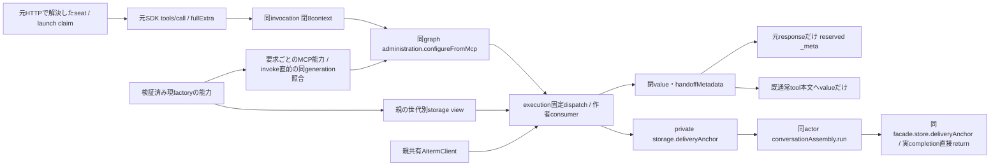

# 元MCP要求と設定切替consumerの親接続

所有モリー。consumer内部は[execution](../execution/model-handoff.md)、元deliveryの一件readは[conversation](../conversation/README.md)の正本に従う。

seat-mcpはSDK handlerの第2引数をそのまま捕捉し、元requestIdの型、実AbortSignal、HTTPで解決したactor/launch claim、元params._metaのnative_callを同invocationの閉8contextへ渡す。budgetはnullで、executionが一回5秒capture窓を所有する。tool引数をhost contextへ採用しない。既本人/引数/変更認可を通ったconfigureだけを同graphの安定facadeへ渡し、内部HTTPへのJSON化で元signalやcontextを失わない。

同invocation専用のconfigure closureが閉2返却のvalueだけを既tool本文へ返す。metadataはその元responseの `_meta['ai.aiterm/handoff.v1']` だけへ置き、abort後・別call・後続responseへ移植しない。consumerが自動切替を扱うtoolはupdate_selfだけであり、実MCP capabilityのexperimental同keyに閉 `{version:1,tools:['update_self']}` を公開する。consumer接続がない入口ではこのcapabilityを出さない。通常HTTPや公開tool引数のschemaは変更しない。

private storage.deliveryAnchor(input,options)は非async closureで、同actorのconversationAssembly.runから同facadeの一件readを直接returnする。元resultとcompletionを保持し、親にread実装やlegacy fallbackを作らない。欠測/失敗は作者consumerの作用不成立へ返す。親共有AitermClientには作者のcaptureHandoffConnectionを採用し、engineへ同実体を注入する。固定dispatchから生成するfacadeへ手書きmethodを足さない。

作者/独立fixtureの既結果を継承し、親の元handler→同graph/context→元responseとprivate actor/completion接点だけを最小検証する。Jのdeferred guard・V/Tの寿命/保存・既catalogを保持し、配布closure/署名はdistribution、本番採否はRootのまま。

## 旧正式executionを保持した親交換

loaderの検証済み同namespace `EXECUTION_METHODS.dispatch` に `administration.configureFromMcp` がある時だけ、返却factoryの `supportsModelHandoff` はtrue。旧export/欠測はfalseで、builtinの能力をselectedへ流用しない。親はloadごとに同factoryのconstructorへportsを束縛し、false世代には自分が追加したdeliveryAnchorだけを通常の列挙storage viewから除く。他port/関数/返却completionは同identity。署名bundle・選択・閉key検査は変更しない。construct/replace/rollbackは同じ経路を通る。

親の現controllerがavailableで同current factory対応の時だけ、要求ごとにM closureと広告を出す。旧selectedは既configure経路、M広告/予約_meta無し。invoke直前にも同generationを同期照合し、交換済み/非availableなら発行前拒否する。拒否後に通常updateを再発行しない。次requestは現factoryへ追従する。通常親起動とM consumer成立は分け、旧選択のままM成功を宣言しない。

## 9fccの境界契約：実データとhost内の接続能力

静的基準sourceは`9fccf85c59a528838f6e442c28ad8e32f9698515`。MH03–06のcaller待機は作者修理source `f4909e9030caf09df3bb56ea73a5fe4e1769e67a` を合成した契約で、親options/会話IPCは同基準のまま。以下をこの親境界の構造正本とし、[全体DFD](../../data-flow.md#親execution境界の詳細対応)から参照する。既口のデータと修理後の寿命を記し、新schemaは追加しない。冒頭の接続図は呼出し・束縛の補助図であり、矢印すべてをwireデータの移動と解釈しない。

境界内の処理を、H1=親の元MCP受付/response整形、H2=親の検証済factory読取/世代組立、X=同hostのexecution consumer、C=同actorのconversation公開read、A=外部Aiterm/nativeと呼ぶ。H1/H2/Xは同processの接続で、Cのfacadeから子へは既conversation要求/結果DTOを通す。関数、AbortSignal、SDK接続、lease、Promiseとその`.completion`はhostの能力/実寿命であり、JSON fieldや保存データとして再構成しない。

### 接続能力の束縛（データフローと別）

| 接続 | 生成・束縛と利用先 | 世代/寿命・拒否と実source |
| --- | --- | --- |
| factory関数と能力metadata | H2が検証後の**実selected namespace**から`createExecutionDispatcher`をそのまま取り、`EXECUTION_METHODS.dispatch`が配列で`administration.configureFromMcp`を含むかをboolean化してfrozen factoryへ置く。関数を呼んで能力を推測しない | [execution-loader](../../../../src/execution-loader.mjs) `createExecutionFactoryLoader`。builtinはbuiltin、selectedはselectedから計算。旧export/欠測false。閉path/資材・source・互換/catalog検査が先で、失敗はfactoryを返さず親起動/交換元へ503。export必須化なし |
| storage関数束 | H2は親の`prepareStartup/updateSession/updateFastMode/deliveryAnchor`から、falseのfactory constructorにだけanchorを除いたown enumerable3key viewを渡す。trueには4key。その他関数identityを保持 | [application-services](../../../../src/application-services.mjs) `storagePorts/loadFactory`。construct/replace/rollbackで**各load結果**へ適用。署名dispatcherの閉key検査・選択台帳を書き換えない。関数の登録自体はMH04の読取データではない |
| 要求ごとのMCP closure | H1がcontrollerのavailableかつ現currentVersionIdに対応する能力Mapからgenerationを捕捉し、M closure/能力広告をその要求へだけ束縛 | application-services `modelHandoffGeneration`→[application-runtime](../../../../src/application-runtime.mjs) `toolsForSource`。invoke直前に現generationを再比較し、不一致は`EXECUTION_NOT_ACCEPTING/status503/effect:not_started`。拒否後の通常update再発行なし。次要求は現世代で再選択 |
| 同actorの会話read | 親の非async anchor closureが`conversationAssembly.run(options.actor, () => facade.store.deliveryAnchor(input,options))`の元返却を直接return | application-services:131–132、[conversation-facade](../../../../src/conversation-facade.mjs) `inherit/invoke/store.deliveryAnchor`。facadeは結果検証用Promiseへ元`.completion`を継承。Cは当該readの認可leaseへ実completionを追跡する。元native leaseと同identityとは主張しない |
| 同SDK connectionと実寿命 | 親の共有AitermClientをXへ注入。Xが`captureHandoffConnection()`で元connection closureを捕捉してcapture/controlを行う | [execution/host-factory](../execution/host-factory.md)、[execution/model-handoff](../execution/model-handoff.md)。別SDK生成/新connect/JSON複製なし。実control/read/operation completionはXのtrackに残り、元response終了で終端扱いにしない |

storage viewは関数の形状を選ぶが、呼出し時には次の既host値を通す。Bot/contextはその呼出しの値で、viewに新しい業務stateや永続queueを持たせない。

| storage口 / 世代 | X→親の実入力 → 利用先 | 親→Xの逆返却 / 保存・失敗 |
| --- | --- | --- |
| prepareStartup / 旧・新 | bot、shortTermMemory、context→`bots.prepareStartupContext(bot.id,shortTermMemory,context)`、次に`onboarding.prepareStartup(bot,usage systemContext又は元context)` | 親async closureが両処理をawaitして完了（独自結果DTOなし）。保存writerはmembers/既onboardingの正本。例外は元呼出しへ、起動準備失敗を成功へ補完しない |
| updateSession / 旧・新 | botId、session、context→同`bots.updateSession`。sessionはexecutionが得た値、親が別IDを生成しない | 元返却を直接return。D4のwriterへ委譲し親の重複session保存を作らない。元エラーを伝播 |
| updateFastMode / 旧・新 | botId、fastMode、context→members構成では同`bots.updateFastMode`、非members構成では既`bots.update(botId,{fastMode},context)` | 元返却を直接return。D4の既writer、独自ACK/再送なし。元エラーを伝播 |
| deliveryAnchor / 新対応世代だけ | 実job由来4key＋同invocation actor/signal options→同actor Cの限定read（MH04） | 同anchor/null/エラー（MH05）とhost実completion（MH06）。読取のみ。旧世代にはこの関数key自体を渡さない |

### 方向付きデータ辞書と受渡し表

下表の「保存なし」はその境界データ自身を新規保存しない意味。設定の希望・intent・採用ACKのwriterは次表へ分ける。内容の実値、本文、opaque tokenは例示しない。

| ID / 向き・データ | 生成元 → 変換 → 利用先 | 世代/寿命・保存writer / 拒否先 |
| --- | --- | --- |
| MH01 client→H1 元MCP要求 | JSON-RPC id、`params.name/arguments/_meta`。H1のSDK handlerが`call,fullExtra`を受け、[mcp-tools](../../../../src/mcp-tools.mjs)のtool/引数閉key検査・台帳fresh確認→[profiles-mcp](../../../../src/members/profiles-mcp.mjs)へ。update_selfの対象botIdは`from`から生成、モデル等のchangesは元arguments | 元invocationだけ。argumentsは利用者入力、認証actorやsignalの根拠にしない。未知tool/引数/不在Botは元MCPエラー経路。profileだけの変更はregistry更新で、すべてのupdate_selfがconfigureへ進むわけではない |
| MH02 H1→X changes＋閉8context | H1のconfigure closure→同graph固定`administration.configureFromMcp(botId,changes,context)`。contextはschema、actor、toolName、originalMcpRequestId、expectedLaunch、nativeCall、signal、budgetの8key。actorはHTTP席解決の`{kind:'bot',botId:from}`、requestIdの型/実signalは同SDK fullExtra、budget=null | [seat-mcp](../../../../src/seat-mcp.mjs) `handle/CallToolRequestSchema`。HTTP launchヘッダ由来expectedLaunchは**runtime claim**で実native本人性の証明ではない。nativeCallも元`params._meta`由来で未検証。Xが実job/captureと比較する。元要求のclosureだけ、保存なし。世代変化は上記invoke前拒否 |
| MH03 X→A capture要求 / A→X capture結果 | Xが同Botの唯一live jobから実launchとcursorを選び、元nativeCallをcapture要求へ。Aのcapture結果のlaunch/native_call/cursor/anchorを同jobへ比較し、整合時だけ次へ | [model-handoff](../../../../src/model-handoff.mjs) `eligible/prepare`。update_self/codex/同actor/元signal等の条件、同SDK currentConnectionと停止/希望世代を検査。同5秒窓でcapture/read caller待機を有限化するが、実read/全prepareの強制終端時限ではない。不足/不一致はprepare=null、独自本人性を生成しない |
| MH04 X→C deliveryAnchor読取要求 | Xが**実job**のgroupId/botId/context/contextIdから`{deliveryId,target,context,contextId}`を生成。`{actor:ingress.actor,signal:abort.signal}`をhost optionsとして親anchor口へ。同actor scopeからfacade→既`history.deliveryAnchor`要求DTO | [model-handoff](../../../../src/model-handoff.mjs) `prepare`、[conversation requests](../../../../src/conversation/requests.mjs)。targetを引数からActorと推定せず、Cの捕捉actorと照合。directはcontextId=target、roomは既room認可。読取のみ、新writerなし |
| MH05 C→X anchor結果 / エラー | Cは保存行から唯一の同delivery/targetと必要fieldを照合し、4key同anchor又はnullを返す。本文を返さない。facadeは閉shapeと元input一致を再検査、XもdeepEqual後に窓/current/job等を再検査 | [conversation dispatcher](../../../../src/conversation/dispatcher.mjs) `history.deliveryAnchor`→[ConversationStore](../../../../src/conversation-store.mjs)（roomはRoomRegistry）→[results](../../../../src/conversation/results.mjs)→facade。認可拒否/不正resultはエラー、欠測/不一致はnullとしてXのM準備不成立へ。実completionは逆方向のJSONではなく次段のhost寿命 |
| MH06 Cの実read寿命→Xの追跡 | 親が元Promiseを直接return、facadeは`.completion`継承、Xは`trackCompletion(reading.completion ?? reading)`。Cも当該readの継承又は予約leaseへ実completionを登録 | [conversation-assembly](../../../../src/conversation-assembly.mjs) `context/invoke/run`、facade `inherit`。結果返却/呼出元timeoutを資源解放としない。**signalはassembly optionsとIPCへ未配線**。同元窓の期限/abortでXのcaller待機を打ち切るが、子read取消/全prepare返却は保証せず、元実completionは終端まで残る。詳細は下の具体edge |
| MH07 X→intent保存・A→X作用receipt | 検証済launch＋candidate settings＋早期UUID→binding/digest/requestedを保存。captureのprocess/launch/cursor/native call、元requestId、anchor、bindingからorigin tuple/digestを一回固定。保存成功後の同operationへbind/control/read/revokeとreceiptを対応 | [ConfigurationRequests](../../../../src/configuration-requests.mjs) `prepareHandoff/claimHandoff/recordHandoff`、consumer正本。intentはD3a。私有tuple/connectionはhost内、元responseへ全部を載せない。bind/作用/耐久終端は元response送信とは独立で、保存不明を成功へ補完しない |
| MH08 X→H1 閉2返却 | `BotAdministration.configureFromMcp`が`{value,handoffMetadata}`を返す。valueは既updateのbot/configurationApplication等、metadataは適格prepare時のoperation/origin_digest/call_token又はnull | [bot-administration](../../../../src/bot-administration.mjs) `configureFromMcp/update/apply`。元5秒metadata窓/元signal終了でmetadata=nullへ閉じるが、実apply/control completionは別追跡。valueの保存受付をnative設定適用成功と同義にしない |
| MH09 H1→client 元tool本文 | invocation専用configure closureはvalueだけをtoolへ返す。callBellTeamToolの既公開整形後、元response `content:[{type:'text',text:JSON.stringify(value)}]`へ | seat-mcp→mcp-tools。閉2全体を本文へ混ぜず、metadataはMH10。保存なし。引数/業務エラーは元SDKのエラー経路へ返る |
| MH10 H1→client 元response metadata | 同closureが捕捉したhandoffMetadataがあり、**同fullExtra.signalが未abort**の時だけ `_meta['ai.aiterm/handoff.v1']`へ | seat-mcpのhandler local変数。一要求だけ、別response/後続callへ共有しない。広告は接続能力に基づくが実metadataはcapture/read/保存等が成立した当該要求だけ。response実受領/後続作用receiptはX/Aの既契約、広告/送信だけで成立としない |

### 保存責任と逆方向のACK

| 保存データ / ID | 生成・writer→保存先→reader | ACKと寿命・拒否 |
| --- | --- | --- |
| 希望Bot設定 / D4 | XのAdministrationがcurrentとchangesをpreview→既bots.updateへ委譲。物理writerはmembersのregistry、既Bot/profile store | [bot-administration](../../../../src/bot-administration.mjs) `update`は希望保存を先にawaitし、実applyは別completion。希望保存/受付と実native設定の一致は別。希望失効/停止はassertCurrentで検査 |
| 設定intent・終端 / D3a | XのConfigurationRequestsがbinding/requestedを生成→**XのConfigurationIntents**が`root/state/configuration-intents/:botId/:id.intent.json`へ。同ownerがnot-issued/receipt/handoff-stop/handoff終端fileを検証して保存、pending/reconcileが読む | 親はtrusted root/anchorを注入するだけで第2writerを作らない。[configuration-intents](../../../../src/configuration-intents.mjs)、[resume-storage](../../../../src/resume-storage.mjs)の既0600一時file/fsync/link/dir fsync。M終端は同binding・terminal・later_effect excluded・in_flight空を保存/再読した返却snapshotでcompletion解放。保存不明を未発行/成功へ書換えない |
| execution採用選択 / D3b | controllerが`{currentVersionId,previousVersionId}`を生成→親`onAdopt:selection.save`→**親createExecutionAdoptionStore**が`root/state/execution-release.json`へ。親bootstrap readが次起動の2scalarをcontrollerへ渡す | [execution-generation](../../../../src/execution-generation.mjs) `adopt`が保存Promiseと実completionをawaitし、[execution-adoption](../../../../src/execution-adoption.mjs)がfile/fsync/rename/dir fsync。ACK前に新rootを開かない。失敗candidateはclosed確認→旧factory復元と旧選択保存ACK、不明はunavailable。D3aと別writer/file、D7b共通更新ledgerも別 |

### 旧3key漏れから修理後まで

| 接点 | 修理前source51aca / 旧selected156b（source cfbc） | 対象9fccの修理・残る条件 |
| --- | --- | --- |
| 親constructor→旧dispatcher | 親がanchor付きstorage4keyを常時渡す。旧dispatcherはprepareStartup/updateSession/updateFastModeの閉3keyだけで、engine生成前`EXECUTION_PORTS_INVALID` | 同検証済selected factoryのfalseから3key viewを作る。署名payload/検証/選択を改変せず旧起動形状を維持。true世代だけ4key |
| 元MCP→旧administration | 常時M closureがtruthyとなり、旧dispatch表に無いconfigureFromMcpへ通常update_selfが進み得る | 同能力情報で広告/closureを発行前分岐。旧世代は既scopedTools.configure経路でM広告/予約_metaなし。新facade methodの存在だけを能力の証拠にしない |
| 旧→新→旧/rollbackと滞留要求 | 接続生成時のtrueやbuiltin能力を別selectedへ流用すると、現世代と不一致 | load毎のconstructorと現available generationを使用。invoke前不一致は未発行拒否、通常updateの再送fallbackなし。consumer内部の「bind未発行の同intentを通常applyへ引継ぐ」既契約とは別の境界 |

修理sourceと作者の親最小2case（.520512608秒）、loader担当の受入、Centiの通常親9fcc/00fe＋実旧selected156bの起動受入は各原本を継承する。この文書化では再走しない。旧selected正常起動はM50実選択/実Root会話/active native継承を証明しない。通常installerでのAiterm世代reset差は未移行として全体DFDに保持する。

### 構造化で特定したedgeとread-window修理

**MH04→MH06のcaller窓と実寿命**：9fccのconversation-assembly/IPCはsignal未配線（N102確認）。consumer修理は同元deadline/AbortSignalでcapture/read caller待機を打ち切り、失効をprepare=nullとして既通常apply分岐へ返す。遅着成功/拒否からprepareHandoff/metadataを新発行しない。元capture及びreading.completionのidentityをdispatcherへ追跡し、同actor/当該read認可leaseは真の終端まで保持する。子取消ACK/元native lease同identity/全HTTP wall上限とは扱わない。実装正本は[execution図](../execution/model-handoff.md)のcaller待機/実終端表。

この修理では親options/会話IPCの変更、新cancel wire、lease早期解放を追加しない。新しい取消能力が必要ならRoot採否へ具体契約差を返す。

数値のRPC残budgetは元fullExtraから取得しておらずbudget=null。現caller窓はconfigureFromMcpが開始時に一回作る5秒deadlineと元signal/window.signalであり、RPC残時間への厳密な束縛や全HTTP上限とはしない。
