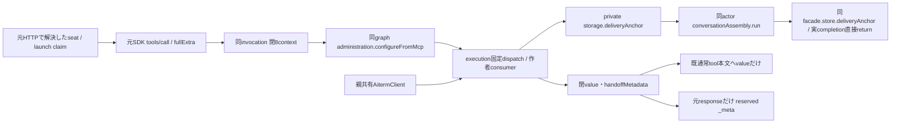

# 元MCP要求と設定切替consumerの親接続

所有モリー。consumer内部は[execution](../execution/model-handoff.md)、元deliveryの一件readは[conversation](../conversation/README.md)の正本に従う。

seat-mcpはSDK handlerの第2引数をそのまま捕捉し、元requestIdの型、実AbortSignal、HTTPで解決したactor/launch claim、元params._metaのnative_callを同invocationの閉8contextへ渡す。budgetはnullで、executionが一回5秒capture窓を所有する。tool引数をhost contextへ採用しない。既本人/引数/変更認可を通ったconfigureだけを同graphの安定facadeへ渡し、内部HTTPへのJSON化で元signalやcontextを失わない。

同invocation専用のconfigure closureが閉2返却のvalueだけを既tool本文へ返す。metadataはその元responseの `_meta['ai.aiterm/handoff.v1']` だけへ置き、abort後・別call・後続responseへ移植しない。consumerが自動切替を扱うtoolはupdate_selfだけであり、実MCP capabilityのexperimental同keyに閉 `{version:1,tools:['update_self']}` を公開する。consumer接続がない入口ではこのcapabilityを出さない。通常HTTPや公開tool引数のschemaは変更しない。

private storage.deliveryAnchor(input,options)は非async closureで、同actorのconversationAssembly.runから同facadeの一件readを直接returnする。元resultとcompletionを保持し、親にread実装やlegacy fallbackを作らない。欠測/失敗は作者consumerの作用不成立へ返す。親共有AitermClientには作者のcaptureHandoffConnectionを採用し、engineへ同実体を注入する。固定dispatchから生成するfacadeへ手書きmethodを足さない。

作者/独立fixtureの既結果を継承し、親の元handler→同graph/context→元responseとprivate actor/completion接点だけを最小検証する。Jのdeferred guard・V/Tの寿命/保存・既catalogを保持し、配布closure/署名はdistribution、本番採否はRootのまま。
