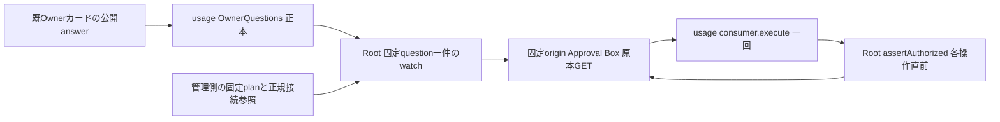

# Rabbit認証の固定管理caller候補

Root所有。既OwnerQuestionsカードの公開answer→同管理parentのwatch→usage consumer.executeを唯一の契機とする。新HTTP/RPC/daemon/認証画面は追加しない。内部answer拒否/内部harness-auth POST403を維持する。これはsource候補であり実行readyではない。

callerは固定planからquestionId/依頼者/質問文/選択肢/許可回答を束縛する。実順序は通常カード作成/通知→管理planへID固定→製品反映→親の正本読取/watch接続→その後の公開回答。反映より前に回答済みならそのrunはalready_answeredとして無操作にし、本体起動を妨げない。consumer生成/原本GET/native呼出しも0で、既回答からの自動実行・カードの再作成はしない。再開するなら新しい具体plan/カードを作り、再びOwner判断を受ける。Rootのprocess内重複抑止は補助であり、usageのstate/olrw-authの永続run/消費/全操作intentを代替しない。consumerのcloseは入場停止だけでcancelを発行しない。

原本は同じ許可済み既接続Bearerを使うhttps://approval-box.kitepon.dev/connector/v1/connectionと/decisions/{固定ID}の直接GET。MCP取得はfetched/versionを更新するため使わない。管理planの期待connection/Owner user、回答済みversion、option、context/options SHA、requester対応、実行期限を照合する。requesterは自己申告で本人証明にならず、対応を管理側で固定する。answeredの取消API/実行との原子連結は無いので、既AiControlの停止epochと期限も各操作直前に検査する。

今回sourceは原本照合と既カードwatchの直接境界まで。管理parentへ既Bearerを渡す現在の資格接点は未成立。席資格の自動読取は実装しない。次の具体反映案は既readonly control配下/run/bellteam-maintenance/olrw-auth/{plan.json,connection-token}をroot管理で固定し、通常親起動時に一件だけ読み組み立てる方式。新mount/OS権限を追加せず、既接続のparent利用そのものとroot配置にはOwner裁定が必要。root-owned信頼記録のloader/配置接続は次差分で、現在存在すると扱わない。

通常製品更新/親再起動が初回接続に必要。既AI実行は中断し得て、元同CLI会話の保持は保証しない。変更前image/profile/state復旧参照を保存し、起動前拒否なら旧imageへ戻す。旧履歴snapshotの再投入/元席の再配送は戻しに含めない。実停止・戻し操作は別Owner決裁後。

native status/cancelの世代検証と正規交代、管理clientのSSH identity/remote MCP・shell HOME/config到達証拠は未成立。固定adapterはこの不足をboolや元席PID観測で補わない。ミカのconsumer公開I/F/Owner専用公式URL表示/有界入力待ちを合意後に組立てる。candidate試験は合成値だけで、資格/実認証/新PTY/Host/本番操作0。

source: src/olrw-management-caller.mjs、test/olrw-management-caller.test.mjs。application-servicesは管理bootstrapのolrwManagement参照がある場合だけ同じSecretRequests実体とstate/olrw-authをconsumer factoryへ注入する。application-runtime全体closeはcaller停止→既資源closeを行う。通常bootstrapにはまだこの参照producerがなく、無反映で有効化できない。root配置loader/usage/nativeを結合するまで本番で有効化しない。既公開契約の変更はない。
