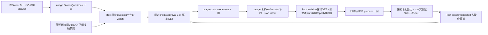

# Rabbit認証の固定管理caller候補

Root所有。既OwnerQuestionsカードの公開answer→同管理parentのwatch→usage consumer.executeを唯一の契機とする。新HTTP/RPC/daemon/認証画面は追加しない。内部answer拒否/内部harness-auth POST403を維持する。これはsource候補であり実行readyではない。

callerは固定planからquestionId/依頼者/質問文/選択肢/許可回答を束縛する。実順序は通常カード作成/通知→管理planへID固定→製品反映→親の正本読取/watch接続→その後の公開回答。反映より前に回答済みならそのrunはalready_answeredとして無操作にし、本体起動を妨げない。consumer生成/原本GET/native呼出しも0で、既回答からの自動実行・カードの再作成はしない。再開するなら新しい具体plan/カードを作り、再びOwner判断を受ける。Rootのprocess内重複抑止は補助であり、usageのstate/olrw-authの永続run/消費/全操作intentを代替しない。consumerのcloseは入場停止だけでcancelを発行しない。

原本は同じ許可済み既接続Bearerを使うhttps://approval-box.kitepon.dev/connector/v1/connectionと/decisions/{固定ID}の直接GET。MCP取得はfetched/versionを更新するため使わない。管理planの期待connection/Owner user、回答済みversion、option、context/options SHA、requester対応、実行期限を照合する。requesterは自己申告で本人証明にならず、対応を管理側で固定する。answeredの取消API/実行との原子連結は無いので、既AiControlの停止epochと期限も各操作直前に検査する。

管理parentへ既Bearerを渡す実資格接点は未成立。席資格の自動読取は実装しない。source候補のloaderは既readonly control配下/run/bellteam-maintenance/olrw-auth/{plan.json,connection-token}をroot管理で固定し、通常親起動時に一件だけ読み組み立てる。新mount/OS権限を追加せず、既接続のparent利用そのものと実root配置にはOwner裁定が必要。source上のreader接続を実配置/資格利用可能の成立へ補完しない。

通常製品更新/親再起動が初回接続に必要。既AI実行は中断し得て、元同CLI会話の保持は保証しない。変更前image/profile/state復旧参照を保存し、起動前拒否なら旧imageへ戻す。旧履歴snapshotの再投入/元席の再配送は戻しに含めない。実停止・戻し操作は別Owner決裁後。

native status/cancelの世代検証と正規交代、管理clientのSSH identity/remote MCP・shell HOME/config到達証拠は未成立。固定adapterはこの不足をboolや元席PID観測で補わない。ミカのconsumer公開I/F/Owner専用公式URL表示/有界入力待ちを合意後に組立てる。candidate試験は合成値だけで、資格/実認証/新PTY/Host/本番操作0。

固定adapterはRoot所有AitermClientを既正規SSH/stdinの公開MCPへ接続する。host=rabbit/user=kite、承認済みNode絶対pathと正式npm公開entry絶対pathを固定引数とし、共有PATH切替/OS wrapper/remote転送引数を使わない。initializeのname=aiterm/version=固定Vをauth前に照合し、そのSDK実参照と版をClientのguarded callへ毎回渡す。初回connectの結果を保持し、切断/unknown/typed拒否後に新接続や他env launcherへ進まない。clientInfoは既固定bellteam、parent _metaは渡さない。

initializeは無作用とは扱わない。opt-in error reporterや依存初期化の既動作、同SSHの実Node/UID/HOME/config/cwd/state/socket/artifact実体は別に計画・承認・非秘密実測が必要。Node/entryの絶対pathとinitialize版だけをそれらの証明へ代用しない。管理plan配置はinitializeまでの明示許可と事前条件が揃ってから行い、実target根拠をroot証跡として公開するまでauthは有効にしない。

## 通常bootstrapと固定root記録

application-servicesはOwnerQuestions初期化後にprepareOlrwManagementを呼ぶ。`/run/bellteam-maintenance/olrw-auth/plan.json`無しは通常無効。祖先root所有/非可変directory、file root:1001/0440/通常/nlink1/NOFOLLOW/有界同FDを要求する。tokenは同directoryのconnection-tokenだけ。Botが持ち込むpath/環境/許可JSONを読まない。不正/欠測/接続失敗はOLRWだけunavailableにし、本体起動は続ける。既回答はtoken/原本GET/MCP前に無操作へ戻す。

planのschemaはbellteam.olrw-auth.management.v1、contextはusageの7field、questionは固定カード5field、approvalは固定decision/回答済み版/Owner・connection/許可option/context/options SHA/requester、targetは承認済みnodePath/entryPath/正式version/profileSha256の4field。profileSha256はSSH/UID/Node/正式package全体integrity/HOME/config/cwd/state/socketとinitialize副作用の独立確認原本のdigest参照で、自己申告boolの代用にはしない。root配置者がその原本/Owner裁定との束縛を持つ。

pendingカードのbootstrapは固定参照を組み立てるだけで、原本GET/接続prepareを行わない。Owner回答後のclaim前start許可はplan/期限/停止epoch/Boxだけを照合し、未生成のtarget証拠を要求しない。usageの永続run/session名予約とstart intent fsyncの後、auth.start内でinitialize原本GET→照会後plan/期限/epoch再検査→固定MCP prepare一回（10秒上限）へ進む。撤去/置換/期限/停止ならprepare0。成功/失敗/unknown/再起動後のrun/session再使用拒否はusageの唯一の正本が持ち、Rootに別run台帳を追加しない。

接続後logs/olrw-client-preflight.jsonへ親PID/出生・その接続のSSH PID/出生・対象profile参照を1001/0600で出す。この出力は観測対象の名札であり許可証ではない。独立した承認済み実測後、root配置者だけがtarget-evidence.jsonをroot:1001/0440で公開する。schema bellteam.olrw-auth.target-evidence.v1、runId/profileSha256/親PID出生/SSH PID出生が現在接続と完全一致する場合だけauthへ進める。欠測のみ100ms間隔で受動再読し、期限はrun開始15分/管理許可期限の最小。close/停止epoch/期限で待ちを終了し、遅着証拠を採用せず再prepare/auth0。一般待受けや新daemonではない。

実auth前はplan raw bytes不変・同接続PID出生・root evidence・Box原本を照会後にも再確認し、SDKへ渡す直前にはawait無しで期限/close/停止epochを確認する。unknown後の再準備/再接続/別env launcher/自動status・cancelは無い。通常終了/親close/拒否回答/許可失敗はconsumer入場停止と管理client closeだけで、無許可cancelを追加しない。実測/配置の手順・担当・具体値は統括の実行案で確定し、このsourceから実SSH/権限/配置を許可済みにしない。

source: src/olrw-management-caller.mjs、olrw-management-loader.mjs、olrw-rabbit-auth.mjsと直接試験。application-servicesは通常bootstrapの固定loaderか明示合成fixtureから得るolrwManagementを使い、同じSecretRequests実体とstate/olrw-authをconsumerへ注入する。application-runtime全体closeはcaller停止→既資源closeを行う。固定plan無しは通常無効、無反映でlive graphへ注入しない。実root配置/資格/正式native供給/実到達が未成立の現在は本番で有効化しない。既公開契約の変更はない。
