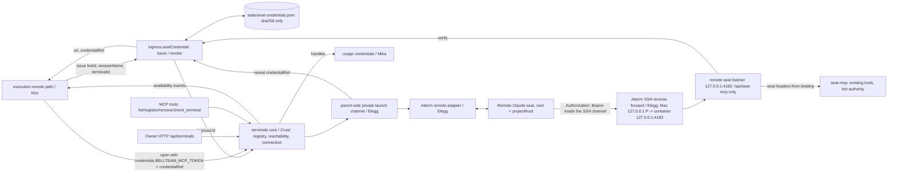
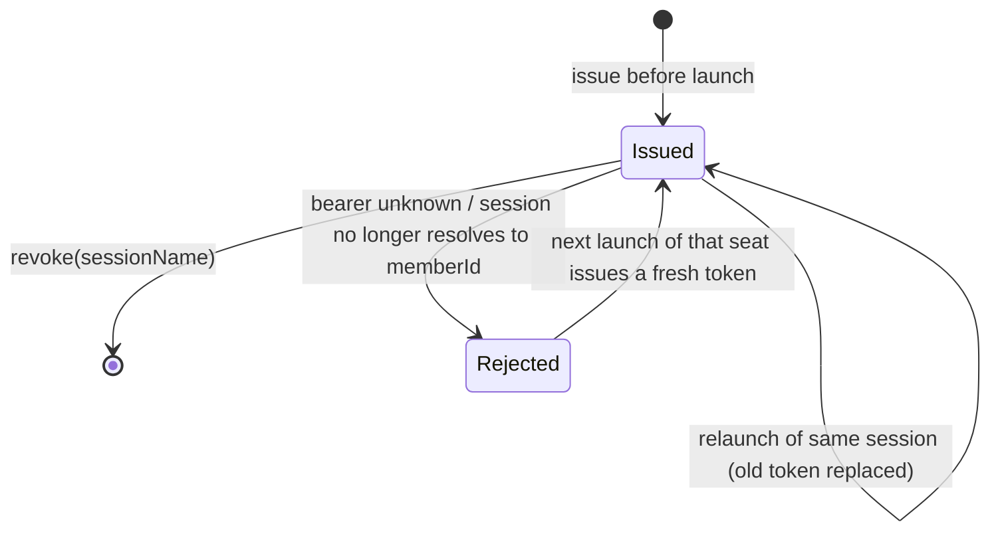

# Remote seat ingress and terminals mount (C4, P1)

Owner: Molly (integration). Contract C4 of [terminals](../terminals/README.md#cross-contracts-adopted-by-trony), plan F-SEAT-HOST (Trony). P1 scope: Owner's Mac + Claude, existing key, no sudo, API/MCP configuration.

This document owns three parent pieces: the remote seat MCP endpoint (container loopback, reached only through Aiterm's SSH reverse forward; Root ruling 2026-11-09, Owner agreed), the per-launch seat credential, and the in-parent mount of the terminals core (execution ports, HTTP/MCP surfaces). Terminal registry/reachability/connection internals are Crust's; remote PTY is Elegg's; credential resolution is Mika's; seat lifecycle is Kiro's.

## Function diagram

## Data flow

| ID | From -> to | Payload / persistence |
| --- | --- | --- |
| RS01 | execution -> `ingress.seatCredential.issue({botId, sessionName, terminalId})` | Called right before the remote launch. `sessionName` keeps today's forms (`<botId>` or `<botId>-<1st\|2nd>-<base36>`) and must resolve to `botId` by the existing account-seat rule (#759). Returns `{url, credentialRef}`: `url = <terminal.ingressUrl>/api/seat-mcp` (call-bridge at `url + '/call-bridge'`); `ingressUrl` is read from the terminal record (core `registry.get`). Errors: `SEAT_CREDENTIAL_INVALID` (400, bad input/name), `TERMINAL_NOT_FOUND` (404), `TERMINAL_INGRESS_UNSET` (409), save failure as-is |
| RS02 | seat-credentials store | 256-bit random token; saved as sha256 + `{botId, sessionName, terminalId, issuedAt}` by `writeAtomic` (temp + rename, 0600). One per sessionName; a new issue replaces the old token. The token is never saved, logged or put in JSON |
| RS03 | `credentialRef` | Opaque frozen object; `JSON.stringify` and `String` give `"[seat credential]"`. Only `seatCredentials.reveal(credentialRef)` returns the token, and only the parent-side private launch channel (Crust/Elegg, injected into `createTerminalsCore`) calls it, to set `Authorization: Bearer <token>` for both MCP servers inside Claude's in-memory MCP config. Nothing is written to the terminal's home or the user's repository; no `--strict-mcp-config`, so the folder's own MCP servers still load |
| RS04 | execution -> `ingress.seatCredential.revoke({sessionName})` | Seat closed or replaced -> credential removed (idempotent) |
| RS05 | remote seat -> Aiterm SSH reverse forward -> remote seat listener | `POST/GET/DELETE /api/seat-mcp[/call-bridge]` (MCP Streamable HTTP, HTTP/1.1) with bearer. The parent serves these two paths on a dedicated listener bound to `127.0.0.1:${BELLTEAM_REMOTE_SEAT_PORT:-4182}` inside the body container; every other path is 404, so no other API is reachable through the forward. Elegg's `aiterm-remote-terminal serve` (UID 1000, same container) opens a reverse forward on the existing SSH connection from the terminal's loopback `127.0.0.1:P` to `127.0.0.1:4182`. The terminal's `ingressUrl` is that terminal-side end (`http://127.0.0.1:P`), so RS01's `url` is unchanged in form. The public listener (gateway 4180 / host 18891) no longer serves `/api/seat-mcp`; there it needs the Owner session like any `/api/*`. A failed bind logs `REMOTE_SEAT_LISTEN_FAILED` and the body keeps serving (remote seats get no MCP until the next start) |
| RS06 | ingress -> `seatCredentials.verify` | bearer -> binding or null. Then the existing `resolveSeatBotId` on `binding.sessionName` must return `binding.botId` (member deleted -> rejected) |
| RS07 | ingress -> seat-mcp | Client `X-Bellteam-Seat` and `Authorization` dropped; `X-Bellteam-Seat = binding.sessionName`; client `X-Bellteam-Launch-Id` kept only as today's runtime launch claim (format-checked, compared by execution, never proof). Path mapped to `/mcp[/call-bridge]`. `executionSource` keeps the same `{sourceSession, source: {launch}}` shape, so configureFromMcp/handoff work unchanged. Same tools and `{kind:'bot', botId}` authority as a local seat; no Owner authority |
| RS08 | core `watch` -> execution | Availability events pass through unchanged (drain resume belongs to execution) |
| RS09 | Owner HTTP / bot MCP -> core.registry / reachability | Owner: `GET /api/terminals`, `GET/PUT/DELETE /api/terminals/:id`, `POST /api/terminals/:id/check` (internal callers 403). Bots: `list_terminals`, `register_terminal`, `remove_terminal`, `check_terminal`. Results are the core's nonsecret projections as-is |

| RS10 | parent refresh helper -> `usageAssembly.credentials.refresh()` | Usage has no timer of its own (Mika C5). The parent watches `usageAssembly.credentials.watch` events `{handle, revision, available}`, and the source-free `{recoveryNeeded}` from each refresh result and the optional `credentials.watchRecovery`. While any handle is unavailable or `recoveryNeeded` is true (no handle needed, e.g. a pending card's 1Password source), one unref'd 60 s timer calls refresh; `recoveryNeeded: false` and restored handles disarm it; it also refreshes once after listen and when a terminal reports `reachable: true`. On body close (and on construction-failure cleanup) `stop()` runs before usage, diagnostics, the native client and terminals close, and resolves only after an in-flight refresh settles. A refresh or report-sink failure is contained (reported once, never an unhandled rejection). No AI polling, no consumer replay. Wired only when usage exposes `credentials.refresh` and `credentials.watch` ([secret-credential-refresh](../../../../src/secret-credential-refresh.mjs)) |

Credentials survive a body restart (hashes on disk), so a running remote seat keeps its MCP across a body swap.

## Seat credential state

Protection: a caller cannot speak as a seat it was not launched as (privilege escalation / wrong identity), and the token is not exposed (stored hashed, private env only). A rejected request returns `400 BELLTEAM_SEAT_UNRESOLVED` (not 401/403, so Claude Code does not start an OAuth flow or cache needs-auth). Exit: execution's existing relaunch of a failed seat issues a new credential; no manual unlock.

`launchId` is not part of the binding: it is known only after the launch receipt, and today's launch header is already a runtime claim that execution compares.

## Mount (P1)

- Terminals runs as an injectable in-parent core, no child process and no new service. Crust's PR adds `export { createTerminalsCore } from './terminals/core.mjs'` to `src/bootstrap.mjs`; `createApplicationServices` receives it and calls `createTerminalsCore({ stateRoot: <root>/state, credentials, seatCredentials, report })` once. Without it, the endpoints return `503 TERMINALS_UNAVAILABLE` and execution gets no `terminals` port.
- `stateRoot` is `<BELLTEAM_ROOT>/state` (`/srv/bellteam/state`), written by the parent UID 1001. Use `writeAtomic` from `src/json-file.mjs`; one writer per file.
- `credentials` is `usageAssembly.credentials`, usage's credential facade (Mika, C5) with system authority captured inside usage-assembly (null: opens return CREDENTIAL_UNAVAILABLE); `report` is `diagnostics.record`.
- Execution gets `ports.terminals` (the core's `connection` and `watch`, as-is) and `ports.ingress = {seatCredential: {issue, revoke}}` only when its factory declares `supportsRemoteSeats === true` (older engines reject unknown port keys).
- `createTerminalsCore` also receives `seatCredentials: {reveal}` for the private launch channel.
- Child packaging (work-graph precedent) waits until terminals needs exchange without a body swap.

## Core interface the parent mounts (Crust)

`createTerminalsCore({stateRoot, credentials, seatCredentials, report})` (Crust #771) returns the members below. `seatProject` defaults to `dirname(stateRoot)` = BellTeam root, the same seat project the parent's Aiterm client uses; terminals spawns Elegg's UID 1000 `aiterm-remote-terminal` itself through `seatCommandSpec`, so no native client is passed:

| Member | Used by | Shape |
| --- | --- | --- |
| `registry.list()` / `get(terminalId)` | HTTP, MCP, `seatCredential.issue` | nonsecret projections; `get` returns null when absent. The projection carries `ingressUrl` (`http(s)://host[:port]`, how this terminal reaches BellTeam; for a forwarded terminal the terminal-side loopback end of Aiterm's reverse forward, `http://127.0.0.1:P` (RS05)) |
| `registry.put(input)` / `remove(terminalId)` | HTTP, MCP | upsert by terminalId; `ingressUrl: null` clears; optional `confirmHostKey: 'SHA256:…'` confirms host trust. Validation and typed errors (`code` + `status`) are the core's |
| `reachability.check(terminalId)` | HTTP, MCP | the core's observation DTO |
| `connection` | execution `ports.terminals.connection` | passed as-is; methods are the terminals/execution contract (PR #765) |
| `watch(listener)` | execution `ports.terminals.watch`, parent refresh helper | events with `terminalId`, `reachable`, `observedAt` |
| `close()` | body close | optional |

## Limits

- Seat MCP traffic and its bearer travel only inside the SSH connection Aiterm already holds; nothing listens on the LAN for remote seats (the former P1 plain-HTTP-on-LAN limit is gone). Anyone on the terminal who can reach its loopback port P still needs a valid per-launch bearer.
- The P1 Owner Mac key (`bot-c2adbe04/integrations/ssh/id_ed25519_macbook`) is a UID 1000 0600 file; the body and usage child run as UID 1001 and cannot read it. The parent does not copy or re-permission it. It stays with Aiterm (UID 1000, Elegg), which already uses it with its ssh config; a parent-side fixed provider for it is not wired.
- Claude Code's `${VAR}` expansion inside `--mcp-config` headers is the same mechanism local seats use in their config file; the first remote launch on the Mac confirms it.
