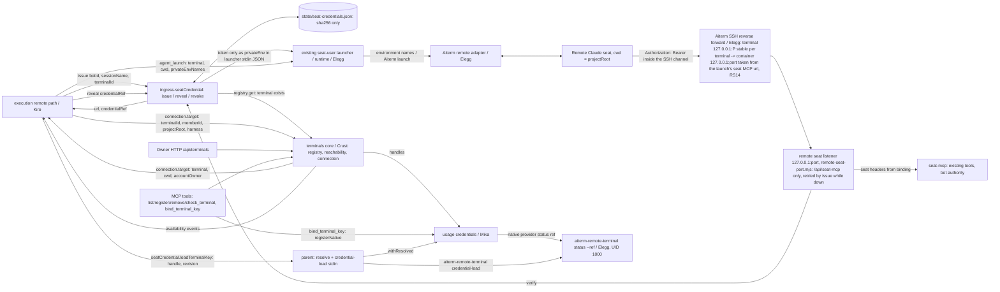
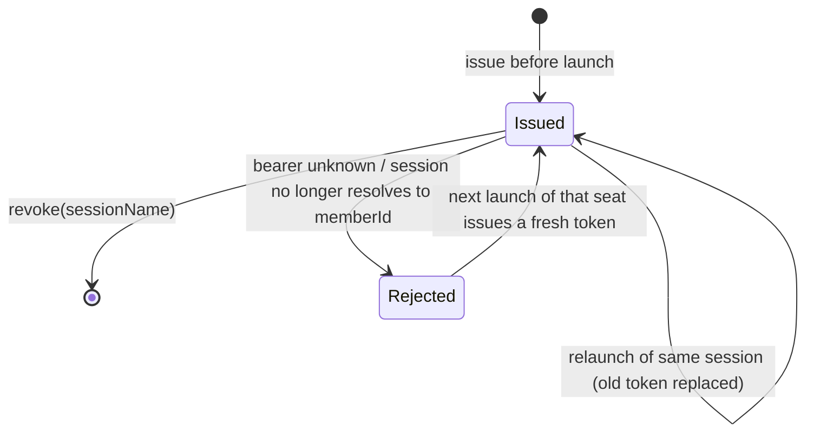
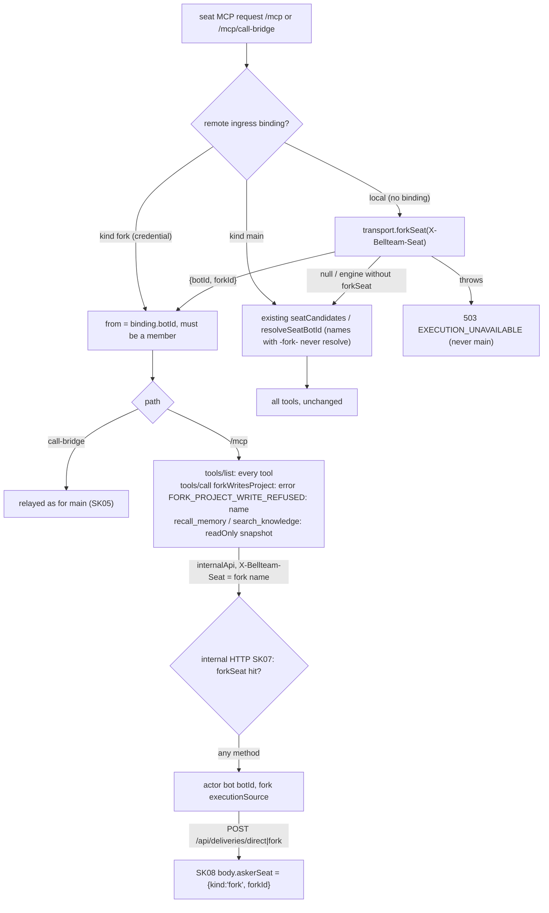
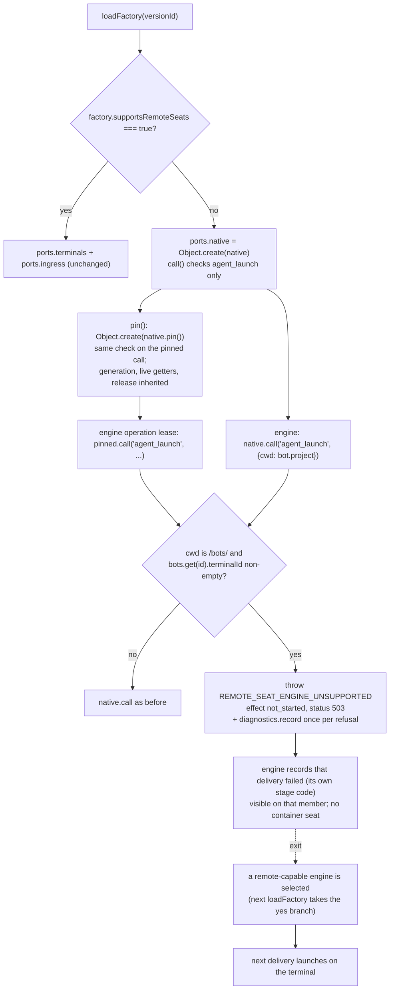

# Remote seat ingress and terminals mount (C4, P1)

Owner: Molly (integration). Contract C4 of [terminals](../terminals/README.md#cross-contracts-adopted-by-trony), plan F-SEAT-HOST (Trony). P1 scope: Owner's Mac + Claude, existing key, no sudo, API/MCP configuration.

This document owns three parent pieces: the remote seat MCP endpoint (container loopback, reached only through Aiterm's SSH reverse forward; Root ruling 2026-11-09, Owner agreed), the per-launch seat credential, and the in-parent mount of the terminals core (execution ports, HTTP/MCP surfaces). Terminal registry/reachability/connection internals are Crust's; remote PTY is Elegg's; credential resolution is Mika's; seat lifecycle is Kiro's.

## Function diagram

## Data flow

| ID | From -> to | Payload / persistence |
| --- | --- | --- |
| RS01 | execution -> `ingress.seatCredential.issue({botId, sessionName, terminalId, kind?})` | Called right before the remote launch. `kind` is `'main'` (default) or `'fork'` ([SK03](#seat-kind-read-only-fork-seats-sk01-sk07)); any other value is `SEAT_CREDENTIAL_INVALID`. A main `sessionName` keeps today's forms (`<botId>` or `<botId>-<1st\|2nd>-<base36>`) and must resolve to `botId` by the existing account-seat rule (#759); a fork's is `<mainSession>-fork-<12hex>`. The terminal must be registered (`registry.get`). Returns `{url, credentialRef}`: `url = http://127.0.0.1:${BELLTEAM_REMOTE_SEAT_PORT:-4183}/api/seat-mcp` (call-bridge at `url + '/call-bridge'`), the container target; Aiterm rewrites its origin to the terminal's reverse-forward end, so the terminal's `ingressUrl` is no longer read. Before issuing, it ensures the RS05 listener is bound (one bind attempt when it is down). Errors: `SEAT_CREDENTIAL_INVALID` (400, bad input/name), `TERMINAL_NOT_FOUND` (404), `SEAT_FORWARD_UNAVAILABLE` (503, `effect: not_started`: the listener could not bind; nothing is launched; the delivery keeps execution's not-started proof and stays queued), save failure as-is. Exit of that refusal (`createRemoteSeatListener` in `src/remote-seat-port.mjs`): the terminal is recorded as waiting and a non-AI bind retry runs every 30 s only while one waits (the body's shared close path — `close()` and signal `stop()` — ends it: after close no retry, bind, issue or event, and a bind that lands after close is closed again); the first successful bind (that retry or any later RS01) emits `{terminalId, reachable: true, observedAt}` on execution's terminals `watch` port (RS08), which drains the same retained delivery IDs |
| RS02 | seat-credentials store | 256-bit random token; saved as sha256 + `{botId, sessionName, terminalId, kind, issuedAt}` (`kind` absent in older rows = main) by `writeAtomic` (temp + rename, 0600). One per sessionName; a new issue replaces the old token. The token is never saved, logged or exposed in public MCP/card/history JSON; the launcher-stdin `privateEnv` JSON request in RS03 is the only JSON exception |
| RS03 | `credentialRef` -> `ingress.seatCredential.reveal(credentialRef)` -> seat launcher stdin | Opaque frozen object; `JSON.stringify` and `String` give `"[seat credential]"`. Only `reveal` returns the token. One launch path (Owner ruling 2026-11-09): execution calls `reveal` only inside its Aiterm seat launch call and puts the value into the launcher's stdin request as `privateEnv: {BELLTEAM_MCP_TOKEN}` with `privateEnvNames`; the launcher (`run-seat-aiterm-launch.mjs`, runtime) sets it in its own process env and passes only the names to Aiterm, which moves the mcp_config `Authorization: Bearer ${BELLTEAM_MCP_TOKEN}` header into the seat's environment. The token is never in argv, a file, the PTY, a log, or public MCP/card/history JSON; its launcher-stdin `privateEnv` request is the explicit JSON exception. Terminals no longer reveal |
| RS04 | execution -> `ingress.seatCredential.revoke({sessionName})` | Seat closed or replaced -> credential removed (idempotent) |
| RS05 | remote seat -> Aiterm SSH reverse forward -> remote seat listener | `POST/GET/DELETE /api/seat-mcp[/call-bridge]` (MCP Streamable HTTP, HTTP/1.1) with bearer. The parent serves these two paths on a dedicated listener bound to `127.0.0.1:${BELLTEAM_REMOTE_SEAT_PORT:-4183}` inside the body container (`src/remote-seat-port.mjs`, the one constant, read only by the listener and RS01's `url`; RS14). Its own port: 4182 is the diagnostics admin server (`0.0.0.0`, host 18892), and sharing it made this bind fail and every remote seat MCP reach the admin server (401, 2026-11-10 Crust); every other path is 404, so no other API is reachable through the forward. Elegg's Aiterm keeper (aiterm-mcp `remote-terminal.js`, R12; UID 1000, same container) holds one reverse forward per terminal (one Aiterm MCP server process, lock in its state root) to the container port carried by RS01's `url` (RS14); reconnecting while that terminal has seats. The terminal-side loopback port P is per terminal and stable: the first forward lets the terminal pick it, Aiterm records it in the binding and requests the same P on every reconnect, because a seat keeps the URL it was launched with while the SSH connection can be replaced. At `agent_launch`, Aiterm rewrites scheme+host:port of every mcp_config server `url` to `http://127.0.0.1:P`, keeping path/query and headers. So the origin of RS01's `url` (the container target) is replaced by Aiterm and never used by the seat. A refused forward fails that launch with `SEAT_FORWARD_UNAVAILABLE` (the next open retries). Launch shape (one launch path, Owner ruling): Kiro calls Aiterm's normal `agent_launch`/`claude_agent` with `terminal: {ref, target, trustRevision, credentialRevision}` and `cwd`; the bearer goes in mcp_config as `Authorization: "Bearer ${NAME}"` with NAME in env_vars (or a literal header), and Aiterm moves header values out of the config file into the seat's environment, so the token is never in a file, argv, PTY or log. The public listener (gateway 4180 / host 18891) no longer serves `/api/seat-mcp`; there it needs the Owner session like any `/api/*`. A failed bind logs `REMOTE_SEAT_LISTEN_FAILED` (stderr + diagnostics row, module integration) and the body keeps serving; while it is down every remote launch first retries the bind in RS01 and, if it still fails, refuses it as not started (`SEAT_FORWARD_UNAVAILABLE`, RS01) instead of launching a seat without MCP. Exit: RS01's bind retry; the first successful bind republishes each waiting terminal as reachable (RS08) |
| RS06 | ingress -> `seatCredentials.verify` | bearer -> binding `{sessionName, botId, terminalId, kind}` or null. Main: the existing `resolveSeatBotId` on `binding.sessionName` must return `binding.botId` (member deleted -> rejected). Fork: `binding.botId` must still be a member (the fork name never resolves by name, SK02); the seat MCP then runs in fork mode (SK04) |
| RS07 | ingress -> seat-mcp | Client `X-Bellteam-Seat` and `Authorization` dropped; `X-Bellteam-Seat = binding.sessionName`; client `X-Bellteam-Launch-Id` kept only as today's runtime launch claim (format-checked, compared by execution, never proof). Path mapped to `/mcp[/call-bridge]`. `executionSource` keeps the same `{sourceSession, source: {launch}}` shape, so configureFromMcp/handoff work unchanged. Same tools and `{kind:'bot', botId}` authority as a local seat; no Owner authority |
| RS08 | core `watch` + RS01 listener -> execution | Availability events pass through unchanged (drain resume belongs to execution). The parent's execution `watch` port also carries the RS01 listener's `{terminalId, reachable: true, observedAt}` for a terminal refused while the listener was down; unsubscribe removes both |
| RS09 | Owner HTTP / bot MCP -> core.registry / reachability / trust / keys / folder | Owner: `GET /api/terminals`, `GET/PUT/DELETE /api/terminals/:id`, `POST /api/terminals/:id/check`, `POST /api/terminals/:id/trust {fingerprint}` -> `core.trust.attest` (Apple app on that Mac; no bot MCP tool), `POST /api/terminals/:id/keys/ssh/authorize` (empty body) -> `core.keys.authorize` (one-time `terminal.login` card; no bot MCP tool), `POST /api/terminals/:id/folder {path, create?}` -> `core.folder` (internal callers 403). Bots: `list_terminals`, `register_terminal`, `remove_terminal`, `check_terminal`. Results are the core's nonsecret projections as-is |

| RS10 | parent refresh helper -> `usageAssembly.credentials.refresh()` | Usage has no timer of its own (Mika C5). The parent watches `usageAssembly.credentials.watch` events `{handle, revision, available}`, and the source-free `{recoveryNeeded}` from each refresh result and the optional `credentials.watchRecovery`. Event reason `unbound` is a removal, not an outage. While any handle is unavailable or `recoveryNeeded` is true (no handle needed, e.g. a pending card's 1Password source), one unref'd 60 s timer calls refresh; `recoveryNeeded: false` and restored handles disarm it; it also refreshes once after listen and when a terminal reports `reachable: true`. On body close (and on construction-failure cleanup) `stop()` runs before usage, diagnostics, the native client and terminals close, and resolves only after an in-flight refresh settles. A refresh or report-sink failure is contained (reported once, never an unhandled rejection). No AI polling, no consumer replay. Wired only when usage exposes `credentials.refresh` and `credentials.watch` ([secret-credential-refresh](../../../../src/secret-credential-refresh.mjs)) |

| RS11 | usage native credentials -> parent provider -> `aiterm-remote-terminal status --ref <uuid>` | Wired once at assembly by `usageAssembly.credentials.setNativeProvider({status})` when both terminals and that seam exist. Each `status(ref)` runs the one-shot UID 1000 bin from aiterm-mcp >= 0.65.1 (`<package>/dist/remote-terminal-cli.js`, on the seat PATH beside `aiterm-mcp`) through the seat command entry (`createSeatProcessRunner(root)`, same seat project as terminals). Exit 0 prints one `aiterm.remote-binding-status.v1` line and exit 2 one `aiterm.remote-binding-error.v1` line; both JSON objects are returned as-is and usage validates them (ref/target/credential provider/revision/available; anything else is `SECRET_SOURCE_UNAVAILABLE`). Any other exit, signal, spawn failure or non-JSON output is `REMOTE_TERMINAL_STATUS_UNAVAILABLE`. No value or key bytes cross: status carries only ref, target and the credential revision/availability. Image before 0.65.1: the bin is missing, every status is unavailable, the handle stays unavailable and RS10 keeps refreshing |
| RS12 | bot MCP `bind_terminal_key({terminalId, ref})` -> parent -> `usageAssembly.credentials.registerNative` -> `core.registry.put` | The legitimate live caller of `registerNative` (Mika C5). `ref` is an Aiterm-held key ref (uuid). The parent reads the terminal record and passes `{ref, target: {host, user, port}}` from it, never from the caller, with scope `{terminalId, purpose: 'terminal.ssh'}`. Usage asks RS11 for the status, saves a new handle row (`state/secret-native-credentials/<handle>.json`, usage's writer) and returns `{handle, revision, available}`. The parent then sets that handle as the terminal's `sshKeyRef` through the core's `put` (which reads host trust once). Returns `{credential, terminal}` (nonsecret). Errors: `TERMINAL_NOT_FOUND` 404, `CREDENTIAL_UNAVAILABLE` 503 (no terminals or usage seam), usage's `SECRET_CREDENTIAL_INVALID` / `SECRET_SOURCE_UNAVAILABLE` as-is; on a usage failure no terminal field changes. Same bot authority as `register_terminal`. A repeat call issues a new handle and replaces `sshKeyRef`; the old handle row stays unused |
| RS13 | execution -> `ingress.seatCredential.loadTerminalKey({terminalId, memberId, ref, handle, revision})` -> parent -> `aiterm-remote-terminal credential-load` | App-set terminal keys (Trony ruling 2026-11-09, Aiterm 0.67.0). Before a remote launch on a terminal whose target carries `credential: {handle, revision}` (Crust #811), execution calls this with the target's `ref` and the launching member. The parent validates the input (terminal id, uuid ref/handle, positive integer revision) before resolving, then calls `usageAssembly.credentials.withResolved(handle, {terminalId, memberId, purpose: 'terminal.ssh', expectedRevision: revision}, consume)` (usage throws `SECRET_CREDENTIAL_STALE` 409 before any byte when the handle's revision moved) and, inside `consume`, runs `aiterm-remote-terminal credential-load --ref <ref> --terminal-id <id> --handle <handle> --revision <n> --purpose ssh-key` through the seat command entry (UID 1000) with the raw key as stdin (at most 64 KiB, unchanged). The value exists only in that call: never in execution, argv, env, a file, the PTY or a log; the key then lives only in that terminal's private ssh-agent. Exit 0 returns the `aiterm.credential-load.v1` receipt; exit 2 throws the binding error's `code` (409, DTO attached as `binding`); anything else `TERMINAL_KEY_LOAD_UNAVAILABLE` (503); bad input `TERMINAL_KEY_LOAD_INVALID` (400); no usage seam `CREDENTIAL_UNAVAILABLE`. A method on the existing `seatCredential` object, so engines that do not know it are unaffected (their `ingress` key list is unchanged). Sudo handles are never loaded here |
| RS14 | `src/remote-seat-port.mjs` -> RS01 `url` -> Aiterm `agent_launch` -> binding -> reverse forward | One owner, one carrier. `remoteSeatPort()` (`BELLTEAM_REMOTE_SEAT_PORT`, else 4183) is read only by the RS05 listener and RS01's `url`. The `url` in the launch's mcp_config is the only way the port reaches Aiterm: Aiterm (aiterm-mcp >= 0.70.3, Elegg, remote-terminal.md R8/R12) takes the container port D from that url (every mcp_config server under `/api/seat-mcp`, call-bridge included: http, host 127.0.0.1, one port, else `SEAT_FORWARD_UNAVAILABLE` not_started before any session), stores it in the terminal binding as `seat_ingress_port` and builds `ssh -R 127.0.0.1:P:127.0.0.1:D` from the binding in whichever Aiterm process holds the lock; every active Aiterm process keeps the forward (60 s takeover). No env lookup and no default; a binding without `seat_ingress_port` builds no forward until the next launch writes it. aiterm-mcp <= 0.70.2 read `BELLTEAM_REMOTE_SEAT_PORT ?? 4182` from its own env, so the body image must carry >= 0.70.3 (Dockerfile installs `aiterm-mcp@latest`). BellTeam passes the port in no env, argv or stdin. Not consumers: terminals' `aiterm-remote-terminal serve` (never builds a forward). History (2026-11-10): first the listener and Aiterm both defaulted to 4182, the diagnostics admin port; then the listener moved to 4183 and only `serve` got the variable while the launcher's Aiterm still forwarded to 4182. Both: the port was held in two places (body + Aiterm default) with no shared contract. Exit after a body swap: a seat launched before it keeps its old binding until relaunched |

Credentials survive a body restart (hashes on disk), so a running remote seat keeps its MCP across a body swap.

## Seat credential state

Protection: a caller cannot speak as a seat it was not launched as (privilege escalation / wrong identity), and the token is not exposed (stored hashed, private env only). A rejected request returns `400 BELLTEAM_SEAT_UNRESOLVED` (not 401/403, so Claude Code does not start an OAuth flow or cache needs-auth). Exit: execution's existing relaunch of a failed seat issues a new credential; no manual unlock.

`launchId` is not part of the binding: it is known only after the launch receipt, and today's launch header is already a runtime claim that execution compares.

## Seat kind: fork seats (SK01-SK08)

For N102's fork inquiry ([fork-inquiry](../conversation/fork-inquiry.md), BellTeam MCP row). Kiro's fork launch supplies the kind; the seat MCP enforces it server-side. Contract agreed with Kiro 2026-11-10.

Owner contract 2026-11-10 (Root rulings to Molly): 「プロジェクトフォルダ内の一切の書き込みを禁止。ファイルの書き込みのほか、プロジェクトフォルダ内にSQLなどがあればそれも更新も含めて禁止。それ以外は全て許可する。」 It covers every Bot's project folder (`/srv/bellteam/bots/*/`). A fork lists and calls every tool and reaches call-bridge like a main seat; only the BellTeam MCP calls whose server-side effect writes inside a project folder are refused.

| ID | From -> to | Contract |
| --- | --- | --- |
| SK01 | execution -> parent `transport.forkSeat(sessionName)` | Live registry of every running fork, local and remote: `{botId, forkId}` from launch to close, else `null`. The seat MCP asks it for local seats; the internal HTTP API asks it for both (SK07). Sync or Promise. An engine without the method has no forks. A throw is `503 EXECUTION_UNAVAILABLE`, never a main fallback |
| SK02 | `seatCandidates(name)` | A name containing `-fork-` yields no candidate, so a closed or unknown fork session is `400 BELLTEAM_SEAT_UNRESOLVED`, never main. Fork names are `<mainSession>-fork-<12hex>` (Kiro) |
| SK03 | execution -> `seatCredential.issue({..., kind:'fork'})` -> verify | Remote forks: the credential carries the kind (RS01/RS02/RS06). Revoke at close is execution's (RS04) |
| SK04 | seat MCP fork mode | `tools/list` = every `bellTeamTools` entry. `tools/call` where `forkWritesProject(name, args)` (`mcp-tools.mjs`) throws `FORK_PROJECT_WRITE_REFUSED: <name>` before any handler, refresh or internal call: always `write_member_doc`, `update_self`, `update_bot`, `set_avatar`, `set_fast_mode` (PATCH `/api/bots/:id` rewrites AGENTS.md/CLAUDE.md), `restart_session` (startup writes previous-session.md), `create_bot`, `delete_bot`; `remember`, `revise_memory`, `pin_memory`, `consolidate_growth`, `record_knowledge` unless `scope: 'shared'` (shared stores are outside every project). Every other call runs with `fork: true` in the tool context, so `recall_memory` / `search_knowledge` pass `readOnly: true` to memory (memory details, fork reads). Main seats are unchanged |
| SK05 | seat MCP fork mode, call-bridge path | Relayed exactly as for a main seat (the Owner allows every MCP server) |
| SK06 | fork `executionSource` | `{sourceSession: <fork session name>, source: {launch}}`, launch claim from `X-Bellteam-Launch-Id` as today |
| SK07 | seat MCP tool -> `internalApi` -> internal HTTP (`http-server.mjs`, `resolveInternalSeat`) | Read tools that call the body API (`list_models` -> `GET /api/models`, `get_settings`, `list_queued_messages` -> `GET /api/queue`) send the fork session name as `X-Bellteam-Seat`. The internal resolver keeps the main rule first; a `-fork-` name is then looked up in `forkSeat`. A hit on any method runs as `{kind:'bot', botId}` with the fork's `executionSource` (SK06); project-folder writes are refused per tool at SK04, so `sendmessage` / `ask_readonly` from a fork reach `/api/deliveries/direct|fork`. A miss is no Bot (the existing `BELLTEAM_SEAT_UNRESOLVED`); a registry throw is `503 EXECUTION_UNAVAILABLE`. `submitted-secret-caller` stays main-only |
| SK08 | internal HTTP `POST /api/deliveries/direct` and `/api/deliveries/fork` (`bindAskerSeat`) | The body's `askerSeat` is always dropped, then set to `{kind:'fork', forkId}` only when SK07 resolved a fork (execution `forkSeat` registry; remote forks are in it too). A main seat or an unresolved caller never carries one. Consumer: N102's messenger (fork-inquiry "Messages sent by a fork seat") |

Protection (guards.named-protection): a fork must not overwrite existing state inside any Bot project folder (files, AGENTS.md, docs, memory/rag SQLite stores including -wal/-shm). Self-exit: the refusal is per call and holds no state; the asker sends work with `sendmessage` to the main seat, which is never affected.

### Parent wiring for `ask_readonly` (N102)

- `internalApi(port).deliverForkInquiry(value)` -> `POST /api/deliveries/fork` with the same body and seat header as `deliverMessage` (`executionSource` added when known). It is passed to `callConversationTool` as `deliverForkInquiry`, beside `deliverMessage`.
- The route is served by conversation's `createDeliveryApi` (`http-delivery-api.mjs`, N102), already mounted by `http-server.mjs`; the tool entry lives in `conversationTools` and is listed through `bellTeamTools` unchanged.
- `readOnlyHint: true` on `list_models`, `recall_memory`, `search_knowledge` stays as a plain MCP hint; it no longer selects the fork's tools (SK04).

## Mount (P1)

- Terminals runs as an injectable in-parent core, no child process and no new service. Crust's PR adds `export { createTerminalsCore } from './terminals/core.mjs'` to `src/bootstrap.mjs`; `createApplicationServices` receives it and calls `createTerminalsCore({ stateRoot: <root>/state, credentials, report })` once. Without it, the endpoints return `503 TERMINALS_UNAVAILABLE` and execution gets no `terminals` port.
- `stateRoot` is `<BELLTEAM_ROOT>/state` (`/srv/bellteam/state`), written by the parent UID 1001. Use `writeAtomic` from `src/json-file.mjs`; one writer per file.
- `credentials` is `usageAssembly.credentials`, usage's credential facade (Mika, C5) with system authority captured inside usage-assembly (null: opens return CREDENTIAL_UNAVAILABLE); `report` is `diagnostics.record`.
- Execution gets `ports.terminals` (the core's `connection` and `watch`, as-is) and `ports.ingress = {seatCredential: {issue, revoke}}` only when its factory declares `supportsRemoteSeats === true` (older engines reject unknown port keys).
- Child packaging (work-graph precedent) waits until terminals needs exchange without a body swap.

### Old engine never launches a terminal-bound member locally (2026-11-10, Crust/Trony F-SEAT-HOST)

Production 2026-11-10 09:33 JST: the selected execution release f0534f8b (source afa3abb5) does not declare remote seats, got no `terminals`/`ingress` ports, did not know `terminalId`, and launched the Owner's terminal member in the server folder inside the container. The new engine's own `TERMINALS_UNAVAILABLE` covers only new engine + parent without terminals.

| Item | Contract |
| --- | --- |
| Protects | Connection to the wrong target: a terminal-bound member's CLI running in the server folder inside the container. |
| Exit | Selecting an engine that declares `EXECUTION_REMOTE_SEATS` (no wrap), or the Owner removing the member's `terminalId` (local launch is then correct). No timer, no manual unlock. |
| Scope | Only `agent_launch`, through `native.call` or a pinned `native.pin().call` (the old engine's operation lease, [aiterm-generation-pin](../execution/aiterm-generation-pin.md)), whose `cwd` is a registered member project with a non-empty `terminalId`. Every other native call, other members and remote-capable engines are unchanged. The member's registry entry is left as is. |
| Code | `REMOTE_SEAT_ENGINE_UNSUPPORTED`, message 「AI実行制御が古く、この席を端末で起こせません」. The old engine stores its own stage code (`BOT_LAUNCH_FAILED`/`BOT_DELIVERY_FAILED`) on the delivery; the parent's diagnostics record carries the specific code and member id. |

## Core interface the parent mounts (Crust)

`createTerminalsCore({stateRoot, credentials, report})` (Crust #771, trimmed in #792: terminals no longer reveals seat credentials) returns the members below. `seatProject` defaults to `dirname(stateRoot)` = BellTeam root, the same seat project the parent's Aiterm client uses; terminals spawns Elegg's UID 1000 `aiterm-remote-terminal` itself through `seatCommandSpec`, so no native client is passed:

| Member | Used by | Shape |
| --- | --- | --- |
| `registry.list()` / `get(terminalId)` | HTTP, MCP, `seatCredential.issue` | nonsecret projections; `get` returns null when absent. `seatCredential.issue` only checks that the terminal exists; the projection's `ingressUrl` is no longer read (Crust may drop it) |
| `registry.put(input)` / `remove(terminalId)` | HTTP, MCP | upsert by terminalId; `ingressUrl: null` clears; optional `confirmHostKey: 'SHA256:…'` confirms host trust. Validation and typed errors (`code` + `status`) are the core's |
| `reachability.check(terminalId)` | HTTP, MCP | the core's observation DTO |
| `connection` | execution `ports.terminals.connection` | passed as-is (`target`, `onAvailable` since #792); methods are the terminals/execution contract (PR #765) |
| `watch(listener)` | execution `ports.terminals.watch`, parent refresh helper | events with `terminalId`, `reachable`, `observedAt` |
| `close()` | body close | optional |

## Limits

- Seat MCP traffic and its bearer travel only inside the SSH connection Aiterm already holds; nothing listens on the LAN for remote seats (the former P1 plain-HTTP-on-LAN limit is gone). Anyone on the terminal who can reach its loopback port P still needs a valid per-launch bearer.
- The P1 Owner Mac key (`bot-c2adbe04/integrations/ssh/id_ed25519_macbook`) is a UID 1000 0600 file; the body and usage child run as UID 1001 and cannot read it. The parent does not copy or re-permission it. It stays with Aiterm (UID 1000, Elegg), which already uses it with its ssh config; the parent only asks its status (RS11) and never holds the key.
- Claude Code's `${VAR}` expansion inside `--mcp-config` headers is the same mechanism local seats use in their config file; the first remote launch on the Mac confirms it.
