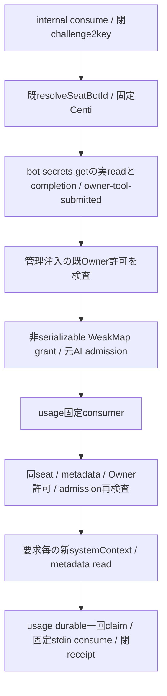

# 提出済secretの管理caller

共通所有モリー、業務consumer/閉HTTPはusage所有ミカ。親は固定request009fedc7/tool claude-rabbit9-auth-20261105/requester bot-8bc1fb5dの管理能力のみを構成する。既Owner許可の技術照合assertOwnerAuthorizedと固定consume/createConsumerは管理assemblyからだけ注入、HTTP bodyやinternal trueで生成しない。現在この技術許可の管理配置は未供給であり、未注入時はconsumer口が503で閉じる。sourceだけから復旧済みとしない。

実HTTP→usage handler→captureSubmittedSecretContext→同一consumerのexecute。親captureはOwner専用submitによるsubmittedだけで認証consume許可を作らない。usage権限tokenは一回使い切りなので、metadata完了後再利用せず再検査は新bot token、管理readは要求毎新systemContext。元read.completion失敗はcapture失敗。grantはJSON偽造不可、固定request外/別Bot/既許可失効/元admission失効を拒否。秘密やchallengeは親記録へ保存せず固定consume閉包内だけ。取消はremote未作用の証明でなく業務claim/unknownを保持する。

親差分はapplication-services→application-runtime→http-server→createControlApi→usage.createUsageApiへの参照注入。usage handler/consumer/SSH adapterは作者source合成が必要。管理Owner許可の既接続expected/credential未配置を仮callbackで代替しない。runtime UID/reader/OS変更なし。必要正式供給はusage payloadに加えて親image（新common moduleと注入）であり、usage単独更新では成立しない。本番親反映は未解決JとRootの通常更新許可に従う。

## 両原申請の技術検証

`submitted-secret-approval.mjs`は既`createOlrwAuthorization`の検証部だけを使い、OLRW loader/attach/startを呼ばない。元申請時specから固定したK-3JM9PS/version3/start_now/requesterトロニーとK-6782UM/version3/entered_secret/requesterセンチのcontext/options SHAを持つ。現在のdecision応答から期待値を逆生成しない。consumeごとに両方を再検査する。既connectionId/userId/有効期限とreadBearer能力が無ければ構築を拒否する。Root本文/原本hash/Owner提出済み/AI受付可はこれを代替しない。

原期待specはRoot `integrations/background-agent-auth-owner-window-20261105/start-request-original-spec.json` とCenti `integrations/team-background-agent-supply-20261105/claude-auth-once-20261105/approval-spec-K-6782UM.json`。Centiのcontext原文には公式URLがあり、その文面を親source/成果物へ複製せずUTF-8原文hashだけで照合する。

実管理credential/connection参照は原申請者Rootが既MCP登録から追跡中で、ここでは未取得。`submittedSecretManagement`未注入は503で閉じ、検証済み管理能力が注入された時だけcaller/consumerへ接続する。現sourceのcallbackや合成試験を、現在の管理credential/connectionが技術成立した証明として扱わない。
