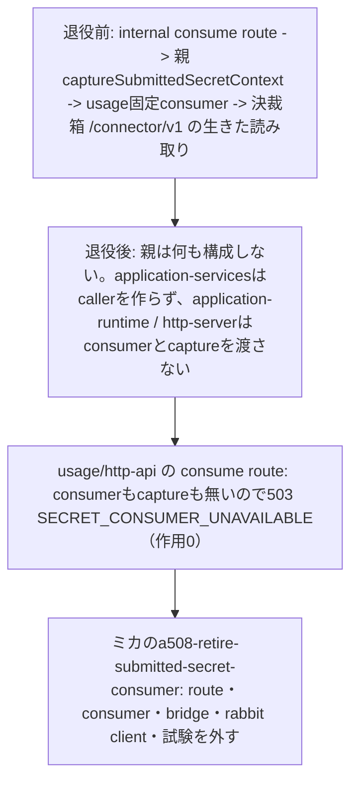

# 提出済secretの管理caller（退役, a490q4, 2026-11-22）

共通所有モリー、業務consumer/閉HTTPはusage所有ミカ。**この親側のcallerは退役した。** 理由（ミカ・オーナー側の合意 2026-11-22）: このconsumerは、2026-11-05の1件の作業（request 009fedc7-410a-4b15-ae0b-3d44ba510515、tool claude-rabbit9-auth-20261105、決裁 K-3JM9PS と K-6782UM）のためだけにあった。認証コードは一回限りで期限切れ、claim file（wx）が2回目を既に止めている。決裁箱のserver保管なし化（peer-channel移行）のあと、K-3JM9PSの生きた読み取りは通らないので、固定仕様だけを信じる形にもしない（固定値は「期待」にすぎず、本当にオーナーが答えた証拠は生きた読み取りだけ）。

状態の遷移: 退役前（接続）→ 親の配線を外す（本PR）→ routeは503（作用0）→ ミカの第二PRで消費側を外す → 将来の提出済secretは新しい決裁と新しい固定値から始める。どの段階にも待ちは無い。

親側で外したもの: `src/submitted-secret-caller.mjs`、`application-services` のcaller生成と注入口（`submittedSecretManagement`）と終了処理、`application-runtime` / `http-server` の受け渡し（`submittedSecretConsumer` / `captureSubmittedSecretContext`）、試験2本。ミカ側（消費側）は第二PRで外す。
