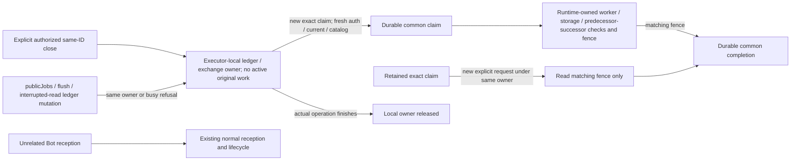
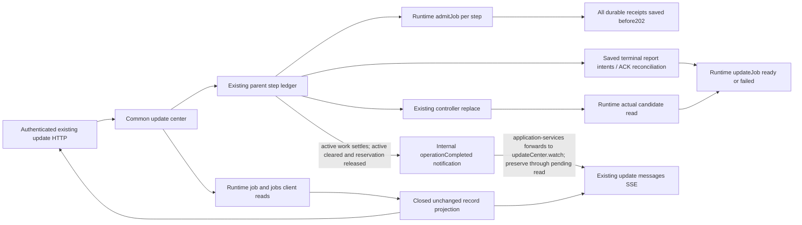
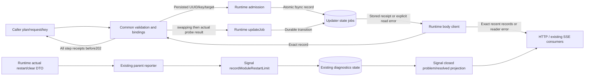
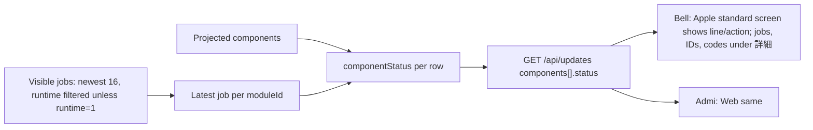
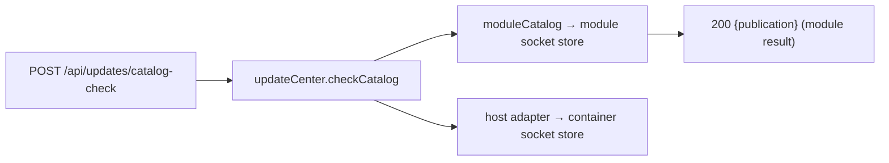

# Common update jobs: HTTP, SSE and activation

Runtime source contract: [runtime/update-jobs.md](../runtime/update-jobs.md). Owner: Molly for common projection, parent activation reports and normal main. Runtime owns the on-disk records/client/probes/restart observation; Signal owns diagnostic validation/storage/projection; Admi owns Web. Source and diagrams ship together. This contract is written before the corresponding code.

## Public API

| Existing update surface | Contract |
| --- | --- |
| POST /api/updates/plans | Existing preview only; no job is admitted |
| POST /api/updates/operations | Existing body plus optional idempotencyKey (1..128 printable ASCII); returns202 `{operation}` only after EVERY step's runtime admitJob receipt has been saved in the existing parent ledger |
| GET /api/updates/operations/:requestId | `{operation}` with optional `jobs:[record,...]` for new operations; records are freshly read from updater storage. Legacy operations have no invented job |
| GET /api/updates | Existing inventory plus `jobs:[record,...]`, newest16 across both updater clients; existing operation/previousOperation each retain their own jobs[]. `kind:"runtime"` jobs, runtime rows and runtime plans/operations appear only with `?runtime=1` ([runtime-updates.md slice D](../runtime/runtime-updates.md#inventory-plan-and-start-slice-d)); without it the body is the pre-Z-b2 shape |
| GET /api/updates/jobs/:kind/:jobId | `{job:record}` read directly from the corresponding updater client; kind is module or container, UUID is validated |
| GET /api/updates/jobs | `{jobs:[record,...]}`; same bounded stored records as inventory/SSE; runtime jobs only with `?runtime=1` |
| Existing messages SSE, type=updates | `at`, `topics:["updates"]`, `botIds:[]`, `roomIds:[]`, `all:false`, plus `jobs:[record,...]` (runtime jobs always removed: SSE has no opt-in and released apps share it) on success or `error:{code,message,path?,reason?}` on read failure; no fabricated state on error. Published only when the jobs/error body differs from the previously published one (fingerprint in http-events); never `all:true`, so clients refresh only the update screen. The parent ledger notifies on saved state change and on operation completion only; read-side refreshes (inventory snapshot host/install readback) never notify (2026-11-07 flood fix) |
| Unreadable record | HTTP503 `{error:"UNREADABLE",message:reason,path,reason}`; missing job retains runtime404 |

The job and problem projection remains Owner-only: existing internal update HTTP403 is retained, and the internal SSE server does not attach the Owner update watcher. Other internal SSE topics keep their existing behavior.

A record is the runtime's complete `bellteam.update-job.v1` record. `jobId/state/reason`, target and nanosecond decimal strings are forwarded unchanged. Six states only: queued/downloading/verifying/swapping/ready/failed. The common operation has no aggregate job state. Existing legacy parent phase/execution fields remain historical compatibility fields; screens use stored jobs and reader errors.

The caller idempotency key defaults to parent requestId. Same retained key + same plan reuses the parent operation and all step receipts; a different plan/key binding conflicts. Per-step backend keys are SHA256(JSON.stringify([parentKey,componentId])), ensuring the exact same bounded key is reused after a partial admission failure. Each step uses its persisted backend request UUID as jobId. Container uses the parent requestId; an installer-backed module reuses that same per-step UUID for startModuleInstall. No new aggregate ID exists. Partial admission produces no202; persisted successful receipts are retained and reused when the same parent key is retried. A partially admitted parent operation has `admission:"pending"` in GET/inventory until all receipts are saved. This is acceptance metadata, not a seventh job state; each admitted job still exposes only its stored six-state value.

A runtime step (single-target plan only) is admitted with `kind:"runtime"` and started through startModuleInstall; the worker completes it and the parent only projects the stored ready/failed record onto the operation, like a Host-completed container step. Installed/builtin steps call admitJob without an installer launch, then downloading/verifying around existing prepare, swapping before replace, and ready only after the runtime replace Promise includes a real candidate public probe. Failures persist a fixed failed reason. If an earlier module aborts, the parent reports failed for an admitted queued/unclaimed container step through the container client; runtime rejects this after an operation/claim exists. No container worker or activation is issued to close that record. Installer-backed steps use their preadmitted jobId/key with the signed installer plan. Historical operations are not replayed or rewritten. Parent restart reconciliation records concrete parent interruption for admitted parent-owned module jobs; it never guesses successful completion.

## Close-only function and data-flow delta

This accepted B delta changes the common executor contract for `close_without_activation`; the public DTOs, v1 persisted envelopes and existing routes remain unchanged. Runtime A ships in the same source diff; [its canonical function/DFD](../runtime/module-installer.md#current-bound-successor-of-an-immutable-termination-record) owns the original worker, storage, predecessor/successor validation and durable fence. An explicit authorized inspect alone can publish the immutable current-bound successor; finalize/read only consume an existing one. A and B require a matched formal source/image S for subsequent adoption; source completion deploys neither body nor companion, whose production baseline remains ecfc until a separate operational decision.

| Function / connection | Scoped contract and state transition |
| --- | --- |
| Close entry and local owner | The executor acquires its local ledger/exchange owner only with no active original work. Before a new claim it checks the exact original and plan, install unknown and apply not issued, other-step/host guards, claim identity, fresh Owner authorization, current and catalog bindings. Busy or invalid state refuses without changing normal Bot reception. No application-global mutex, native drain or conversation/writer drain is added. |
| All mutating read reconciliation | `publicJobs`, terminal-report flush and interrupted-job read reconciliation acquire the same local owner before their first await and hold it through every shared-ledger save. Already-owned callers use a private owned path; read-only projections need no extra writer. A close facing a prior owner refuses busy; operation finish releases ownership. Closed or ledger-faulted executors keep saved read-only projection available and perform no reconciliation writes. |
| New close claim | The local owner saves one existing-v1 decision/claim, invokes the runtime boundary, validates its matching fence and saves common completion. Assertions and fresh bindings remain checked around awaits. Uncertain outcomes preserve the same claim and original unknown; timeout is not cancellation or proof that work was unissued. |
| Retained close intent | Matching retained intent, including partial admission, is a no-admit/no-work/no-read-reconciliation barrier for the original. A later explicit authorized request takes the same owner and only reads the same claim's fence; it never creates a new claim or calls finalize again. Matching fence plus durable common completion converges the claim; otherwise the original remains unknown and intent retained. |
| Guard exit and ownership | Active work or a mutating reader exits by actual operation finish and owner release; a competing request receives busy and can make a new explicit request. A retained uncertain claim exits through matching-claim fence convergence and saved completion. No periodic retry, old-worker replay or inferred success is introduced. |

## Functions and data flow

| Function | Input | Output and owner |
| --- | --- | --- |
| Common start | Validated plan, requestId, optional caller key | Existing parent binding saved -> runtime admitJob for each step -> saved receipts ->202 |
| Common read | Operation bindings or bounded recent lookup | Runtime body-client job/jobs -> closed schema -> unchanged record |
| Activation | Admitted module job + existing adapter | Persist swapping -> replace/probe completion -> ready or failed |
| SSE | Existing update notification | Stored recent jobs or explicit reader error; coalesce concurrent reads and retain a final pending invalidation. After active module work clears and releases its exchange reservation, an internal operationCompleted notification invalidates once even when jobs/error are unchanged, so clients re-read idle capability/notice. Ordinary identical bodies remain suppressed; scope = topic updates only (all:false) |
| Terminal report reconciliation | Saved ready/failed report intent in existing parent ledger | Retry only idempotent updateJob ACK; never replay controller/business work |
| Restart visibility | Runtime active/clear DTO | Existing reporter -> Signal writer -> closed problems projection -> existing update screen |

`GET /api/updates` also includes `problems[]` from Signal's `moduleRestartLimitProblems(await diagnostics.list('all',1000))`. Each row has exactly fingerprint/status/kind/moduleId/count/windowSeconds/lastExit{code,signal}/lastReason. Status is open or resolved; resolved retains the last active evidence. The reporter's acknowledged write invalidates existing update SSE so Web refetches the inventory. Usage/conversation candidate probes capture the documented trusted actor and matching current generation lease, call the candidate channel directly, track actual completion, and release authority only at that completion. The separate BugHub-key /api/admin/logs server and raw diagnostic_log/investigation are not exposed to Web. No new diagnostics writer, timer, restart policy, privilege policy, rollback, replay or production operation is added.

## Completion invalidation contact

`createModuleUpdateExecutor.start` owns the actual active Promise; its existing finally clears active and releases the exchange reservation before notifying `{operationCompleted:true}`. `application-services` and `updateCenter.notify/watch` forward this internal hint unchanged. The updates-only branch of `createMessageEvents` consumes it without adding a public SSE field: bypass identical jobs/error suppression for the completed invalidation, including when a jobs read is already in flight. Ordinary notify/read traffic remains deduplicated and never performs an inventory read in the event publisher. Web and Apple keep the existing updates event -> GET inventory flow. Failure completion invalidates too, without implying successful update or changing persisted job/operation semantics.

No new guard, lock, timeout, retry, queue, or public field is introduced. The existing one-read/pending coalescing is retained; the extra boolean retains completion until the next existing read. Source membership stays integration/application-services, update-center and update-module-executor; conversation/module.json continues to list http-events, whose common updates bridge alone changes. HTTP SSE and common executor run in the body, so a signed conversation/Web asset alone does not activate this repair.

N102 confirmed this existing updates-only contact scope; conversation retains the file ownership. The four changed body files are absent from the members/conversation/execution `*_FILES` archive inventories in `scripts/web_gateway_artifact.py`; those already-dispatched signed assets are unaffected by this source change. `http-server` imports `http-events` in the body. Keep the fixed signer source rather than republishing those assets for this repair.

## Per-component status line (2026-11-08)

Owner defect: the standard screens rendered `jobs[]` as a flat history (same part repeated, raw UUID/state/code, superseded failures looking current). Fix: the server owns one plain-Japanese status per component; clients show it instead of the raw job list.

| Function | Input | Output and owner |
| --- | --- | --- |
| `componentStatus(component, jobs, now)` in `update-center.mjs` | One projected component row + the same visible `jobs[]` the response carries | `components[].status` (additive, optional in schema): `{line, tone, actionRequired, action, latestJob}`. Molly owns wording and rules |
| Latest job per part | `jobs[]` with `target.moduleId === component.id`, max `updatedAtNs` | `latestJob:{jobId,kind,state,outcome,at,reason}` or null. Only the latest job per part is ever summarized, so a failure disappears as soon as a later job exists for that part. shortcut: only the bounded newest-16 window is seen; a part with no job in it gets no job sentence |
| Line | current origin/version, comparison.state, published version, latest job, availability | `line` = installed sentence with the short version name (first 7 hex of `sourceCommit`, else of a hex `version`; none when neither) + update sentence (names the new version when one is available) + latest-job sentence with JST time and the failure in words. No job IDs or codes. Owner 2026-11-08: the page must say each part's current version |
| Body version comparison (`update-host-adapter.snapshot`) | container `current` = the body's builtin source commit (`digest:null`; the body cannot read its own image digest); `published` = catalog release `{sourceCommit, versionId:digest}` | `up_to_date` when the digests match, or when current has no digest and its `sourceCommit` equals the release's `sourceCommit` (a published container release is one image per commit); then `capability.reason = UPDATE_ALREADY_CURRENT`. Before 2026-11-08 only digests were compared, so the running published body showed 新しい版があります |
| Failure that no longer matters | latest job failed, part running and `comparison.state === "up_to_date"` | no job sentence: the part already runs the newest version, so the old failure is not shown (it stays in `latestJob` for 詳細) |
| Failure after a kept swap | latest job failed with `reason.code === "HOST_UPDATE_AITERM_STATE_FAILED"` (container-update-bundled.md: swap kept, `execution: succeeded`, `verification: failed`) | always shown, even when up_to_date: the failure happened on the newest version itself. Sentence names the step and says the new version runs (never 元の版のまま); `actionRequired:false` |
| Need for the user | failed latest job + `availability.available === false` | `tone:"attention"`, `actionRequired:true`, `action` text. A failed job while the part still runs (or the body answering, for `container`) is `actionRequired:false` |

Compatibility: additive only. Released Apple (Codable ignores unknown keys) and Web (`validUpdateInventory` checks consumed keys only) keep working; `jobs[]` stays unchanged for 詳細 and old clients. New clients must treat a missing `status` (older server) by falling back to their current rendering. SSE is unchanged (it still triggers GET).

## Update-path guard sweep (Owner 2026-11-08: "ハッシュで確認してるんだから止める必要ない")

Rule: signature/hash verification stays; a stop, refusal or wait stays only with a named protection and a self-exit (guards.*). Unnamed ones are removed, not tuned.

| Removed (file) | Was | Now |
| --- | --- | --- |
| module-process `replace` drain/quiesce/export failure | old module timed out or refused, was resumed, and the job failed | old child is stopped like a crash (exit, then SIGKILL after 5 s); the candidate launches with no handoff and restores from durable state, the same path as after an unexpected exit |
| http-gateway-process `replace` drain failure or 5 s timeout (2026-11-09) | old gateway was SIGKILLed, then the replace rolled back to it and the job failed (UPDATE_MODULE_FAILED); in production the old gateway kept taking new keep-alive requests during the drain | the drain error is ignored: `stop()` always waits for the old child to end, then the new version starts. A new-version start failure still restarts the previous version |
| module-process / execution-generation `replace` and `reserve` when unavailable or never started | NOT_ACCEPTING: a broken version could never be updated | replaceable; a missing or dead old instance is skipped. On success the module is initialized |
| module-process / execution-generation `exclusive` and `reserve` while recovery or another operation runs | UPDATE_IN_PROGRESS 409 | turns queue; the reservation itself (two exchanges at once) still refuses and exits when its completion settles |
| update-module-executor `checkCurrent`, apply re-check, plan | refused when the adapter was unavailable | only a changed current/generation refuses (wrong target) |
| update-module-executor `plan` during an exchange or an unknown Host install | MODULE_EXCHANGE_BUSY 409 | planning always answers; `start`/`reserveExchange` still refuse a second exchange, which exits when the first settles or its Host result becomes known |
| update-module-executor plan TTL (now+10 min) | plans expired after 10 min | expiry = catalog / Host plan expiry; a catalog-free rollback plan gets 24 h only to bound storage; start re-checks current and publication |
| update-module-executor ledger write fault | sticky: every later operation refused until process restart | notice only; the next save rewrites the whole ledger atomically and clears it |
| update-module-executor ledger capacity (4096 / 16 MiB at save and load) | permanent refusal, and a ledger over the bound was unloadable | cleanup instead: over 1000 operations, the oldest completed/failed go first (each component's latest completed one stays for rollback; unknown stays), then expired unused plans |
| update-host-adapter plan capacity (4096 files) | permanent refusal of container plans | removed |
| update-module-executor inventory `moduleInstallCapabilities` throw | an unreachable Host failed the whole inventory | only the offered rows show HOST_MODULE_INSTALL_UNAVAILABLE |
| update-center `checkCatalog` | refreshed only the module Host store; the container row waited for a 30 min timer | refreshes both stores at once (section below) |

Kept, each with its protection and exit: signature/hash/trust (catalog, sigstore attestation, archive and per-file SHA, receipt/fence hashes); wrong target (plan-current/generation binding, requestId/job binding, entry/source/arch); path safety (no-follow, owner/mode, safe tar paths); state compatibility (data loss); one exchange at a time (exchange mutex/reservation, exits when the exchange settles); no replay of unknown results (exits by reading the same request); Owner authorization; explicit container-restart consent; request-shape validation. Waits are bounded (socket 5 s, catalog check 360 s, init/ready 45 s, handover 70 s) or end on the awaited work.

Activation: every file above is body code, so these take effect at the next approved body swap.

### Catalog check reaches both Host stores (2026-11-08)

Found at the final-modularization swap: module rows read `/run/bellteam-updater/update.sock` and the container row reads `/run/bellteam-container-updater/update.sock`, each with its own catalog store. `POST /api/updates/catalog-check` only refreshed the module store, so the container row waited for its 30 min `bellteam-update-catalog-refresh.timer`. Now `updateCenter.checkCatalog` calls `moduleCatalog.checkCatalog` and `host.checkCatalog` (update-host-adapter → container client `checkCatalog`) together and returns the module result as before (`{publication}` unchanged). A failed container check does not fail the response; it is recorded as diagnostic `UPDATE_CATALOG_CHECK_FAILED` (module `update`) and that row shows its own publication status.

### Follow-ups (2026-11-08, after #568)

- `HOST_MODULE_SOURCE_CHANGED` removed (Trony boundary ruling: module replacement is the box's). `moduleInstallCapabilities` no longer requires the Host installer source to equal `/app/distribution.json`; the protection is the module-install protocol (`moduleInstallProtocol === 1`), which is unchanged. After a body swap, modules stay installable before the Host installer code is reinstalled.
- Host plan directory cleanup: when the executor's ledger cleanup drops an expired, never-started container plan, it also calls `host.forgetPlan(planId)`, which removes that one plan file (missing is fine).

