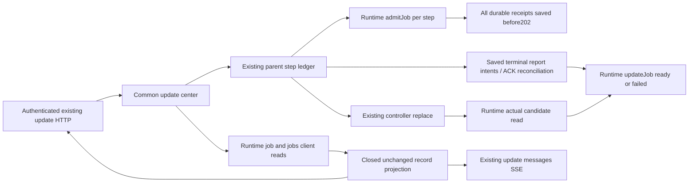
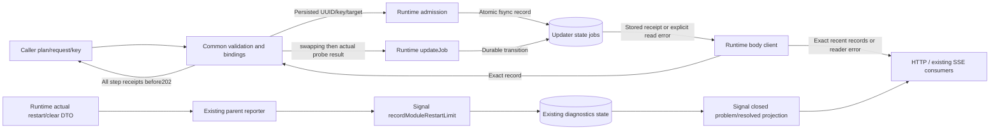

# Common update jobs: HTTP, SSE and activation

Runtime source contract: [runtime/update-jobs.md](../runtime/update-jobs.md). Owner: Molly for common projection, parent activation reports and normal main. Runtime owns the on-disk records/client/probes/restart observation; Signal owns diagnostic validation/storage/projection; Admi owns Web. Source and diagrams ship together. This contract is written before the corresponding code.

## Public API

| Existing update surface | Contract |
| --- | --- |
| POST /api/updates/plans | Existing preview only; no job is admitted |
| POST /api/updates/operations | Existing body plus optional idempotencyKey (1..128 printable ASCII); returns202 `{operation}` only after EVERY step's runtime admitJob receipt has been saved in the existing parent ledger |
| GET /api/updates/operations/:requestId | `{operation}` with optional `jobs:[record,...]` for new operations; records are freshly read from updater storage. Legacy operations have no invented job |
| GET /api/updates | Existing inventory plus `jobs:[record,...]`, newest16 across both updater clients; existing operation/previousOperation each retain their own jobs[] |
| GET /api/updates/jobs/:kind/:jobId | `{job:record}` read directly from the corresponding updater client; kind is module or container, UUID is validated |
| GET /api/updates/jobs | `{jobs:[record,...]}`; same bounded stored records as inventory/SSE |
| Existing messages SSE, type=updates | Existing at/topics/botIds/roomIds/type/all plus `jobs:[record,...]` on success or `error:{code,message,path?,reason?}` on read failure; no fabricated state on error |
| Unreadable record | HTTP503 `{error:"UNREADABLE",message:reason,path,reason}`; missing job retains runtime404 |

The job and problem projection remains Owner-only: existing internal update HTTP403 is retained, and the internal SSE server does not attach the Owner update watcher. Other internal SSE topics keep their existing behavior.

A record is the runtime's complete `bellteam.update-job.v1` record. `jobId/state/reason`, target and nanosecond decimal strings are forwarded unchanged. Six states only: queued/downloading/verifying/swapping/ready/failed. The common operation has no aggregate job state. Existing legacy parent phase/execution fields remain historical compatibility fields; screens use stored jobs and reader errors.

The caller idempotency key defaults to parent requestId. Same retained key + same plan reuses the parent operation and all step receipts; a different plan/key binding conflicts. Per-step backend keys are SHA256(JSON.stringify([parentKey,componentId])), ensuring the exact same bounded key is reused after a partial admission failure. Each step uses its persisted backend request UUID as jobId. Container uses the parent requestId; an installer-backed module reuses that same per-step UUID for startModuleInstall. No new aggregate ID exists. Partial admission produces no202; persisted successful receipts are retained and reused when the same parent key is retried. A partially admitted parent operation has `admission:"pending"` in GET/inventory until all receipts are saved. This is acceptance metadata, not a seventh job state; each admitted job still exposes only its stored six-state value.

Installed/builtin steps call admitJob without an installer launch, then downloading/verifying around existing prepare, swapping before replace, and ready only after the runtime replace Promise includes a real candidate public probe. Failures persist a fixed failed reason. If an earlier module aborts, the parent reports failed for an admitted queued/unclaimed container step through the container client; runtime rejects this after an operation/claim exists. No container worker or activation is issued to close that record. Installer-backed steps use their preadmitted jobId/key with the signed installer plan. Historical operations are not replayed or rewritten. Parent restart reconciliation records concrete parent interruption for admitted parent-owned module jobs; it never guesses successful completion.

## Functions and data flow

| Function | Input | Output and owner |
| --- | --- | --- |
| Common start | Validated plan, requestId, optional caller key | Existing parent binding saved -> runtime admitJob for each step -> saved receipts ->202 |
| Common read | Operation bindings or bounded recent lookup | Runtime body-client job/jobs -> closed schema -> unchanged record |
| Activation | Admitted module job + existing adapter | Persist swapping -> replace/probe completion -> ready or failed |
| SSE | Existing update notification | Stored recent jobs or explicit reader error; coalesce concurrent reads and retain a final pending invalidation |
| Terminal report reconciliation | Saved ready/failed report intent in existing parent ledger | Retry only idempotent updateJob ACK; never replay controller/business work |
| Restart visibility | Runtime active/clear DTO | Existing reporter -> Signal writer -> closed problems projection -> existing update screen |

`GET /api/updates` also includes `problems[]` from Signal's `moduleRestartLimitProblems(await diagnostics.list('all',1000))`. Each row has exactly fingerprint/status/kind/moduleId/count/windowSeconds/lastExit{code,signal}/lastReason. Status is open or resolved; resolved retains the last active evidence. The reporter's acknowledged write invalidates existing update SSE so Web refetches the inventory. Usage/conversation candidate probes capture the documented trusted actor and matching current generation lease, call the candidate channel directly, track actual completion, and release authority only at that completion. The separate BugHub-key /api/admin/logs server and raw diagnostic_log/investigation are not exposed to Web. No new diagnostics writer, timer, restart policy, privilege policy, rollback, replay or production operation is added.
