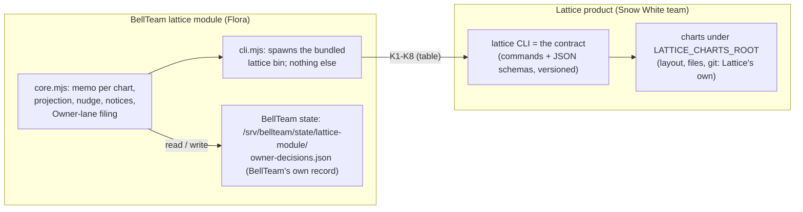

# Lattice工程表 (lattice)

Owner: Flora (bot-7e777fe5). Assigned by the Owner through Trony on 2026-11-11; public contract ruled by Trony on 2026-11-11.

This module brings [Lattice](https://github.com/kitepon/Lattice) (Snow White's product: Plan Alice, Store Ludmila, Runtime Tove) into BellTeam. Lattice internals and every change to Lattice itself belong to Snow White (bot-fc291ae4); this module only runs a released Lattice CLI. The module owns:

- **the charts**: one Lattice store per project (Owner 2026-11-11: one chart per project, no edit permissions, no membership, anyone can open; members follow the coordinator's chart and may make their own);
- **the seat tool** `lattice`: every seat on every harness and OS (container and Owner-terminal seats) reads and writes charts through the bellteam MCP, with no install, PATH or env on the seat;
- **the app read surface**: chart list, chart snapshot and SSE, already projected into who waits for what and who is producing it. Each app draws it natively from the [screen spec](screen-spec.md): Apple first (Rapi), Web (Flora, [web/lattice-chart.md](../web/lattice-chart.md)), Windows (Anis).

Connections are in [module.json](module.json). The overall [function map](../../feature-map.md), [data flow](../../data-flow.md) and [ownership](../../module-ownership.md) trace callers and providers.

Startable notices (a18, Lattice 0.90.0; waiting marks 0.92.0): the module wakes the Bots waiting on them (L10-L12). Prompt sweep (task lattice-idle-bot-20261112/module-prompt; Owner 2026-11-12: all prompting is this module's, Lattice gives facts only): every minute the module reads every chart's cards (the same display read the screens use), sends ONE prompt per lane Bot that is not running and has an in-progress or a startable task, and hands each Owner-lane task once to the chart's creator Bot, which files the one plain-Japanese Approval Box request for that decision (L13-L15, L18-L19; Owner 2026-11-14: script-made cards were unreadable). Done -> "can start" notices go only to Bots that set a waiting mark (L10; plain notices to the lane were abolished on 2026-11-13 once the sweep was proven in production: an idle lane Bot learns its startable task from the sweep). Skipped on purpose (v1): Lattice's Sensor, independence and runtime (Tove) inside BellTeam; task notes (a separate Lattice chain, not in the display read); edits from the apps (seats edit through Lattice); migrating the coordinator's Markdown process table (needs a ruling).

## Process placement

Same shape as [work-graph](../work-graph/README.md): the module runs as its **own module child**, so every change ships as a module-only exchange without stopping the body. The Lattice package (`@quolu/lattice`, the version recorded in the module payload lock) is bundled in the signed module, so a Lattice version bump is a module-only exchange too.

| Part | Owner |
| --- | --- |
| `src/lattice-protocol.mjs`, `src/lattice-ipc.mjs` (both ends), `src/lattice-dispatcher.mjs`, `src/lattice-entry.mjs`, `src/lattice/{core,cli,projection}.mjs` (child) | Flora |
| `src/lattice/http-api.mjs` (thin body HTTP/SSE handler), `src/lattice/mcp.mjs` (tool schema + handler) | Flora |
| Lattice facade (subscribers, refresh timer, one call chain), effect handler `members.list`, module process/start binary/locks, HTTP mount and auth, MCP registration in `mcp-tools.mjs`, packaging/catalog/updater, `publish-lattice.yml` | Molly |
| Lattice CLI behaviour, schemas, store format | Snow White |

## BellTeam <-> Lattice connection (task a102)

Owner 2026-11-14: 「プロダクト間の繋ぎはしっかりと図で定義」「直接参照は…サイレントに破壊されるから危険。契約されてる口でやり取り」. Lattice (the `@quolu/lattice` product, Snow White's team) and this module (Flora) meet only at Lattice's contracted interface, agreed in chart task a101. Since a102 (Lattice >= 0.101.1) the module uses only these rows; the Function map and Data flow below follow them.



Agreed with Snow White 2026-11-14 (a101; contract text: Lattice PR #174, `docs/architecture/dfd-charts-read.md`, function map "Host connection (a101)"). Versions: K3 `trees` in Lattice 0.100.0; K1, K2, K4, K5, K7, K8 in 0.101.0; K4 with `--created-by` alone in 0.101.1 (the module asks >= 0.101.1).

| Id | BellTeam -> Lattice (contract) | What BellTeam gets | Replaces today's |
| --- | --- | --- | --- |
| K1 | `lattice charts list --json` (one process, every chart under `LATTICE_CHARTS_ROOT`) | `lattice.charts_list_result.v1` `{charts_root, charts: [{project_id, name, created_by, created_at, source}], findings}`; `source` = opaque change token (moves on a display-source or identity change); an unreadable chart has `source: null` and a finding; root unset or missing -> `charts: []` + finding `charts_root_unset` | `readdir` of the root + `.lattice` checks; `.bellteam-chart.json` reads; one `display source` per chart |
| K2 | `lattice charts source [--project <id>]... --json` (one process; no `--project` = all) | `lattice.charts_source_result.v1` `{charts: {"<id>": "<source>" or null}}` (null = no chart) | per-chart `display source` (refresh tick, SSE first snapshot, minute sweep); `exists` checks |
| K3 | `todo display read --json` | `lattice.todo_display_read_result.v1` with `trees: [{tree_id, tasks: [{plan_key, task_id}], total, finished}]` (0.100.0) | unchanged command; addressed by K8 |
| K4 | `lattice chart set [--name <1-40>] [--created-by <id>] [--no-code-lane <lane>[,<lane>...]]` (at least one; `--no-code-lane` 0.107.0: tasks in those lanes skip the enforced start gates 1-3, empty string clears it, same value again is `unchanged: true`; `--created-by` alone keeps the name, null stays null) | `lattice.chart_set_result.v1` `{project_id, name, created_by, created_at, unchanged}`; creator = `LATTICE_SEAT_ID` of the run that creates the Store, never overwritten; `--created-by` applies only while `created_by` is null (one-time migration from `.bellteam-chart.json`, re-run harmless). Lattice keeps it in its own store | `.bellteam-chart.json` writes (name, createdBy) |
| K5 | seat surface unchanged (`plan`, `todo`, `status`, `session-context`, `help`, `--help`, `--version`) | the command's JSON; the first Store-creating command (`plan create`, `chart set`) makes the chart dir (0700) and repo; reads never create; on failure only a dir made in that run is removed; a symlink or non-dir path -> `CHART_PATH_INVALID` | BellTeam `mkdir` / `git init` / prune. A rename of a chart that does not exist stays refused here (K2 null -> `LATTICE_CHART_NOT_FOUND`) so naming never creates a chart |
| K6 | `todo blockers --json`, `todo unblock` (`LATTICE_SEAT_ID=owner`), `todo notice list/ack` | as today | unchanged commands; addressed by K8 |
| K7 | `lattice chart repo bind --url <u> --branch <b>` once; `lattice chart repo sync --json` before a seat run on a code chart (at most every 120 s, as today) | `lattice.chart_repo_result.v1` `{project_id, status: current/synced/dirty/diverged/failed, tip, accepted_tip, sensor}`; depth-1 fetch, fast-forward only from `accepted_tip`, never reset or force, then sensor sync (init the first time) | `code-chart.mjs` git commands and `.git/info/exclude` writes inside the chart dir |
| K8 | env `LATTICE_CHARTS_ROOT` + `LATTICE_PROJECT_ID` on every call (both set -> Lattice resolves the chart); seat argv unchanged | - | BellTeam passing `cwd = <root>/<projectId>` (knowing the layout) |

Rules: BellTeam never imports Lattice source files, never reads or writes inside `LATTICE_CHARTS_ROOT`, and keeps its own data (the Owner-lane filing record) in its own state directory `/srv/bellteam/state/lattice-module/` (server uid, beside the charts root, not inside it). Speed (a95) is measured and fixed on K1/K2 (one process per call, not per chart). The hide/count rule (a96) rides on K3's `trees` (a100). This table changes only with the a101 contract.

Removed by a102: the charts-root scan and `.lattice` checks, the per-chart `display source` call, `.bellteam-chart.json` (name and creator now Lattice's, K4), BellTeam's `mkdir` / `git init` / prune of chart dirs (K5), the code-chart git commands and `.git/info/exclude` writes (K7), and `.bellteam-owner-decisions.json` inside the charts root (now `/srv/bellteam/state/lattice-module/owner-decisions.json`). One-time move (`cli.migrateLegacy`, at the first `deliver` of a child generation; shortcut, removed after the release that ran it): each sidecar's name and creator go to Lattice through one `chart set [--name] [--created-by]` each only when it adds something (name when it differs, creator only while Lattice's is null; an unnamed chart gets its creator with no made-up name), the sidecar is deleted, and the old filing record is renamed into BellTeam's state dir when the new one does not exist yet.

## Function map

```mermaid
flowchart LR
  Seats["every seat (container + Owner terminals, all harnesses)"]
  Apps["Apple (Rapi) / Web (Flora) / Windows (Anis)"]
  Ext["Approval Box extension module (Delta; R3)<br/>decision-linked tasks; calls the facade in the body"]
  subgraph Body[body process, stable]
    MCP["bellteam MCP: tool lattice<br/>src/lattice/mcp.mjs (Flora)<br/>registered by Molly"]
    API["src/lattice/http-api.mjs (Flora)<br/>GET /api/lattice/charts<br/>GET /api/lattice/charts/:id<br/>GET /api/lattice/charts/:id/events<br/>GET /api/lattice/blockers<br/>POST /api/lattice/charts/:id/unblock (Owner, unblock only)"]
    Facade["lattice facade (Molly)<br/>SSE subscribers per chart,<br/>refresh timer, one call chain"]
    Effects["effect handlers (Molly):<br/>members.list, messages.send, turns.read,<br/>decisions.file, decisions.read"]
    ABox["Approval Box connector /connector/v1<br/>(Nayuta; body connection)"]
    Msg["messenger.sendmessage<br/>(public send path; wakes the seat)"]
    PChan["createLatticeParentChannel (Flora)"]
  end
  subgraph Child[lattice child, module-only exchange]
    CChan["createLatticeChildChannel (Flora)"]
    Disp["lattice-dispatcher (Flora)<br/>charts / chart / refresh / run"]
    Core["core.mjs: per-chart memo, epoch, version,<br/>token (own + external predecessors' charts),<br/>view key (roster + their memo versions)"]
    Cli["cli.mjs: spawn node on bundled lattice bin with LATTICE_PROJECT_ID (K8)<br/>seat runs (allowlist), host calls: charts list/source,<br/>chart set, chart repo bind/sync (K1, K2, K4, K7); bounded output"]
    Proj["projection.mjs: cards, edges, waits, producers"]
    Notices["notices.mjs: startable notices<br/>-> waiting Bots only, ack, re-list"]
    Nudge["nudge.mjs: every chart's cards (memo)<br/>-> ONE prompt per lane Bot not running;<br/>a lane that is no Bot -> the chart creator Bot (reassign)"]
    Owner["owner-decisions.mjs: Owner-lane task -> chart creator Bot once (record);<br/>legacy Lattice-filed requests: answer -> creator, else cancel + hand over"]
    Rec["/srv/bellteam/state/lattice-module/owner-decisions.json<br/>(BellTeam's own state, outside Lattice's root)"]
    OwnerTask["owner-task.mjs: the Owner actor, confined to<br/>decision tasks (approval-box/dec-*) and linked cards (L20)"]
    Stops["blockers.mjs: every chart todo blockers -> stop list;<br/>Owner unblock (stopId -> todo unblock as owner)"]
    Code["code-chart.mjs: code charts (bellteam):<br/>before a seat run (every 120 s) chart repo bind (once) + chart set --no-code-lane (once, K4) + chart repo sync (K7)"]
  end
  subgraph SeatGraph["seat side, runs as the member (no child, no server uid); Lattice's code graph on the member's own clone (a230)"]
    E1["config/lattice-harness-entries.json (E1) + E2 item lattice (Flora)<br/>CLI registration writes it into each seat's claude/codex/grok/cursor/gemini config"]
    GMcp["/usr/local/bin/lattice-mcp -> bundled bin/lattice-mcp.mjs (Lattice)<br/>stdio; lattice_sensor_explore/search/callers/callees/impact/node/files/status; projectPath = the clone"]
    GInit["/usr/local/bin/lattice-sensor-init [path] (scripts/lattice-sensor-init, Flora)<br/>then lattice sensor init (which excludes .lattice/sensor/, g2)"]
    Clone["member's own clone: <clone>/.lattice/ (index, git-excluded)"]
  end
  Store["charts under LATTICE_CHARTS_ROOT=/srv/bellteam/state/lattice<br/>(layout, files, git, repo checkout: Lattice's own)"]
  Repo["GitHub kitepon/BellTeam main<br/>(public, https, no credentials)"]
  Reg["members.registry"]
  Seats -->|tools/call lattice| MCP --> Facade
  E1 -->|"registers (L22)"| GMcp
  Seats -->|"tools/call lattice_sensor_* (L22)"| GMcp -->|"read + watch"| Clone
  Seats -->|"shell, once per clone (L23)"| GInit -->|"sensor init"| Clone
  Apps -->|JSON / SSE| API --> Facade
  Facade -->|root calls| PChan <-->|IPC| CChan --> Disp --> Core
  Core --> Cli -->|lattice CLI only (K1-K8)| Store
  Core --> Proj
  Core -->|before a seat run on a code chart| Code -->|chart repo bind / sync (K7)| Cli
  Store -.->|Lattice fetches the repo itself| Repo
  CChan -->|effect inside a root call| PChan --> Effects --> Reg
  Effects -->|messages.send| Msg
  Facade -->|"deliver once per child generation (onGeneration)"| PChan
  Core -->|after a release write / on deliver| Notices -->|"todo notice list|ack"| Cli
  Facade -->|"nudge every 1 min (L13)"| PChan
  Core -->|"on nudge: memo projections (L14)"| Nudge
  Core -->|on nudge| Owner -->|"read / write (L18)"| Rec
  Ext -->|"facade.ownerTask / facade.link (L20)"| Facade
  Sched["Body scheduler + registry (BotScheduler, BotRegistry removal hook)"] -->|"facade.run: fixed 接続 verbs as the schedule's owner Bot (L21)"| Facade
  Ext -->|"facade.chart / facade.charts (read)"| Facade
  Core -->|"root ownerTask: confined args, LATTICE_SEAT_ID=owner"| OwnerTask -->|"lattice CLI"| Cli
  Core -->|"root link: card is decision-driven"| Rec
  Core -->|"on blockers / unblock (L16-L17)"| Stops -->|"todo blockers --json; todo unblock (LATTICE_SEAT_ID=owner)"| Cli
  Nudge -->|"turns.read, messages.send (L15)"| CChan
  Owner -->|"turns.read, messages.send (L18); decisions.read, decisions.cancel (L19, legacy requests)"| CChan
  Effects -->|"decisions.file / decisions.read / decisions.cancel"| ABox
```

## Data flow

| ID | From -> to | Data | Notes |
| --- | --- | --- | --- |
| L1 | seat -> body MCP | `lattice {project, name?, args, input?}` | `from` = caller Bot id from the seat credential (Kiro: container, account and Owner-terminal seats alike; a fork seat resolves to its parent Bot). Open to forks: charts are outside `/srv/bellteam/bots/*` |
| L2 | MCP handler -> facade -> child | root `run {from, projectId, args, input, name?}` (the facade passes `name` only when given) -> `{exitCode, result, stdout, stderr}` | After a run, the facade refreshes that chart at once |
| L3 | child -> Lattice CLI | `process.execPath <bundled>/@quolu/lattice/bin/lattice.mjs <args>` with cwd = Lattice HOME and env `{PATH, HOME=/srv/bellteam/state/lattice-home, LATTICE_SEAT_ID=from, LATTICE_DASHBOARD_AUTOSTART=0, LATTICE_CHARTS_ROOT=/srv/bellteam/state/lattice, LATTICE_PROJECT_ID=<projectId>}` (K8: Lattice resolves the chart under the root; BellTeam never builds the chart path) (the charts root, Lattice 0.99.0: a task may wait on a task of another chart there, read only; without it Lattice refuses a cross-chart connect `charts_root_unset` and reads every cross-chart predecessor as not finished) | Lattice makes the chart dir and repo on its first store-creating command and records the creator from `LATTICE_SEAT_ID` (K5); a command on a missing chart answers `CHART_NOT_FOUND`. Lattice's own lock protects the store; in the child writes (`run`, `unblock`, `deliver`, `nudge`) run one at a time in arrival order; reads (`charts`, `chart`, `refresh`, `blockers`, and a seat `run` that `latticeRunReads(args, input)` in `src/lattice-protocol.mjs` classifies as read-only: `--version`, `--help`, `help`, `status`, `session-context`, `plan show`, `todo show|status|blockers|display`, `todo note list`, `todo notice list`, never with `input` or `name` (a named run renames the chart: a write, ordered with the other writes; Epinel #1393); Centi Z2 lab 2026-11-14: a seat `--version` waited 37 s behind a write) never wait behind a write and run beside it; a read-only seat run on an existing chart also skips core's per-chart lock and the code-chart maintenance (on a chart that does not exist yet it keeps the lock, because the run makes and prunes the chart dir) (Lattice's display read and blockers take no store lock; the memo tolerates two syncs of one chart; seat runs on one chart stay serialized by the per-chart lock). Incident 2026-11-14 05:05-05:30 UTC (Snow White, Trony): a `todo add` on the large plan bellteam-dev-added took ~40 s of Lattice CPU, and every read (list 36-109 s, chart 51-85 s) queued behind such writes |
| L4 | child -> Lattice (read) | change tokens from `lattice charts list --json` (K1, every chart with name, creator and `source` in one process, for `charts` / `nudge` / `blockers` / `deliver`) or `lattice charts source --project <id>... --json` (K2, one process for the asked charts: `chart`, `refresh`, external predecessors' charts; null = no chart), and `lattice todo display read --json` -> `lattice.todo_display_read_result.v1` `{state, store, verified_at, source, inconsistency, dropped_members}` | Minimum Lattice version = `@quolu/lattice` 0.85.5 (first release with these two reads). With no store yet, `read` returns `state: "unavailable"`; `source` fails (STORE_INCONSISTENT) before Lattice 0.95.0, and a failed source counts as a probe failure, so a full read follows; from 0.95.0 `source` exits 0 with `project_id: null`, `manifest_digest: null`, `members: []` and a `STORE_UNINITIALIZED` diagnostic, a stable token that changes when the Store is created. The token of a chart = its own source plus, for each other chart its last projection has an external predecessor on, that chart's source (task a95). Full read on token change, first observation, probe failure (`null` token), after a run (dirty), or a failed last read (dirty). Up to 16 charts sync at once, a new one starting as soon as one ends (a pool, not batches: production 2026-11-14 after a102, warm list 7.6-13 s because each batch of 16 waited for its slowest ~2 s read, four batches in a row). No time ceiling (task a95, Owner 2026-11-14 「工程表がすごく遅い」: the 30 s re-read of every chart cost ~2 s of spawns per list call; production 2026-11-14: 0.15 s per `display source` spawn). A roster change, or a version change of an external predecessor's chart memo here (its name, titles and producers as this child last read them), with an unchanged token re-projects the kept read (no CLI; before 2026-11-14 the memo version was in the token, so one busy chart's change re-read every chart waiting on it, one more round per link) |
| L5 | child -> parent effect | `members.list {}` -> `{members:[{id,name,color,avatarVersion,deleting}]}`, once per root call that syncs a chart (task a95: every sync compares the roster key `[failed, roster]`) | Same effect and validator as work-graph. A failed read keeps the last roster (`degraded:['members']`) |
| L6 | apps -> body API -> facade -> child | `charts {}`, `chart {projectId}`; SSE: `refresh {projectIds}` every `nextRefreshMs` while subscribers exist | Snapshot pushed whole on each change |
| L7 | child -> Lattice CLI (K4) | a seat `run` with `name`: `lattice chart set --name <name> --json` with `LATTICE_SEAT_ID=from`; a rename alone needs an existing chart (K2 null -> `LATTICE_CHART_NOT_FOUND`); with a command, the name is set after the command succeeds and the chart exists, so a refused command never leaves a named empty chart. The creator is Lattice's (`created_by`, the seat whose run created the store, never overwritten) | Lattice keeps both in its store (`.lattice/chart.json`, Lattice 0.101.0); BellTeam reads them from K1 |

| L8 | child -> Lattice CLI (K7) | before a seat run on a code chart, at most every 120 s: `lattice chart repo bind --url <url> --branch <branch> --json` once per child generation, then `lattice chart set --no-code-lane approval-box --json` once per child generation (a234; the bellteam chart carries the Owner-wait lane so enforced start gates 1-3 do not hold 決裁箱 tasks; `lattice.chart_set_result.v1`, idempotent), then `lattice chart repo sync --json` -> `lattice.chart_repo_result.v1` `{status: current/synced/dirty/diverged/failed, tip, accepted_tip, sensor, failure?: {step, message}}` | Lattice owns the checkout, git and sensor: depth-1 fetch the first time and without depth after (history stays connected, 0.107.0), fast-forward only from `accepted_tip`, never reset or force (K7). Only `bellteam` is a code chart (`CODE_CHARTS`). A status other than current/synced is one log line `lattice-code <id> <status> [step]`; the seat command runs on the checkout as it is |
| L10 | child (inside root `run`) -> parent effect -> messenger | When a seat's write returns Lattice's `notices` (0.90.0: `done`, `retire`, `unblock`, `phase accept`, `phase close-unaudited`, `dependency disconnect`), each notice goes to its recipients: every `waiting[].agent` (Lattice 0.92.0; since 0.104.0 the mark is the 優先接続, `todo connect priority`, old `todo wait`) that equals a roster Bot id (not deleting), minus the notice's `acked_recipients` (already informed when an earlier waiter set was acked): effect `messages.send {from, target, message}` per recipient (from = the seat Bot that wrote; <= 4000 chars). Owner ruling 2026-11-12: a notice is information, never an order: the text says the task can start now (prerequisite done), that whether and when to start is the lane's call, the done condition, and Lattice's `next_action` only "for reference, if you start it". Delivery rule (Owner ruling via Snow White, 0.92.0): a notice with `waiting` is always delivered and wakes each waiting roster Bot; its text names the wait (since, reason) and, to a waiter that is not the lane, says the lane starts it and the wait ends when the task starts or is retired. A notice without a waiting roster Bot is sent to nobody and acked (plain notices abolished 2026-11-13, module-prompt: the 1-minute sweep prompts the idle lane instead); the lane is a recipient only when it set its own waiting mark. Each send -> `{delivery, deliveryId, code?}` from `messenger.sendmessage`, the same path as the `sendmessage` tool (Trony ruling 2026-11-12; waking a sleeping seat is the messenger's). The writing Bot is never sent to (the notice is in its own result) and counts as informed. Recipients that are not roster Bots (`owner`, `main`, names) are never sent; a notice with no roster recipient at all is acked with nothing sent. A seat's own `todo notice list|ack` is not a release write and is passed through untouched | Delivery never changes the seat's result. At most 50 sends per root call (`NOTICE_SLICE`) |
| L11 | child -> Lattice CLI | `todo notice ack --lane <lane> --notice <id>,...` per lane after the sends, one ack per notice once every recipient is covered (Lattice records the ack under `(notice_id, waiting_digest)` with all recipients; a later change of the waiter set re-opens the notice and only the not yet informed recipients are sent). A recipient is covered only on a confirmed acceptance (`running`, `steered`, `queued`, `delivered`, `answered`; Trony a34 guard condition, Epinel 2026-11-12). `refused` (`SENDER_NOT_FOUND`, `BOT_NOT_FOUND`, `MESSAGE_REQUIRED`, `LATTICE_SEND_USER_NOT_ALLOWED`), `unknown`, `failed`/`stopped`, any other value and a thrown effect (old body without `messages.send`: `LATTICE_INVALID`, timeout) never cover: the notice stays unacked, the chart is re-listed at its next run and at the next child generation (a deleted Bot leaves the roster, so it is not sent again), and the child remembers in memory which recipients of that `(notice_id, waiting_digest)` were already covered so a retry does not wake them twice. A notice with no lane (null) cannot be acked; that memory alone keeps it from being re-sent within one child generation. Acks live in Lattice's host-local `.lattice/todo/notices/` | Lattice keeps the unacked list; the child keeps only an in-memory set of charts to re-list |
| L12 | parent onGeneration -> facade.deliver() -> child root `deliver {}` | Once per child generation (start, restart, exchange); the root call is held until the child is ready. The child lists `todo notice list --json` (all lanes, unacked) per chart under that chart's run lock and sends as L10/L11, `from` = the trigger's actor when it is a roster Bot, else `scheduler`. Result `{delivered, failed}`. The same re-list runs inside the next `run` on a chart whose earlier sends failed, whose ack failed, whose result had `notices: null`, or that had no roster yet | An old child refuses `deliver` (`LATTICE_INVALID`); the facade swallows it. Recovery covers missed deliveries and CLI writes made outside the seat tool |
| L13 | facade timer -> child root `nudge {}` | Owner (Quo 2026-11-12, the whole spec): 「では、1分で。」 The facade arms one 60 s timer at creation (unref'd, independent of subscribers), calls `nudge` on its serialized chain and re-arms after each call; a failure (child unavailable, old child refusing `nudge` with `LATTICE_INVALID`) is swallowed and the next tick tries again. Result `{charts, prompted, skipped, failed, filed, routed}` | Self-exit: nothing is held; every tick starts fresh |
| L14 | child memo -> nudge.mjs | No `todo nudge`: the sweep reads each chart's projection through the same memo sync as `charts` (L4, display read, re-read when the chart's token moved; a chart whose read fails is skipped and counted `failed`). Per card: `in-progress`, or `ready` (pending and every predecessor finished, a predecessor on another chart included (task a60), the projection's rule), and not `blocked`/`done`/`retired`. Target = the card's lane resolved as the projection does (a roster Bot id or name, not deleting); `owner` goes to L18; any other lane (empty, a deleting Bot, or an id that is no roster Bot: Lattice takes any lane id, Snow White 2026-11-15) goes to the chart's creator (K1 `created_by`, a roster Bot) as a reassign entry (task a145, Owner 2026-11-15: 「こんなに工程があるのに、動いてるやつが少ない…催促で動くんじゃないんだっけ」; production had ready cards in lanes `bughub-host-vault-worker`, `olrw-apple-claude-20261031`, `execution-only-swap` unprompted for hours to days); no creator Bot -> logged `lattice-nudge-lane <project> no-creator` once per chart per tick, and the chart leaves that state when its creator is set (K4) or the card is reassigned. The reassign warning about one card reaches its creator ONCE (task b25, Trony 2026-11-15: Shiratsuru's `mac-bench` card warned her three times in minutes, each delivery starting a turn): the child keeps the delivered warnings in memory (key chart/plan/task/lane/state -> creator), sends again only when the card changes (state or lane) or leaves and re-enters the warning, and an unaccepted send is retried at the next sweep; a child restart warns once more. The lane Bot's own prompt repeats every sweep by design. Lattice adds nothing and the module adds no other condition | Read-only; nothing is recorded |
| L15 | child -> parent effects | `turns.read {botIds}` -> `{turns: {<id>: 'working'|'idle'|'unknown'}}` (`transport.runningState(id)`: `working` while a turn runs or the Bot has its own background work (a process its CLI started, or a pending subagent result) that is not on the Owner-approved exclusion list (task a41); a schedule never makes a Bot read `working`, Owner ruling 2026-11-14, task a72); for each lane Bot that is not `working` (`unknown` or a failed read is prompted): ONE `messages.send {from: 'scheduler', target, message}` per Bot per tick (<= 4000 chars, the send contract; Epinel gate: never more than one message). Task lines that would pass 4000 are left out and the message ends with `... and N more of your tasks are in progress or can start: see \`lattice status\` on each chart.`). Text (English, Owner's words): you are not running and have in-progress or startable tasks; start at least one; a task that cannot move is sorted by what it waits on (Owner, settled 2026-11-13 20:0x JST, task a58): (1) a process the Bot started itself counts as running (above), so it is not prompted; (2) a member's work -> first link that member's EXISTING task (a Bot doing work has one): the 前工程 on the same chart (`todo predecessor add --after <plan>/<task>`), a 他条件に接続 for a task on another chart (`todo connect condition add --to task:<project>/<plan>/<task>`; Lattice 0.104.0, a161; the old `todo dependency connect` and `--from-project` still work as aliases for one minor); only when that task does not exist, add it as a task in that member's lane (`todo add --before`), then return an in-progress task to unstarted (`todo retract --reason`); a task waiting on prerequisites is not prompted; (3) something no AI can operate at all (an outside review such as Apple's, and the like) -> a stop with the reason naming what it waits on (`todo block --reason`), as the last resort; a stopped task is not prompted. Then one line per task, grouped by chart: `<plan>/<task> 「title」 (in progress|startable)` with its `start` command (startable only). Reassign entries (L14, a145) follow in the same ONE message under their own head (the start head is left out when the Bot has only those): the tasks on charts it created are in progress or can start but their lane is no Bot or the Owner, so nobody is prompted; give each to a member Bot id or `owner` (`plan show --json`, change the lane, `plan revise`; or `todo retire` and `todo add --lane`); one line each `<plan>/<task> 「title」: lane "<lane>" is not a Bot` (or `lane is empty`). Every tick repeats it while the condition holds (Owner: 1 minute) | A refused or unknown send is logged `lattice-nudge-send <bot> not accepted`; the next tick retries |
| L16 | Owner app -> body API -> facade -> child root `blockers {}` | per chart listed by K1 (up to 16 at once, pool as L4; no lock: a read) `lattice todo blockers --json` (Lattice 0.96.0) -> `bellteam.lattice-blockers.v1` (contract: Public contract, Stops). Chart name and creator from K1. A chart whose read fails is listed in `unreadCharts` and logged `lattice-blockers <id> <code>` | Read-only; nothing cached |
| L17 | Owner app -> body API -> facade -> child root `unblock {projectId, stopId}` | under the chart's run lock: `todo blockers --json` again, find `stopId`; absent -> `already-gone`; present -> `lattice todo unblock --plan P --task T` with env `LATTICE_SEAT_ID=owner` (no other args, no input) -> exit 0 = `removed` (`unchanged: true` -> `already-gone`, `TASK_NOT_FOUND` / `PLAN_NOT_FOUND` / no chart -> `already-gone`), any other refusal -> `refused {code, reason}`. The result's notices go out as L10 with `from: 'scheduler'` (the messenger refuses `owner` as a sender). The chart's memo is marked dirty, so its subscribers get the new snapshot | Named protection (privilege escalation: an Owner-named write): `owner` reaches `LATTICE_SEAT_ID` only from this route; a seat's `from` is always its Bot id (L1) |
| L18 | child -> record -> parent effect `messages.send` -> chart creator Bot (which files the Approval Box request) | Owner: 「決裁箱連発すんなよ。決裁箱に出した記録もつけてスクリプトで判断しろ。」 Owner 2026-11-14 (bug): 「基本的にLatticeから送ってくる決裁箱の内容が全然わからん。何を決済して欲しいのか全然わからん。」 Lattice files nothing to the Approval Box itself: a script cannot write the card the Approval Box instructions require (title = what to decide in one sentence; background = reason and impact first; plain Japanese; each option says what happens after it; what is to be approved, e.g. a draft, on the card), and chart rows are English (voice.language), so the old script card showed the English title and design memo raw and duplicated the Bot's own request. Each tick, every Owner-lane card that is `in-progress` or `ready` (L14) with no record under `<project>/<plan>/<task>` is handed ONCE to the chart creator Bot (K1 `created_by`, a roster Bot): `messages.send {from:'scheduler', target: creator, message}` (English) naming the task and asking it to make sure exactly ONE Approval Box request (`request_decision`, its own) exists for that decision, written to those instructions (none if it or the Bot that added the task already filed one), to record the Owner's answer on the chart (`todo start` unless in progress, then `todo done`; or `todo note`) and to `cancel_decision` its request if the task is retired or done first; the hand-over also says who closes the card (Trony 2026-11-16, a189): with no extension link the Bot that filed it closes it on the answer; a card the Approval Box extension drives (a link row) is skipped here and closed by the extension, a hand close of it shows as diverged (extension L6). Accepted delivery -> record `{projectId, plan, taskId, title, status:'asked', askedAt}` written atomically (temp + rename) before the next card; the nudge result counts it in `filed`. The hand-over asks the creator to set the request's session_label to `Lattice <project> <plan>/<task>`, so the answer that reaches it names the task. No reminder (task a211, Owner 2026-11-16 「毎時間ポーリングでAI起こすのは禁止では？」; this removed the hourly reminder of a145, which broke the common rules `waiting.bot` (formerly completion.no-idling: never a timed schedule just to check on another AI) and the Owner's 11/08 ruling that no timed wake watches a peer): the hand-over is the only message a handed-over task ever causes, sent once on the card's own state and never on a clock. The Owner's answer reaches the Bot that filed the request in its own conversation (Approval Box delivers it there), and that Bot records it; a card the extension drives (L20, lane `approval-box`) is closed by the extension itself. `remindedAt` is no longer written; a row that has it is read as before and keeps it. No creator Bot (none recorded, or not a roster Bot) -> logged `lattice-owner-ask <project> no-creator`; delivery not accepted -> logged `lattice-owner-ask <key> not accepted`; nothing is recorded and the next tick tries again | Named protection (Owner: no repeated filing): the record, one hand-over per task (`shortcut: a reopened Owner task is not handed over again; upgrade if the Owner asks for it`). Self-exit: `asked`, `routed` and `closed` are final and never block the sweep; a chart with no creator leaves the state when its creator is set (K4) |
| L19 | child -> parent effects `decisions.read`, `decisions.cancel` -> messenger / Approval Box | Legacy: `open` records are requests Lattice itself filed before 2026-11-14 (old L18: `decisions.file` with the English title and memo). Each tick, every `open` record: `decisions.read {decisionId}` -> `{status: 'pending'|'held'|'answered'|'cancelled', answer?: {optionId?, text?}}` (`GET /connector/v1/decisions/{id}`; on `answered` the body also posts `/decisions/{id}/fetched` once so the request shows the answer was collected). `answered` -> `messages.send {from:'scheduler', target: chart creator (K1 `created_by`, L7)}` with the task, the Owner's answer and the command to record it (`todo start` unless already in progress, then `todo done`; or `todo note`), then the record becomes `routed`. `cancelled` -> `closed`. Still `pending` or `held` while the task has ended on its chart (card `done` or `retired`; Chime 2026-11-13: a retired Owner task left a live request with a "済んだ" button the Owner could not make sense of) -> `decisions.cancel {decisionId, reason}` (`POST /connector/v1/decisions/{id}/cancel`, the reason names the end in Japanese for the Owner) -> `closed`, nothing routed; a card not seen in the projection (unreadable chart) is never taken as an end. Still `pending` or `held` while the card is `in-progress` or `ready` and its chart has a roster creator Bot (the unreadable card the Owner reported, already pending) -> the record becomes `reask` (written before the cancel, so the intent survives a lost cancel reply or a failed later write; Epinel #1430) -> `decisions.cancel {decisionId, reason}` (reason in Japanese: the card was hard to read, `<creator name>` asks again in plain words) -> the record is deleted, so L18 hands the task to the creator in the same tick; one decision ends with one card, the Bot's. A `reask` record is read every tick like `open`: `cancelled` (the cancel took effect though its reply or the delete was lost) -> deleted and handed over; `pending`/`held` -> the cancel is retried; `answered` -> routed; an ended card -> cancelled as ended -> `closed`. No creator Bot (none recorded, or not a roster Bot) -> logged `lattice-owner-route <project> no-creator`, the record stays `open` until one exists | A failed read, cancel or refused send changes nothing; the next tick retries. `LATTICE_DECISIONS_UNAVAILABLE` ends the tick's L18-L19 part (L18); any other cancel failure (refused, or a body without `decisions.cancel`) skips that record only |
| L20 | Approval Box extension (Delta) -> facade.ownerTask / facade.link -> child roots `ownerTask {projectId, args, input}` / `link {projectId, plan, taskId}` | Owner 2026-11-15 (Approval Box extension, R3; Trony routed): a decision an AI files becomes one Owner-lane chart task, answering it marks it done, an unresolved answer inserts a new decision task. Facts stay in Lattice; the extension owns only the link. `ownerTask` runs a Lattice seat command as the actor `owner` (`LATTICE_SEAT_ID=owner`; the chart records the Owner; its notices go out as `scheduler`, like L17) under the chart's run lock, and only these: `plan create` with plan_key `approval-box` and every task `dec-*` in lane `approval-box`; `todo add --plan approval-box --task dec-* --lane approval-box` (the retired `owner` is refused since a192); `todo start\|done\|retire\|note\|retract` on `approval-box/dec-*` or on a card registered with `link` (the extension attaches a decision to an existing Owner-lane task, rule L8 of its design); `todo predecessor add\|remove --plan P --task T --after <plan>/<task> --reason` (Lattice 0.104.0, a161; the retired `todo dependency connect\|disconnect` is refused since Delta's switch, #1627) when one end is such a task, never `--from-project`. Flags are a per-verb allowlist read from the bundled Lattice's `todo --help` (add: plan, task, title, phase, lane, done-condition, design-memo, after, before, reason; start: plan, task, override-reason, parallel-frontier; done and note: plan, task, message; retire and retract: plan, task, reason; dependency: from-plan, from-task, to-plan, to-task, reason; plan create: json, serialization-reviewed), so no file-reading flag (`--evidence`, `--input`, `--test-result`, a later one) can pass. Any other verb or flag, a repeated, `--flag=value` or stray word: `LATTICE_OWNER_TASK_REFUSED` (403), nothing runs. `link` records `{projectId, plan, taskId, status:'linked', linkedAt}` in the L18 record: the hand-over skips the card. A card that is not a decision task must exist in the Owner-wait lane, `approval-box` or legacy `owner` (else `LATTICE_OWNER_TASK_REFUSED`); an `asked` record becomes `linked`; a legacy `open`/`reask` or final `routed`/`closed` record keeps its state (each already skips). Idempotent, no unlink. Reads stay `facade.chart` (cards with `plan`, `taskId`, `state`, `lane`, `title`; edges `{from, to, waiting}` as `<plan>/<task>` ids; a finished leaf stays in `cards` with `archived`) and `facade.charts` (`createdBy`, `name`). Writes run one at a time with the other root writes (a write waits at most 50 s in the facade queue; an answer must never wait on it). Not on the HTTP API or the seat MCP | Named protection (privilege escalation: an Owner-named write, L17): the Owner actor reaches Lattice only through the confined check; a seat's `from` is still always its Bot id, and `run` is unchanged. Self-exit: a refusal runs nothing and the caller fixes its args (the check is a pure function of args, input and the `linked` record). `shortcut: a linked row is never removed (one small row per decision); upgrade if owner-decisions.json grows past ~10k rows` |
| L21 | Body scheduler (`BotScheduler.performCommandSchedule`) and `BotRegistry.removeSchedule` hook -> `facade.run({from: <schedule owner Bot>, projectId, args})` (a164; Owner 2026-11-15 19:5x JST: a schedule is a 他条件に接続 target) | A command schedule that carries `connect {project, plan, task}` is one connected check. Fixed verbs only, built in code (no free-form args from a caller): `todo connect condition add\|resolve\|remove --plan P --task T --to schedule:<id>` (`add` carries `--reason <schedule name>`, `remove` carries `--reason 'schedule removed'` (Lattice refuses a remove without a reason: INVALID_ARGUMENTS, found by the a164 live check), `resolve` carries `--message <last 5 lines>`) and one `todo show --plan P --task T` read for the task lane. Exit 0 -> resolve, then the schedule is disabled; exit 75 -> nothing (on a `once` schedule, which is disabled at claim and never checked again, 75 is a failure); any other exit -> ONE failure notice to the lane Bot (fallback: the schedule owner when the lane is `owner` or not a Bot; never the Owner), the 接続 stays open, the schedule is disabled; a resolve that fails or answers `LATTICE_WRITE_PENDING` is also one failure notice. Removal of a connected schedule (MCP, HTTP, editor, Bot deletion) runs `condition remove` AFTER the schedule is durably removed. add / resolve / remove are idempotent on the Lattice side (exit 0, `unchanged: true`; Snow White 2026-11-15), so a retry after PENDING is safe. The members module (signed, hot-updated) never calls the facade: it only validates and stores `connect`. Version: needs `@quolu/lattice` >= 0.104.0 in the child before any 接続 is written (an older child reads the new connection events as `UNSUPPORTED_SCHEMA`). LIVE since 2026-11-16 00:3x JST (Z46b + body with #1635; live check on a scratch chart: add-after-save opens the 接続, a once schedule's exit 0 settles it with the output as evidence and disables the schedule, removal closes it): the seat tool text (`src/lattice/mcp.mjs`) names the schedule form (`set_schedule` with `command` and `connect`); a seat never writes `--to schedule:<id>` itself. Release order: body first, then members. Body entry point: `BotScheduler.releaseConnection(botId, schedule)`; it is wired as `BotRegistry.onScheduleRemoved` only where the registry lives in the body. Where the registry lives in the members child, the child reports a removed connected schedule to the parent through the members effect `schedules.connectionRemoved {botId, schedule}` (answers nothing); `src/members-assembly.mjs` `onEffect` calls `scheduler.releaseConnection`. The add runs in the same assembly: it wraps `facade.bots.setSchedule` (every entry point: MCP, HTTP, editors), and only a save whose input carries `connect` AND is for a new schedule or a `connect` that differs from the stored one runs `todo connect condition add --plan P --task T --to schedule:<id> --reason <schedule name>` as the owner Bot (Lattice reopens a settled 接続 on a later `add`, Flora 2026-11-15: the scheduler's own disable, plain editors, an editor echoing the schedule back and a re-enable never add). With no scheduler built yet (startup window) a save carrying `connect` is refused BEFORE the save with `SCHEDULE_CONNECT_FAILED: LATTICE_UNAVAILABLE`. A failed add (anything but `unchanged`, `LATTICE_WRITE_PENDING` included) removes a schedule that call created and returns `SCHEDULE_CONNECT_FAILED: <reason>` (an update keeps the stored schedule); that removal reports through the same effect, so at most one idempotent `condition remove` follows (Belota 2026-11-15). The scheduler disables a settled schedule through `registry.setSchedule(..., enabled: false)` (a CAS disable on the members protocol would remove the small read-to-save race and the `lastRunAt` reset; Belota's call) |
| L22 | CLI registration -> seat config; seat -> `lattice-mcp` -> member's clone | E1 `bellteam.harness-entries.v1` product `lattice` (shipped file `/app/config/lattice-harness-entries.json`, E2 item in `config/harness-products.json`): MCP server `lattice-code-graph` = `/usr/local/bin/lattice-mcp` (no args) for claude, codex, grok, cursor, gemini, no hooks. The seat's CLI starts it over stdio as the member; each call `lattice_sensor_*` carries `projectPath` = an absolute path of a git tree indexed by L23, and the server keeps that tree's graph current by watching it. A tree without an index answers "not indexed, run lattice sensor init <path>" | The tool and the graph are Lattice's (a225, Snow White, 0.106.0); BellTeam only registers and links it. The seat tool `lattice` (L1) still refuses `sensor`: it runs as the server uid, so a seat tool call would write `.lattice/` as the wrong owner. The bin is the body image's bundled copy (`/app/src/lattice/node_modules`), so the body's pin decides the version; the index of a clone is written and read by that same copy |
| L23 | seat -> `lattice-sensor-init [path]` -> clone | `lattice-sensor-init` (default `.`): resolve the clone's top level (`git rev-parse --show-toplevel`), then `lattice sensor init <top level> --json` as the member (about 11 s, 143 MB under `.lattice/sensor/` on BellTeam). Re-run refreshes the index. Outputs Lattice's `lattice.sensor_command_result.v1`. Not a git tree: `git` fails and the script exits non-zero before touching anything | Lattice 0.107.0 (g2) appends `.lattice/sensor/` to the tree's `.git/info/exclude` itself, so the wrapper no longer writes it (a234); without that line `git add -A` would commit 143 MB. It runs as the member, so the files are the member's and no other clone is reachable beyond what the member can already write |

### Code charts (Trony assignment 2026-11-12; Owner: Lattice is not a plain table)

A code chart is bound to its product repo so that Lattice's conflict check (`todo independence witness scaffold|declare|compile`) and code graph (`todo structure input|compile|realize`) read the real source. Since a102 the checkout, its git, the fast-forward and the sensor are Lattice's (K7, Lattice 0.101.0; L8): BellTeam only names the repo (`CODE_CHARTS`: `bellteam` -> `https://github.com/kitepon/BellTeam.git` `main`, Trony assignment 2026-11-12) and asks for a sync before a seat run on that chart, at most every 120 s, so a gate adoption is in the checkout at the next use. Lattice's sync fetches depth 1 the first time (later without depth, so history stays connected), fast-forwards only from its accepted tip, never resets or forces, and reports `dirty` / `diverged` / `failed` instead of touching someone's edits.

## Seat tool `lattice` (public contract for seats)

Input schema: `{ project: string, name?: string, args: string[], input?: object }`.

- `project`: chart id, `^[a-z0-9][a-z0-9-]{0,62}$`. Lattice's `project_id` is this directory name. A new id creates a new chart on its first write (Owner ruling 7: anyone may make a chart).
- `name`: the chart's display name for every screen, 1-40 characters, no control characters or surrounding spaces (`LATTICE_NAME_INVALID` otherwise). Give it when making a chart; `args: []` with `name` only renames an existing chart (no Lattice command runs; result `{exitCode:0, result:{name}, stdout:null, stderr:''}`; a project with no chart yet is the tool error `LATTICE_CHART_NOT_FOUND` and nothing is written). To name a new chart, pass `name` with its `plan create`. Screens never show `project`.
- `args`: Lattice CLI arguments after `lattice`, e.g. `["session-context"]`, `["plan","create","--template","--json"]` (prints the `plan create` input template; Lattice refuses `--template` without `--json`), `["todo","start","--plan","p1","--task","t01"]`, `["todo","note","--plan","p1","--task","t01","--message","..."]`, `["todo","dependency","connect","--from-plan",...]`, and (Lattice 0.86.0+, pinned 0.86.1 on 2026-11-12 for Trony's one-task request) `["todo","add","--plan","p1","--task","t23","--title","...","--phase","ph1","--lane","<Bot id>","--after","t10","--design-memo","..."]` to add one task without resending the plan, `["todo","retire","--plan","p1","--task","t23","--reason","..."]` to retire one, and (Lattice 0.87.0, pinned 2026-11-12, Snow White PR #137) `["todo","independence","witness","declare","--plan","p1","--task","t23","--owns","src/a.mjs#fn,src/a.mjs#Cls.method","--reads","src/b.mjs#g"]` to declare only your own task's code for the conflict check, by function (a path without `#` claims the whole file, so it is for files with no functions and new files; a function not yet on main is declared by its name and kept as a new function, so check `declaration.new_names` for typos; Snow White 2026-11-17) (others' rows kept; once every ready task is declared Lattice compiles by itself, otherwise it answers `waiting_for` with the undeclared tasks). The first argument must be one of `plan`, `todo`, `status`, `session-context`, `help`, `--help`, `--version`.
- Design memo (Lattice 0.88.0, Owner ruling 2026-11-12): every task needs a non-blank `design_memo` (`plan create` / `plan revise` input, `todo add --design-memo`); Lattice refuses a missing or blank one with `DESIGN_MEMO_REQUIRED` and never writes `NO_PLAN` itself. `plan create --template` prints blank memos, so a verbatim copy is refused. The module, seat tool, Web and apps never fill or default `design_memo`: `input` and `args` reach Lattice unchanged.
- Enforced plans (Lattice 0.88.0, ADR 0200 in Lattice): `["todo","independence","mode","--plan","p1","--set","enforced","--reason","..."]` passes through like any `todo` command. A Lattice older than 0.88.0 reports the whole store `STORE_CORRUPT` while any plan in it is enforced, and the builtin child (body image) is the fallback reader of the same store, so a plan is set enforced only after both the module asset and the body image carry >= 0.88.0.
- Declare without git (Lattice 0.90.0, pinned 2026-11-12 for Trony's a13): chart dirs are `git init` with no commit, so before 0.90.0 `todo independence witness declare` failed `INDEPENDENCE_OBSERVATION_GIT_FAILED` (resolve_head) and no task of an `enforced` plan could start. Now the row is recorded with `observation: "unavailable"` (not observed, not compiled); the declared task's `todo start` advisory reads `coverage: "declared_unobserved"` (never "safe"), and an undeclared task is still refused `enforced_witness_undeclared`. The code chart (project `bellteam`, a real checkout) is unaffected. The builtin child (body image) is only the fallback reader; while it is older than 0.90.0 a fallback run refuses declare on these charts again, but reads the store unchanged (no store format change).
- Phase decisions as text (Lattice 0.91.0, pinned 2026-11-12 for Trony's a23): `["todo","phase","accept","--plan","p1","--phase","ph1","--message","<evidence>"]` and `phase reject ... --reason <text> --message <text>` take the evidence as text, so a heavy phase of an `enforced` plan can close on chart dirs without a commit (before, accept needed an evidence file inside the Store root and gate 5 refused `close-unaudited`). Results and `phase status` carry `decision_evidence_state` (`committed` | `uncommitted` | null); the screens show no audit state, so nothing changes there. From Lattice 0.93.0 it is anchored under a ref, so gc keeps it (next bullet).
- Waiting (Lattice 0.92.0, Alice #152; tool description, Owner 2026-11-12: set it only if being interrupted mid-work is fine, since a waiting mark is delivered at once even while the Bot works; without it the 1-minute sweep prompts an idle Bot): a seat that has nothing to do until a task becomes startable records `["todo","wait","--plan","p1","--task","t23","--reason","<text>"]` (state `waiting`; `startable_now` when it already can start, `not_pending` when it is started or finished, writes nothing then) and ends its turn; the module wakes it with the notice (L10). `--cancel` drops the wait. A wait ends by itself when the task starts or is retired. Notices carry `waiting`, `waiting_digest`, `summary`, `acked_recipients`; `notice list` adds `wait_unreadable`. 0.92.0 reads 0.91.0 stores (ack set v1 reads as v2).
- Evidence anchor (Lattice 0.93.0, Lattice PR #155): every evidence blob Lattice writes (`todo done --message`, `phase accept|reject --message`, `--evidence` files) gets a ref `refs/lattice/evidence/<oid>` in the chart dir's git, also on a Store root with no commit, so a `git gc` (the code chart's auto gc after the L8 fetch) never prunes it. The ref is not a commit: `decision_evidence_state` still reads `uncommitted`. Evidence written before 0.93.0 is anchored once per chart by `["todo","evidence","anchor","--json"]` (`lattice.todo_evidence_anchor_result.v1` `{anchored, already, missing}`; idempotent; Flora runs it on each chart with accepted phases at the 0.93.0 rollout). The L8 fetch (`--refmap=`) and checkout never touch `refs/lattice/*`. The builtin child (body image) older than 0.93.0 is only the fallback reader: it writes evidence without the ref and counts an anchored blob as reachable (`committed`); no store format change.
- Uninitialized charts (Lattice 0.94.0, Lattice PR #157): a chart dir with no Store yet (`status` reads `state: "uninitialized"`, e.g. a project id used once by a read) answers the seat's `todo` commands (`show`, `start`, ...) with `STORE_UNINITIALIZED` / `store_uninitialized` and next_action `lattice plan create --template --json` instead of `STORE_INCONSISTENT` / `artifact_missing`; `todo evidence anchor` there exits 0 with `lattice.todo_evidence_anchor_uninitialized.v1` (`anchored: []`, `missing: []`). The two display reads follow in Lattice 0.95.0 (#161, checked on 0.95.0): `todo display read` exits 0 with `state: "unavailable"` and inconsistency `STORE_UNINITIALIZED` (`detail.reason store_uninitialized`), and `todo display source` exits 0 with `project_id: null`, `manifest_digest: null`, `members: []` and diagnostic `{field: manifest, code: STORE_UNINITIALIZED}` (L4); on 0.94.0 they still answered `STORE_INCONSISTENT` / `artifact_missing`. A Store missing only its manifest still answers `STORE_INCONSISTENT`. The module passes both codes through unchanged.
- Retract and reopen (Lattice 0.97.0, Lattice #165): `["todo","retract","--plan","P","--task","T","--reason","<why>"]` works from any seat on any in-progress task (result `kind: "start_retracted"`, actor and reason recorded; the task is unstarted again); `["todo","reopen","--plan","P","--task","T","--reason","<why>"]` returns a done task to pending (the redo records a start). Both pass through like any `todo` command. **No downgrade below 0.97.0**: a journal with a 0.97.0 reopen cannot be read by an older Lattice (it answers `UNSUPPORTED_SCHEMA` / `newer_lattice_value` for that plan, not corruption). So the lattice module never goes back to an asset pinned below 0.97.0, and the builtin child (fallback reader) reads such plans only once the body image is cut from a main with this pin; until then a fallback shows that plan as unreadable (`unavailable`) instead of wrong. No store format change for charts without a reopen.
- Stop time and actor across a revise (Lattice 0.97.1, Lattice #167): `todo blockers` keeps `blocked_at` and `blocked_by` after the plan is revised (0.97.0 returned them null there); same JSON shape, no new command, no store format change. A stop that read `blockedAt: null` under 0.97.0 gets its real time, so its `stopId` changes once at the exchange; an unblock aimed at the old id answers `already-gone` and the app's re-read (every unblock answer) shows the stop again with the new id.
- Blockers read (Lattice 0.96.0, Lattice #163): `["todo","blockers","--json"]` -> `lattice.todo_blockers_result.v1` `{project_id, blockers: [{plan_key, task_id, title, lane, reason, blocked_at, blocked_by: {agent, host, session}, unblock_action}], result_digest}`, every stop of the chart sorted by plan_key, task_id; read-only; no Store -> exit 0, `project_id: null`, `blockers: []`. `todo unblock` is unchanged: any seat may run it; on a task that is not blocked it exits 0 with `unchanged: true`; an unknown task is `TASK_NOT_FOUND` (checked on 0.96.0). Seats reach both through the pass-through (L1-L3); the Owner's cross-chart list and unblock come with task lattice-blockers-20261112/blockers-module.
- Predecessors on another chart (Lattice 0.99.0, Lattice #171, task a60): `["todo","dependency","connect","--from-project","<id>","--from-plan","P","--from-task","T","--to-plan","Q","--to-task","U","--reason","<text>"]` (and `disconnect`) connect a task of this chart to wait on a task of another chart; the other chart is read only, the edge lives in this chart. Every CLI run carries `LATTICE_CHARTS_ROOT` (L3). `todo display read` adds `external_tasks` (projection above); `todo show` prerequisites, external `blocking_tasks` and notice triggers gain `project_id`; `cross_plan_findings` reasons `charts_root_unset` / `chart_unreadable`. No other JSON shape changed; no store format change for charts without such an edge.
- Nudge read removed (Lattice 0.98.0, Lattice #169): `todo nudge` (added in 0.95.0, #160) no longer exists; calling it fails as an unknown command. The module never calls it: the 1-minute sweep reads the memo projections (L14). No other host contract change, no store format change.
- Startable notices (Lattice 0.90.0, Alice #147): `done`/`retire`/`unblock`/`phase accept`/`phase close-unaudited`/`dependency disconnect` results carry `notices`; `["todo","notice","list","--lane","<lane>"]` and `["todo","notice","ack","--lane","<lane>","--notice","<id>"]` pass through like any `todo` command. The module itself delivers each notice as a direct message to the Bots waiting on it (data flow L10-L12); the lane learns a startable task from the 1-minute prompt sweep (L13-L15). A seat need not list them.
- Newer-writer refusal (Lattice 0.89.0): a reader that meets a value a newer Lattice wrote refuses with `UNSUPPORTED_SCHEMA` / `newer_lattice_value` (not corrupt; upgrade, never repair or delete) instead of `STORE_CORRUPT`; real damage stays `STORE_CORRUPT`. The module passes the code through unchanged. On enforced plans the `todo done` hints carry `--message "<PR URL or merged commit sha>"`.
  Named protection: the child runs as the server uid, so Lattice's host commands (`setup`, `hooks`, `bridge`, `dashboard`, `run`, `sensor`) would write host configuration or launch processes as the server (privilege escalation, overwriting host state). Self-exit: the refusal `LATTICE_COMMAND_NOT_SEAT_SURFACE` returns the allowed list; the seat calls again with a seat command.
- `input`: a JSON object for commands that take a JSON file (`plan create`, `plan revise`, `plan backchain`, `todo independence witness scaffold --input`, `todo structure input|compile --input`, `todo structure realize --input`, and `todo structure realize --realized <file>`). A task's `lane` is its assigned owner: write the member's Bot id there (or `owner`) to show a face (see Owner on screen); Lattice accepts only ASCII identifiers (`[0-9A-Za-z][0-9A-Za-z._-]*`) and refuses a Japanese name with `identifier_invalid`. The child writes it to a private temp file (outside the chart, so the worktree stays clean). If `args` contains the token `@input` (e.g. `["todo","structure","realize","--plan","p","--task","t1","--realized","@input"]`), that token becomes the file path; otherwise `--input <file>` is appended. `args` must then not contain `--input`, and `@input` without `input` is refused (`LATTICE_INPUT_CONFLICT`).
- Result: `{ exitCode, result, stdout, stderr }`. `result` is the parsed stdout JSON (null when stdout is not JSON; then `stdout` carries up to 64 KiB of text). `stderr` carries the last 64 KiB. A Lattice refusal is a normal result with its own `code` / `detail.next_action` inside `result`, never a tool error: refusals Lattice prints on stdout are parsed from there, and its CLI errors (`lattice.cli_error.v2`, e.g. `DESIGN_MEMO_REQUIRED` with `detail.pointer` / `detail.prompt` / `detail.next_action`) are printed on stderr with an empty stdout, so `result` is the parsed stderr then.
- A run whose own `mkdir` created the chart dir (a plain, non-recursive mkdir, so an existing path is never claimed) and that leaves it without a Lattice store (`help`, `--version`, a refused first command) removes that dir again, so no empty, unlisted dirs pile up (Molly 2026-11-12). A dir that existed before the run, with or without `.lattice`, is never removed (Epinel gate 2026-11-12); the older `flora-scratch-check` stays for offline maintenance.
- Storage boundary (Epinel gate 2026-11-12): since a102 the chart paths are Lattice's (K8); Lattice refuses a symlinked or non-directory chart path with `CHART_PATH_INVALID` before any write, and that refusal reaches the seat as the result. BellTeam writes nothing under the charts root.
- CLI stdout is kept up to 16 MiB (named protection: memory; a larger output reads as `LATTICE_CLI_BAD_JSON` and the chart is degraded until it shrinks; Centi 2026-11-14: bellteam's display read is already 0.84 MB, past the old 1 MiB soon).
- The CLI run is bounded at 60 s (named protection: a hung CLI would hold the one call chain and stop every chart; self-exit: the process is killed, the result says `LATTICE_CLI_TIMEOUT`, the next call runs).
- Tool errors (not Lattice results): `LATTICE_PROJECT_INVALID`, `LATTICE_NAME_INVALID`, `LATTICE_INPUT_CONFLICT`, `LATTICE_COMMAND_NOT_SEAT_SURFACE`, `LATTICE_UNAVAILABLE` (child not serving). A write accepted but unanswered after 40 s, whether still queued behind others or already sent, is not an error (a292: a queued write is no longer dropped as `LATTICE_WRITE_NOT_SENT`): the result is `{exitCode: null, result: {code: 'LATTICE_WRITE_PENDING', next_action}}`; it keeps running, never resend, check with `todo show` / `todo note list` (Claude Code aborts the MCP call at 60 s with "The operation timed out.", a162).

## Public contract (apps)

Common Owner-authenticated `/api`; internal callers 403; no permission checks of its own (Owner rulings 4-5). The stops routes state their callers explicitly in their own section below. The only Owner write is the stops unblock.

### `GET /api/lattice/charts`

```json
{ "schema": "bellteam.lattice-charts.v1", "at": "…",
  "charts": [{ "projectId": "bellteam", "name": "BellTeam開発", "coordinator": true, "createdBy": "bot-7b140b27",
               "counts": { "total": 31, "done": 18, "working": 4, "waiting": 3, "blocked": 1, "connections": 2 },
               "activeMembers": ["bot-39be7047"], "updatedAt": "…", "state": "verified" }] }
```

`counts` follows the Counts rule (Projection rules): only `counted` cards (trees not fully finished, hidden cards included). `counts.connections` (added 2026-11-15, a161; optional on the wire, missing = 0) = the open 接続 entries on those cards: the 一覧 card reads 接続 N from it, no longer 待ち from `counts.waiting` (kept for older apps). Order: coordinator charts first (`coordinator` = `createdBy` is the coordinator Bot; module default `bot-7b140b27`, Trony ruling 2026-11-11), then newest `updatedAt`. `createdBy` = the chart's creator as Lattice records it (K1 `created_by`: the seat whose run created the store; older charts got theirs from the a102 migration); when Lattice has none, `actor.agent` of the earliest journal event in the read. It never follows a later plan: Lattice's read holds only each plan's active version, so after the coordinator revised a plan, another member's newer plan had the earliest event and took the chart (Trony finding 2026-11-12: 「BellTeam開発」 lost 統括 when Flora added a plan). `updatedAt` = the latest event time. `name` = the seat-given display name or null.

**Display name rule (all apps, list cards, chart switcher and spoken labels):** `name`; if null, 「<createdBy's member name>の工程表」 using the app's own roster name for that Bot; if that is unknown too, 名前のない工程表. `projectId` is an address for API paths only and is never put on screen or in a spoken label (Trony screen ruling: no raw ids).

### `GET /api/lattice/charts/:projectId`

```json
{ "schema": "bellteam.lattice-chart.v1", "epoch": "…", "version": 7, "at": "…",
  "projectId": "bellteam", "name": "BellTeam開発", "createdBy": "bot-7b140b27", "coordinator": true, "state": "verified", "verifiedAt": "…", "degraded": [],
  "members": [{ "botId": "bot-39be7047", "name": "モリー", "color": "mint", "avatarVersion": "…" }],
  "cards": [{ "id": "p1/t03", "plan": "p1", "taskId": "t03", "title": "部品の配置と保存場所",
              "doneCondition": "…", "designMemo": "…", "state": "in-progress", "lane": "molly",
              "producer": "bot-39be7047", "startedAt": "…", "changedAt": "…", "blockedReason": null, "depth": 1,
              "phase": "p1/ph2", "parent": null, "doneAt": null, "archived": false, "counted": true,
              "connections": [{ "kind": "task", "ref": "lattice:lattice-0990/release", "state": "open", "reason": "0.99.0 first", "since": "…" }] }],
  "phases": [{ "id": "p1/ph2", "title": "部品" }],
  "edges": [{ "from": "p1/t03", "to": "p1/t05", "waiting": true }],
  "externals": [{ "id": "lattice:lattice-0990/release", "projectId": "lattice", "cardId": "lattice-0990/release", "chartName": "Lattice",
                  "title": "0.99.0 を出す", "state": "in-progress", "finished": false, "producer": "bot-fc291ae4" }],
  "waits": [{ "waiter": "bot-7e777fe5", "waitingCard": "p1/t05", "forCard": "p1/t03",
              "producer": "bot-39be7047", "producerState": "in-progress", "since": "…" }] }
```

- `state`: Lattice's display state as is: `verified | unverified | last_verified | unavailable`. `verifiedAt` from Lattice. No codes, reasons, paths or raw ids are sent for display (Trony ruling 2026-11-11: plain sentences only; codes go to the child's diagnostic log).
- card `connections` (added 2026-11-15, task a161; Lattice 0.104.0): the card's open 接続, `[]` when none (optional on the wire, missing = `[]`): `{kind: 'task'|'schedule'|'priority', state: 'open', reason, since, ref?, agent?}`. `task` = a task of another chart, `ref` = its `externals[]` id; `schedule` = a BellTeam schedule, `ref` = its id; `priority` = a Bot that asked to be told at once when the task can start (優先接続), `agent` = that Bot id (an id not in the roster draws as 名簿にないメンバー). Only `open` entries are sent; a settled one is gone (the task is startable again). A 接続 is never in `edges` or `waits`: apps draw it in the 接続 area and as the chip 接続 N on the card, never as a line ([screen spec](screen-spec.md#接続-and-ブロック-a161)).
- `externals` (task a60, since a161 fed only by `connections`): the other chart's facts for each open `task` entry, per [Projection rules](#projection-rules-projectionmjs). Optional on the wire: a missing `externals` is `[]`. An entry's `ref` names an `externals[]` entry, never a card; apps draw it as text (title, else 「ほかの工程表の工程」; the chart name, else ほかの工程表), and tapping it opens that chart at that card (`cardId`). `members` also carries an external `producer` and a `priority` `agent` that are in the roster. Release order: the parent checks every root result with `src/lattice-protocol.mjs` (body, `lattice-process.mjs`), and a parent older than `connections` / `counts.connections` refuses a snapshot that carries them, so the body with this validator goes live before (or with) the child that sends it; an older child under the new body is fine (all optional). Edge `external` is no longer sent (the validator still accepts it from an older child).
- `degraded`: `lattice-read` (the last read failed; the previous snapshot is kept), `members` (last roster kept).
- card `doneAt` / `archived` (added 2026-11-12, Owner request: finished work leaves the chart, a 過去ログ keeps it): when the card finished (null while open) and whether the screens hide it from the chart (shown only in 過去ログ). Optional on the wire like `phases`; missing = null / false.
- card `counted` (added 2026-11-14, task a96): whether the card is in the progress fractions (its tree is not fully finished; Projection rules). Optional on the wire; missing = `!archived`.
- `phases`, card `phase` / `parent` (added 2026-11-12 for the process tree, Owner request): the plan's phases in plan order (`title` may be null; apps then show 名前のないまとまり), the card's phase id or null, and its parent card id or null. Optional on the wire: a child that predates them sends none, and apps treat missing as `[]` / null.
- Lane `approval-box` (決裁箱, Owner 2026-11-16, a188/a189: no task without a worker, an Owner wait is a 決裁箱 task) is the Owner-wait lane: `laneResolver` resolves it, like the retired `owner` / `指揮官` (kept so existing cards still work), to the reserved `"owner"`; the hand-over (L18) and the extension's link treat it as the Owner lane, and the nudge never prompts a Bot for it (no creator reassign warning). The raw `lane` text stays as authored.
- `producer` / `waiter` may be the reserved value `"owner"`: the Owner (指揮官). It is never in `members`; apps draw it from the Owner profile they already read (`GET /api/owner` name, `GET /api/owner/avatar`), fallback name 指揮官, no chat button, not in the member rail.
- `members`: only members referenced by `producer`/`waiter`. A Bot id not in the roster is omitted here; apps draw it as 名簿にないメンバー.
- Errors: 404 `LATTICE_CHART_NOT_FOUND`, 503 `LATTICE_UNAVAILABLE`, 405 other methods.

### `GET /api/lattice/charts/:projectId/events` (SSE)

`event: snapshot` with the snapshot on connect and again whenever `version` changes; `: hb` every 15 s; a client treats 35 s of silence as a drop and reconnects; no replay; a new `epoch` means the child restarted.

### Stops (blockers) — `GET /api/lattice/blockers` and `POST /api/lattice/charts/:projectId/unblock`

Owner ruling 2026-11-12: 「ブロッカー（止め）一覧は作ってくれ。それを見て俺が解除する。AIも解除できる。」 Boundary agreed by Trony with Flora, Rapi, Anis and Admi (task lattice-blockers-20261112/blockers-module). **This section is the single contract the apps (Web Flora, Apple Rapi, Windows Anis) build against.** Apps read only these routes; no app reads Lattice files or runs the CLI. Fields are only ever added; apps ignore unknown fields and treat a missing optional field as absent.

**Who may call (stated, not inherited).**

| Caller | Gets |
| --- | --- |
| Owner apps through the web-gateway's existing `/api/lattice/*` mount, same-origin Owner session (Cloudflare Access on the public host) | the route |
| A request on the main server whose `Host` is a local name (`localhost`, `*.local`, a private IPv4, a single-label name such as `main-server`), with any or no `Authorization` header | the route, as the Owner. This is the product-wide rule of the common authorizer (`usage/application-features.mjs` `authMode` -> `local`), the same for every Owner route; the module adds no check of its own on top of it. Recorded as BugHub **SEC-049** (open, high; Trony 2026-11-12: the common authorizer stays unchanged here and SEC-049 is handled separately, not as a gate of these routes): any process that reaches the main server by a local name is the Owner on every Owner route, including this unblock |
| Any other request on the main server with Cloudflare enabled and no valid Access token (empty or absent) | 401 `UNAUTHORIZED` (common authorizer, before the route) |
| The internal (seat) server, i.e. every Bot | 403 `LATTICE_OWNER_REQUIRED`. Bots read and remove stops through the seat tool (`todo blockers`, `todo unblock`), recorded under their own Bot id |

`POST` needs `Content-Type: application/json` (415 `LATTICE_JSON_REQUIRED` otherwise), so a cross-site form cannot send it.

#### `GET /api/lattice/blockers`

Every stop on every chart, read from `lattice todo blockers --json` per chart at request time (no cache).

```json
{ "schema": "bellteam.lattice-blockers.v1", "at": "…",
  "blockers": [{ "stopId": "3f9c1e0a7b2d4c5e6f708192", "projectId": "bellteam", "chartName": "BellTeam開発", "chartCreatedBy": "bot-7b140b27",
                 "plan": "p1", "taskId": "t07", "cardId": "p1/t07", "title": "…", "lane": "bot-39be7047",
                 "reason": "CI is red on main", "blockedAt": "…", "blockedBy": "bot-39be7047" }],
  "unreadCharts": ["peertable"] }
```

- Order: charts by `projectId`, then Lattice's order (`plan`, `taskId`). Apps may sort as they like.
- `stopId`: 24 lowercase hex, stable for one stop: derived from (`projectId`, `plan`, `taskId`, `blockedAt`). The same task blocked again later is a new stop with a new `stopId`, so an unblock aimed at an old stop never removes a newer one.
- `chartName` / `chartCreatedBy`: for the display name rule above (`chartName` null -> 「<creator's name>の工程表」 -> 名前のない工程表); `cardId` matches the card `id` in the chart snapshot.
- `lane`, `blockedBy`: a Bot id, the reserved `"owner"` (draw as the Owner, like `producer`), or null; `blockedBy` = the agent of the last block event. A Bot id not in the app's roster is drawn as 名簿にないメンバー.
- `reason`: Lattice's full `blocked_reason` text as written by whoever set the stop (may be English or Japanese; shown as is).
- `unreadCharts`: charts whose read failed this time (their stops are missing from the list). Apps say 「一部の工程表を読めませんでした」 when it is non-empty; never show the ids.
- Errors: 503 `LATTICE_UNAVAILABLE` (child down, or a child older than this route), 405 other methods.

#### `POST /api/lattice/charts/:projectId/unblock`

Body `{"stopId": "<24 hex>"}` and nothing else (400 `LATTICE_INVALID` for any other shape; at most 1 KiB). The child takes the chart's run lock, re-reads that chart's stops, and if `stopId` is still there runs `lattice todo unblock --plan <plan> --task <taskId>` with `LATTICE_SEAT_ID=owner`, so the chart records the Owner as the actor. Nothing else can be written through this route.

| HTTP | Body | Meaning; what the app does with the row |
| --- | --- | --- |
| 200 | `{"schema":"bellteam.lattice-unblock.v1","projectId":"…","stopId":"…","outcome":"removed"}` | the Owner removed it; drop the row |
| 200 | same with `"outcome":"already-gone"` | the stop is not there any more (removed by someone else, re-blocked as a new stop, task or chart gone); drop the row. A re-send after an unknown result lands here, so re-sending is harmless |
| 409 | `{"error":"LATTICE_UNBLOCK_REFUSED","outcome":"refused","code":"…","reason":"…"}` | Lattice refused (`code` from Lattice, `reason` = its plain message or next action); keep the row and show 「外せませんでした」 with `reason` |
| 400 | `LATTICE_INVALID` / `LATTICE_PROJECT_INVALID` | malformed request; an app bug |
| 503 | `LATTICE_UNAVAILABLE` | try again later; the row stays |

**How apps learn about changes.** There is no blockers stream. Apps read `GET /api/lattice/blockers` when the list opens, on pull-to-refresh, after every unblock answer (any outcome), and when they come back to the foreground. An open chart screen already sees the change through its chart SSE (`card.state` leaves `blocked`, `blockedReason` becomes null). Startable notices released by an Owner unblock go to the lane Bots from `scheduler` (L10).

## Projection rules (`projection.mjs`)

Input: one `lattice.todo_display_read_result.v1`. For `verified` / `last_verified` the store is `lattice.todo_store_read.v1` (members with `plan`, `tasks`, `journal.events`, `plan_scoped.events`); for `unverified` it is raw `{members:[{descriptor, plan, snapshot}]}` and task states come from `snapshot.tasks`. Missing or malformed fields drop only that task or edge.

- **Card** per `plan.tasks[]`: `id = plan_key/task_id`; `title` (fallback task id), `doneCondition`, `designMemo`, `lane`. `state` = Lattice status; `pending` becomes `ready` when every predecessor is `done` or `retired`, and every predecessor on another chart is `finished` (below).
- **Producer**: `actor.agent` of the task's latest `start` event (= the Bot id through `LATTICE_SEAT_ID`); before any start, the authored `lane` when it names a member: equal to a member Bot id, or to a member's name (Latin letters compared case-insensitively); the reserved value `owner` when the lane is `owner` or `指揮官` (the Owner, who has no Bot id; Trony 2026-11-12); otherwise null. Lattice writes its default lane `main` when the author gives none; the projection reads `main` as no lane (`lane: null`), so such a card is 担当なし, not 「main」. A finished card (`done` / `retired`) with a `lane` takes the lane's member (or null) and ignores the starter: Lattice refuses `todo done` on a pending task and a seat can only act under its own Bot id, so a coordinator closing a task that its owner already finished runs `todo start` + `todo done` under the coordinator's name; Lattice keeps that record (who ran each command), and the screen keeps showing the authored owner instead of reassigning the card (Trony question 2026-11-12). The coordinator adds a `todo note` saying who finished it.
- **Owner on screen (all apps; Trony defect 2026-11-12)**: a card's owner is its `producer` (face + name); else its authored `lane` text as written (the plan author's assignment: drawn as text with its initial, its own swimlane after the member lanes, no chat, not in the member rail); else 担当なし. The 接続 panel uses the same rule for the connected card's owner, and the edge chip 「前工程：◯◯」 names the owner of the card the edge starts from (「前工程：担当なし」 when none). Authors who want a face write the member's Bot id in `lane` (the seat tool description says so; Lattice refuses non-ASCII lanes, Snow White 2026-11-12). The projection still resolves an ASCII member name. `startedAt` = that start's `recorded_at`; `changedAt` = the task's latest event time.
- **Tree** (Owner 2026-11-12): `phases` = `plan.phases[]` with a `phase_id` (`id = plan_key/phase_id`, `title`); card `phase` = its `phase_id` when that phase exists, else null; card `parent` = `plan_key/parent_task_id` when that card exists, is not the card itself and does not close a parent cycle, else null.
- **Finished, archived and counted** (Owner 2026-11-14, tasks a98/a96; trees from Lattice 0.100.0 `todo display read` `trees`, chart a100, Snow White's team. Owner: 「木の大きさ（工程の数）については、それを返す機能はスノーホワイト達が作るべき」; BellTeam computes no trees): `doneAt` = Lattice's `done_at` for `done` (else the card's `changedAt`), the card's `changedAt` for `retired`, null otherwise. A card's tree is the `trees[]` entry that lists its task (`{tree_id, tasks, total, finished}`); a card in no entry (an older Lattice) is a tree of one. `archived`: (1) an unfinished card is never archived; (2) a finished card (`done` / `retired`) with next cards (kept local edges `from` it) is archived once every one of them is finished (several next cards: it stays until all are; Owner: 「繋がってた次の工程が終わったものから消す。」); (3) a finished card with no next card (single, or the last of a chain) is archived at once (Owner 2026-11-14, task a109: 「こういう完了してる最後か単発かわからないけど、これも消えないダメだよね。趣旨的に。」; until then it waited for its whole tree to finish). Archived cards stay in `cards` (details, 前の工程 links, 過去ログ) and are left out of the tree and lane drawings. `counted` = the card's tree is not fully finished (`finished < total`): every task of such a tree counts, archived ones included; a fully finished tree counts nowhere (Owner: 「数の分数は表示によらず木の中に存在する工程そのものの数を分母とする。」).
- **Edges**: `plan.hard_dependencies` (`from` -> `to`), `plan.joins` (each `after` -> `before`), and cross-plan `plan_scoped.events` of kind `cross_plan_dependency` minus `cross_plan_dependency_removed` tombstones. An edge with an unknown end, a self edge, or one closing a cycle is dropped. `waiting` = predecessor not finished and successor not finished.
- **Connections (接続)** (Lattice 0.104.0, task a161; replaces the 0.99.0 external edges of task a60): the display read's `connections[]` (`{plan_key, task_id, connections: [{kind, ref, state, reason, since, event_digest}]}`; a `priority` entry has `agent` and no `ref` or `state`) feeds each card's `connections`: `kind` in `task | schedule | priority`, `state` absent or `open` (a `settled` entry and a malformed or unknown one are dropped, only that entry). A `task` entry's `ref` is `<project>/<plan>/<task>`; its facts come from the read's `external_tasks[]` (`{project_id, plan_key, task_id, status, finished, reason}`, still sent by 0.104.0 for a task of another chart; Lattice reads the other chart read only from `LATTICE_CHARTS_ROOT`). The snapshot gets one `externals[]` entry per open `task` entry: `id = <project_id>:<plan_key>/<task_id>`, `projectId`, `cardId = plan_key/task_id`, `state` = its status (`null` when Lattice could not read it: `reason` set, or no entry), `finished` (Lattice's flag; `false` when unread), and, from the other chart's memo when the child has one (core, not the pure projection), `chartName`, `title`, `producer` (null otherwise). A cross-chart `cross_plan_dependency` plan-scoped event (both project ids set and different; Lattice still writes one for a `task` 接続) is ignored: it makes no edge. A `pending` card stays `pending` while a `task` entry whose `externals` entry is not `finished`, or a `schedule` entry, is open; a `priority` entry never holds it (Lattice records one only for a task that cannot start). `todo display source` of this chart does not move when the other chart changes, so this chart's token (L4) includes the other chart's source: the memo re-reads when the other chart changes (task a95), and re-projects without a read when this child's memo of the other chart gets a new version (L4).
- **Waits**: one per waiting edge whose successor is not `retired`: `waiter` = successor's producer, `producer` = predecessor's producer, `producerState` = predecessor's state, `since` = the later of the predecessor's and the successor's `changedAt`. Sorted oldest `since` first.
- **Depth** (the column of every view that has columns: 担当, ツリー, the iPhone 段 headings): longest path from a root over the kept edges, counting shown cards only. An archived card adds no column, so the leftmost shown card is column 0, shown as 1段目 (Owner 2026-11-14, task a108: 「詰めるでお願いします。」, his first words 「一段目が全て表示からなくなった時は、段を繰り上げたらいい」; the existing 'lay out only shown cards' applied to the column too, no new rule). Apps take `depth` as it is, so every app follows with no change of its own.
- **Counts**: over the `counted` cards only (above): `total` = those cards, `done` = done + retired among them, `working` = in-progress, `blocked`, `waiting` = cards with at least one waiting incoming edge, `connections` = the open `connections` entries of those cards (an uncounted card is in a finished tree, so the last four are the same over all cards). Apps compute the chart's own fractions (header ring, tree root, phase done/total) from `cards` with the same `counted` flag; a card without the field (an older child) counts when it is not archived.

## Child protocol (`src/lattice-protocol.mjs`)

`LATTICE_PROTOCOL_VERSION = 1`; `LATTICE_STATE_COMPATIBILITY = {state:'none'}`: the child's own memory (memos, epoch, versions) is not carried across a swap; chart repos are Lattice's format, which Lattice versions keep compatible; chart names and creators live in Lattice's store since a102 (K4), so it needs no state version or migration. Root methods and params:

| Method | Params | Result |
| --- | --- | --- |
| `charts` | `{}` | `bellteam.lattice-charts.v1` |
| `chart` | `{projectId}` | `bellteam.lattice-chart.v1` (or error `LATTICE_CHART_NOT_FOUND`, 404) |
| `refresh` | `{projectIds}` (1-50) | `{snapshots:[chart snapshots whose version changed], nextRefreshMs}` (2000 while any chart is asked) |
| `run` | `{from, projectId, args, input, name?}` (`input` object or null; `name` 1-40 plain characters, `args` may be `[]` only with `name`) | `{exitCode, result, stdout, stderr}` |
| `deliver` | `{}` | `{delivered, failed}` |
| `nudge` | `{}` | `{charts, prompted, skipped, failed, filed, routed}` |
| `blockers` | `{}` | `bellteam.lattice-blockers.v1` |
| `link` | `{projectId, plan, taskId}` | `{schema:'bellteam.lattice-link.v1', projectId, plan, taskId, linked:true}` (L20) |
| `ownerTask` | `{projectId, args, input}` (no `from`) | as `run`: `{exitCode, result, stdout, stderr}`; refusal `LATTICE_OWNER_TASK_REFUSED` (L20) |
| `unblock` | `{projectId, stopId}` (24 hex) | `{schema:'bellteam.lattice-unblock.v1', projectId, stopId, outcome:'removed'\|'already-gone'\|'refused', code?, reason?}` |

Snapshot validation (`validateLatticeResult`, both ends) accepts `phases` and card `phase` / `parent` / `doneAt` / `archived` / `counted` as optional keys, so a body with this validator takes both older and newer children. A child that sends them needs a body with this validator: they ship together in one body train (the builtin child follows the body image), never as a module-only exchange onto an older body.

Effects: `members.list {}`, `messages.send {from, target, message}`, `turns.read {botIds}`, `decisions.file {title, context, options, requester, session_label}` -> `{decisionId, existing}` (the lattice child stops calling it on 2026-11-14, L18; the body keeps it for running exclusions), `decisions.read {decisionId}` -> `{status, answer?}`, `decisions.cancel {decisionId, reason}` -> `{status: 'cancelled'}`; accepted only inside a pending root call. Effect errors: `LATTICE_DECISIONS_REFUSED` (409) and `LATTICE_DECISIONS_UNAVAILABLE` (503) reach the child unchanged so L18 can tell skip-one-card from end-the-tick; any other failure reaches it as `LATTICE_EFFECT_FAILED` (503). A child that uses `decisions.*` needs a body that answers them: they ship in one body train. The body answers `decisions.*` with its own Approval Box connection (Trony ruling 2026-11-13: never the bell user's `/home/bell/.approval-box/config.json`; issued by Nayuta; the token lives in BellTeam's secret store (Mika) and is read through its public read path only inside the call; contract with Mika pending). No token, a timeout (5 s per request), a network failure or HTTP 5xx: the effect fails `LATTICE_DECISIONS_UNAVAILABLE`, nothing is recorded, the tick's filing part ends, the next tick retries. HTTP 4xx: `LATTICE_DECISIONS_REFUSED`, the child goes on with the next card. Controls `initialize {generation, mode}`, `quiesce`, `resume`, `exit` and `validateLatticeReady` exactly as work-graph. Root calls: writes (`run`, `unblock`, `deliver`, `nudge`) run one at a time in arrival order; reads (`charts`, `chart`, `refresh`, `blockers`, and a seat `run` that `latticeRunReads(args, input)` in `src/lattice-protocol.mjs` classifies as read-only: `--version`, `--help`, `help`, `status`, `session-context`, `plan show`, `todo show|status|blockers|display`, `todo note list`, `todo notice list`, never with `input` or `name` (a named run renames the chart: a write, ordered with the other writes; Epinel #1393); Centi Z2 lab 2026-11-14: a seat `--version` waited 37 s behind a write) never wait behind a write and run beside it; a read-only seat run on an existing chart also skips core's per-chart lock and the code-chart maintenance (on a chart that does not exist yet it keeps the lock, because the run makes and prunes the chart dir) (Lattice's display read and blockers take no store lock; the memo tolerates two syncs of one chart; seat runs on one chart stay serialized by the per-chart lock)  Only fixed error codes cross the wire.

## State it owns

| State | Where | Writer | Reader |
| --- | --- | --- | --- |
| Chart stores, names, creators, code-chart checkouts and sensor indexes | under `LATTICE_CHARTS_ROOT=/srv/bellteam/state/lattice` (layout Lattice's own) | Lattice CLI inside the child, only through the contract (K1-K8) | child through K1/K2/K3 |
| Owner-lane filing record | `/srv/bellteam/state/lattice-module/owner-decisions.json` (BellTeam's own state dir, 0700; moved from the charts root by the a102 one-time migration) `{<project>/<plan>/<task>: {status:'asked', askedAt, remindedAt? (legacy, no longer written since a211)} | {projectId, plan, taskId, status:'linked', linkedAt} (L20; the extension drives the card) | {decisionId, status:'open'|'reask'|'routed'|'closed', filedAt}}` (`open` and `reask` only for legacy Lattice-filed requests, L19; `reask` = withdraw and hand over, kept until the cancel is seen) | child `owner-decisions.mjs` and root `link` (core.mjs), both under the child's one-at-a-time root writes (temp + rename) | child, every nudge tick |
| Lattice HOME | `/srv/bellteam/state/lattice-home/` | Lattice CLI | Lattice CLI |
| Memo, epoch, version, last snapshot, last read, token and view key per chart | child memory | child | child |

Memo per chart (`core.mjs` `sync`, every `charts` / `chart` / `refresh` / `nudge`; task a95):

| From | Condition (checked in order) | To | Cost |
| --- | --- | --- | --- |
| none | first observation | Read | one display read (CLI); name and creator from K1 (from the caller's list, else one `charts list`) |
| any | token `null` (source failed) or memo dirty (after a run, unblock or a failed read) | Read | the same |
| Current | token differs from the memo's | Read | the same |
| Current | token same, view key differs (roster, or the memo version of a chart it has an external predecessor on) | Re-projected | none: projection of the kept read with the new roster and the other charts' names, titles and producers |
| Current | token and view key same | Current | none |
| Read | read and name ok | Current | - |
| Read | read or name fails | Current, dirty, `degraded:['lattice-read']` | - |

Self-exit of the dirty state: the next sync reads again. No time ceiling: the token covers every Lattice input of the snapshot (own store, external predecessors' charts); the view key covers the roster and the other charts' memos; the chart name changes only through a run, which marks dirty).

`/srv/bellteam/state` is the server uid's persistent state volume (survives image swaps; Molly 2026-11-11). It is inside `/srv/bellteam`, which the nightly backup walks (Trony's runbook `bots/bot-7b140b27/docs/bellteam-backup-20261005.md`). Offline ownership maintenance re-modes it to 700/600 under the server uid; the child relies on no exec bits or git hooks.

## Failure handling

| Failure | What happens | Exit on its own |
| --- | --- | --- |
| Store inconsistent or partly unreadable | Lattice returns `unverified` / `last_verified` / `unavailable`; passed through; apps show a plain sentence and draw what they can | the next full read after repair returns `verified` |
| CLI read or chart-name read fails (spawn error, crash, bad JSON, timeout, a chart gone from K1) | keep the last good snapshot, `degraded:['lattice-read']`, one diagnostic log line with the code | the memo stays dirty: the next call reads again |
| `charts list` / `charts source` fail (Lattice exits non-zero or prints no JSON: an unreadable root, a bad chart path) | `charts` and `chart` return 503 `LATTICE_UNAVAILABLE`, never an empty list or `LATTICE_CHART_NOT_FOUND`; in `refresh` every asked chart stays in the round and its read reports `degraded:['lattice-read']`. A missing root is Lattice's `charts: []` | nothing is cached: the next call (apps retry 1, 2, 4 s; the refresh tick every 2 s) succeeds once the permission or disk is repaired |
| `members.list` fails | keep the last roster, `degraded:['members']` | next read |
| Producer not in the roster | omitted from `members`; apps draw 名簿にないメンバー | appears once the Bot exists |
| Write conflict inside Lattice | Lattice's result says so; the seat calls again | Snow White's release makes writers wait |
| Code chart fetch / fast-forward / sensor fails (network, diverged or dirty worktree, timeout, sensor not initialized or interrupted init) | one diagnostic log line with the code (`dirty`, `diverged`, `sensor-failed`, `origin-elsewhere` or the git/sensor code); the seat command runs on the checkout as it is | the next run on that chart 120 s later retries (sensor: sync, then init on `LATTICE_SENSOR_NOT_INITIALIZED`); never reset, cleaned or forced |
| Child down or exchanging | 503 `LATTICE_UNAVAILABLE`; apps keep the last drawing and reconnect; seat tool error | new child, new epoch, fresh snapshot |
| Older server without the module | 404 on `/api/lattice/*`; apps say the feature is not on this server yet | server update |

## How it updates

- Module code and the bundled Lattice version ship together as a module-only exchange (`publish-lattice.yml` attestation; Epinel adopts catalog rows; Molly exchanges). The body does not stop.
- New Lattice release: Snow White announces it -> Flora refreshes the module lock to the latest release (Owner 2026-11-14: always the latest, no exact pin; `distribution/lattice/package.json` asks `>=` the minimum the module needs, today 0.111.5, and the lock records the resolved version) -> module-only exchange. 0.100.0: `trees` in display read (a100), incoming edges kept across a revision, revisions fast on large plans (production copy of bellteam: `todo add` 32.55 s on 0.99.0 -> 2.20 s). 0.101.0: the host contract K1-K8; 0.101.1 (minimum since a102): `chart set --created-by` alone (K4), so an unnamed legacy chart keeps its creator without a name. 0.102.0: `setup` exits 0 on partial (not called by the module). 0.102.1 (minimum since a150): a task's note context is cut at 512 entries; before it, a plan with more than 512 plan notes (bellteam-dev-added, 546) failed `todo note list|show --task` and start's note_context with NOTE_PROJECTION_INVALID on every task; the module asks `>=0.102.1`. 0.103.0 (minimum since a154): the plan-scoped journal seals at 1 MiB and continues in a new segment; before it, every write to a plan over the cap (bellteam-dev-added) was refused with `plan_scoped_journal_segment_limit_exceeded`; the module asks `>=0.103.0`. 0.104.0 (minimum since a165): the 512-task cap of a plan is lifted (`todo add` on bellteam-dev-added was refused `bounded_collection_violation`), `todo predecessor add|remove` and `todo connect condition add|remove|resolve` / `todo connect priority` exist (the old `todo wait` and `dependency connect|disconnect` stay aliases that print `lattice.todo_command_retired.v1` on stderr after success), and status / session-context are `lattice.todo_status_result.v10` with `connections`; the module reads status by field, not by schema name, and asks `>=0.104.0`. 0.105.0 (minimum since a166; Ludmila #199, ADR 0202): superseded plan versions keep only a reverse patch, and `todo compact [--plan <key>] [--limit <n>] --json` (`lattice.todo_compact_result.v1`) shrinks a chart; no status or other JSON schema change; the module never calls `todo compact`. A compacted chart is unreadable to a child older than 0.105.0, so Ludmila runs the compact only after the 0.105.0 child is live (Snow White 2026-11-15); the module asks `>=0.105.0`. 0.106.0 (minimum since a176; ADR 0203): reads and writes no longer verify evidence or re-check history (`todo verify` is the only full check and runs only when asked), a done record is plain text (task evidence `{message}`; legacy records stay readable), `evidence_unverified` stays in the v10 shapes but is always false, and 監査待ち is 監査前 in labels only (JSON keys unchanged). A 0.105 reader refuses the new done/accept/reject shapes, so the 0.106.0 child is live before a seat writes them (Snow White 2026-11-16); the module asks `>=0.106.0`. 0.107.0 (minimum since a234): `chart set --no-code-lane <lane>[,...]` (tasks in those lanes skip the enforced start gates 1-3; the module sets `approval-box` on the code chart `bellteam` once per child generation), `chart repo sync` fetches depth 1 only the first time, `sensor init|sync` appends `.lattice/sensor/` to `.git/info/exclude` (g2), the enforced done-reference gate (gate 4) is gone, and `done|phase accept|reject --evidence` read the file as `--message`; a reader older than 0.106.0 cannot read the new done shape, and a chart with a `no_code_lanes` key is unreadable to an older child, so the 0.107.0 child must be live before the module sets the lane (the pin and the call ship in one child); the module asks `>=0.107.0`. 0.108.0 (minimum since a248; no new BellTeam call): after a plan revision (`todo add`, `todo predecessor`, `plan revise`) declared tasks keep their independence record, `INDEPENDENCE_READY_UNDECLARED` is gone (an undeclared ready task is unjudged only for itself), the record is written for more than 8 declared tasks (`wave_plan: null` above 8), and the judgment reads a clean code chart through its maintained index (about 1.7 s instead of about 12 s; a dirty tree falls back to the isolated path); the module asks `>=0.108.0`. 0.109.0 adds function-level declarations (code graph stage A, ADR 0204): `todo add|witness declare --owns|--reads path#function` and plan create/revise `tasks[].touches` (--schema-version 6) record the functions a task changes, Lattice judges that task against every unfinished task by function and records the overlaps itself (the add is never refused; the result carries `declaration`), the Store gains `.lattice/todo/relations/<plan>/`, and new read fields appear (`todo start` advisory.relations, `todo show` relations, `session-context` independence[].function_conflicts; `status --json` is unchanged). A plan that writes `path#function` in `--reads` gets witness set v6, which a seat older than 0.109.0 cannot read, so every seat on the shared Store (and the code chart host) is on 0.109.0 before members write functions. The module asks `>=0.109.0` (minimum since a250; no new BellTeam call: the seat tool passes todo through). 0.110.0 (ADR 0205, stage B): a function two lanes both write is split at the second start and `todo function-split verify|decline` settles it (passed through, no new BellTeam call); the first split promotes that plan to `lattice.todo_plan.v9`, which a seat older than 0.110.0 cannot read (UNSUPPORTED_SCHEMA), so the child and every seat bin move to 0.110.x in one train before any split is written. 0.110.1 (minimum since a295): Store reads stop re-verifying retained versions (#234) and sensor affected queries run concurrently (#235); production copy: `todo note` 4.4 -> 2.0 s, `status` 1.9 -> 0.9 s, `todo add` 20.5 -> 6.5-7.4 s (root of a292); the module asks `>=0.110.1`. 0.110.2 (minimum since a298; #237, no host change, no BellTeam call): a command validates the same Store bytes once (`todo add` about 5.7 -> 4.3 s on the production copy); the module asks `>=0.110.2`. 0.111.0 (minimum since f1; Snow White 2026-11-17, no new BellTeam call): a witness row can carry `new_symbols` and a relation entry a function name with no lines; a name not on main is kept as a new function (`declaration.new_names` with near names, to check for typos) instead of stopping the row, a declined overlap adds no wait once the overlap is gone, and a whole code file declared gets `declaration.whole_files`. A seat older than 0.111.0 cannot read those rows, so the child and every seat bin move to 0.111.0 in one train before anyone declares a function that is not on main; the module asks `>=0.111.0`. 0.111.1 (minimum since f3; no host change, no BellTeam call): text only; each `declaration.new_names` entry has `text`, and a `todo add` with `declaration.written: false` carries `declaration.next_action`; the module asks `>=0.111.1`. Never roll the child back below 0.110.0 once a split exists. A reader older than 0.104.0 meets the new connection events as UNSUPPORTED_SCHEMA (newer_lattice_value), so no 接続 is written before the child is on 0.104.0. If a release ever changes the chart repo format incompatibly, `LATTICE_STATE_COMPATIBILITY` changes with it so the updater does not swap it as compatible.
- The MCP tool schema and the HTTP mount live in the body, so changing them rides a body train (Molly).
- Web page ships through the Web gateway (Admi reviews the registration lines; Molly exchanges web-gateway). Apple and Windows pages ship with their apps; Flora accepts them on real screenshots.
