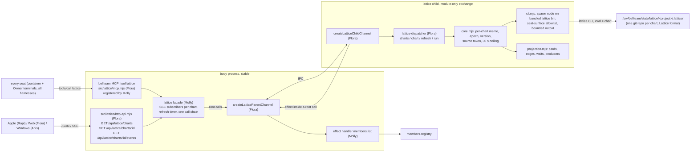

# Lattice工程表 (lattice)

Owner: Flora (bot-7e777fe5). Assigned by the Owner through Trony on 2026-11-11; public contract ruled by Trony on 2026-11-11.

This module brings [Lattice](https://github.com/kitepon/Lattice) (Snow White's product: Plan Alice, Store Ludmila, Runtime Tove) into BellTeam. Lattice internals and every change to Lattice itself belong to Snow White (bot-fc291ae4); this module only runs a released Lattice CLI. The module owns:

- **the charts**: one Lattice store per project (Owner 2026-11-11: one chart per project, no edit permissions, no membership, anyone can open; members follow the coordinator's chart and may make their own);
- **the seat tool** `lattice`: every seat on every harness and OS (container and Owner-terminal seats) reads and writes charts through the bellteam MCP, with no install, PATH or env on the seat;
- **the app read surface**: chart list, chart snapshot and SSE, already projected into who waits for what and who is producing it. Each app draws it natively from the [screen spec](screen-spec.md): Apple first (Rapi), Web (Flora, [web/lattice-chart.md](../web/lattice-chart.md)), Windows (Anis).

Connections are in [module.json](module.json). The overall [function map](../../feature-map.md), [data flow](../../data-flow.md) and [ownership](../../module-ownership.md) trace callers and providers.

Skipped on purpose (v1): Lattice's Sensor, independence and runtime (Tove) inside BellTeam; task notes (a separate Lattice chain, not in the display read); edits from the apps (seats edit through Lattice); migrating the coordinator's Markdown process table (needs a ruling).

## Process placement

Same shape as [work-graph](../work-graph/README.md): the module runs as its **own module child**, so every change ships as a module-only exchange without stopping the body. The Lattice package (`@quolu/lattice`, pinned in the module payload lock) is bundled in the signed module, so a Lattice version bump is a module-only exchange too.

| Part | Owner |
| --- | --- |
| `src/lattice-protocol.mjs`, `src/lattice-ipc.mjs` (both ends), `src/lattice-dispatcher.mjs`, `src/lattice-entry.mjs`, `src/lattice/{core,cli,projection}.mjs` (child) | Flora |
| `src/lattice/http-api.mjs` (thin body HTTP/SSE handler), `src/lattice/mcp.mjs` (tool schema + handler) | Flora |
| Lattice facade (subscribers, refresh timer, one call chain), effect handler `members.list`, module process/start binary/locks, HTTP mount and auth, MCP registration in `mcp-tools.mjs`, packaging/catalog/updater, `publish-lattice.yml` | Molly |
| Lattice CLI behaviour, schemas, store format | Snow White |

## Function map



## Data flow

| ID | From -> to | Data | Notes |
| --- | --- | --- | --- |
| L1 | seat -> body MCP | `lattice {project, name?, args, input?}` | `from` = caller Bot id from the seat credential (Kiro: container, account and Owner-terminal seats alike; a fork seat resolves to its parent Bot). Open to forks: charts are outside `/srv/bellteam/bots/*` |
| L2 | MCP handler -> facade -> child | root `run {from, projectId, args, input, name?}` (the facade passes `name` only when given) -> `{exitCode, result, stdout, stderr}` | After a run, the facade refreshes that chart at once |
| L3 | child -> Lattice CLI | `process.execPath <bundled>/@quolu/lattice/bin/lattice.mjs <args>` with cwd = chart dir, env `{PATH, HOME=/srv/bellteam/state/lattice-home, LATTICE_SEAT_ID=from, LATTICE_DASHBOARD_AUTOSTART=0}` | The chart dir is created on the first run (`mkdir`, `git init -q`). Lattice's own lock protects the store; the child also runs root calls one at a time |
| L4 | child -> Lattice CLI (read) | `lattice todo display source --json` (cheap token) and `lattice todo display read --json` -> `lattice.todo_display_read_result.v1` `{state, store, verified_at, source, inconsistency, dropped_members}` | Minimum Lattice version = `@quolu/lattice` 0.85.5 (first release with these two reads). With no store yet, `source` fails (STORE_INCONSISTENT) and `read` returns `state: "unavailable"`; a failed source counts as a probe failure, so a full read follows. Full read on token change, first observation, probe failure, after a run, or 30 s after the last full read |
| L5 | child -> parent effect | `members.list {}` -> `{members:[{id,name,color,avatarVersion,deleting}]}` | Same effect and validator as work-graph. A failed read keeps the last roster (`degraded:['members']`) |
| L6 | apps -> body API -> facade -> child | `charts {}`, `chart {projectId}`; SSE: `refresh {projectIds}` every `nextRefreshMs` while subscribers exist | Snapshot pushed whole on each change |
| L7 | child -> chart dir | `.bellteam-chart.json` `{name?, createdBy?}` merged and written atomically (temp + rename): `createdBy = from` by the `run` that first makes the store (no `.lattice` before, one after), or by a `run` with `name` on a chart that has no recorded creator (claiming an older chart, e.g. Trony renames 「BellTeam開発」 once); `name` by `run` with `name`. Read with every full read; never overwritten once set | Lattice has no project name or creator, so the module keeps both beside the store. A missing or malformed file or field is absent |

## Seat tool `lattice` (public contract for seats)

Input schema: `{ project: string, name?: string, args: string[], input?: object }`.

- `project`: chart id, `^[a-z0-9][a-z0-9-]{0,62}$`. Lattice's `project_id` is this directory name. A new id creates a new chart on its first write (Owner ruling 7: anyone may make a chart).
- `name`: the chart's display name for every screen, 1-40 characters, no control characters or surrounding spaces (`LATTICE_NAME_INVALID` otherwise). Give it when making a chart; `args: []` with `name` only renames an existing chart (no Lattice command runs; result `{exitCode:0, result:{name}, stdout:null, stderr:''}`; a project with no chart yet is the tool error `LATTICE_CHART_NOT_FOUND` and nothing is written). To name a new chart, pass `name` with its `plan create`. Screens never show `project`.
- `args`: Lattice CLI arguments after `lattice`, e.g. `["session-context"]`, `["plan","create","--template","--json"]` (prints the `plan create` input template; Lattice refuses `--template` without `--json`), `["todo","start","--plan","p1","--task","t01"]`, `["todo","note","--plan","p1","--task","t01","--message","..."]`, `["todo","dependency","connect","--from-plan",...]`. The first argument must be one of `plan`, `todo`, `status`, `session-context`, `help`, `--help`, `--version`.
  Named protection: the child runs as the server uid, so Lattice's host commands (`setup`, `hooks`, `bridge`, `dashboard`, `run`, `sensor`) would write host configuration or launch processes as the server (privilege escalation, overwriting host state). Self-exit: the refusal `LATTICE_COMMAND_NOT_SEAT_SURFACE` returns the allowed list; the seat calls again with a seat command.
- `input`: a JSON object for commands that take `--input <file>` (`plan create`, `plan revise`, `plan backchain`). A task's `lane` is its assigned owner: write the member's Bot id or name there to show a face (see Owner on screen). The child writes it to a private temp file and appends `--input <file>`; `args` must then not contain `--input`.
- Result: `{ exitCode, result, stdout, stderr }`. `result` is the parsed stdout JSON (null when stdout is not JSON; then `stdout` carries up to 64 KiB of text). `stderr` carries the last 4 KiB. A Lattice refusal is a normal result with its own `code` / `detail.next_action` inside `result`, never a tool error.
- A run that leaves the chart dir without a Lattice store (`help`, `--version`, a refused first command) removes that dir again, so no empty, unlisted dirs pile up under the charts root (Molly 2026-11-12: `flora-scratch-check` stayed behind and only the server uid can remove it). A dir with `.lattice` is never removed.
- The CLI run is bounded at 60 s (named protection: a hung CLI would hold the one call chain and stop every chart; self-exit: the process is killed, the result says `LATTICE_CLI_TIMEOUT`, the next call runs).
- Tool errors (not Lattice results): `LATTICE_PROJECT_INVALID`, `LATTICE_NAME_INVALID`, `LATTICE_INPUT_CONFLICT`, `LATTICE_COMMAND_NOT_SEAT_SURFACE`, `LATTICE_UNAVAILABLE` (child not serving).

## Public contract (apps)

Common Owner-authenticated `/api`; internal callers 403; no permission checks of its own (Owner rulings 4-5).

### `GET /api/lattice/charts`

```json
{ "schema": "bellteam.lattice-charts.v1", "at": "…",
  "charts": [{ "projectId": "bellteam", "name": "BellTeam開発", "coordinator": true, "createdBy": "bot-7b140b27",
               "counts": { "total": 31, "done": 18, "working": 4, "waiting": 3, "blocked": 1 },
               "activeMembers": ["bot-39be7047"], "updatedAt": "…", "state": "verified" }] }
```

Order: coordinator charts first (`coordinator` = `createdBy` is the coordinator Bot; module default `bot-7b140b27`, Trony ruling 2026-11-11), then newest `updatedAt`. `createdBy` = the chart's recorded creator (sidecar `createdBy`, below); for a chart made before the record existed and not yet claimed, `actor.agent` of the earliest journal event in the read. It never follows a later plan: Lattice's read holds only each plan's active version, so after the coordinator revised a plan, another member's newer plan had the earliest event and took the chart (Trony finding 2026-11-12: 「BellTeam開発」 lost 統括 when Flora added a plan). `updatedAt` = the latest event time. `name` = the seat-given display name or null.

**Display name rule (all apps, list cards, chart switcher and spoken labels):** `name`; if null, 「<createdBy's member name>の工程表」 using the app's own roster name for that Bot; if that is unknown too, 名前のない工程表. `projectId` is an address for API paths only and is never put on screen or in a spoken label (Trony screen ruling: no raw ids).

### `GET /api/lattice/charts/:projectId`

```json
{ "schema": "bellteam.lattice-chart.v1", "epoch": "…", "version": 7, "at": "…",
  "projectId": "bellteam", "name": "BellTeam開発", "createdBy": "bot-7b140b27", "coordinator": true, "state": "verified", "verifiedAt": "…", "degraded": [],
  "members": [{ "botId": "bot-39be7047", "name": "モリー", "color": "mint", "avatarVersion": "…" }],
  "cards": [{ "id": "p1/t03", "plan": "p1", "taskId": "t03", "title": "部品の配置と保存場所",
              "doneCondition": "…", "designMemo": "…", "state": "in-progress", "lane": "molly",
              "producer": "bot-39be7047", "startedAt": "…", "changedAt": "…", "blockedReason": null, "depth": 1,
              "phase": "p1/ph2", "parent": null, "doneAt": null, "archived": false }],
  "phases": [{ "id": "p1/ph2", "title": "部品" }],
  "edges": [{ "from": "p1/t03", "to": "p1/t05", "waiting": true }],
  "waits": [{ "waiter": "bot-7e777fe5", "waitingCard": "p1/t05", "forCard": "p1/t03",
              "producer": "bot-39be7047", "producerState": "in-progress", "since": "…" }] }
```

- `state`: Lattice's display state as is: `verified | unverified | last_verified | unavailable`. `verifiedAt` from Lattice. No codes, reasons, paths or raw ids are sent for display (Trony ruling 2026-11-11: plain sentences only; codes go to the child's diagnostic log).
- `degraded`: `lattice-read` (the last read failed; the previous snapshot is kept), `members` (last roster kept).
- card `doneAt` / `archived` (added 2026-11-12, Owner request: finished work leaves the chart, a 過去ログ keeps it): when the card finished (null while open) and whether the screens hide it from the chart (shown only in 過去ログ). Optional on the wire like `phases`; missing = null / false.
- `phases`, card `phase` / `parent` (added 2026-11-12 for the process tree, Owner request): the plan's phases in plan order (`title` may be null; apps then show 名前のないまとまり), the card's phase id or null, and its parent card id or null. Optional on the wire: a child that predates them sends none, and apps treat missing as `[]` / null.
- `members`: only members referenced by `producer`/`waiter`. A Bot id not in the roster is omitted here; apps draw it as 名簿にないメンバー.
- Errors: 404 `LATTICE_CHART_NOT_FOUND`, 503 `LATTICE_UNAVAILABLE`, 405 other methods.

### `GET /api/lattice/charts/:projectId/events` (SSE)

`event: snapshot` with the snapshot on connect and again whenever `version` changes; `: hb` every 15 s; a client treats 35 s of silence as a drop and reconnects; no replay; a new `epoch` means the child restarted.

## Projection rules (`projection.mjs`)

Input: one `lattice.todo_display_read_result.v1`. For `verified` / `last_verified` the store is `lattice.todo_store_read.v1` (members with `plan`, `tasks`, `journal.events`, `plan_scoped.events`); for `unverified` it is raw `{members:[{descriptor, plan, snapshot}]}` and task states come from `snapshot.tasks`. Missing or malformed fields drop only that task or edge.

- **Card** per `plan.tasks[]`: `id = plan_key/task_id`; `title` (fallback task id), `doneCondition`, `designMemo`, `lane`. `state` = Lattice status; `pending` becomes `ready` when every predecessor is `done` or `retired`.
- **Producer**: `actor.agent` of the task's latest `start` event (= the Bot id through `LATTICE_SEAT_ID`); before any start, the authored `lane` when it names a member: equal to a member Bot id, or to a member's name (Latin letters compared case-insensitively); otherwise null. A finished card (`done` / `retired`) with a `lane` takes the lane's member (or null) and ignores the starter: Lattice refuses `todo done` on a pending task and a seat can only act under its own Bot id, so a coordinator closing a task that its owner already finished runs `todo start` + `todo done` under the coordinator's name; Lattice keeps that record (who ran each command), and the screen keeps showing the authored owner instead of reassigning the card (Trony question 2026-11-12). The coordinator adds a `todo note` saying who finished it.
- **Owner on screen (all apps; Trony defect 2026-11-12)**: a card's owner is its `producer` (face + name); else its authored `lane` text as written (the plan author's assignment: drawn as text with its initial, its own swimlane after the member lanes, no chat, not in the member rail); else 担当なし. 待ちの流れ and edge chips use the same rule: the waiter is the owner of the waiting card, the producer the owner of the awaited card. Authors who want a face write the member's Bot id or name in `lane` (the seat tool description says so). `startedAt` = that start's `recorded_at`; `changedAt` = the task's latest event time.
- **Tree** (Owner 2026-11-12): `phases` = `plan.phases[]` with a `phase_id` (`id = plan_key/phase_id`, `title`); card `phase` = its `phase_id` when that phase exists, else null; card `parent` = `plan_key/parent_task_id` when that card exists, is not the card itself and does not close a parent cycle, else null.
- **Finished and archived** (Owner 2026-11-12): `doneAt` = Lattice's `done_at` for `done` (else the card's `changedAt`), the card's `changedAt` for `retired`, null otherwise. `archived` = the card is finished and none of its next cards (kept edges `from` it) is still unstarted (`pending` / `ready`); a finished card with no next card is archived at once. Archived cards stay in `cards` (details, 前の工程 links, 過去ログ, counts) and are left out of the tree and lane drawings.
- **Edges**: `plan.hard_dependencies` (`from` -> `to`), `plan.joins` (each `after` -> `before`), and cross-plan `plan_scoped.events` of kind `cross_plan_dependency` minus `cross_plan_dependency_removed` tombstones. An edge with an unknown end, a self edge, or one closing a cycle is dropped. `waiting` = predecessor not finished and successor not finished.
- **Waits**: one per waiting edge whose successor is not `retired`: `waiter` = successor's producer, `producer` = predecessor's producer, `producerState` = predecessor's state, `since` = the later of the predecessor's and the successor's `changedAt`. Sorted oldest `since` first.
- **Depth**: longest path from a root over the kept edges.
- **Counts**: `working` = in-progress, `blocked`, `waiting` = cards with at least one waiting incoming edge, `done` = done + retired.

## Child protocol (`src/lattice-protocol.mjs`)

`LATTICE_PROTOCOL_VERSION = 1`; `LATTICE_STATE_COMPATIBILITY = {state:'none'}`: the child's own memory (memos, epoch, versions) is not carried across a swap; chart repos are Lattice's format, which Lattice versions keep compatible; the optional `.bellteam-chart.json` sidecar is backward-compatible (missing or malformed fields read as absent; older children read only `name`, and an older child's rename writes `{name}` alone, so after a rollback a renamed chart falls back to the earliest-event creator until it is named again), so it needs no state version or migration. Root methods and params:

| Method | Params | Result |
| --- | --- | --- |
| `charts` | `{}` | `bellteam.lattice-charts.v1` |
| `chart` | `{projectId}` | `bellteam.lattice-chart.v1` (or error `LATTICE_CHART_NOT_FOUND`, 404) |
| `refresh` | `{projectIds}` (1-50) | `{snapshots:[chart snapshots whose version changed], nextRefreshMs}` (2000 while any chart is asked) |
| `run` | `{from, projectId, args, input, name?}` (`input` object or null; `name` 1-40 plain characters, `args` may be `[]` only with `name`) | `{exitCode, result, stdout, stderr}` |

Snapshot validation (`validateLatticeResult`, both ends) accepts `phases` and card `phase` / `parent` / `doneAt` / `archived` as optional keys, so a body with this validator takes both older and newer children. A child that sends them needs a body with this validator: they ship together in one body train (the builtin child follows the body image), never as a module-only exchange onto an older body.

Effect: `members.list {}` only, accepted only inside a pending root call. Controls `initialize {generation, mode}`, `quiesce`, `resume`, `exit` and `validateLatticeReady` exactly as work-graph. Root calls run one at a time. Only fixed error codes cross the wire.

## State it owns

| State | Where | Writer | Reader |
| --- | --- | --- | --- |
| Chart stores | `/srv/bellteam/state/lattice/<project>/` (git repo, `.lattice/**`) | Lattice CLI inside the child, only through `run` | child (`todo display read/source`) |
| Chart display name and creator | `/srv/bellteam/state/lattice/<project>/.bellteam-chart.json` `{name?, createdBy?}` | child, only through `run` (creator once: the store-making run, or the first naming run of an unclaimed chart) | child, with every full read |
| Lattice HOME | `/srv/bellteam/state/lattice-home/` | Lattice CLI | Lattice CLI |
| Memo, epoch, version, last snapshot and token per chart | child memory | child | child |

`/srv/bellteam/state` is the server uid's persistent state volume (survives image swaps; Molly 2026-11-11). It is inside `/srv/bellteam`, which the nightly backup walks (Trony's runbook `bots/bot-7b140b27/docs/bellteam-backup-20261005.md`). Offline ownership maintenance re-modes it to 700/600 under the server uid; the child relies on no exec bits or git hooks.

## Failure handling

| Failure | What happens | Exit on its own |
| --- | --- | --- |
| Store inconsistent or partly unreadable | Lattice returns `unverified` / `last_verified` / `unavailable`; passed through; apps show a plain sentence and draw what they can | the next full read after repair returns `verified` |
| CLI read or chart-name read fails (spawn error, crash, bad JSON, timeout, I/O error on the name file) | keep the last good snapshot, `degraded:['lattice-read']`, one diagnostic log line with the code | next token change or the 30 s ceiling |
| Charts root not a directory, or the root or a chart dir unreadable (any error other than a missing path: ENOTDIR on the root, EACCES, EIO, …) | `charts` and `chart` return 503 `LATTICE_UNAVAILABLE` (the code goes to the error's `detail`), never an empty list or `LATTICE_CHART_NOT_FOUND`; in `refresh` the chart stays in the round and its read reports `degraded:['lattice-read']`. A missing root or dir is the normal "no chart yet" | nothing is cached: the next call (apps retry 1, 2, 4 s; the refresh tick every 2 s) succeeds once the permission or disk is repaired |
| `members.list` fails | keep the last roster, `degraded:['members']` | next read |
| Producer not in the roster | omitted from `members`; apps draw 名簿にないメンバー | appears once the Bot exists |
| Write conflict inside Lattice | Lattice's result says so; the seat calls again | Snow White's release makes writers wait |
| Child down or exchanging | 503 `LATTICE_UNAVAILABLE`; apps keep the last drawing and reconnect; seat tool error | new child, new epoch, fresh snapshot |
| Older server without the module | 404 on `/api/lattice/*`; apps say the feature is not on this server yet | server update |

## How it updates

- Module code and the bundled Lattice version ship together as a module-only exchange (`publish-lattice.yml` attestation; Epinel adopts catalog rows; Molly exchanges). The body does not stop.
- New Lattice release: Snow White announces it -> Flora bumps the pin in the module lock -> module-only exchange. If a release ever changes the chart repo format incompatibly, `LATTICE_STATE_COMPATIBILITY` changes with it so the updater does not swap it as compatible.
- The MCP tool schema and the HTTP mount live in the body, so changing them rides a body train (Molly).
- Web page ships through the Web gateway (Admi reviews the registration lines; Molly exchanges web-gateway). Apple and Windows pages ship with their apps; Flora accepts them on real screenshots.
