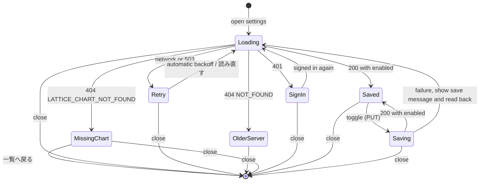
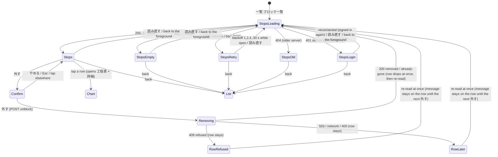

# Lattice工程表: screen, user path and motion spec

Words (a161, Owner 2026-11-15 via Trony; Lattice 0.104.0): 前工程 = a task of the same chart that must finish first (a tree line); 他条件に接続 (接続) = waiting on a condition outside the chart (a task of another chart, a BellTeam schedule); 優先接続 = a Bot asked to be told at once when a task can start; ブロック = `todo block`, the last resort. 「待ち」 and 「止め / 止まり」 are retired words: where this spec used them they now read 接続 and ブロック (section [接続 and ブロック](#接続-and-ブロック-a161)).

Shared by the Apple (SwiftUI, Rapi), Windows (Anis) and Linux apps. Data only from the [lattice contract](README.md#public-contract-apps). The visual reference is Flora's design mock (`/srv/bellteam/bots/bot-7e777fe5/docs/lattice-chart-screen.html`, accepted by Trony 2026-11-11). Owner 2026-11-11: the old Web-made chart looked cheap; use each platform's rendering to the full, and never pull the Apple design down to Web limits.

Units: `pt` = SwiftUI points = CSS px = WinUI effective pixels. Times in ms. User-facing text is Japanese and plain: no codes, reasons, ids or paths anywhere on screen (Trony ruling 2026-11-11).

## Screens

| Screen | Content |
| --- | --- |
| **一覧** (chart list) | Only charts whose list `counts.total` is above 0 are listed, here and in the chart switcher's choices (Owner 2026-11-14, task a107: 「0/0は開いたって何もないから、表示しなくていい…工程表の選択のプルダウンにもね」; the list's own count, no new rule). Each app filters the list it already reads; the server list keeps every chart, because the member chart buttons read the same list and must stay unchanged. Other ways in (a member's chart button, 工程へ移動, a stop row) still open such a chart. Cards: chart name (rule below; never the project id), crown + 統括 on coordinator charts (pinned first), mini progress ring `done/total` (the server's `counts`: the `counted` cards, every task of the trees not fully finished, hidden ones included; README Projection rules), active member avatars, 接続 N. A non-tappable card 新しい工程表 says: 工程表はメンバーがLatticeでつくります。権限も参加登録もなく、誰でも開けます。 |
| **工程表** (chart) | Toolbar: chart switcher (chart name, 統括 badge), live pill, progress ring, counters 作業中 / 接続 / ブロック. Left: member rail (avatars; working = rotating accent arc; blocked = red dot; waiting = hourglass with count). Center: swimlanes per owner ([owner rule](README.md#projection-rules-projectionmjs): `producer`, else the authored `lane` text, else none; lane label = member avatar + name, or the lane text with its initial; unassigned lane 担当なし, last), cards in columns by `depth`, edges as smooth curves. Right (Mac/iPad/Linux/Windows/Web wide): 接続 panel. Mac/iPad/Linux/Windows (Owner 2026-11-14): the panel starts closed as a slim handle on the right edge (hourglass + 接続 count); tapping the handle opens it, its close button folds it back; the choice is kept while the app is open. Web (Owner 2026-11-14, task a76): the same on a wide window (1024 px and wider): a right-edge handle (hourglass + 接続 count, red when a producer is blocked) opens the panel and its close button folds it, kept while the page is open; under 1024 px the panel stays the horizontal strip above the chart. Linux: the toolbar wraps progress and counters to a second row when the window is too narrow for one row. Apple (Owner 2026-11-14): the wide layout is used only when the chart's column is wide enough for it (760 pt); a narrower column, such as an iPad in portrait beside the sidebar, uses the iPhone flow, so the chart never spreads under the sidebar. |
| **ツリー** (Owner 2026-11-12; default view of 工程表; **redesigned for Apple, Owner 2026-11-14, task a98 (Owner OK: 「よし進めろ。」)**) | Owner: 「工程表のツリーが無駄。ただ分類しただけになっている。繋がりの表現は弱い。一方、担当ごと表示は素晴らしい」. Shown cards: exactly the 担当 view's (not `archived`; one flag for both views). Which cards are archived is the server's one rule ([README Projection rules](README.md#projection-rules-projectionmjs), final rule: a finished card leaves once all its next cards are finished; a finished card with no next card (single or last) leaves at once (a109); unfinished cards always show; trees from Lattice 0.100.0); both views and every client follow the flag. Same toolbar, rail and 接続 as 担当; the segmented control ツリー / 担当 / 過去ログ stays. **Mac / iPad (wide)**: 「現担当の表示方針をベースに、担当ごとにまとめず、木の構造を優先して表示する」: the 担当 view's cards (Card body below), edges (curves, waiting particles, chips) and columns (`depth`), with no lanes: rows follow the dependency structure ([Structure layout](#structure-layout-ツリー-task-a98)) so lines cross as little as possible. No chart root, phase or parent boxes and no parent links (the old tree's classification; the structure shown is the dependencies, `edges`). Tap a card -> 詳細; member highlight dims cards and edges like 担当. **iPhone** (and the iPhone flow, e.g. an iPad column under 760 pt): the old tree is removed (「ツリーを廃止」); in its place the same Structure layout with each card drawn only as its owner's small icon (owner rule face; 担当なし: an empty dashed circle), drawn like the member rail's avatar (working = rotating arc, blocked = red dot). An in-progress card shows its title under its icon (「作業中のものは近くに作業内容を出す」). Tapping an icon shows that card exactly as Mac / iPad draws it, just above the icon (「MacとiPadと同等の作業内容が表示される」); tapping that card opens 詳細; tapping elsewhere or another icon closes or moves it. Edges as on Mac / iPad, without chips. Web, Windows and Linux keep the 2026-11-12 tree (chart -> phases -> cards, parent nesting, dependency arcs) until the Owner decides otherwise. Fractions: every progress fraction (toolbar ring, chart root, phase done/total, 一覧 ring) counts the cards with `counted` (every task of the trees not fully finished, hidden ones included; a fully finished tree counts nowhere; Owner 2026-11-14, a96; the server decides, README Projection rules). The counters 作業中 / 接続 / ブロック are unchanged. |
| **過去ログ** (Owner 2026-11-12) | Third view of the ツリー / 担当 / 過去ログ switch. Every finished card (`done` / `retired`, archived or not), newest `doneAt` first, under JST day headings (今日 / 昨日 / M月D日): state glyph, title, owner face + name (owner rule), finish time HH:MM. Tap opens 詳細. Empty: まだ終わった工程はありません。 The switch shows the count (過去ログ N).  **Closed trees (a457, Owner 2026-11-19 via Tronie: 「既に閉じてるツリーを読むのもやめたらいい」; contract: README `history` route and snapshot `history`)**: the snapshot holds only open trees, so the list is the finished cards of the snapshot plus the finished cards of closed trees, which the app reads from `GET /api/lattice/charts/:id/history` ONLY when 過去ログ is opened (first page on opening, the next page when the list scrolls to its end while `next` is not null; rows merge newest `doneAt` first, a card already in the snapshot is not shown twice; while a page loads the rows already known stay and a small spinner row ends the list; a failed page shows one plain row 「続きを読めませんでした。」 with 読み直す, the rest of the list stays; a 404 from an older server shows only the snapshot's rows). The switch count = finished cards of the snapshot + `history.closed` (missing = 0), so it needs no request. 詳細 of a history row opens the card as the page sent it (no 前の工程 links: a closed tree's edges are not read). The ツリー and 担当 views, counts, 段 and edges are unchanged.|
| **ブロック一覧** (stops) | Every stop on every chart with 外す (Owner only). Reached from 一覧. Detail in the section ブロック一覧 below |
| **接続** (formerly 待ちの流れ; a161) | The panel of 他条件に接続 and 優先接続, rows oldest first; rows, empty text and wording are in the section [接続 and ブロック](#接続-and-ブロック-a161). iPhone: these rows come first, as a horizontal card pager above the chart. |
| **詳細** (card detail) | Sheet over the chart: title, state badge + producer, 設計メモ (`designMemo`, Markdown as plain text), 終了条件, 前の工程 / 次の工程 with their states (tappable; 次の工程 also lists the tasks of other charts that wait on this card, [below](#詳細-次の工程-and-the-waiters-2026-11-28)), 着手 time. A predecessor on another chart (task a60) is listed in 前の工程 with its chart name (「<chart name>の工程表」); tapping it opens that chart at that card. It is never drawn on the canvas or in ツリー (no line leaves the chart). No notes in v1. |

### Structure layout (ツリー, task a98)

Pure function of the snapshot (Apple `LatticeStructure`), the same for Mac / iPad cards and iPhone icons; only the sizes differ.

1. Nodes: the shown cards. Links: `edges` whose two ends are shown cards (an edge touching an archived card or another chart is not drawn, as in 担当).
2. Column: the card's `depth`, as in 担当 (counted over shown cards only, so the leftmost shown card is the first column; README Projection rules, task a108).
3. Groups: cards joined by links form a group. Groups go top to bottom in the order of their first card in the snapshot `cards`; groups of one card (no link) go after all linked groups, in the same order.
4. Rows inside a group, column by column from the left: a card's wanted row = the rounded mean row of its predecessors in the group (a card with none: the next free row of its column, in snapshot order). Cards of one column are sorted by wanted row (ties: snapshot order) and each takes the larger of its wanted row and the next free row of that column. So a chain runs straight, siblings stack under each other, and a join sits between its predecessors.
5. Sizes: Mac / iPad = the 担当 card and column pitch, a row as tall as its tallest card plus the 担当 stack gap. iPhone = icon 32 pt, column pitch 96 pt, row pitch 52 pt; a row holding an in-progress card is 32 pt taller for its title (11 pt, up to 2 lines, 88 pt wide, centred under the icon).
6. Stability: a card keeps its place while its column and its predecessors' rows stay; any move animates with the card spring (Motion).

Owner as an owner (Trony 2026-11-12): `producer` / `waiter` `"owner"` is the Owner. Draw the Owner's name and avatar from the app's Owner profile (`/api/owner`, `/api/owner/avatar`; 指揮官 and an initial while unknown), never the raw word; no 会話を開く, not in the member rail; a lane of its own like a member's.

Chart name, everywhere a chart is named (list card, switcher, spoken labels): the snapshot/list `name`; if null, 「<作った人の名前>の工程表」 from `createdBy` and the app's own roster name; if that is unknown, 名前のない工程表. The project id is only an API address and never appears on screen or in a spoken label.

Card states (glyph, badge text): 未着手 `pending` (dashed outline, dashed circle), 着手可 `ready` (accent outline + soft glow, play), 作業中 `in-progress` (accent tint, producer avatar with rotating arc, elapsed minutes), ブロック `blocked` (warm red tint #E0533D, octagon exclamation, reason line), 完了 `done` (compact desaturated pill, seal check), 取り下げ `retired` (struck-through grey, archive). Edges: satisfied = thin faint line; waiting = thicker accent gradient from producer card to the waiting card, particles flowing toward the waiter, chip 「前工程：◯◯」 (◯◯ = the producer of the finishing card).

Card body (open states): a vertical stack of badge row, title (up to 2 lines, then ellipsis) and one note line (担当 ◯◯ / 理由 / ◯◯がつくっています). The card is tall enough for all three; the note line never overlaps the title (Trony defect 2026-11-12, Web 1440x900).

Colors: BellTheme (Apple `BellTheme`, Web `:root` tokens, Windows theme): member accent by `color` (violet, rose, indigo, sky, mint, amber; unknown -> violet), ink, muted, line, canvas. Dark mode follows the platform.

## User path (state transitions)

State diagram (canonical for all three apps; the table below gives each transition's trigger and detail; Owner 2026-11-12: function diagram, data flow and, for UI, a state diagram). Every state has a way out that the user can take, and every failure state also leaves on its own.

```mermaid
stateDiagram-v2
  [*] --> Loading: open (Apple nav / Web 工程表 button / Windows nav)
  Loading --> List: list read, 0 or 2+ charts
  Loading --> Chart: list read, exactly 1 chart (first open only)
  Loading --> OldServer: list 404
  Loading --> Reconnecting: 503 / network
  Reconnecting --> Loading: backoff 1,2,4..30 s
  OldServer --> [*]: 閉じる
  List --> Chart: tap a chart card
  List --> Chart: back (when 一覧 was opened from a chart)
  List --> [*]: close / app navigation
  List --> Stops: ブロック一覧 (see ブロック一覧 below)
  Stops --> List: back
  Stops --> Chart: tap a stop row (opens its 詳細)
  state Chart {
    [*] --> Tree
    Tree --> Lanes: ツリー / 担当
    Lanes --> Tree: ツリー / 担当
    Tree --> Peek: tap an icon (iPhone flow, a98)
    Peek --> Peek: tap another icon
    Peek --> Tree: tap elsewhere
    Peek --> Detail: tap the card shown
    Tree --> History: 過去ログ
    Lanes --> History: 過去ログ
    History --> Tree: ツリー
    History --> Lanes: 担当
    History --> Detail: tap a row
    Detail --> History: close / swipe / Esc (came from History)
    Tree --> Detail: tap a box
    Lanes --> Detail: tap a card
    Detail --> Detail: 前の工程 / 次の工程
    Detail --> Approvals: 決裁を開く (Owner-lane card whose decision the Approval Box extension knows; none without the extension)
    Detail --> Tree: close / swipe / Esc (came from Tree)
    Detail --> Lanes: close / swipe / Esc (came from Lanes)
    Lanes --> Lanes: member highlight on / off
    Tree --> Tree: member highlight on / off
  }
  Approvals --> Chart: 工程表で見る (the extension's 決裁箱 screen, its 詳細; Web: the chart dialog closes, hash #approvals/<decisionId>, the way back reopens the chart at that card)
  Chart --> Chart: 接続 工程へ移動 (opens that card's 詳細; a card on another chart opens that chart at it)
  Chart --> Chart: 接続 handle opens the panel / × folds it (wide: Mac, iPad, Web 1024 px+; starts folded, kept while the app is open)
  Chart --> Reminders: 工程表の設定
  Reminders --> Chart: 閉じる / back
  Chart --> List: chart switcher / すべての工程表
  Chart --> Conversation: 会話を開く / 統括と話す
  Conversation --> Chart: back (Web: reopening 工程表 resumes this chart)
  Chart --> ChartReconnecting: 503 / 35 s silence
  ChartReconnecting --> Chart: next snapshot
  Chart --> NotFound: 404 LATTICE_CHART_NOT_FOUND
  NotFound --> List: 一覧へ戻る
  Chart --> Unavailable: state unavailable / no cards
  Unavailable --> Chart: readable snapshot
  Unavailable --> List: 一覧へ戻る
  Chart --> [*]: close
```

Every button leads to exactly one next view; every failure view says what happened, what happens next, and what the user can do, and is left without a code.

| From | User action | Next |
| --- | --- | --- |
| App (Apple nav / Web header button `工程表` / Windows nav) | open | 一覧. If exactly one chart is listed (above), 工程表 of that chart |
| 一覧 | tap a chart card | 工程表 of that chart |
| A member's conversation, right panel 「AIと操作」 (Apple iPad/Mac, Windows, Linux; Owner 2026-11-14); Web: the chat header 「…」 menu (Web has no right panel) | tap a chart button (one per chart whose `createdBy` is that member) | 工程表 of that chart (iPad: the 工程表 screen in the detail column; Mac, Windows, Linux: the 工程表 window; Web: the 工程表 dialog) |
| 一覧 | close (Web dialog ×, Mac window close) | back to the app |
| 一覧 opened from a 工程表 (switcher or the すべての工程表 button: iPhone at the right of the header, Apple wide layout, Windows and Web at the far left of the toolbar, Owner 2026-11-14) | back (top-left chevron with that chart's name, iOS edge swipe, Esc) | the 工程表 it came from, same scroll position. The app's own navigation (tab bar, 相関図 / 工程表 switch) stays visible on 一覧, so the user can always leave (Owner 2026-11-12: no way back after the iPhone overview button) |
| 工程表 | chart switcher | 一覧 |
| 工程表 | ツリー / 担当 / 過去ログ | the same chart in that view; 詳細 and highlight carry over |
| 過去ログ | tap a row | 詳細 of that card |
| ツリー (Mac / iPad) | tap a card | 詳細 of that card (a98; Web, Windows, Linux: tap a box of the old tree) |
| ツリー (iPhone flow) | tap an icon | that card, drawn as on Mac / iPad, just above the icon (a98) |
| that card over an icon | tap it / tap elsewhere / tap another icon | 詳細 of that card / closes / moves to that icon |
| 工程表 | tap a card | 詳細 of that card (card morphs into the sheet) |
| 工程表 | tap a member in the rail | highlight that member's cards and waits, dim the rest; tap again or tap empty canvas -> clear |
| 接続 row | 会話を開く | the producer's chat (existing chat screen); back returns to this 工程表 |
| 接続 row | 工程へ移動 | canvas scrolls/zooms to the awaited card and opens its 詳細; an awaited card on another chart opens that chart at it |
| 詳細 of an Owner-lane card (`producer` is `owner`) | (shown by itself, no tap) | The app asks the Approval Box extension `GET /api/approvals/by-task?project=<chartId>&plan=<plan>&task=<taskId>` once when the 詳細 opens (not on every snapshot). 200 `{decisionId, status: pending\|held\|answered\|cancelled, title}` -> a 決裁 block under 終了条件: the decision's own `title` (as Approval Box has it) and its state in words 待ち / 保留 / 回答済み / 取り下げ, and the button 決裁を開く. 404, 401, 503, network, bad JSON, or no extension -> no block and nothing else changes (no message, no retry: the next 詳細 asks again). The id never shows |
| 詳細 | 決裁を開く | The extension's 決裁箱 screen with that decision's 詳細 selected (Apple route `approvals/<decisionId>`; Web: the 工程表 dialog closes and the hash becomes `#approvals/<decisionId>`; Windows/Linux: the extension's window). Delta owns that screen and its way back (工程表で見る) |
| 詳細 | tap 前の工程 / 次の工程 item | 詳細 of that card, canvas follows; an item on another chart (a predecessor of another chart, or a waiter) opens that chart and its 詳細 (back to the first chart: the chart switcher) |
| 詳細 | close / swipe down / Esc | 工程表, same scroll position |

Failure and edge views (all leave on their own; the action is optional):

| Condition (data) | Shown (Japanese, plain) | What happens next | Action |
| --- | --- | --- | --- |
| list empty | 工程表はまだありません。メンバーがLatticeで工程をつくると、ここに並びます。 | appears on the next list read | 閉じる |
| `state: unverified` | amber banner: 工程表の記録に食い違いがあります。読める分だけ表示しています。 | 直り次第、自動で最新に戻ります。 | 統括と話す (opens the coordinator's chat) |
| `state: last_verified` | blue-grey banner: いまの記録が読めないため、最後に確認できた状態（verifiedAt, JST）を表示しています。 chart slightly dimmed | 読めるようになると自動で切り替わります。 | 統括と話す |
| `state: unavailable` | empty state with a closed bud: この工程表はまだ読めません。 | 記録が整うと自動で表示します。 | 一覧へ戻る |
| `degraded` contains `lattice-read` | small pill: 最新の記録を読み直しています… (chart stays) | next good read removes it | none |
| `degraded` contains `members` | small pill: メンバー情報を読み直しています… | next read | none |
| producer not in `members` | avatar 「?」, name 名簿にないメンバー | appears once the member exists | none |
| 503 or stream drop (35 s silence) | last drawing dimmed + top pill: 工程表に再接続しています… with spinner | reconnect with backoff 1, 2, 4 … 30 s, forever while open; a new snapshot redraws | close |
| 404 `LATTICE_CHART_NOT_FOUND` | この工程表は見つかりません。 | — | 一覧へ戻る |
| 404 on `/api/lattice/charts` (older server) | このサーバーではまだ工程表を使えません。 | appears after the server update | 閉じる |

## 工程表の設定

Place a gear button with the accessible label 「工程表の設定」 in the chart toolbar in ツリー, 担当 and 過去ログ. It opens a native settings sheet titled 「工程表の設定」 for the open chart. Show the chart name and one switch labelled 「1分ごとの催促」. Supporting text: 「着手できる工程や作業中の工程があるとき、手が空いている担当に知らせます。」 The switch affects this chart. 優先接続 still sends its immediate notification.

Read the [reminders API](README.md#get-and-put-apilatticechartsprojectidreminders) when the sheet opens and on reconnect. Show the saved value as ON or OFF. Leave the switch disabled while reading or saving. Send one PUT with the desired value on a change, and show the value returned by the server. If a save fails, show 「設定を保存できませんでした。」 and read back the server value to reconcile an uncertain write. Keep the confirmed value when the read fails and offer 「読み直す」. Retry transient reads with the app’s existing backoff while the sheet is open. A route-level 404 (`NOT_FOUND`) means the server predates the setting. Show 「このサーバーでは催促の設定を変更できません。」 A chart-level 404 uses the existing missing-chart path. Sign-in recovery follows the app’s existing rules. Close or back works in every state and returns to the same chart view. Ignore replies for a closed sheet or another chart.

## ブロック一覧 (stops; Owner 2026-11-12: 「ブロッカー（止め）一覧は作ってくれ。それを見て俺が解除する。」)

Data only from the [Stops contract](README.md#stops-blockers--get-apilatticeblockers-and-post-apilatticechartsprojectidunblock). Order of the apps: Web (Flora) first, then Apple (Rapi) and Windows (Anis) from this section. The screen shows the stops and one 外す button per stop; nothing else is written.

| Part | Content |
| --- | --- |
| Entry | 一覧 has a button ブロック一覧 at the top (next to the list title). Only the Owner apps show it (the route is Owner-only) |
| Header | ブロック一覧, back (「← すべての工程表」, Esc / edge swipe) to 一覧, a 読み直す button (Web, Windows; F5 on Windows) / pull-to-refresh (Apple) |
| Row (one per `blockers[]`, newest `blockedAt` first) | octagon glyph in the ブロック red; card `title` (2 lines, then ellipsis); chart name (name rule above, never `projectId`); 担当 = `lane` face + name (owner rule: Bot id -> member, `"owner"` -> the Owner, other text as written, null -> 担当なし); 理由 = `reason` as written (up to 3 lines, the whole text in the spoken label); ブロックした人 = `blockedBy` face + name (same rule) and 止めた時刻 `blockedAt` in JST (今日 HH:MM / 昨日 HH:MM / M月D日 HH:MM); button 外す |
| Row tap (not the button) | opens that chart (工程表) and the card's 詳細 (`cardId` = card `id`) |
| 外す | two steps in the row, no modal: 外す -> the row shows 「このブロックを外しますか？」 with 外す (accent) and やめる; やめる / Esc / tapping elsewhere returns. Confirmed: the button shows a spinner, the row stays |
| `unreadCharts` non-empty | thin amber line above the rows: 一部の工程表を読めませんでした。読めた分だけ表示しています。 (no ids) |

| State / answer | Shown (Japanese, plain) | What happens next | Action |
| --- | --- | --- | --- |
| StopsLoading (first read) | spinner ブロックを読んでいます… (later reads keep the rows, no spinner) | the answer | back |
| StopsEmpty | 止まっている工程はありません。 | 読み直す / foreground re-read | back |
| StopsRetry | the last rows dimmed (or empty) + pill ブロック一覧を読み直しています… | backoff 1, 2, 4 … 30 s forever while open | back, 読み直す (now) |
| StopsOld (404) | このサーバーではまだブロック一覧を使えません。 | appears after the server update | back |
| StopsLogin (Windows; sign-in lost) | ログインが必要です。ログインし直すと、自動で表示します。 (same text as the 工程表) | no timer; reads again when the app reconnects after signing in, or on 読み直す / foreground | back, 読み直す |
| removed / already-gone | the row fades out (200 ms; Reduce Motion: none) | re-read | — |
| 409 refused | under the row: 外せませんでした: `reason` (Lattice's text as is) | re-read; the stop stays | 外す again |
| 503 / network | under the row: いまは外せませんでした。少し待ってからもう一度お試しください。 | re-read | 外す again |
| 400 | same text as 503 (an app bug; nothing is shown about it) | re-read | 外す again |

Re-reads: on open, 読み直す / pull-to-refresh, after every 外す answer (any outcome), and on coming back to the foreground; never on a timer while the list is readable (the contract has no stream). An open 工程表 sees a removal through its own chart stream. A re-send after an unknown answer is harmless (`already-gone`).

Accessibility: each row is one element 「ブロック、<title>、<chart name>、担当 <lane>、理由 <reason>、<ブロックした人>が<時刻>にブロックしました」 with the action 外す; the confirm step moves focus to its 外す, やめる returns focus to the row's 外す.

## 詳細: 次の工程 and the waiters (2026-11-28)

Tronie ruling (Owner agreed 2026-11-28): the task a 他条件に接続 points at shows who waits on it, the same way a task shows its successors. Same on every platform (Apple, Web, Windows, Linux): the apps draw only what the card carries and recompute nothing.

| Part | Rule |
| --- | --- |
| Data | The card's `waiters[]` ([README](README.md#projection-rules-projectionmjs), L27; Lattice's K11 (b)): `{ref, reason, since}`, `ref` = an `externals[]` entry (title, chart name, producer, state, finished). Missing or empty = none; a client without the field shows 次の工程 as today |
| Where | In 詳細, under 次の工程, AFTER the same-chart successors (edges), oldest `since` first. The heading and the row style are the 次の工程 ones. No new panel, no canvas line, no 接続 chip or counter (those count the card's own open entries), nothing in ツリー / 担当 / 過去ログ |
| Row | The waiter's title (else 「ほかの工程表の工程」), under it 「<chart name>の工程表」 (else ほかの工程表), its producer's face and name, its state; the `reason` as one muted line (as written). A `done` waiter reads as done; a `retired` one is not sent, so never shown. State unknown (`null`): 読めていません |
| Tap | Opens that chart at that card with its 詳細 (the existing external-item route; back: the chart switcher) |
| Live | A new, settled or reopened waiter, and a waiter's title or state, reach the open 詳細 with the next snapshot (SSE); no refresh button, no timer |
| Accessibility | 「次の工程：「<title>」（<chart name>の工程表）、<state>」, the same sentence shape as a 次の工程 row |

## 接続 and ブロック (a161)

Owner 2026-11-15 (via Trony): 「他条件に接続と優先接続はUI上は同じ場所に表示しようぜ　今でいうと『待ち』の表示箇所だ。」 and 「ツリーで表現されるものではない、特別な接続たちってことだ。」 Snow White (contract 2026-11-15): cross-chart and schedule connections are never in `edges`; Lattice gives them only in each task's `connections`.

**One place, the old 待ち place.** The toolbar counter (接続 N), the member rail mark, the right-edge handle and the 接続 panel (formerly 待ちの流れ) show 他条件に接続 and 優先接続 together. The word 待ち is gone from every screen and spoken label.

| Part | Rule |
| --- | --- |
| Data | Per card `connections[]` (from `todo display read` 0.104.0, read by `projection.mjs`): `{kind: 'task'\|'schedule'\|'priority', ref, state: 'open'\|'settled', reason, since, settledAt?, evidence?}`; a `priority` entry carries `agent` (the Bot that asked) instead of `ref`. Only `open` entries count and draw; a settled one leaves the area (the task is startable again). `kind: 'task'` rows take the awaited card's title, chart name and producer from `externals[]` when Lattice gives that fact, else ほかの工程表の工程 (state unknown: 読めていません) |
| Never a line | A 接続 is never an edge: not in ツリー, not in 担当, no curve, no particle. It is shown only in the 接続 area and as a chip on the card itself (link glyph + 「接続 N」, N open entries; none for a card without one) |
| 前工程 | Unchanged: same-chart `edges`, drawn as lines (satisfied = faint, waiting = accent gradient with particles and the chip 「前工程：◯◯」, ◯◯ = the producer of the finishing card, 担当なし when it has none), listed in 詳細 under 前の工程. They are NOT rows of the 接続 panel (Trony 2026-11-15: the panel shows only 他条件に接続 and 優先接続) |
| Toolbar counters | 作業中 / 接続 / ブロック. 接続 = number of open entries on the chart; ブロック = number of `blocked` cards |
| Member rail | working = rotating arc; ブロック = red dot; 接続 = a link glyph with the count of that member's cards that have an open entry (the old hourglass) |
| Right handle / panel | handle: link glyph + 接続 count (red when a producer is in ブロック); panel title 接続; same wide-layout rule and fold behaviour as before (Mac/iPad/Linux/Windows start folded; Web 1024 px+; narrow = the horizontal strip / iPhone pager) |
| Panel rows (open entries, oldest `since` first) | **task**: the card that is connected (title, owner face, 接続 <length>, 「担当 ◯◯」); 「この工程の完了が条件になっています」; the awaited card title with its chart (「<chart name>の工程表」), producer and state as in the old cross-chart row; buttons 会話を開く (producer), 工程へ移動 (opens that chart at that card). **schedule**: 「予定の結果が条件になっています」 (Lattice gives only the schedule id, so no name, owner face or next-check time yet; they join when BellTeam supplies them), no 工程へ移動. **priority**: 「<agent face + name> が、着手できるようになったらすぐ動きたいと伝えています」; no awaited card; 工程へ移動 opens the card. Reason text of the entry is shown as one muted line (as written). A row whose connected card's producer is in ブロック is emphasized |
| Empty | 接続している工程はありません。 |
| ブロック一覧 | The former 止め一覧, renamed everywhere: entry button, header, rows, empty text (「ブロックされている工程はありません。」), the card state badge 止まり -> ブロック, its spoken label. Behaviour, contract and 外す unchanged |
| Accessibility | Panel rows read 「「<card title>」（担当 <owner>）は、<task: 「<awaited title>」の完了が条件になっています。つくっているのは<producer>、<state> / schedule: 予定の結果が条件になっています / priority: <agent>が、着手できるようになったらすぐ動きたいと伝えています>」; chip: 「接続 N」 |

Order of work (a161): this spec -> Web (Flora: `projection.mjs` connections, `lattice-chart-model.js`, `lattice-chart.js`, `lattice-stops.js` words) -> Apple (Rapi) and Windows (Anis) build to it with real shots. State diagram: the states and arrows are unchanged; every `止め一覧` / `Stops` label above reads ブロック一覧.

## Data handling

1. Open `GET /api/lattice/charts/:id/events`; each `snapshot` replaces the model. Diff against the drawn chart by card `id` / edge `from`+`to` and animate the difference. Existing cards keep their positions while their `depth` and lane do not change.
2. A new `epoch` or a reconnect: same as a fresh snapshot.
3. Avatars: `GET /api/bots/:id/avatar?v=<avatarVersion>` through the app's avatar cache; empty version -> initial on the accent.
4. 一覧 reads `GET /api/lattice/charts` on open and every 10 s while visible.

## Motion

| Moment | Apple | Web / Windows |
| --- | --- | --- |
| card state change | `spring(response: 0.45, dampingFraction: 0.82)` | same curve (cubic approximation) |
| card -> 詳細 | `matchedGeometryEffect` | shared-element / FLIP |
| waiting edge flow | `TimelineView(.animation)` + `Canvas`: one particle per 600 ms, 1.4 s travel toward the waiter | canvas / Win2D, same numbers |
| working arc | one turn per 8 s | same |
| completion | seal check `symbolEffect(.bounce)` + a 5-petal bloom fading in 700 ms | same, CSS / composition |
| blocked | `symbolEffect(.pulse)` | opacity pulse |
| new card | scale 0.92 -> 1 + fade, 300 ms | same |
| Reduce Motion | no particles, no rotation, no bloom; cross-fade only | `prefers-reduced-motion` / system setting |

## Accessibility

Each card is one accessibility element: 「<title>、<state>、つくっている <producer>」, plus 「接続 N」 when it has open entries. 接続 panel rows read as in the section 接続 and ブロック. Edge chips say 「前工程：<producer>」 (「前工程：担当なし」 when the finishing card has no owner). Colour never carries state alone: glyph + badge text always present.
