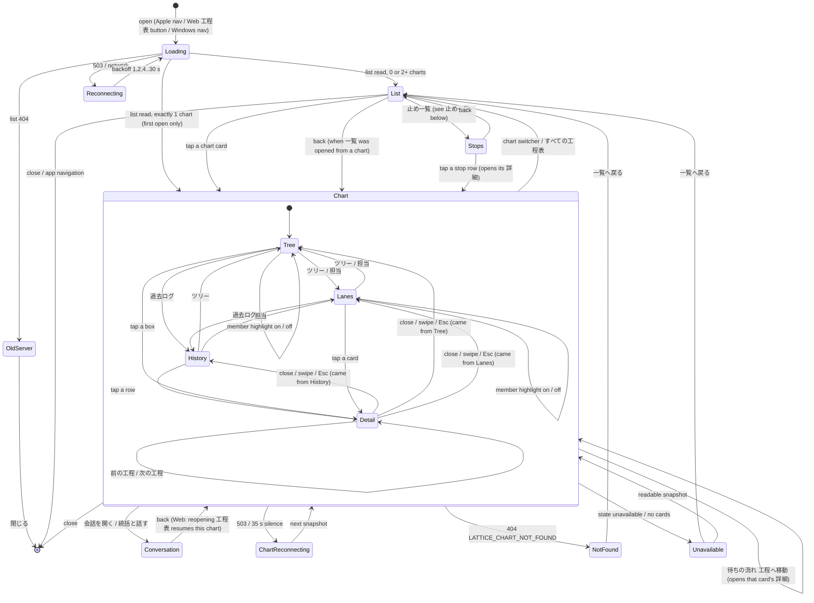
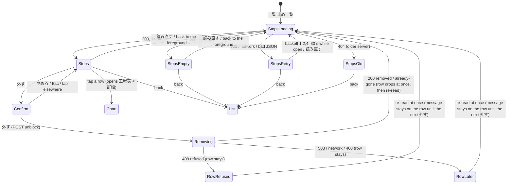

# Lattice工程表: screen, user path and motion spec

Shared by all three native drawings: Apple first (SwiftUI, Rapi), Web (Flora), Windows (Anis). Data only from the [lattice contract](README.md#public-contract-apps). The visual reference is Flora's design mock (`/srv/bellteam/bots/bot-7e777fe5/docs/lattice-chart-screen.html`, accepted by Trony 2026-11-11). Owner 2026-11-11: the old Web-made chart looked cheap; use each platform's rendering to the full, and never pull the Apple design down to Web limits.

Units: `pt` = SwiftUI points = CSS px = WinUI effective pixels. Times in ms. User-facing text is Japanese and plain: no codes, reasons, ids or paths anywhere on screen (Trony ruling 2026-11-11).

## Screens

| Screen | Content |
| --- | --- |
| **一覧** (chart list) | Cards: chart name (rule below; never the project id), crown + 統括 on coordinator charts (pinned first), mini progress ring `done/total`, active member avatars, 待ち N. A non-tappable card 新しい工程表 says: 工程表はメンバーがLatticeでつくります。権限も参加登録もなく、誰でも開けます。 |
| **工程表** (chart) | Toolbar: chart switcher (chart name, 統括 badge), live pill, progress ring, counters 作業中 / 待ち / 止まり. Left: member rail (avatars; working = rotating accent arc; blocked = red dot; waiting = hourglass with count). Center: swimlanes per owner ([owner rule](README.md#projection-rules-projectionmjs): `producer`, else the authored `lane` text, else none; lane label = member avatar + name, or the lane text with its initial; unassigned lane 担当なし, last), cards in columns by `depth`, edges as smooth curves. Right (Mac/iPad/Web wide): 待ちの流れ panel. |
| **ツリー** (Owner 2026-11-12; default view of 工程表) | Archived cards (`archived`: finished and every next card already started, or no next card) are not drawn in ツリー or 担当; a phase whose cards are all archived is not drawn; a card whose parent is archived hangs from the parent's phase. The ring and counters still count every card. Same toolbar, rail and 待ちの流れ as the lane view; a segmented control ツリー / 担当 in the toolbar switches the center (remembered while the app is open). Center: a left-to-right tree: the chart (name, ring done/total) -> its phases (`phases`: state glyph of the phase = 止まり if any card is blocked, 作業中 if any is working, 完了 if all are finished, else 未着手; title; done/total) -> cards under their phase, nested under `parent`; cards with no phase hang from the chart after the phases. Each card is a compact box (state glyph in its tone, one-line title with ellipsis, owner face) so the whole tree fits; tap opens 詳細. Tree links are soft elbows from parent to child. Dependencies (`edges`) are arcs on the right of the boxes: waiting = accent with an arrow toward the waiter, satisfied = faint. Member highlight dims boxes and arcs like the lane view. |
| **過去ログ** (Owner 2026-11-12) | Third view of the ツリー / 担当 / 過去ログ switch. Every finished card (`done` / `retired`, archived or not), newest `doneAt` first, under JST day headings (今日 / 昨日 / M月D日): state glyph, title, owner face + name (owner rule), finish time HH:MM. Tap opens 詳細. Empty: まだ終わった工程はありません。 The switch shows the count (過去ログ N). |
| **止め一覧** (stops) | Every stop on every chart with 外す (Owner only). Reached from 一覧. Detail in the section 止め一覧 below |
| **待ちの流れ** | One row per `waits[]`, oldest first. Each row reads on its own (Owner 2026-11-12: 「この1116って誰がやってんだ？何の表示なの」): the **waiting card's title** with its owner face and 待ち <length>; under it 「担当 ◯◯」 (or 担当なし); then 「この工程が終わるのを待っています」 over the **awaited card title**; then 「つくっている」 producer avatar + name + state (作業中 N分 / 止まり: blockedReason / 未着手: 担当 ◯◯ / 担当なし; ◯◯ and 「◯◯が待っている」 follow the owner rule, so an authored lane is named even before anyone starts), wait length. Buttons: 会話を開く, 工程へ移動. A row whose producer is blocked is emphasized. iPhone: these rows come first, as a horizontal card pager above the chart. |
| **詳細** (card detail) | Sheet over the chart: title, state badge + producer, 設計メモ (`designMemo`, Markdown as plain text), 終了条件, 前の工程 / 次の工程 with their states (tappable), 着手 time. No notes in v1. |

Owner as an owner (Trony 2026-11-12): `producer` / `waiter` `"owner"` is the Owner. Draw the Owner's name and avatar from the app's Owner profile (`/api/owner`, `/api/owner/avatar`; 指揮官 and an initial while unknown), never the raw word; no 会話を開く, not in the member rail; a lane of its own like a member's.

Chart name, everywhere a chart is named (list card, switcher, spoken labels): the snapshot/list `name`; if null, 「<作った人の名前>の工程表」 from `createdBy` and the app's own roster name; if that is unknown, 名前のない工程表. The project id is only an API address and never appears on screen or in a spoken label.

Card states (glyph, badge text): 未着手 `pending` (dashed outline, dashed circle), 着手可 `ready` (accent outline + soft glow, play), 作業中 `in-progress` (accent tint, producer avatar with rotating arc, elapsed minutes), 止まり `blocked` (warm red tint #E0533D, octagon exclamation, reason line), 完了 `done` (compact desaturated pill, seal check), 取り下げ `retired` (struck-through grey, archive). Edges: satisfied = thin faint line; waiting = thicker accent gradient from producer card to the waiting card, particles flowing toward the waiter, chip 「◯◯が待っています」.

Card body (open states): a vertical stack of badge row, title (up to 2 lines, then ellipsis) and one note line (担当 ◯◯ / 理由 / ◯◯がつくっています). The card is tall enough for all three; the note line never overlaps the title (Trony defect 2026-11-12, Web 1440x900).

Colors: BellTheme (Apple `BellTheme`, Web `:root` tokens, Windows theme): member accent by `color` (violet, rose, indigo, sky, mint, amber; unknown -> violet), ink, muted, line, canvas. Dark mode follows the platform.

## User path (state transitions)

State diagram (canonical for all three apps; the table below gives each transition's trigger and detail; Owner 2026-11-12: function diagram, data flow and, for UI, a state diagram). Every state has a way out that the user can take, and every failure state also leaves on its own.

Every button leads to exactly one next view; every failure view says what happened, what happens next, and what the user can do, and is left without a code.

| From | User action | Next |
| --- | --- | --- |
| App (Apple nav / Web header button `工程表` / Windows nav) | open | 一覧. If exactly one chart exists, 工程表 of that chart |
| 一覧 | tap a chart card | 工程表 of that chart |
| 一覧 | close (Web dialog ×, Mac window close) | back to the app |
| 一覧 opened from a 工程表 (switcher or the iPhone すべての工程表 button) | back (top-left chevron with that chart's name, iOS edge swipe, Esc) | the 工程表 it came from, same scroll position. The app's own navigation (tab bar, 相関図 / 工程表 switch) stays visible on 一覧, so the user can always leave (Owner 2026-11-12: no way back after the iPhone overview button) |
| 工程表 | chart switcher | 一覧 |
| 工程表 | ツリー / 担当 / 過去ログ | the same chart in that view; 詳細 and highlight carry over |
| 過去ログ | tap a row | 詳細 of that card |
| ツリー | tap a box | 詳細 of that card |
| 工程表 | tap a card | 詳細 of that card (card morphs into the sheet) |
| 工程表 | tap a member in the rail | highlight that member's cards and waits, dim the rest; tap again or tap empty canvas -> clear |
| 待ちの流れ row | 会話を開く | the producer's chat (existing chat screen); back returns to this 工程表 |
| 待ちの流れ row | 工程へ移動 | canvas scrolls/zooms to the awaited card and opens its 詳細 |
| 詳細 | tap 前の工程 / 次の工程 item | 詳細 of that card, canvas follows |
| 詳細 | close / swipe down / Esc | 工程表, same scroll position |

Failure and edge views (all leave on their own; the action is optional):

| Condition (data) | Shown (Japanese, plain) | What happens next | Action |
| --- | --- | --- | --- |
| list empty | 工程表はまだありません。メンバーがLatticeで工程をつくると、ここに並びます。 | appears on the next list read | 閉じる |
| `state: unverified` | amber banner: 工程表の記録に食い違いがあります。読める分だけ表示しています。 | 直り次第、自動で最新に戻ります。 | 統括と話す (opens the coordinator's chat) |
| `state: last_verified` | blue-grey banner: いまの記録が読めないため、最後に確認できた状態（verifiedAt, JST）を表示しています。 chart slightly dimmed | 読めるようになると自動で切り替わります。 | 統括と話す |
| `state: unavailable` | empty state with a closed bud: この工程表はまだ読めません。 | 記録が整うと自動で表示します。 | 一覧へ戻る |
| `degraded` contains `lattice-read` | small pill: 最新の記録を読み直しています… (chart stays) | next good read removes it | none |
| `degraded` contains `members` | small pill: メンバー情報を読み直しています… | next read | none |
| producer not in `members` | avatar 「?」, name 名簿にないメンバー | appears once the member exists | none |
| 503 or stream drop (35 s silence) | last drawing dimmed + top pill: 工程表に再接続しています… with spinner | reconnect with backoff 1, 2, 4 … 30 s, forever while open; a new snapshot redraws | close |
| 404 `LATTICE_CHART_NOT_FOUND` | この工程表は見つかりません。 | — | 一覧へ戻る |
| 404 on `/api/lattice/charts` (older server) | このサーバーではまだ工程表を使えません。 | appears after the server update | 閉じる |

## 止め一覧 (stops; Owner 2026-11-12: 「ブロッカー（止め）一覧は作ってくれ。それを見て俺が解除する。」)

Data only from the [Stops contract](README.md#stops-blockers--get-apilatticeblockers-and-post-apilatticechartsprojectidunblock). Order of the apps: Web (Flora) first, then Apple (Rapi) and Windows (Anis) from this section. The screen shows the stops and one 外す button per stop; nothing else is written.

| Part | Content |
| --- | --- |
| Entry | 一覧 has a button 止め一覧 at the top (next to the list title). Only the Owner apps show it (the route is Owner-only) |
| Header | 止め一覧, back (「← すべての工程表」, Esc / edge swipe) to 一覧, a 読み直す button (Web, Windows; F5 on Windows) / pull-to-refresh (Apple) |
| Row (one per `blockers[]`, newest `blockedAt` first) | octagon glyph in the 止まり red; card `title` (2 lines, then ellipsis); chart name (name rule above, never `projectId`); 担当 = `lane` face + name (owner rule: Bot id -> member, `"owner"` -> the Owner, other text as written, null -> 担当なし); 理由 = `reason` as written (up to 3 lines, the whole text in the spoken label); 止めた人 = `blockedBy` face + name (same rule) and 止めた時刻 `blockedAt` in JST (今日 HH:MM / 昨日 HH:MM / M月D日 HH:MM); button 外す |
| Row tap (not the button) | opens that chart (工程表) and the card's 詳細 (`cardId` = card `id`) |
| 外す | two steps in the row, no modal: 外す -> the row shows 「この止めを外しますか？」 with 外す (accent) and やめる; やめる / Esc / tapping elsewhere returns. Confirmed: the button shows a spinner, the row stays |
| `unreadCharts` non-empty | thin amber line above the rows: 一部の工程表を読めませんでした。読めた分だけ表示しています。 (no ids) |

| State / answer | Shown (Japanese, plain) | What happens next | Action |
| --- | --- | --- | --- |
| StopsLoading (first read) | spinner 止めを読んでいます… (later reads keep the rows, no spinner) | the answer | back |
| StopsEmpty | 止まっている工程はありません。 | 読み直す / foreground re-read | back |
| StopsRetry | the last rows dimmed (or empty) + pill 止め一覧を読み直しています… | backoff 1, 2, 4 … 30 s forever while open | back, 読み直す (now) |
| StopsOld (404) | このサーバーではまだ止め一覧を使えません。 | appears after the server update | back |
| removed / already-gone | the row fades out (200 ms; Reduce Motion: none) | re-read | — |
| 409 refused | under the row: 外せませんでした: `reason` (Lattice's text as is) | re-read; the stop stays | 外す again |
| 503 / network | under the row: いまは外せませんでした。少し待ってからもう一度お試しください。 | re-read | 外す again |
| 400 | same text as 503 (an app bug; nothing is shown about it) | re-read | 外す again |

Re-reads: on open, 読み直す / pull-to-refresh, after every 外す answer (any outcome), and on coming back to the foreground; never on a timer while the list is readable (the contract has no stream). An open 工程表 sees a removal through its own chart stream. A re-send after an unknown answer is harmless (`already-gone`).

Accessibility: each row is one element 「止まり、<title>、<chart name>、担当 <lane>、理由 <reason>、<止めた人>が<時刻>に止めました」 with the action 外す; the confirm step moves focus to its 外す, やめる returns focus to the row's 外す.

## Data handling

1. Open `GET /api/lattice/charts/:id/events`; each `snapshot` replaces the model. Diff against the drawn chart by card `id` / edge `from`+`to` and animate the difference. Existing cards keep their positions while their `depth` and lane do not change.
2. A new `epoch` or a reconnect: same as a fresh snapshot.
3. Avatars: `GET /api/bots/:id/avatar?v=<avatarVersion>` through the app's avatar cache; empty version -> initial on the accent.
4. 一覧 reads `GET /api/lattice/charts` on open and every 10 s while visible.

## Motion

| Moment | Apple | Web / Windows |
| --- | --- | --- |
| card state change | `spring(response: 0.45, dampingFraction: 0.82)` | same curve (cubic approximation) |
| card -> 詳細 | `matchedGeometryEffect` | shared-element / FLIP |
| waiting edge flow | `TimelineView(.animation)` + `Canvas`: one particle per 600 ms, 1.4 s travel toward the waiter | canvas / Win2D, same numbers |
| working arc | one turn per 8 s | same |
| completion | seal check `symbolEffect(.bounce)` + a 5-petal bloom fading in 700 ms | same, CSS / composition |
| blocked | `symbolEffect(.pulse)` | opacity pulse |
| new card | scale 0.92 -> 1 + fade, 300 ms | same |
| Reduce Motion | no particles, no rotation, no bloom; cross-fade only | `prefers-reduced-motion` / system setting |

## Accessibility

Each card is one accessibility element: 「<title>、<state>、つくっている <producer>」. 待ちの流れ rows read 「「<waiting title>」（担当 <waiter>）は、「<awaited title>」が終わるのを待っています。つくっているのは<producer>、<state>」. Edge chips say 「<waiter>が待っています」, or 「次の工程が待っています」 when the waiting card has no owner. Colour never carries state alone: glyph + badge text always present.
