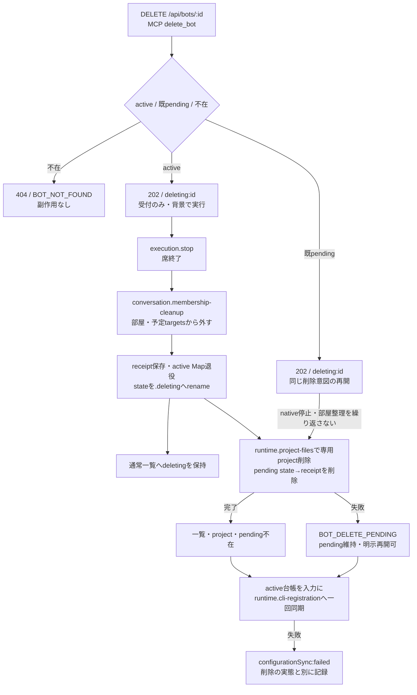

# メンバー削除の受付・再開・完了

[担当の正本](README.md)。実装は[deletion.mjs](../../../../src/members/deletion.mjs)と[BotRegistry](../../../../src/bot-registry.mjs)。

## 入出力と失敗の公開契約

| 窓口 | 契約 |
| --- | --- |
| HTTP `createMemberDeletionApi({administration})` | DELETEだけを受け、`administration.remove(id)`の受付を202/{deleting:id}で返す。GET/PATCHの既pendingは従来どおり404 |
| MCP `deleteBotTool/runDeleteBotTool` | schemaと説明もmembersが所有。botId省略時はfrom。callerはactiveな席として従来の共通認証を通る。既pendingは実行Map不在でも同じinternalApi.remove→HTTP入口へ送れる |
| `startMemberRemoval` | activeはstop→rooms.removeBot→bots.remove。stop/部屋整理の失敗では後続を進めずwriteLog。pendingは既存削除意図だけを再開し、別のnative sessionを起動/停止しない |
| `BotRegistry.hasPendingRemoval(id)` | IDを検証し、split stateの既pending directory又はreceiptの有無を返す。active/不在の分類のためだけに実行Mapへ再採用しない |
| `BotRegistry.remove(id)` | 通常`{id}`。cleanup完了・CLI同期失敗時は`{id,configurationSync:{state:'failed',name,message,code?,status?}}`。同期はcleanup試行後に一回。共有writerの既onChange(bots) Promise/reject契約は変えない |
| cleanup失敗 | `BOT_DELETE_PENDING`をthrowしpendingを残す。同期も失敗した場合は同じ例外の`configurationSync`へ独立した失敗を添える。背景moduleが同期失敗と削除失敗を別のlogへ各一回記録 |
| 同じ対象への並行更新/削除 | BotRegistryの既存プロフィール変更順序でremoveも直列化する。receipt作成途中へ別のcleanupが割り込まない。先の削除完了後は不存在として扱う |
| 初期化の既pending再開 | resumePendingRemovalsの既契約を維持。active stateだけ残る準備receiptを外し、active/pending両方なら競合。CLI同期はbootstrapの別工程 |

configurationSync失敗で削除を未完へ戻したり、削除成功として同期成功を補完したりしない。独立したlogは`BellTeam CLI configuration sync error after delete: <id>:`、cleanup失敗は`BellTeam delete error: <id>:`。自動再送・新しい永続queue・native起動は加えない。

一覧ではreceiptを保持する間deleting=true/online=false。project・pending state・receiptが消えた時だけ通常一覧から消える。背景受付202を物理削除完了として表示しない。room自体の削除はconversationの別契約。

## 所有データ、caller、限定検証

membersは`state/bots/<id>`、`.deleting/<id>`と`<id>.json`、専用`bots/<id>`の削除意図と順序を持つ。projectの実操作はruntimeの公開proxy、部屋参照整理はconversation、native停止はexecutionへ委譲する。共有CLI JSONを直接読書きしない。

直接callerはHTTPの登録、MCPの登録と席API中継、BotAdministrationの委譲、BotRegistryのremove/初期化resume、一覧投影。既export/設定/fixtureは保ち、共通入口の初回差分だけを統合担当へ渡す。機能図はpendingの正規受付と同期失敗の独立を反映し、全体には既存callbackのruntime.cli-registration接続を登録した。

`test/member-deletion.test.mjs`で同期失敗時のcleanup、cleanup失敗との同時報告、receiptだけ/dirだけ/両方のpendingを正規MCP→HTTPで再開、GET/PATCH/完全不存在の拒否、native呼出0、無関係Bot保持、並行cleanupを確認する。既Bot state/registry/Administration/HTTP/MCP/席API試験を直接境界として併走する。

これはsourceと隔離fixtureの修理。実対象Andersonへの再DELETE、手動rm、状態手変更、実席の停止/再起動、本番反映は行っていない。共有JSON競合の修理はruntime担当、外部CLI writerの競合解消までをこの差分の保証に含めない。
