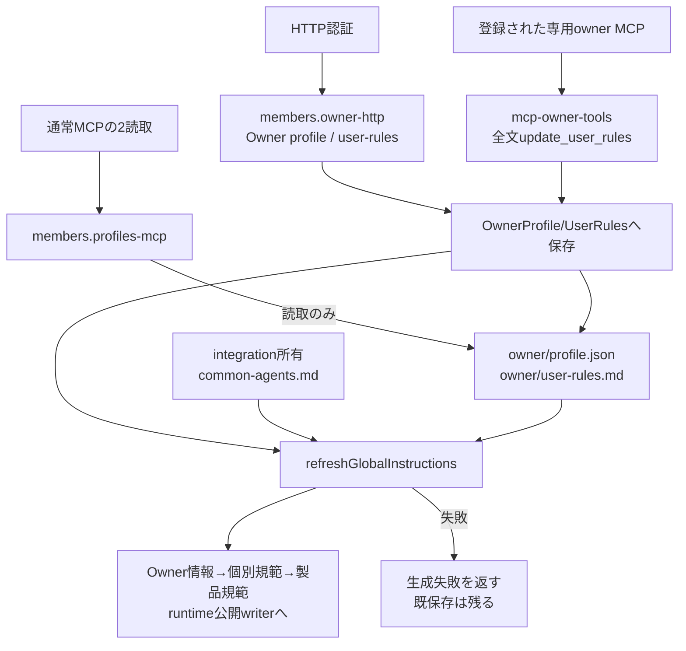

# Owner規範と起動指示

[担当の正本](README.md)。全製品共通テンプレートは[integration](../integration/README.md)、席での実書込みは[runtime](../runtime/README.md)の公開窓口を使う。

## Ownerプロフィールと規範

`OwnerProfile.get/update`が`owner/profile.json`、`UserRules.get/update`が`owner/user-rules.md`を所有する。HTTPの更新と別owner MCPは、保存後に`refreshGlobalInstructions`を呼ぶ。`createGlobalInstructionsRefresher`はOwner情報→ユーザー規範→製品規範の順に生成して、`writeGlobalInstructions`または席proxyに渡す。Bot個別のAGENTS生成とは別責任である。全製品共通テンプレート`config/common-agents.md`は統合担当が所有し、membersは生成経路へ渡された本文を使う。

Webの`createOwnerEditor.save`はprofile PATCH→rules PUTの順であり、一括transactionではない。後段に失敗した時にも前段の保存は残り得る。指示生成失敗も、正本保存の失敗と同じ意味にはしない。[owner-profile.mjs](../../../../src/owner-profile.mjs)、[user-rules.mjs](../../../../src/user-rules.mjs)、[global-instructions.mjs](../../../../src/global-instructions.mjs)を参照。

## 公開handlerと境界

`members/owner-http.mjs:createOwnerApi({ownerProfile,userRules,refreshGlobalInstructions})`はGET/PATCH /api/owner、GET /api/owner/avatar、GET/PUT /api/user-rulesを所有する。createApplicationApiはこの窓口と既conversation assetsを接続する。全経路/status/返却と画像整形を維持する。

通常MCPはprofiles-mcpのget_owner_profile/get_user_rulesによる読取だけ。全文更新は既`mcp-owner-tools.mjs`の専用ownerTools/callOwnerToolへ登録済みの席だけが行い、共通MCPへ新しい更新道具を足さない。登録された席の本人性・公開入口は既設定に従う。本文の型/長さ/余分key検証を保持し、権限を役職の文字列へ置換しない。

どちらの更新も正本保存→指示再生成の順。生成失敗時は元の例外を伝え、保存済みprofile/rulesを消したり成功へ変えたりしない。通常MCPの応答整形、共通認証とエラー変換はintegration。全製品共通テンプレートの変更をmembers内部で行わない。

専用Owner schema/handlerは既に1機能のfileなので移動せずmembersのsource所有を登録した。Ownerの現在値やユーザー規範本文はこの図へ複製しない。global-instructions/ProjectFiles/runtimeの既export・writerを変更せず、直接のOwner/rules/生成/MCP/HTTP試験を確認する。

## 現行の専用owner MCPのwriter

`src/mcp-owner-server.mjs`は独立したstdio入口で、OwnerProfile/UserRulesとglobal refresherを自身で生成する。通常bootstrapとは別実体で同じ正本を書き得る。独立更新では専用権限を保つproxyへ接続してwriterを一本化する必要がある。[契約入力](module-update.md)に初回の変更範囲を記した。現行sourceで既に一本化済みとはしない。
