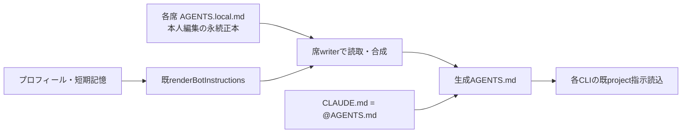
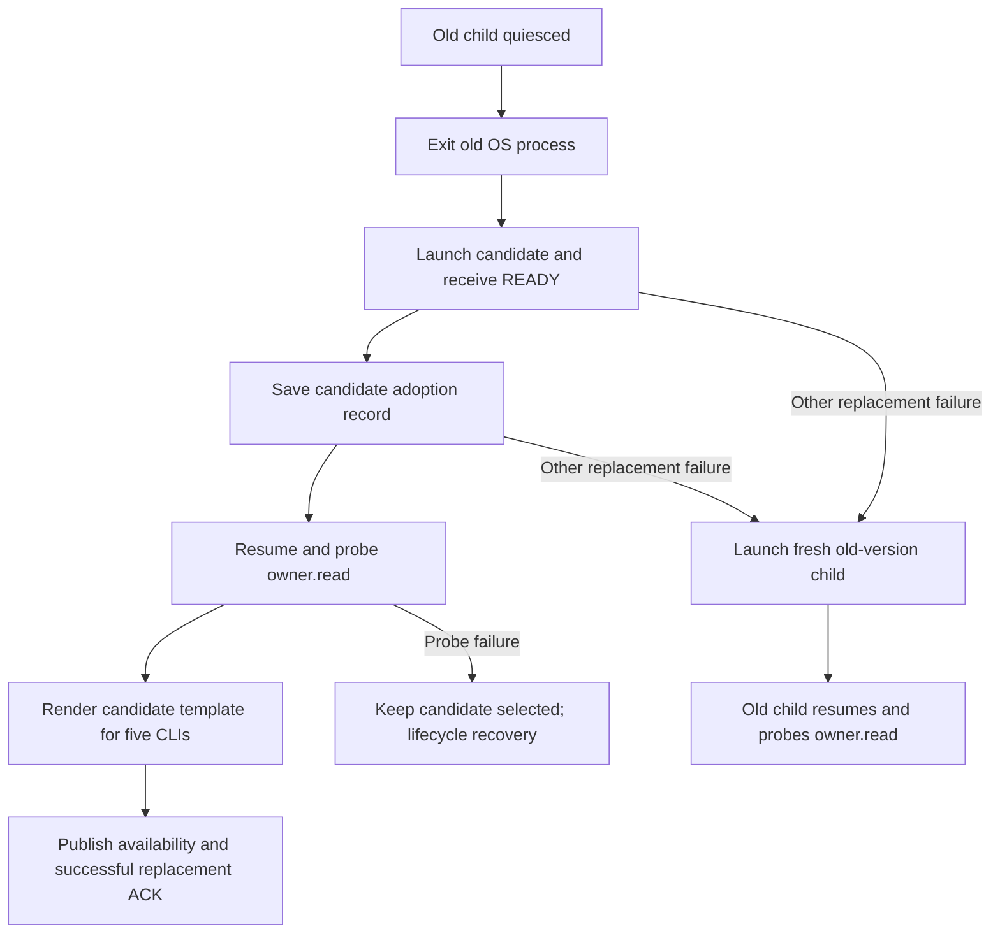

# Owner規範と起動指示

[担当の正本](README.md)。全製品共通テンプレートは[integration](../integration/README.md)、席での実書込みは[runtime](../runtime/README.md)の公開窓口を使う。

```mermaid
flowchart TD
  Http["HTTP認証"] --> Owner["members.owner-http<br/>Owner profile / user-rules"]
  Read["通常MCPの2読取"] --> Member["members.profiles-mcp"]
  BotWrite["通常MCP update_user_rules<br/>text"] --> Code["profiles-mcp: before=現在値, after=正規化text<br/>code=HMAC(process key, from/before/after) 8桁"]
  Code --> Proof["呼出Botの直接会話timelineで24h以内<br/>messageAuthor.kind=user のOwner入力の全文が<br/>「規範変更を承認 code」か"]
  Proof -->|"無し"| Proposal["保存しない。差分+「規範変更を承認 code」を<br/>呼出Botからユーザーへ送る。approval.required"]
  Proposal -->|"Owner本人がその言葉を送る→同じtextで再呼出"| Code
  Proof -->|"有り: messageId/at/quote"| BotSave["members rules.botUpdate<br/>actor=bot, before固定"]
  BotSave -->|"現在値≠before"| Changed["USER_RULES_CHANGED 409<br/>読み直して案を出し直す"]
  Dedicated["登録された専用owner MCP"] --> Rules["mcp-owner-tools<br/>全文update_user_rules"]
  Owner --> Save["OwnerProfile/UserRulesへ保存<br/>rules.update actor=owner"]
  Rules --> Save
  BotSave --> Save
  Member -->|"読取のみ"| Data["owner/profile.json<br/>owner/user-rules.md"]
  Save -->|"本文が変わった時だけ先に追記"| History["owner/user-rules-history.jsonl<br/>at/actor/instruction/before/after"]
  Save --> Data
  History --> HistoryApi["GET /api/user-rules/history<br/>rules.history 新しい順50件"]
  BotSave -->|"保存後"| Notice["呼出Botからユーザーへの直接会話に<br/>自動記録: 誰/時刻/根拠/差分"]
  Save --> Refresh["refreshGlobalInstructions"]
  Generation["新members世代の初回owner.read<br/>候補の準備確認、利用可能の公開前"] --> Refresh
  Common["integration所有<br/>common-agents.md"] --> Refresh
  Data --> Refresh
  Refresh --> Write["Owner情報→個別規範→製品規範<br/>runtime公開writerへ"]
  Write --> Globals["home下5CLIのAGENTS<br/>次の通常指示読込から"]
  Refresh -->|"失敗"| Failure["生成失敗を返す<br/>既保存は残る"]
  Refresh -->|"世代起動時の失敗"| Diagnostic["初回だけdiagnostic MEMBERS_GLOBAL_INSTRUCTIONS_FAILED<br/>owner.readは成功、次のowner.readで再試行"]
```

## 本人編集の個別指示と生成AGENTS

正本は `/srv/bellteam/bots/<bot-id>/AGENTS.local.md`。これは全席が任意に使える個別指示で、生成処理が作成・編集するファイルではない。本人と正規の設置担当はこのファイルを保存し、次の起動準備又は既プロフィール更新から再生成する。roleへ本文を入れず、生成AGENTS/CLAUDEを直接編集しない。

保存直後の再生成には既MCP `update_self({})`、設置担当は `update_bot({botId})` を使える。これはプロフィールへの追加fieldや新権限ではなく、既プロフィール保存から指示生成を呼ぶ操作である。正本の保存だけでは実行中CLIの既読込済みcontextを変更しない。CLIが次に起動指示を読む時から反映される。生成本文には正本の内容を短期記憶より前に置き、短期記憶を更新しても正本を削除しない。

`ProjectFiles.writeInstructions` と `operateMembersProject` のwriteInstructions/prepareStartupContextが、既プロフィール・短期記憶の生成本文に個別正本を合成する。正本無し/空は既本文を維持、改定は次の再生成で読む。プロフィール変更・harness変更・短期記憶更新も正本を書き換えず、CLAUDEは既参照一行を維持する。固定pathの通常ファイルだけを読み、symlink/所有者不一致/読取中変化等は生成AGENTSを書き換える前に拒否する。失敗を個別指示無しの成功へ丸めない。

CLI固有のAGENTS.overrideやCLAUDE.localに依存しない。個別指示は生成AGENTS本文として届き、各CLIの既読込経路と制限に従う。教本等の内容・改訂判断・責任境界を生成機構が決定しない。個別正本を削除又は空にした後の再生成で追加本文を除去できる。

## Ownerプロフィールと規範

`OwnerProfile.get/update`が`owner/profile.json`、`UserRules.get/update/history`が`owner/user-rules.md`と`owner/user-rules-history.jsonl`を所有する。HTTPの更新、通常MCPのBot更新と別owner MCPは、保存後に`refreshGlobalInstructions`を呼ぶ。`createGlobalInstructionsRefresher`はOwner情報→ユーザー規範→製品規範の順に生成して、`writeGlobalInstructions`または席proxyに渡す。Bot個別のAGENTS生成とは別責任である。全製品共通テンプレート`config/common-agents.md`は統合担当が所有し、membersは生成経路へ渡された本文を使う。

### 全文共通指示の有効template

共通規範の正本は`config/common-agents.md`一か所。全文を`renderGlobalInstructions`が各CLIのglobal指示へ組み立て、`writeGlobalInstructions`が既存5つの指示ファイルへ保存する。`SECTION models`を含む全文はそのまま保持し、通常dispatch/steer本文へ同じ節を再付記しない。通常配送は元の入力本文を維持する。別段落やUserRulesに規範を複製しない。背景agentの実行・入力束縛・要約投影はexecution、設定保存はusage、共通組立はintegrationが所有する。既API/handler/DTO/TTLはこの差分では変えない。

供給にはbuiltinの`package-server.mjs`収録config、members artifactの本文生成用config、executionの`EXECUTION_FILES`収録configを従来どおり同じSHAへ揃える。前者のglobal helperとmembers dispatcherは各配置内のtemplateを読み、execution artifactは既署名版との互換性のためassetを保持するが、新しいdispatchでは読み込まない。stateのUserRules更新だけではこのtemplateは変わらない。module導入で配置のtemplateが変わった時は、新世代の初回owner.readでglobal指示へ反映する。採用mainからの通常image又は既公開moduleの反映単位・供給順はintegration/distribution/runtimeの既条件に従う。

全文の正規生成契機はbootstrapのglobal refresher、正規Owner/UserRules保存後のmembers `writeGlobal`、又は新members世代の初回`owner.read`。どれも`global.writeInstructions`→runtime writerへ渡す。initialize/resumeはleaseを持たずeffectを出せないため、世代起動の生成は親が全世代へ必ず送る準備確認`owner.read`（lease付き）の中で世代ごとに1回だけ行う。これでmembers module導入時に、その配置のtemplateで5CLIのglobal指示が本体交換なしに更新され、本体再起動時もbootstrapのbuiltin版の後に採用版templateが上書きする。生成失敗でもowner.readは成功させ、membersを止めない。成功するまで同世代の次のowner.readで再試行し、diagnosticは世代ごと最初の1件だけ出す。各owner.readは自分のcontextで生成を1回ずつ直列に試み、成功済みの世代では書かない。read pinのowner.readが準備確認より先や同時に来た時、親がそのeffectを拒否する（MEMBERS_EFFECT_UNSUPPORTED）のは異常として報告せず、待っているlease付き読取は他の試行の結果を流用せず自分のleaseで生成する。Owner/UserRules保存も従来どおり再生成する。members initializeのrestore/projection、個別profileやAGENTS.local再生成だけをglobal生成と扱わない。生成した全文は各CLIの次の通常指示読込から使う。配送本文は呼出元の原文を維持し、既配送本文/既読込contextの遡及更新や、nativeによる初回tool順序強制は行わない。

### Candidate probe and rollback ordering

The active members assembly uses `src/members-process.mjs` (`members-assembly.mjs`), not the generic module controller. Its replacement flow exits the old child, launches the candidate, saves the adoption record, then resumes the candidate and probes `owner.read`. The generation render therefore runs before the caller receives successful replacement/availability ACK, but after durable candidate selection. A render failure alone still returns a successful `owner.read` and retries on a later read.

A failed probe takes lifecycle recovery without old-version rollback. Other rollback errors after old-process exit launch a fresh old-version child; they never reuse the previously rendered child. That fresh child renders its own template on its first probe if its version includes this refresh hook. Restoring a pre-hook version cannot promise automatic refresh: candidate global files may remain until an Owner/UserRules save, another generation with the hook, or body bootstrap refreshes them. Only drain/preparation failure before candidate launch reuses the same old child, and then no candidate render has occurred. Sources: `members-process.mjs` replacement/resume and `members/dispatcher.mjs` generation refresh. The parent continues to issue only the documented `owner.read`; no parent change is needed (Molly, 2026-11-08).

Webの`createOwnerEditor.save`はprofile PATCH→rules PUTの順であり、一括transactionではない。後段に失敗した時にも前段の保存は残り得る。指示生成失敗も、正本保存の失敗と同じ意味にはしない。[owner-profile.mjs](../../../../src/owner-profile.mjs)、[user-rules.mjs](../../../../src/user-rules.mjs)、[global-instructions.mjs](../../../../src/global-instructions.mjs)を参照。

## 公開handlerと境界

`members/owner-http.mjs:createOwnerApi({ownerProfile,userRules,refreshGlobalInstructions})`はGET/PATCH /api/owner、GET /api/owner/avatar、GET/PUT /api/user-rules、GET /api/user-rules/historyを所有する。createApplicationApiはこの窓口と既conversation assetsを接続する。全経路/status/返却と画像整形を維持する。

通常MCPはprofiles-mcpのget_owner_profile/get_user_rulesの読取と、ユーザーの明示指示がある時だけの`update_user_rules`（Owner 2026-11-10、Trony経由）。専用`mcp-owner-tools.mjs`のownerTools/callOwnerToolは従来どおり残す。本文の型/長さ/余分key検証を保持し、権限を役職の文字列へ置換しない。

### Botによるユーザー規範の更新（Owner本人の承認だけ）

- 入力: `update_user_rules({text})`。textは全文置換。Botはユーザーが直接会話で自分の言葉で頼んだ時だけ呼ぶ（common-agents RULE owner.rules-write）。ただしその頼みは保存の根拠にしない。引用は文の証拠であって、規範変更の許可ではないため（Epinel #876 review）。
- 承認の運び方: profiles-mcpが`before`（現在値）と`after`（`normalizeUserRules(text)`）から、親プロセスごとの乱数鍵で`code = HMAC(key, [from, before, after])`の先頭8桁（16進大文字）を作る。鍵はBotに見えないので、Botは示された差分以外のcodeを作れない。呼出元`from`（ingressが決めたBot ID、引数ではない）の直接会話timeline（conversationの公開`store.timeline`）で、24時間以内の`kind=message, direction=outgoing, messageAuthor.kind=user`（conversationが認証済みOwner入力だけに付ける作者、#877）の発言の全文が、通知した承認の言葉`規範変更を承認 <code>`そのものなら承認とする。照合は空白（全角含む）を除き、全体を囲む「」一組を外し、大文字小文字を問わない。codeに触れただけの発言（「その<code>は承認しない」、質問、前後に言葉が付いたもの）は承認にならない。`send_user_message`等のBot代筆（`messageAuthor.kind=bot`）、作者の無い過去記録（`unknown`/欄なし）、peer、予定、ルームは承認にならない。
- 承認が無い時: 保存せず、呼出Botからユーザーへの直接会話に「承認のお願い」（Bot名・JST時刻・行差分・「規範変更を承認 code」を送れば保存、24時間有効）を送り、`{text: before, changed: false, approval: {required: true, notice: {delivered}}}`を返す。
- 拒否（guard）: 承認が無い保存と、承認後に本文が変わった保存。守るもの: 既存状態（Ownerの規範の正本）の上書き。Ownerが見ていない差分は書かない。self-exit: 状態を持たない。Ownerが示された言葉を送ると、同じtextの次の呼出が保存する。`USER_RULES_CHANGED`の時は読み直して出した新しい案に、新しいcodeが付く。親の再起動は鍵を替えるだけで、次の呼出が新しい案を送る。Owner HTTPの保存は常に通る。
- 保存: members `rules.botUpdate {text, before, botId, instruction:{messageId,at,quote}}`（quoteは承認したOwner発言、ownerWrite不要。承認の確認は親のprofiles-mcpが済ませる）→ Owner保存と同じ直列化の中で、現在値が`before`と違えば`USER_RULES_CHANGED`(409)で書かない → 保存・`refreshGlobalInstructions`。結果は`{text, before}`。承認済みcodeは`before`に結び付くため、保存後は同じcodeが別の差分へ効かない。
- Ownerへの見え方: 本文が変わった保存は、Owner/Botどちらも`owner/user-rules-history.jsonl`に`{schema:'bellteam.user-rules-change.v1', at, actor:{kind:'owner'}|{kind:'bot',botId}, instruction?, before, after}`を追記し、`GET /api/user-rules/history`（members `rules.history`、lease付き読取）が新しい順50件を`{changes}`で返す。Botの保存後は、そのBotからユーザーへの直接会話に、Bot名・JST時刻・承認した発言・行差分の自動記録を送る。Web/Apple/Windowsはクライアント変更なしで会話として見える。通知の失敗は保存を取り消さず、結果の`ownerNotice.delivered=false`で返す。
- 差分の計算（`userRulesDiff`、承認前にも走る）: 共通の先頭・末尾行を除き、残りの行数の積が100万以下の時だけLCS（Uint16、最大2MB）を使う。超える時は残りの旧行を全部`- `、新行を全部`+ `で並べる。どちらも変更の全体を示し、時間とメモリは入力20,000字に比例して収まる。
- 前提: conversationの`messageAuthor`（#877）。それより前の配置では作者付きのOwner発言が無いので、Botの保存は起きない（案の通知だけ）。

どちらの更新も正本保存→指示再生成の順。生成失敗時は元の例外を伝え、保存済みprofile/rulesを消したり成功へ変えたりしない。通常MCPの応答整形、共通認証とエラー変換はintegration。全製品共通テンプレートの変更をmembers内部で行わない。

専用Owner schema/handlerは既に1機能のfileなので移動せずmembersのsource所有を登録した。Ownerの現在値やユーザー規範本文はこの図へ複製しない。global-instructions/ProjectFiles/runtimeの既export・writerを変更せず、直接のOwner/rules/生成/MCP/HTTP試験を確認する。

## 現行の専用owner MCPのwriter

`src/mcp-owner-server.mjs`は独立したstdio入口で、OwnerProfile/UserRulesとglobal refresherを自身で生成する。通常bootstrapとは別実体で同じ正本を書き得る。独立更新では専用権限を保つproxyへ接続してwriterを一本化する必要がある。[契約入力](module-update.md)に初回の変更範囲を記した。現行sourceで既に一本化済みとはしない。

## Common-rules DSL prefix (Owner 2026-11-07)

Function: integration owns the verbatim DSL prefix in config/common-agents.md. DFD: unchanged rendered Owner/user prefix + full common template → existing five CLI global writers. `SECTION models` stays in those full global instructions; execution forwards the caller's original message text without a `bellteam_task_settings` suffix. members/dispatcher and members/instructions pass the template through without heading parsing. Root’s fixed communication-through-Japanese-preamble DSL is copied verbatim; the original English Ponytail body remains byte-identical. No endpoint, write location or runtime policy parser is introduced.

Root final content decision supersedes the initial prefix-only constraint: the two canonical fenced DSL blocks form the common policy, followed by the original English Ponytail text. Both fenced blocks and the pass-through renderer/writers are unchanged; only execution's duplicate per-delivery suffix is removed.
