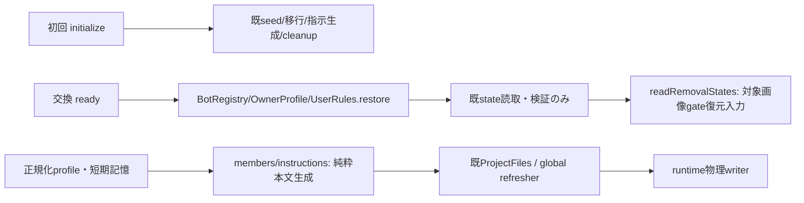
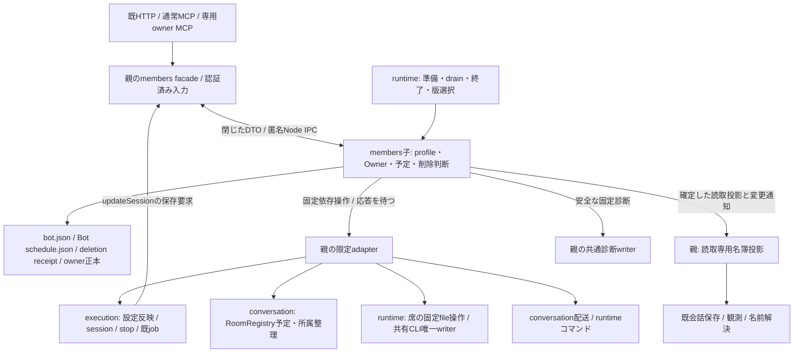
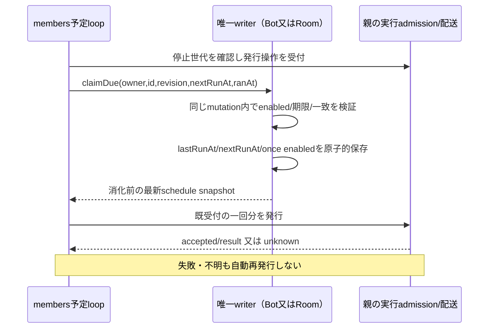
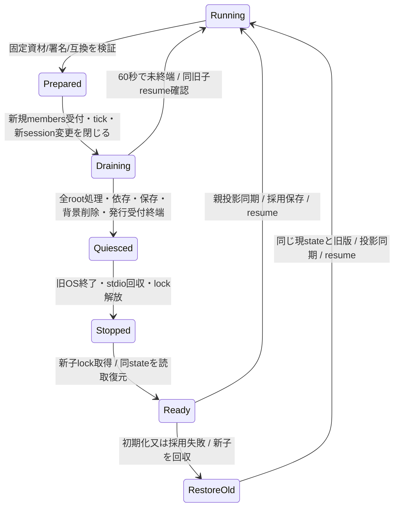

# メンバー・予定の独立更新：契約入力

担当：ベロータ。入力sourceは `9e83c192a9b624e3c5e891df65953e755d098314`（PR272）。初回案をRoot公開契約v1（作者席正本SHA256 `7c0a83e3dba30607b6dfe098d55c51ac4e7c14d00acc896e50ab37d9eaaf6a0e`）で固定し、段階実装中。既存動作は[registry](registry.md)、[profiles](profiles.md)、[schedules](schedules.md)、[deletion](deletion.md)、[instructions](instructions.md)が正本。単独交換・配布受入済みという意味ではない。

## 実装した内部接点（第一差分）

`BotRegistry.restore()`は既`.initialized`、bot.v8、schedule.v1と削除receiptを検証してrefreshする。seed/migration/cleanup/モデル照会/指示書込/CLI同期は呼ばず、欠損や未知形式を修復しない。通常initializeは既動作を維持する。OwnerProfile/UserRulesのrestoreも存在必須の読取のみで、既getの未初期化互換動作とは分ける。これらはchild ready組立の公開口であり、まだ親bootstrapへ第二writerを追加しない。

`BotRegistry.readRemovalStates()` → `{removals:[{botId,active,hasIntent:true,retired}]}`。毎回既receipt/退役directoryと当該writerのintentを読む。active/pending両directory競合や不正receiptは失敗。不明を空一覧にしない。親conversationの起動前gate復元用であり、cancelのactive/intent無し条件を証明する口ではない。通常運転中のcancelは同per-Bot直列化内のfresh判定が必要。

`renderBotInstructions(profile, shortTermMemory='')`と`renderGlobalInstructions(owner,rules,commonRules)`を`src/members/instructions.mjs`で公開。前者には正規化profileとtrim済み短期記憶、後者には既Owner/rulesと同配布物のcommon本文を渡す。ファイル操作なし。既ProjectFiles/global refresherもこの関数を使い、既export/物理writerと出力を維持する。

`src/members/state-compatibility.mjs`の`MEMBERS_STATE_COMPATIBILITY`と`assertMembersStateCompatibility(value)`は既形式6key/valueのexact宣言/検証。宣言一致は実state検証の代用ではなく、restoreを別に行う。entry/dispatcher/IPC/effect/claim切替は次差分で、未供給のfactoryがあるように呼び出さない。

Rootの全体設計に沿い、membersの台帳・規範生成・予定定義/発行判断を固定版の子processへ移す。既AIのtransport/job/watch・会話writer・RoomRegistry・共有CLI登録writerは生かす。同UID1001内の協調writer分離を提案し、別UIDのOS隔離を成立済みとはしない。共通入口と組立てはモリー、起動/排他/版交換はエピネル、署名配布はセンチ。各担当の公開契約をRootが固定してから実装する。

## 現状と初回の分離

親でBotRegistry/OwnerProfile/UserRulesをもう一つ生成しない。親に残すのは読取投影と公開操作adapter。`get/has/keys/values`互換の投影は内部判定の正本にならず、変更は子が現在状態を読み検証する。既BotSessionStateのnative観測と不明状態はexecutionのまま維持し、それをprofile保存の代用にしない。

### 固定sourceのcaller一覧

| caller群（全体検索から分類） | 現接点 | 変更する境界 |
| --- | --- | --- |
| `bootstrap.mjs` | Registry/Owner/UserRulesの生成、initialize、全指示、configure、環境復元 | 起動時一回の移行と子attachを分離。交換でbootstrap全体を再実行しない |
| `members/{profiles-mcp,profiles-http,owner-http,schedules-mcp,schedules-http,deletion}.mjs`、`mcp-owner-tools.mjs` | public受付とRegistry直呼び | 既schema/HTTP wireを保ち専用操作へ。部屋資格は既room-accessを使う |
| `mcp-owner-server.mjs` | 別processでOwnerProfile/UserRulesとglobal writerを生成 | 専用権限を保つproxyへ。**これを残すとOwner正本のwriterが二重になる**。通常MCPへ更新を公開しない |
| `http-server.mjs`、`mcp-tools.mjs`、`seat-mcp.mjs`、`http-events.mjs` | refresh、caller資格、Map、watch | モリーの共通facade接続。SSE通知は再読込の契機で正本ではない |
| `application-services.mjs`、`bot-administration.mjs` | preview/update、prepareStartup、session/fast保存、適用Map | async公開操作。稼働反映/receipt/停止はキロの所有を保つ |
| `messenger.mjs`、`room-messenger.mjs`、`room-registry.mjs`、`identity.mjs`、`member-identity.mjs`、`mcp-conversation-tools.mjs` | 名簿照合・名前・room member検証 | 確定投影を読取り、変更は公開操作で再検証。対象削除の資材save停止はconversation所有 |
| `self-turns.mjs`、`seat-turns.mjs`、`idle-sessions.mjs`、`turn-reports.mjs` | 観測対象/名前、定期処理 | 交換で停止/再生成しない。新session変更のadmissionだけ実行担当へ |
| `http-{bot,conversation,goal}-api.mjs`、`call-bridge-server.mjs` | 存在/対象取得 | 公開async refresh又は確定投影。既受付の出力保存は名簿子の応答に依存させない |
| `onboarding.mjs`、`harness-auth.mjs`、`owner-questions.mjs`、`secret-requests.mjs`、`card-timelines.mjs`、`usage/{http-api,application-features,notifications}.mjs` | create/update、資格、名前、一覧 | onboarding固定ID作成も専用認証済操作。通知/カード既保存のcallbackは投影で継続 |
| `memory-service.mjs`、`seat-runtime.mjs`、`bot-environment.mjs`、`harness-config.mjs` | project列挙/名前解決/一回初期化 | runtime/記憶の公開操作へ必要fieldだけ渡す。再初期化やCLI writer複製をしない |
| `scheduler.mjs`、`ai-control.mjs` | tick、手動run、mark、resume skip、commandJobs、03時idle整理 | 下の発行契約と停止接点に分ける。AI全体停止をmembers更新の手段にしない |
| `server-state-{ownership,writers,transfer}.mjs`、保守scripts | 一括移行/権限/backup | 通常稼働writerではない。全体保守EXでmembers子も止まる条件をruntime/配布が合わせる |

`push-notifications.mjs`内の旧bots参照は現通知子の稼働callerではない（9e83はusage facadeで名前を射影する）。残存sourceを新しい台帳writerとして配線しない。全行の検索原本とSHAは作者席 `integrations/members-module-update-20261103/` に保存する。

## 唯一writerとpath

以下は通常split-state構成の絶対path。旧非split構成からの初回移行は既installer/transfer契約で扱い、子が勝手に採用しない。

| 対象 | 唯一の業務writer / 交換時の扱い |
| --- | --- |
| `/srv/bellteam/state/bots/<id>/bot.json` | members子BotRegistry。profile/sessionを同じBot別mutation順序で保存。schema v8を維持 |
| 同`/schedule.json` | members子。schedule-definitionとmutateSchedulesを同じprocessに持つ。既schedule.v1/revisionを保持 |
| `/srv/bellteam/state/bots/.deleting/<id>`、`<id>.json`、`.initialized` | members。退役rename/cleanup/receiptを所有。新子のread-only attachで削除を再実行しない |
| `/srv/bellteam/owner/profile.json`、`user-rules.md`と各一時file | members子。profile更新と規範生成を所有者単位で直列化。専用owner MCPの直接writerを廃止して接続する |
| `/srv/bellteam/rooms/<id>/schedule.json` | **親RoomRegistryだけ**。members子は公開list/set/remove/claim/skipを使用。部屋作成/削除/removeBotも同じ所有者へ |
| `/srv/bellteam/state/bots/<id>/messages/assets/*`、`/srv/bellteam/owner/messages/assets/*` | conversation MessageAssets。members交換では触れない。Bot親dirの退役renameは対象画像saveの停止/完了後だけ |
| `/srv/bellteam/bots/<id>/{AGENTS.md,CLAUDE.md,memory/previous-session.md}` | 生成判断はmembers。実書込みはruntimeのUID1000固定操作。Bot自身のdocs等を交換時に触らない |
| `/home/bell/.{claude,codex,grok,cursor,gemini}/AGENTS.md`等 | 本文生成はmembers、物理writerは既runtime公開global指示操作。共有CLI JSONの直列化はSeatRuntime一実体 |
| `state/members.lock`、`state/members-release.json`（提案） | 前者は子の生存中排他、後者はruntime親の採用record。業務stateのsnapshot戻しには使わない |

`state/bots`や`owner`全体をmembers専有directoryとは呼ばない。画像writerを含む親directoryのrenameと保守には所有者間の区切りが必要。別UIDの割当/移設は今回の契約から勝手に決めない。

## 公開操作DTO案

methodは下表の固定列挙。任意objectのメソッド名、関数、Map、Promise、任意path/UID/envを渡さない。親だけが既認証からactor/capabilityを付け、Bot申告のfrom/役職を権限にしない。通常HTTP/MCPの説明・引数・返却shapeは既adapterで維持する。

| 親→membersの操作 | 入力 / 返却と作用 |
| --- | --- |
| `profiles.read` / `profile.read` | `{}`又は`{botId}`。active/pendingと既profile field。画像本文は専用読取で返し、通常MCPは既URL整形 |
| `profile.create` | `{input, seedId?}`。既create schema、seedIdは初期案内の内部経路だけ。保存後部分失敗は取り消さない |
| `profile.preview` / `profile.update` | `{botId,changes}`。既PROFILE_FIELDSだけ。model等の適用判断は親Administration。sessionは不可 |
| `profile.session` | `{botId,session}`、実行担当の内部callback限定。保存ACKまで旧native操作の処理範囲に含める |
| `profile.startup` | `{botId,shortTermMemory}`。固定previous-sessionと個別指示を更新。ネイティブ起動は行わない |
| `profile.remove` / `removal.state` | `{botId}`。前者は既202受付/背景削除、後者はactive/pending/absent。新規背景作業はdrainのactive集合に含む |
| `owner.read/update` / `rules.read/update` | `{}`、`{changes}`、`{text}`。更新はOwner HTTP又は専用owner MCPの権限のみ。保存後生成までを追跡 |
| `schedules.list/set/remove` | `{ownerKind:'bot'|'room',ownerId,input?|scheduleId?}`。roomは親の資格確認と唯一writerへ委譲 |
| `schedules.run` | `{ownerKind,ownerId,scheduleId}`。既手動実行、nextRunAt/enabledを変更しない。受付不明を再送しない |
| `schedules.prepareResume` | `{at}`。旧tick終端を待って期限内だけskip。AI OFF→ON前の既公開接点、失敗時はOFFを維持 |
| `schedules.interruptCommands` | `{}`。既停止要求を全jobへ先に送り、stopConfirmedを合成。交換の通常drainからは呼ばない |

親への依存操作は固定union：モデル候補照会、runtimeのproject新規取得/初期化/削除/固定内容読書き/CLI同期、executionの対象stop、conversationの対象cleanup・Room予定操作・既配送、記憶ensureScope、診断。各引数は既公開窓口の必要fieldだけ。profile.project/home/rootは認証済botIdと固定構成から親が解決する。CLI同期へはactiveの`{id,project}`だけ、aiterm/秘密設定は親に残す。

**IPC容量**：通知の64KiBをそのまま流用できない。既HTTPは16MiB、profileには最大3,000,000文字の画像fieldが4つある。業務本文上限は既16MiB＋固定envelope枠とし、method毎の既field上限も維持する案。要求/応答をログへ出さない。初期一覧は画像を除いた1profileずつの限定転送で流量を制御し、全件完了後だけ投影を交換する。巨大な全名簿を1messageへ詰めず、公開APIへ新しい件数上限を足さない。snapshot開始/項目/完了と変更はchannel内の順序で照合し、途中失敗は旧投影を正本へ昇格しない。並行数/timeoutの具体値はruntimeと固定する（通知の64件を容量検証なしに転用しない）。

### 規範/ProjectFilesの更新可能な実装

現在のSeatRuntimeはimage内`run-seat-runtime.mjs`からProjectFilesをimportする。子へRegistryだけ移すと個別AGENTSの生成コードがimageに残る。membersに純粋な本文生成を置き、runtimeには既botIdの固定fileを読み書きする公開操作を依頼する。previous-session読取→本文生成→AGENTS/CLAUDE保存は同じBotのmutation/drainに含める。global-instructionsもmembers配布物の共通テンプレートと生成関数を用い、物理書込だけ既runtimeへ渡す。共通規範の内容所有は変えない。

## 受付と部分成功

通知の `{type:'request',id,method,params}` → `accepted` → `result` とcontrolを最小再利用する。acceptedは検証・受付後、業務作用前。unsent/明示拒否だけnot_accepted、送信試行後の期限/断線はunknown。同じID/本文を自動再送しない。channel内idは相関用で永続重複排除の鍵ではない。

保存成功・runtime生成失敗・CLI同期失敗・native反映失敗を一つの成功へ潰さない。既作成/Owner保存後生成失敗、削除cleanupとconfigurationSync、Administrationのpending/accepted/failedを保持する。子→親依存操作にも受付/結果の区別が要る。親adapterがnot_acceptedを返した時だけ未作用と言え、自由stack/本文を転送しない。

全体の受付停止を先に全channelへ掛けると、子が待っている逆向きruntime/Room操作やsession保存が通らずdrainが止まる。**新規root業務要求だけ閉じ、受付済み要求の依存応答と内部保存callbackは終端まで開く**。逆向き操作の因果関係は既channel要求の相関に結び付ける。public payloadから内部callback権限を作れない。

## 予定の一回分とrevision

現9e83はdispatch→markScheduleRun。revisionは編集を守るが、dispatch後mark前の子喪失で再発行を防げない。以下は**Root/N102/キロへ固定を求める変更案**で、既実装の保証ではない。

- claimは新IDやqueueを作らず、既`ownerKind/ownerId/schedule.id/revision/nextRunAt`で照合。競合編集・skip・削除・先行claim後はnullで発行0。revisionは編集世代のまま、発行で勝手に増やさない。
- Botはmembers、RoomはRoomRegistryの既mutateSchedules内に実装。有限ranAtと期限到来も検証する。removeBotのtargets整理はrevisionを増やさないため、list時の古いprompt/targetsを使わずclaim時の最新snapshotを発行する。claim後の参加者変更も既RoomMessengerで検証する。返却はno-opの`null`又は消化前の最新schedule snapshot。保存ACK不明時は発行しない。同じ要求の自動再送や、読取りだけで前回の発行権を再構成しない。未終端のclaimが残る間は次の同一回を進めず、交換のdrainにも含める。次tickも消化した同一回を自動再発行しない。
- 保存後・発行前の死亡では一回分が未配送になる。この案は**一回までの発行**を優先し、必達/ちょうど一回を約束しない。lastRunAtは配送成功時刻ではなく試行時刻という既意味を明記し、判明した未発行/unknownを診断へ残す。電源断耐久性は既writeAtomicの限界を超えた保証にしない。
- AI停止を先に検出した場合はclaim0。claim後に停止世代が変わればnative/command発行0・その一回分は再送せず停止結果を残す。親admissionは既AiControlの世代検証を保持し、子に別paused正本を置かない。
- `prepareResume(at)`はtick/claimを区切った後、at以下だけ既skipped semanticsで処理する。交換中のOFF→ONは拒否してOFFを維持し、未完処理をON成功へしない。全体STOPは交換中も優先して通す。
- 手動runは別の明示依頼で、定時のclaimへ混ぜない。HTTP202の断線を再runしない。定義/削除とBot退役の直列化も同一ownerで合わせ、退役後にschedule読取の空file生成でactive directoryを復活させない。
- キロの確認に従い、既`commandJobs`/runner/AbortController/completion/失敗通知/interruptCommandsは親に保持する。子は保存済み予定の一回のcommand発行を親の限定窓口へ渡す。交換drainは発行受付/登録の終端までで、開始済みcommandの完了を待たず、通常交換ではabortしない。global STOPは親の同じjob集合へ全abortを先に送る。membersの独立単位は予定定義/時刻判断/発行受付であり、実行jobの寿命はexecution/runtimeの境界として図示する。
- 東京03時の`maintenanceDate`とisIdle/isRunning/Throughline回数→restartIfIdleは親に保持する。別のIdleSessionsの30分観測/seen/closeIdleも親に残す。子の交換で日付を初期化せず、交換自体はnative restartを呼ばない。

## 交換のdrainと既AIの生存

親transport、BotSessionState、Administration.applications、DeliveryJob、watch、会話writer、RoomRegistryは同じ実体を維持。キロが必要性を確認した交換epoch＋入場/終了tokenを親の公開barrierとして追加する案。wakeはprepareStartup前からnative→updateSession/fast保存まで、restartはclose→wake保存までを一tokenで覆う。既sessionChangesはRPC返却で消え保存まで覆わず、waking/whenIdle/close/停止barrierは入場停止の代用にならない。reconfigureの既AI idle待ちはtoken外に置き、idle後/native直前にepochを再検証して、交換中又は古いepochの未発行処理をnot_acceptedにする。既AIが回答中というだけでは待たず、出力・履歴保存・既receipt/session/launch/turn・stopは生存させる。内部の不明sessionを作り直して正常扱いしない。

予定依存やsession callbackが旧子へ戻る必要がある間は、旧子をquiescedにしない。members controllerの予約とexecution側のadmissionを同一開始順で合わせ、開始前から走っていた操作のcallbackを拒否しない。具体barrierはキロの公開操作として供給してもらう。

計画交換中の名簿は書込みを閉じた確定投影として、既会話の名前解決/観測に使える。認証/本人性や新規操作の前提にはfresh async窓口を使い、seat-mcpの利用不能を未登録400、HTTPの利用不能を不存在404へ丸めない。交換中の表示はstale/unavailableを明示する。新しいプロフィール/予定/削除/Owner更新は503 not_acceptedで返し、永続・無制限bufferは作らない。未知の子断線時は投影を正常な最新状態として新しい権限変更/起動に使わず、既受付の出力は捕捉済みidentityとreceiptで保存する。投影の消去や再構築から既jobを停止しない。

60秒で区切れなければ旧子を殺さずresume ACK後に受付を戻す。ACK不明ならunavailable、新writer0。quiesced後の回収5秒/new ready45秒は通知と同条件の候補。親の逆向き未終端操作も0を確認してから旧OS終了へ進む。子IPC消失でparent effectsまで取消済みと推測しない。

## 削除と初期化・戻し

削除202後の背景処理を追跡集合に登録する。activeはexecution.stop→conversationの対象save/所属整理→receipt保存・退役rename→runtime専用project削除→pending/receipt削除→CLI同期。pending再開では別nativeを起動/停止しない。N102の新公開案`prepareBotAssetRemoval(botId)`で画像owner=削除Botの新save/saveAllを先に閉じ、readImageからwriteまで待って成功確認後にrenameする。固定版にはこの窓口が無い。宛先Botを対象にしてuser画像まで止めない。退役前のactiveかつ同じ削除意図無しが確認できた中止だけ`cancelBotAssetRemoval(botId)`を使える。pending/不明では自動再開せず、既receiptから復元し別の永続tombstoneを増やさない。共有履歴・他Bot・owner画像を消さない。members交換は削除処理の区切りまで待ち、途中で期限なら旧resumeする。

新子readyで現`BotRegistry.initialize()`をそのまま呼ばない。同関数はseed/migrateProfiles/resumePendingRemovals/全員AGENTS生成を行う。初回image導入の移行/一回bootstrapと、単独交換のread-only attachを分ける。attachは既`.initialized`/schema/構造を検証し、profile/予定/既pendingの状態を読み、業務write0でready。予定と削除再開は採用/resume後だけ。破損を空の台帳へ置換しない。

初回のstate format/pathは据置。bot.v8、schedule.v1、owner-profile.v1、rules text、deletion.v1をmanifestの互換集合に含める。新版がwrite開始した後も旧版が読書きできる組だけ通常戻しを許す。snapshotを戻して利用者の更新を消さない。破壊的migrationは別の段階契約とし、この初回で黙って実行しない。採用record破損はbuiltin fallbackに隠さない。

親全体終了/消失は通常交換と別。新規受付/発行を閉じ、既操作は有限終端、未知はunknown。lock残存時は新writer0。通知の孤児回収の機構は再利用するが、session/配送の成功は補完しない。初回builtin→同source署名版→builtinの隔離受入を先に行い、異sourceの任意互換まで成立したとはしない。

## 実装担当と必要な合意

| 担当 | 具体sourceと依頼する接点 |
| --- | --- |
| members（当席） | `bot-registry.mjs`のattach/mutation/drain、`scheduler.mjs`のclaim発行と親command/maintenance公開窓口への委譲、`project-files.mjs`/`global-instructions.mjs`の生成、`owner-profile.mjs`/`user-rules.mjs`、`members/*`専用DTO/dispatcher/facade、`mcp-owner-{server,tools}.mjs`。module図/直接試験も同差分 |
| モリー | bootstrap/application-services/application-runtimeの一実体組立、共通HTTP/MCP認証・エラー/未受付unknown・SSE/Update接続、専用owner proxy。既public schemaや他担当内部を当席が編集しない |
| エピネル | `notifications-{ipc,process,locks,release}.mjs`の必要機構再利用、members固定entry/lock/reader/controller、`seat-runtime.mjs`/`run-seat-runtime.mjs`の固定内容writer、保守とCLI同期。任意policy/RPC基盤を作らない |
| N102 | RoomRegistry唯一writerのclaim/skip/資格/targets、Bot削除時の対象MessageAssets drain。部屋保存場所は動かさない |
| キロ | launch/reconfigure/session保存の限定admission/drain、既実行/STOPを維持。03時idle整理の一日一回状態、commandJobs/runner/失敗通知/全停止の親実体 |
| センチ | 固定members archive/依存inventory/署名/互換集合・正規UID/lockの実物受入。初回外箱へのentry導入は通常main候補で扱う |
| Root | claimによる一回までの発行と未配送の限界、上記横断公開契約、初回同UID/据置pathの裁定。本番は別の既条件 |

現在の通知/Update Hostの進行はこの設計の待ち条件にしない。契約入力の返却で終わらず、固定後は担当内部実装→必要境界試験→モリー通常main→センチ同source署名/実物受入→結果照合まで継続する。

## 必要な限定検証

既試験の再利用、停止位置、担当ごとのassertは[境界試験計画](module-update-tests.md)を参照する。

- 同時profile/session更新、Bot退役と予定編集/空file生成、Owner更新/生成の部分失敗、全writerが一つであること。
- Room claimの競合編集/削除/同じtuple二要求、保存ACK喪失は発行0、claim後発行結果不明の再送0、global pauseの前後、resume skipのrevision保持。
- 背景削除/逆向きcallback中の60秒drain失敗→旧resume、新writer0。親で開始済みの長いcommandは交換後も完了/停止通知まで同じjobで継続。全依存応答を塞いだ相互待ちを生じないこと。
- nativeの同session/launch/turn・既AI出力保存一回・新launch0を、親同実体/人工fixtureと、後段のキロ実物観測でそれぞれ確認。人工fixtureを実AI証明にしない。
- 交換readyではproject/規範/CLI/nativeへの書込み0、bootstrap移行が一回だけ、現stateの旧版戻し、破損/互換不一致/旧lock保持の拒否。
- 既avatar最大入力/日本語UTF8/全件投影の途中切断、専用owner権限、schema外method/path拒否、秘密/本文非ログ。
- 正規固定entryで同source A→B→A、OS終了とlock確認、Room/画像writer継続、専用子だけ終了、全体停止0。既成功群を無理由に再走しない。

現時点の未実施：製品code、単独交換、実予定/実AI、main/配布/本番。主な未固定点はclaim semantics、実行admission、owner専用proxy、runtime固定内容writer、Room/画像接点である。

## 担当内確認の返却（2026-11-03 JST）

エピネルはruntime機構と固定内容writerを担当内として確認。Mollyは共通assembly/認証/HTTP-MCP/診断を担当内として確認。N102はRoom claim/skipの同一writer、最新snapshot返却と対象画像drainを担当内として確認。キロは親epoch/tokenが未提供で追加が必要なこと、command/03時整理/IdleSessionsを親に残すことを確認した。本紙はこの4返却を反映しており、各担当内部を当席が実装する許可とはしない。

参照原本は各席の `docs/members-runtime-input-20261103.md`（エピネル）、`docs/members-module-common-contract-inputs-20261103.md`（Molly）、`docs/conversation-members-update-contract-20261103.md`（N102）、`docs/members-execution-swap-contract-20261103.md`（キロ）。固定SHA-sizeと絶対pathは作者成果のmanifestへ記録する。Rootへの固定依頼は、閉じた逆向きeffect DTO/専用owner権限伝達/容量と期限、claimの一回までの発行方針、親epoch/token、対象画像drainとcancel、初回移行/ready/互換集合である。
