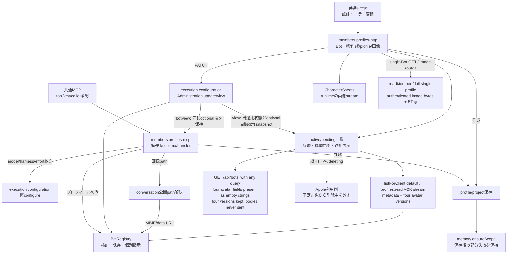

# プロフィール・画像の公開受付

[担当の正本](README.md)。所有データと起動読込は[registry](registry.md)、削除とpending再開は[deletion](deletion.md)、Owner個別規範は[instructions](instructions.md)を参照。

## 公開契約

| 所有窓口 | 入力と返却・失敗 |
| --- | --- |
| `profiles-mcp.mjs` | memberReadTools/memberWriteToolsとcallMemberTool。list_bots/get_bot/get_self/get_owner_profile/get_user_rules/update_user_rules/update_self/update_bot/set_avatar/create_botの説明/schema/handlerを所有。入力は`{name,args,from,registry,botView?,configure,memory,ownerProfile,userRules,store?,deliverMessage?}`（store/deliverMessageはupdate_user_rulesの承認確認と承認依頼・自動記録だけに使う） |
| MCP通常更新 | プロフィールだけならregistry.update。model/harness/reasoningEffortのいずれかを指定したら、他の同時変更も含め既configureへ渡す。返ったpending/failed/unknownを変換せず、現在値だけで適用成功にしない。update_selfの対象はfrom |
| MCP読取 | get_bot/get_selfは既botViewを使い適用観測を保持。list_botsは従来どおりactive台帳のみ。avatar本文を外しURLへする共通整形と認証/引数keyの検証はintegrationが維持 |
| 自動設定操作の表示 | HTTP一覧とget_self/get_botはexecution.viewのoptional `automaticConfigurationApplication`を保持する。HTTP単体profile GETも既viewを返す。閉DTO/同期snapshotの正本は[execution](../execution/automatic-configuration.md)。membersはDTOを生成・補完せず、欄不在とunknownをそのまま扱う。既configurationApplicationの意味・値を変えず、native作用や操作完了を推測しない |
| avatar | 既resolveBotImagePath、PNG/JPEG/WebP/GIF検証、data URL化→registry.updateの順を維持。HTTPのavatar/large/source経路とfallback/etagは既共有画像窓口を使用 |
| `profiles-http.mjs` | createMemberProfileApiがBot一覧/作成、GET/PATCH profile、avatar、character-sheet一覧/streamを所有。Bot項目の`account`/`seatLaunch`は親の`readSeatProjection`の値をそのまま載せる（未対応は項目なし）。既createBotApiはこのhandlerへ委譲し、execution/memory/conversationの残る経路を保持 |
| HTTP更新/表示 | PATCHは既Administration.updateへ、GETと一覧の適用観測は既viewへ。返却/statusは既契約。モデルの稼働適用/Map/停止・再開はexecutionが持つ |
| List | `GET /api/bots` always includes `avatar`, `avatarLarge`, `avatarSource`, and `avatarLargeSource` as empty strings for required-string client decoders; image bodies are never sent, preserving all four `*Version` fields and crop metadata. `?avatar=omit` is accepted as a no-op; no query enables inline images. Pending receipts remain deleting=true/online=false, with current membership rechecked after asynchronous reads |
| Appleの一覧利用 | [Apple利用側](../apple/README.md)は既HTTPのdeletingを任意fieldとして読み、trueのBotを予定の期待集合へ含めない。[予定集合の契約](schedules.md#名簿と予定の対象集合)を参照。fieldなしは従来のactiveとして扱う |
| 作成 | registry.create後にmemory.ensureScope。記憶領域や後段生成が失敗しても、保存済みBotを勝手に消さず元の例外を伝える。偽の会話を発行しない |
| character-sheet | 正本直下の画像だけを扱う既CharacterSheets契約を維持。runtime公開streamへAbortSignalを渡し、HTTP切断で取消、metadata前/headers後の失敗を元どおり扱う。draftを正本へ昇格しない |

モデル一覧、fast、停止/再起動、native、自動適用の判断と完了/再開はexecution。membersは公開configure/update/viewの入出力を使う。キロと初回移管境界を合わせ、update_self/update_botをexecutionへ重ねて移管しない。native接点を追加する時はその公開結果の契約を別途調整する。

初回共有差分はmcp-toolsの登録/委譲、http-bot-apiの専用handler呼出だけ。公開export/全9説明とschema/順序、profile/画像保存形式は保つ。設定値や全Botの起動指示を実環境へ配布する操作はこのsource分離に含めない。

## 限定検証

member-profilesが通常保存/configure委譲の分岐と元receipt/例外、表示の適用観測とavatar非露出、作成後の部分保存、Owner生成失敗を専用窓口で確認する。既MCP/席/HTTP、モデル反映表示、avatar/設定画stream、profile並行更新、削除受付を直接境界として確認。共有入口の新しい全面実装や全試験再走を追加しない。

## 独立更新後の画像とfresh読取

投影/profiles.readは画像4fieldを持たない。HTTPのprofile/画像/設定画の対象確認とMCP get_bot/get_selfはfresh readMemberから完全な単一profileを読み、投影だけのavatarを返さない。MCPはその後既共通整形で画像本文を外しhasAvatar/URLを返す。失敗503を404へ丸めない。

HTTP list output never contains avatar bodies. The facade defaults to the confirmed metadata snapshot; only a legacy snapshot missing version fields uses the existing full-profile fallback to calculate versions. That fallback retains `includeDeleting:true`, distinct method pins, confirmed-404 filtering and unknown/503 propagation. Its images are discarded by the list handler. Single-Bot `GET /api/bots/<id>` still returns the complete profile for editor re-crop; the four authenticated image routes retain their fallback and ETag behavior.

members/errors.mjsのnormalizeMembersErrorは既固定semantic prefix/コードだけをcode/statusへ変換する。自由message/stack/入力値をwireへ渡さず、未登録errorはruntimeの既generic fallbackへ。受理後outcome unknownを変更しない。部分保存後のeffect失敗でも可能な限り最新metadata投影を先に送って、保存済み状態を古い表示へ隠さない。元例外は保持し成功へ丸めない。

## Default list snapshot

既`profiles.read {}`の一件ずつACKする投影profileへ、`avatarVersion` / `avatarLargeVersion` / `avatarSourceVersion` / `avatarLargeSourceVersion`を付ける。各値は既avatarVersionの空文字またはSHA256先頭16hex。largeは既HTTP同様`avatarLarge || avatar`を使う。画像4本文を送らず、既hasAvatar/hasAvatarLargeとpendingの意味は保つ。共通hash/cacheはavatar-value.mjsへ移し、http-assets.mjsの既avatarVersion exportを維持する。

The parent uses the ACK-completed snapshot of the same generation/revision by default, avoiding one `profile.read` per Bot. `listForClient({omitAvatars:false})` remains an internal legacy fallback, with no HTTP opt-in. The handler emits all four avatar keys as empty strings alongside the version fields, taking existing versions before computing missing legacy versions. Required-string Apple decoders retain their list contract without transferring image bodies. Fresh single-profile reads, membership/pending rechecks, authorization and failure semantics remain unchanged.

Deployment: both `src/members-facade.mjs` and the imported `src/members/profiles-http.mjs` execute in the body in the current assembly ([residency inventory M08](../../parent-residency.md)). Republishing or replacing only the members child cannot activate this caller change. Body activation belongs to Trony's existing approval boundary; this patch does not migrate handlers or restart the body.

単一配列をIPCへ追加せず、既streamの一件ごとの16MiB上限とactual completion寿命を維持する。600名metadataが合計16MiB超でも一snapshotで扱う。全体図の既registry接続内の修理なので、全体のport追加はない。
