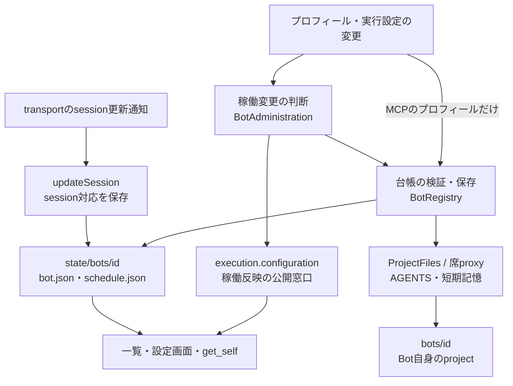

# メンバー・予定・指示の所有データと処理

[担当の正本](README.md)。削除の受付・完了と同期失敗は[削除契約](deletion.md)を参照。

## メンバーのデータは三つに分かれる

通常構成の`state/bots`は本体の状態、`bots`は席のprojectである。席分離なし構成では同一rootを使う互換経路がある。`config/bots.json`は未初期化時のseedであり、毎回のrefreshで現在のプロフィールを上書きする物ではない。

| 責務 | caller → 実関数 | 保存/失敗/副作用 |
| --- | --- | --- |
| 起動読込 | `bootstrap` → `BotRegistry.initialize` | 分離状態の移行不足を拒否。seed、`.initialized`、未完削除再開、旧profile移行、指示生成、refreshの順 |
| 台帳読取 | HTTP/MCP/実行前 → `refresh/#readProfiles/readProfile` | stateRootのmetadataでcacheを検証。Mapは投影、削除予定は実行用Mapへ戻さない |
| 作成 | HTTP POST / MCP create_bot → `create` → memory.ensureScope | 入力/effort/fast検証→project新規取得→profile/空予定/指示生成→refresh→onChange。後段失敗でも前段保存は存在し得る |
| プロフィール更新 | `update/previewUpdate/#mutateProfile` | Bot別に直列化。許可field、画像とcrop、model/effort/fastの契約を確認→profile保存→指示生成→通知 |
| 実行設定 | HTTP PATCH / MCP configure → `BotAdministration.update/apply` | preview、変更/再適用要否、wasRunningを確認して保存。稼働中は背景reconfigure、返却はpendingになり得る |
| session対応 | transport callback → `updateSession` | profileのsessionだけ更新。通常編集fieldとして外部から受けない |
| 起動指示 | `prepareStartupContext` → `ProjectFiles.prepareStartupContext/writeInstructions` | 引継ぎ文をprevious-sessionへ保存し、本人編集のAGENTS.local.mdを席writerで合成して指示を再生成。個別正本は上書きしない。[個別指示の契約](instructions.md#本人編集の個別指示と生成agents)を参照 |
| Remote binding | HTTP/MCP create/update → `create/update` | `terminalId`/`projectRoot` saved in bot.json v8 as additive fields; pair rule and path validation. See [remote-seat.md](remote-seat.md) |
| モデル一覧 | `LiveModelCatalog` → Aiterm | effort/fast検証に使用。保存値だけでnativeの変更成功を証明しない |

稼働反映の内部状態と実行結果の正本は[execution](../execution/README.md)。保存値と反映観測を同じ正本へまとめない。[bot-registry.mjs](../../../../src/bot-registry.mjs)、[project-files.mjs](../../../../src/project-files.mjs)を参照。

## 予定：定義、発行、実行結果は別

[予定の公開受付・定義・発行](schedules.md)が正本。

## Ownerプロフィールと規範

[Owner規範・起動指示の正本](instructions.md)へ移管した。
