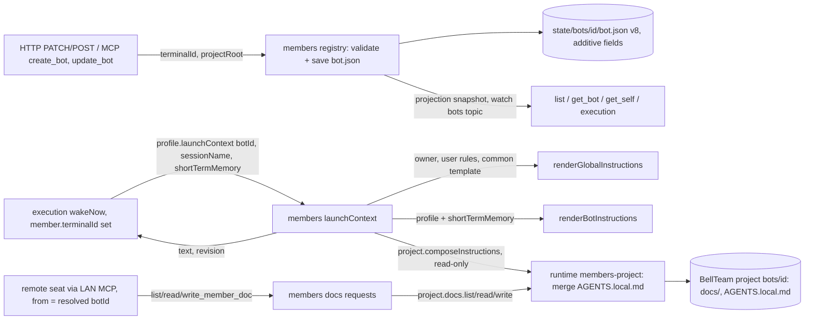

# Remote seat member contracts (C1, C6)

[Members owner document](README.md). Request: Trony, 2026-11-09 (F-SEAT-HOST). Cross contracts: [terminals C1/C6](../terminals/README.md#cross-contracts-adopted-by-trony), [execution remote seat](../execution/remote-seat.md) (Kiro, PR #765). P1 scope: Owner's Mac + Claude Code, configured by API/MCP.

Members owns the member binding fields, the launch-time instruction text and the member-scoped canonical docs interface. Execution decides when to launch and how to carry the text; terminals owns the target; Molly's ingress resolves the calling seat to `from`. Members never writes into a member's `projectRoot` or the terminal's home.

## Function diagram

## C1 member binding

| Field | Value and validation | Owner and use |
| --- | --- | --- |
| `terminalId` | `''` (local seat) or terminals registry key: `^[A-Za-z0-9][A-Za-z0-9._-]{0,127}$` | Saved by members; existence and target are checked by terminals at `connection.open` (missing binding is reported there, no silent substitute) |
| `projectRoot` | `''` or absolute POSIX path (P1 macOS): starts with `/`, no NUL, no `.`/`..`/empty segments, no trailing `/` except `/`, at most 4096 bytes | The remote process starts with `cwd = projectRoot`. Members never reads or writes it |
| pair rule | both empty or both set (`BOT_REMOTE_BINDING_INVALID`) | A member is either local or bound to one terminal folder |
| `bindingRevision` (derived, not stored) | first 16 hex of sha256 of `JSON.stringify([terminalId, projectRoot])` | Returned by launchContext as `revision`; execution relaunches fresh at the next idle boundary when it changes |

The fields are additive optional keys in `bellteam.bot.v8`, so a v8 reader that predates them still restores the file. Create/update/preview use the existing per-Bot serialized `#mutateProfile` path and the existing projection snapshot plus `watch` change notice (`topics: ['bots']`, the Bot ID). No new event channel. Local members (`terminalId: ''`) keep the existing launch path and file writes unchanged.

Limit: a pre-C1 members child writes `bot.json` without the two fields, so a rollback to such a version drops a saved binding on the next profile save. The Owner re-enters it after rollforward; no member data other than the binding is affected.

## Launch context (execution -> members)

`bots.launchContext(botId, {sessionName, shortTermMemory}, context)` in the facade -> request `profile.launchContext` -> `{launchContext: {text, revision}}`.

| Part of `text`, in order | Source |
| --- | --- |
| Owner info, user rules, BellTeam common rules | `renderGlobalInstructions(owner, rules, config/common-agents.md)`: the same text the local seat reads from its home `AGENTS.md` |
| Member instructions with `AGENTS.local.md` and the previous-session block | `renderBotInstructions(profile, shortTermMemory)` merged by runtime `project.composeInstructions` (the same `composeProjectInstructions` the local `AGENTS.md` uses) |
| Remote access note | Fixed English section: canonical `docs/` and `AGENTS.local.md` stay in BellTeam, reached with `list_member_docs` / `read_member_doc` / `write_member_doc`; memory and knowledge through the existing memory tools; `projectRoot` is the user's folder and receives no BellTeam files |

It is read-only: no `previous-session.md`, `AGENTS.md` or `CLAUDE.md` write for this call. Errors are the existing members errors (`BOT_NOT_FOUND`, `MEMBERS_UNAVAILABLE`, `MEMBERS_PROJECT_INVALID`, ...); execution maps them to `effect: 'not_started'` and the message stays queued. A member without a binding returns `BOT_REMOTE_BINDING_MISSING` so a local member is never launched with remote instructions by mistake.

## C6 member-scoped docs

| MCP tool (members) | Request -> runtime effect | Result |
| --- | --- | --- |
| `list_member_docs` {} | `docs.list` -> `project.docs.list` | `{files: [{path, size, modifiedAt}]}`: `AGENTS.local.md` if present and every regular file under `docs/` |
| `read_member_doc` {path} | `docs.read` -> `project.docs.read` | `{path, content, modifiedAt}` |
| `write_member_doc` {path, content} | `docs.write` -> `project.docs.write` | `{path, size, modifiedAt}` after an atomic same-directory rename |

The target is always the caller's own project: the botId is `from`, resolved by the MCP ingress (loopback today, Molly's LAN seat credential in C4), never a tool argument or header. `path` is `AGENTS.local.md` or `docs/<relative>`; absolute paths, `..`, empty segments, NUL, symlink components and non-regular targets are rejected (`MEMBERS_DOC_PATH_INVALID`). Listing uses the same boundary: a symlinked or foreign-owned `docs/` (or descended subdirectory) is `MEMBERS_DOC_PATH_INVALID`, and nested symlink entries are skipped, never followed. Content is UTF-8 up to 1 MiB (`MEMBERS_DOC_TOO_LARGE`). Writes create missing `docs/` subfolders. Saving `AGENTS.local.md` does not rewrite the local `AGENTS.md`; the next launch context or the existing regeneration (`update_self({})`) reads it.

Protections named: wrong target (another member's project, the user's repository or home) and data loss (atomic write, real errors returned). Both exit automatically: a valid path in the caller's own project succeeds on the next call. There is no lock or retained denial state.

## Verification scope

Focused members tests only: field validation/persistence/projection, pair rule, revision, launchContext composition order and no-write, docs path rejection and round-trip. Execution launch, terminals connection, ingress identity and native carrier are their owners' tests.
