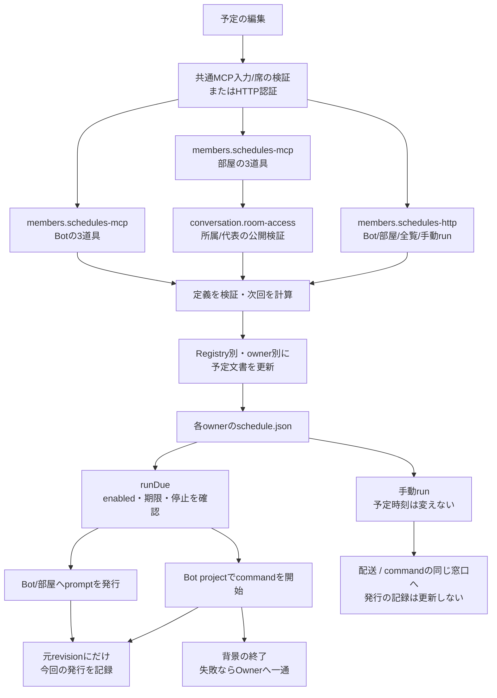

# 予定の公開受付・定義・発行

[担当の正本](README.md)。部屋定義/参加者/targetsの正本は[conversation](../conversation/rooms.md)。

## 予定：定義、発行、実行結果は別

| 段階 | caller → 関数 | 契約 |
| --- | --- | --- |
| 編集 | HTTP/MCP → Registry.setSchedule → `mutateSchedules` | 既存IDの存在を確認しrevisionを増やす。prompt/commandはちょうど一方 |
| 次回計算 | `normalizeSchedule/intervalDaysNext/cronNext` | once/cron/interval_days/interval_hours。timezoneと暦日で計算。disabledはnextRunAtなし |
| 部屋特有 | `RoomRegistry.setSchedule` | command拒否。targetsは部屋参加者内で重複除去。共通normalizeだけではtargetsを所有しない |
| 更新の順序 | `mutateSchedules` | registry実体とownerごとの短命Promise。read→edit→write、finallyで解放。配送queueではない |
| 自動発行 | `BotScheduler.runDue` → dispatch → markScheduleRun | 二重tickと全体停止を確認。配送失敗/unknownも今回の試行として消化し自動再送しない |
| 実行記録 | 各Registry.markScheduleRun | expectedRevisionが違えば編集後の予定を変更しない。onceを無効化、次回を計算。roomはtargets保持 |
| command | `runCommandSchedule/performCommandSchedule` | jobを登録しAbortSignalを渡す。発行と終了を分け、成功/中断では失敗通知を出さない |
| command停止 | AiControl → `interruptCommands` | 全jobへ先にabortし、completionを集めstopConfirmedを確認 |
| 手動 | HTTP run → `runBotSchedule/runRoomSchedule` | 既存予定を読むがmarkScheduleRunしない。返却202は発行まで |
| 全体再開 | AiControl → `prepareResume` | 進行tickを待ち、停止解除要求時刻以前の期限をskippedで区切る。後の過去時刻予定まで消さない |
| 定時の席整理 | `restartLongSessions/restartLongSession` | 東京03時、当日一回、idleかつrunning、Throughline完了ターン閾値。現役jobを閉じる処理へ一般化しない |

予定定義と文書共通処理は基底のBotRegistryから`schedule-definition.mjs`と`json-file.mjs`へ移し、Bot/roomが直接使う。BotRegistryの既exportは互換窓口として残す。[整理案D2](../../detail-status.md#d2-機能の所有者を経由している共通処理を分離する)はこの依存方向を対象にする。時刻計算やwriter順序を作り直す必要はない。

## 公開handlerと初回登録

| 所有する窓口 | 入出力と検証 |
| --- | --- |
| `src/members/schedules-mcp.mjs` | botScheduleTools/roomScheduleToolsがBot/部屋各3道具の説明とschemaを提供し、scheduleToolHandlersがset/list/removeを処理。入力は`{registry,rooms,from,args}`、返却は既`{schedule}`/`{schedules}`/`{removed}`。botId省略はfrom |
| 部屋資格 | set/removeはconversationのrequireRepresentative、listはrequireRoomMember。ROOM_NOT_FOUND/MEMBER_REQUIRED/REPRESENTATIVE_REQUIREDはそのまま伝播。拒否時は予定を書かない。targets検証とcommand拒否はRoomRegistry公開API |
| 共通MCP入口 | tool存在/入力キー/active呼出席/台帳refreshを検証後、6道具を登録・委譲。代表資格や予定入力を共通入口へ複製しない。6説明/schemaと登録順は抽出前と一致 |
| `src/members/schedules-http.mjs` | createScheduleApiがBot/部屋の予定CRUD、全予定一覧、手動runを担当。既`http-schedule-api.mjs`は同exportの互換re-export。部屋予定分岐はhttp-room-apiから移管 |
| HTTP部屋予定 | 既認証・URL/status/JSON・rooms.refreshを保持。MCPの代表/所属制限をHTTPへ追加しない。GET200、POST201、PUT200、DELETE204、部屋不在404。bodyのidよりURLのidを使う |
| 手動run | POST `/api/{bots,rooms}/:id/schedules/:scheduleId/run`。既scheduler.runBotSchedule/runRoomScheduleへ渡し、202/{ran:id}。scheduler不在503、発行時刻/revisionの記録は更新しない |

初回共有差分はmcp-toolsの登録/委譲、http-schedule-apiの互換export、http-room-apiの予定分岐除去。次の予定内部/schema/説明/HTTP修理はmembers内で更新できる。RoomRegistry、公開資格helper、schedulerの内部挙動、保存形式、既config/exportを変更しない。

## 確認範囲

`test/member-schedules.test.mjs`が専用handlerと共通登録、Bot対象省略/指定、Registry例外の同一性、部屋資格拒否時の無書込み、targets検証、command拒否、HTTP CRUD/refresh/手動runと互換exportを確認する。関連MCP/席API、予定の定義・世代、HTTP、RoomRegistry、conversation公開helperの試験を実行する。予定発行の実データやnative、本番へ操作しない。

図はhandler所有とroom-access接続を更新した。予定の入出力・保存・発行・失敗の意味は既契約内であり、時刻計算/予定writer/実行結果の図の構造は保つ。全体はmodule.jsonのroom-access利用を登録して再生成する。
