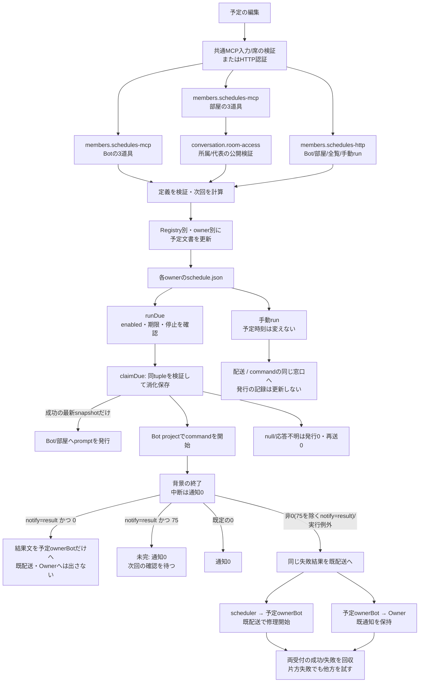
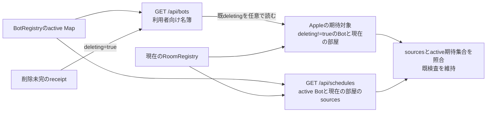
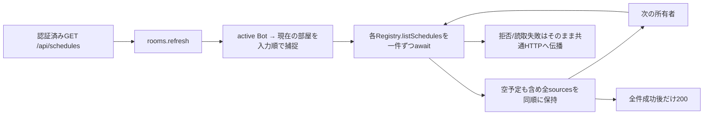
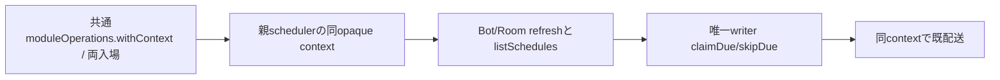
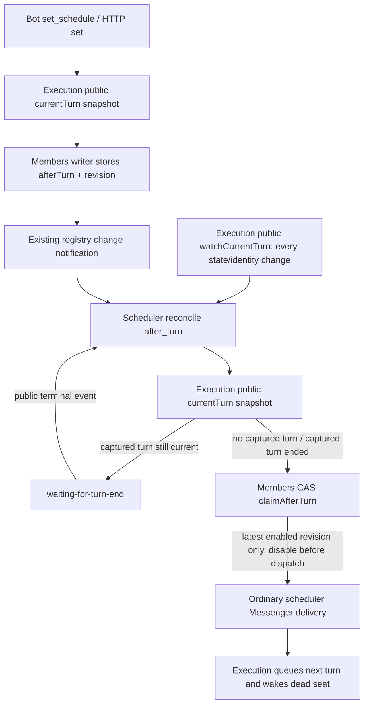

# 予定の公開受付・定義・発行

[担当の正本](README.md)。部屋定義/参加者/targetsの正本は[conversation](../conversation/rooms.md)。

## 予定：定義、発行、実行結果は別

| 段階 | caller → 関数 | 契約 |
| --- | --- | --- |
| 編集 | HTTP/MCP → Registry.setSchedule → `mutateSchedules` | 既存IDの存在を確認しrevisionを増やす。prompt/commandはちょうど一方 |
| 次回計算 | `normalizeSchedule/intervalDaysNext/cronNext` | once/cron/interval_days/interval_hours。timezoneと暦日で計算。disabledはnextRunAtなし |
| 部屋特有 | `RoomRegistry.setSchedule` | command拒否。targetsは部屋参加者内で重複除去。共通normalizeだけではtargetsを所有しない |
| 更新の順序 | `mutateSchedules` | registry実体とownerごとの短命Promise。read→edit→write、finallyで解放。配送queueではない |
| 自動発行 | `BotScheduler.runDue` → claimDue → dispatch | 同module leaseでfresh読取/消化保存/発行受付。claim前と発行前に停止世代を検証。null/不明は発行0、消化を戻さない |
| 実行記録 | 各Registry.claimDue/skipDue | revision/nextRunAt/enabled/期限を照合し保存。成功時は消化前の最新snapshot、競合はnull。markScheduleRunは互換用に残し自動発行では使わない |
| command | `runCommandSchedule/performCommandSchedule` | jobを登録しAbortSignalを渡す。発行と終了を分け、成功/中断では失敗通知を出さない。`notify=result`の0は結果配送、75は未完で通知0 |
| command結果配送 | `performCommandSchedule` → 既`Messenger.sendmessage` | `notify=result`かつ0の時だけ、終了コードと既末尾5行（stdout優先）を`from:scheduler,target:bot.id`で一回。Ownerへは送らない。配送失敗は元reportErrorへ。job再実行/再送はしない |
| command失敗配送 | `performCommandSchedule` → 既`Messenger.sendmessage` | 元結果の非0/例外から同じ失敗文を予定所有BotとOwnerへ各一回。両方の受付完了/失敗を回収し、配送失敗を伝播。job再実行/通知再送はしない |
| command停止 | AiControl → `interruptCommands` | 全jobへ先にabortし、completionを集めstopConfirmedを確認 |
| 手動 | HTTP run → `runBotSchedule/runRoomSchedule` | 既存予定を読むがmarkScheduleRunしない。返却202は発行まで |
| 全体再開 | AiControl → `prepareResume` | 進行tickを待ち、同leaseで停止解除要求時刻以前だけskipDue。lastRunAtと新revisionを保持 |
| 定時の席整理 | `restartLongSessions/restartLongSession` | 東京03時、当日一回、idleかつrunning、Throughline完了ターン閾値。現役jobを閉じる処理へ一般化しない |

予定定義と文書共通処理は基底のBotRegistryから`schedule-definition.mjs`と`json-file.mjs`へ移し、Bot/roomが直接使う。BotRegistryの既exportは互換窓口として残す。[整理案D2](../../detail-status.md#d2-機能の所有者を経由している共通処理を分離する)はこの依存方向を対象にする。時刻計算やwriter順序を作り直す必要はない。

## 公開handlerと初回登録

### command結果のデータフローと状態所有

全体DFDの[P4 メンバー・予定](../../data-flow.md)から、既conversation.messagesとruntime.seat-processへ接続する詳細。機能構造は上図、データ方向は次表を正本とする。

| flow | 発信元 → 受信先 / データ | 状態所有・失敗 |
| --- | --- | --- |
| SC1 | Registryの消化済snapshot → scheduler / bot.id・project、schedule.id・name・command | 予定定義/claimはmembers、親commandJobsはscheduler。消化を戻さない |
| SC2 | scheduler → runtime.runShellCommand / command・cwd・AbortSignal | 実process、UID、環境、stdout/stderrの回収と実終了はruntime |
| SC3 | runtime → scheduler / 元code・signal・stdout・stderr又は元実行例外 | 既結果を通知結果で上書きしない。job中断は配送0。既定の正常code0は配送0。`notify=result`の0はSC8、75は配送0 |
| SC4 | scheduler → conversation.messages / 既末尾5行と予定IDを含む失敗文 | `from:scheduler,target:bot.id`で修理担当へ、既`from:bot.id,target:user`でOwnerへ各一回。本文は同じで、新しいincident本文の読取/転送を足さない |
| SC5 | conversation → scheduler / 各既配送の受付結果又は失敗 | `Promise.allSettled`で片方の失敗による短絡を避け、失敗は元のreportError経路へ返す。受付はAI修理完了の証明ではない |
| SC6 | conversation → 既会話writer/通知・execution / 配送記録・Bot起動又は停止拒否 | 会話記録はconversation、Owner可視性/Pushはusage、実AI配送/全体停止はexecution。親の消化済leaseを再利用せず既sendmessageの新受付を使う |
| SC7 | command/backup producer → 既私有incident / 元rc・error・詳細 | incidentはproducer所有のまま。schedulerに新daemon/queue/incident storeを増やさず、元commandも再送しない |

| SC8 | scheduler → conversation.messages / 予定IDと終了コード0、既末尾5行を含む結果文 | `notify=result`のBot予定だけ。`from:scheduler,target:bot.id`で一回、Ownerへは送らない。受付/失敗はSC5と同じく元reportErrorへ。眠っている席を起こすのは既配送(execution)の所有 |

配送が失敗した時は両宛先の試行を終えてから一つなら元例外、複数ならAggregateErrorを返す。元command結果は変更せず、別の成功結果へ置換しない。手動runも同じdispatch窓口を通る。予定schema/保存/claim/停止・runShellCommand/親assembly/通知内部に変更はない。

| 所有する窓口 | 入出力と検証 |
| --- | --- |
| `src/members/schedules-mcp.mjs` | botScheduleTools/roomScheduleToolsがBot/部屋各3道具の説明とschemaを提供し、scheduleToolHandlersがset/list/removeを処理。入力は`{registry,rooms,from,args}`、返却は既`{schedule}`/`{schedules}`/`{removed}`。botId省略はfrom |
| 部屋資格 | set/removeはconversationのrequireRepresentative、listはrequireRoomMember。ROOM_NOT_FOUND/MEMBER_REQUIRED/REPRESENTATIVE_REQUIREDはそのまま伝播。拒否時は予定を書かない。targets検証とcommand拒否はRoomRegistry公開API |
| 共通MCP入口 | tool存在/入力キー/active呼出席/台帳refreshを検証後、6道具を登録・委譲。代表資格や予定入力を共通入口へ複製しない。6説明/schemaと登録順は抽出前と一致 |
| `src/members/schedules-http.mjs` | createScheduleApiがBot/部屋の予定CRUD、全予定一覧、手動runを担当。既`http-schedule-api.mjs`は同exportの互換re-export。部屋予定分岐はhttp-room-apiから移管 |
| HTTP部屋予定 | 既認証・URL/status/JSON・rooms.refreshを保持。MCPの代表/所属制限をHTTPへ追加しない。GET200、POST201、PUT200、DELETE204、部屋不在404。bodyのidよりURLのidを使う |
| 手動run | POST `/api/{bots,rooms}/:id/schedules/:scheduleId/run`。既scheduler.runBotSchedule/runRoomScheduleへ渡し、202/{ran:id}。scheduler不在503、発行時刻/revisionの記録は更新しない |

初回共有差分はmcp-toolsの登録/委譲、http-schedule-apiの互換export、http-room-apiの予定分岐除去。次の予定内部/schema/説明/HTTP修理はmembers内で更新できる。RoomRegistry、公開資格helper、schedulerの内部挙動、保存形式、既config/exportを変更しない。

## 名簿と予定の対象集合

利用者向け名簿は削除途中のBotを表示に残す。一方、予定の実行対象と全予定のBot所有者集合はactive台帳だけを使い、pending receiptを再採用しない。部屋は現在のRoomRegistryから取得する。予定0件のactive Botもsourcesの所有者として含める。

[Apple利用側](../apple/README.md)はGET /api/botsの既`deleting`を任意fieldとして読み、trueのBotを期待する予定所有者から除く。fieldが無い従来のBotはactiveとして扱う。active所有者の欠落を含む既検査は維持する。Appleのdecode/表示/照合の内部はApple担当の正本で管理し、ここへ複製しない。

削除未完の修理はmembersの[削除契約](deletion.md)、Appleの期待集合の解釈はApple担当が持つ。名簿件数とsources件数の差だけでHTTP不正や削除完了を判定しない。HTTP200、payloadの意味の検証、実削除の完了は別に扱う。この参照追加は既契約の明記であり、新field/ルート/実削除操作を追加しない。

## 全予定一覧の有限集約

全予定の集約は既プロフィール一覧と同じ逐次収集を使う。所有者数によるPromise.allの一斉発行で、単一要求だけで[共通IPCのroot64枠](../runtime/module-ipc.md)を超えないようにする。Bot/部屋の返却順・名前・予定0件のsources・JSON形式を保ち、一件失敗した時は部分一覧を返さず後続読取を止める。rooms.refreshの失敗も伝播する。別要求の混雑や交換中の拒否は既公開契約に従う。所有者間の一括snapshot保証は追加しない。

これは予定一覧の既入出力・失敗契約内の修理である。read pin/認可・IPC上限・Registryの保存・予定発行は各担当の既契約を使う。実IPCの64/65所有者反例で単一要求の構造欠陥を確認したが、2026-11-04 13:43の障害原因は当時の件数/live/要求IDが欠測のため未確定。

## 確認範囲

`test/member-schedules.test.mjs`が専用handlerと共通登録、Bot対象省略/指定、Registry例外の同一性、部屋資格拒否時の無書込み、targets検証、command拒否、HTTP CRUD/refresh/手動runと互換exportを確認する。関連MCP/席API、予定の定義・世代、HTTP、RoomRegistry、conversation公開helperの試験を実行する。予定発行の実データやnative、本番へ操作しない。

図はhandler所有とroom-access接続を更新した。予定の入出力・保存・発行・失敗の意味は既契約内であり、時刻計算/予定writer/実行結果の図の構造は保つ。全体はmodule.jsonのroom-access利用を登録して再生成する。

## 独立更新での予定発行

schedulerは親に同じ実体を保持し、membersAdmission（transportの同一実体、又は共通組立から注入）で一tick/手動run/prepareResumeのrootを取る。Botのrefresh/list/claimと配送の第2内部引数に同`{membersLease}`を渡し、Roomの唯一writerへも同contextを渡す。MollyはAiControl.admitをadmitWorkへ注入し、claim前/発行直前に同じ全体停止世代を検証する。03時maintenanceはこのtick leaseの外で既transportの入場を使い、既commandJobs/maintenanceDateは親に残す。

Room予定のtargetsはlistを使わずclaim返却snapshotだけを発行する。claim後の資格は既RoomMessengerが再検証する。commandは親jobを同期登録し、完走を待たずmodule rootを終える。同leaseのnotify受付までの実completionはKiro transportが追跡し、その後のAI完走はdrainに含めない。

応答不明のclaimは親の短命unconfirmedClaimsで同tupleの再要求を抑制する。新revision/次時刻又は削除を観測すると解除。永続発行台帳や自動再送queueは足さず、親全体再起動の履歴保証へ広げない。保存後・発行前の喪失では未配送が残り、lastRunAtは配送成功ではない。[固定契約](module-update.md)の範囲である。

本差分はN102 020c84→fc7ec352→7e4fb90eのRoom claim/skip・同lease会話adapterが前提。作者席ではこの本人3commitをmergeした隔離開発checkoutで検証する。Molly通常候補は同本人sourceを既に取り込んでおり、N102内部を当席で変更しない。新scheduler境界6件と既関連33件の原本は自席integrations/members-module-update-20261103のscheduler-members-lease-tests.log/scheduler-claim-tests.log。Kiro gate内部/実IPC/実AI/配布成功の証明には使わない。

## conversation子導入のcaller context

runDueのRoom refreshも他の読取/claimと同じ内部optionsを受ける。これは親安定Room facadeへ旧受付leaseを渡す修理で、Room writerを複製しない。conversation導入時はconstructorのmoduleOperationsへ共通createModuleOperationContextの実体を注入する。tick/prepareResume/手動runはwithContext(operation, context?)で最初のfresh/消化前に両入場を予約し、親opaque contextをcloneせず読取/claim/skip/配送へ渡す。既contextはassertされた継続で、新予約/finishを増やさない。一方拒否なら作用0、accepted後unknownは再送0。provider未注入の既builtinは従来membersAdmissionだけを使う。両入場の原子性・channel逆effect束縛・交換mutexは共通/runtime所有で、このcallerは再実装しない。

直接境界はtest/members-conversation-operation.test.mjsのcaller用providerと、test/members-module-operation-integration.test.mjsの実共通factory＋実Room CASで確認する。後者のconversation gateは別MembersAdmissionによる機構fixtureで、Kiro実lifetime gate/実IPC/実予定発行を証明しない。

## Turn-end continuation (`after_turn`)

Owner contract, 2026-11-08. Bot schedules add `kind=after_turn`: one prompt-only delivery, no clock fields. Creation/update binds the owning Bot's current execution turn; with no current turn it becomes eligible immediately. List returns `state: waiting-for-turn-end` while enabled. Removal and replacement use the existing owner writer and revision. Room schedules keep their clock-only contract.

| Flow | Public handoff / ownership |
| --- | --- |
| AT1 | BotRegistry.setSchedule captures execution's current turn snapshot through an injected public snapshot; members child obtains it through `schedules.currentTurn` parent effect. External input cannot choose a turn ID. Existing execution identities are reused. |
| AT2 | Members schedule.json owns `afterTurn` ({state:working/idle/unknown,turnId:string/null}), revision, enabled, lastRunAt, nextRunAt=null. Definition rejects command and all clock fields. State is waiting-for-turn-end while enabled, completed when consumed, disabled when explicitly disabled. |
| AT3 | Execution owns active-turn identity and all normal/error/stop terminal events. Scheduler uses only public snapshot/subscription, including after an engine change; execution internals remain execution-owned. |
| AT4 | Registry change after save and execution terminal event request reconciliation. Snapshot comparison after the durable save closes the end-during-save race. Startup reconciliation recovers persisted waiters whose captured turn has already ended. No clock tick wakes an after_turn continuation. |
| AT5 | `claimAfterTurn(botId,scheduleId,expectedRevision,expectedAfterTurn,ranAt)` uses the existing per-owner writer. Exactly one caller receives the latest pre-consumption snapshot; replacement/removal/disabled or duplicate event yields null. It disables before ordinary dispatch. |
| AT6 | Scheduler uses the existing module operation context, stop admission, and `dispatchBotSchedule` Messenger path. A prompt enters the ordinary next-turn delivery path; no execution-internal access or separate queue is added. Existing explicit global AI stop remains authoritative. |

Affected scope: schedule-definition, BotRegistry writer/CAS, members request/effect/facade/assembly, parent scheduler wiring, Bot MCP description/schema and HTTP's existing delegated path. The scheduler and parent wiring remain body-resident; members child definition/storage/MCP are distributed in members. The execution handoff is owned and tested by Kiro. A focused schedules test covers binding, delayed/immediate activation, update/remove/duplicate-event races and input rejection. Existing clock schedule behavior is outside this change.

Execution agreement (Kiro): `transport.currentTurn(botId)` returns `{state:working,turnId:opaque}` / `{state:idle,turnId:null}` / `{state:unknown,turnId:null}`. `watchCurrentTurn(listener)` emits every snapshot change, including unknown resolution. Offline/dead seats are idle. Live unknown observations resolve on the existing seat observation poll or seat closure. Unknown at save persists as unknown; first resolved working CAS-binds that identity, first resolved idle consumes it. No timestamp field is used. A stale observation may miss intervening turns; the first resolved working identity is the recoverable binding. Ordinary delivery to another already-started turn can steer it; scheduler does not create a private execution queue.

AI global pause defers after_turn dispatch. The parent subscribes to the existing AiControl change event and reconciles after enable; no timed wake is required. Native turn-change events reconcile only that Bot; startup and registry generation/change events reconcile the current owners.

Released-client edit compatibility: existing Apple/Web editors map an unknown kind to cron. To prevent overwriting the saved continuation, BotRegistry rejects replacing an existing after_turn with another kind (`SCHEDULE_AFTER_TURN_REPLACE_REQUIRED`, 409); after_turn prompt/name/enabled updates remain valid. Clock fields on after_turn remain invalid. An intentional clock schedule is created after deleting the old continuation through the existing remove path. This validation protects the saved definition and adds no runtime waiting state. HTTP PUT checks this before members input normalization so released editors receive the explicit error even when their fallback cron expression is empty. POST/MCP replacement is also protected by the owning writer.

## Command result delivery (`notify=result`)

Owner ruling, 2026-11-12 14:45 JST (via Snow White, Trony a26). A Bot waiting on a script, background job or CI check must be told when it ends, without an in-session watcher and without a fake failure shown to the Owner.

Bot command schedules accept an optional `notify`: `failure` (default, existing behavior) or `result`. `result` requires `command`; prompt, after_turn and room schedules reject it (`SCHEDULE_NOTIFY_INVALID`). The default is stored as absent, so existing documents are unchanged.

| Exit of the command | Default (`failure`) | `notify=result` |
| --- | --- | --- |
| 0 | no message | result message to the owning Bot only (SC8) |
| 75 (EX_TEMPFAIL, "not finished yet") | failure to Bot + Owner | no message; a repeating check runs again at its next time |
| other non-zero, signal, runner exception | failure to Bot + Owner (SC4) | same failure to Bot + Owner (SC4) |
| aborted by AI stop | no message | no message |

Usage: a one-shot job is `kind=once` with `at` now and the job itself as the command. A repeating check is cron/interval whose command exits 75 while pending and 0 with the result text when the awaited thing has ended. The awaited thing's own failure (CI red) is a finished check: exit 0 and say it in the output. Non-zero means the check itself broke, which keeps the existing Owner-visible failure contract. The woken Bot removes its repeating check with remove_schedule.

shortcut: the scheduler does not disable a repeating check after its result; a check still enabled at its next time runs again. Upgrade to a revision-CAS disable on the existing owner writer if Bots miss removals.

Update compatibility: `setSchedule` keeps the stored `notify` when an update omits the key, so released Apple/Web editors that drop unknown fields do not silently turn result delivery off. `notify=failure` turns it off explicitly.

Release order: the parent validates members results with its own `members/protocol.mjs`, so the body that accepts `notify` must be live before or with the members module that lets Bots save it. No new connection, queue, daemon, execution contract or runtime change: SC8 uses the same `Messenger.sendmessage` and scheduler actor as SC4 and prompt schedules.
