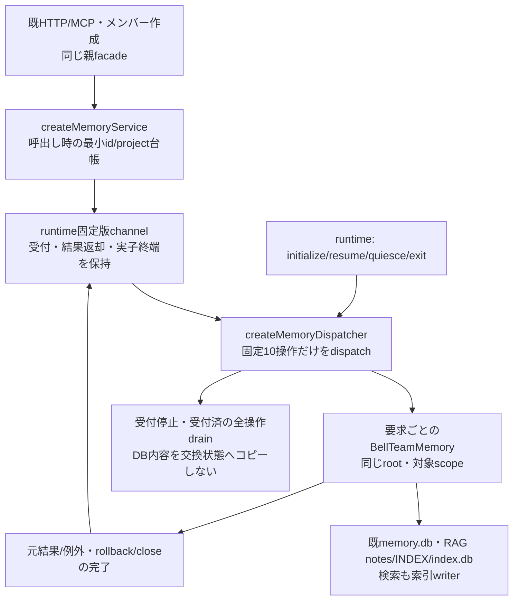
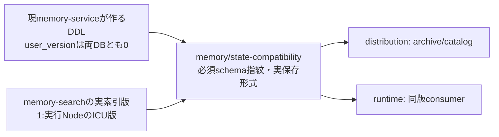

# 単体更新の業務factoryと処理完了

業務はビスケット、席UID/proxy・固定版runner/依存source・実子終端/世代交換はruntime、親の安定facade/assemblyと公開HTTP/MCPの登録はintegration。全体は[機能図](../../feature-map.md)、処理内部と既データ形式は[details.md](details.md)を参照する。

## factoryと閉じたdispatch

`src/memory/factory.mjs:createMemoryService({registry, dispatch})` は既10メソッドと同じ呼出形式を返す。`dispatch(method, {args, profiles})`へ渡すargsは位置引数の配列。initializeは0引数、ensureScopeは従来の位置引数、通常操作は第1引数objectをそのまま渡す。profilesはinitializeだけ全件、sharedは0件、他は呼出時の最終botIdの1件。未知Botは空配列を渡し、scope/Bot/業務の検証順はBellTeamMemoryが持つ。親のregistry関数と元callerのPromiseを生存させ、関数や全Botのプロフィールを子へserializeしない。

`src/memory/dispatcher.mjs:createMemoryDispatcher({root})` は `validateRequest / dispatch / control / disconnect` を供給する。rootは起動側が固定し、要求から変更しない。要求の操作と封筒、profilesのid/projectだけを検証し、通常引数の既検証はserviceへ渡す。対象Mapとserviceは要求ごとに作り、並行する別Bot/scope操作の台帳を上書きしない。任意関数名、DBハンドル、pathを操作名として実行する窓口はない。

## restore・受付・終了

| control | 入力 | 返却と効果 |
| --- | --- | --- |
| initialize | `{}` | `{restored:true}`。一度だけ構成を復元し、受付はまだ閉じる。DB/Markdownの読書き、全件ensureScope、索引構築は行わない |
| resume | `{}` | `{resumed:true}`。旧世代へ戻る場合も同じ現データを使用して受付を再開 |
| quiesce | `{}` | 直ちに新規受付を閉じ、全業務Promiseの後始末まで待って `{quiesced:true}`。途中resume/disconnectで世代が変わればfalse |
| exit | `{}` | quiescedかつ業務操作0件の時だけ`{closed:true}`。DB/Markdownを巻き戻さない |
| disconnect | 引数なし | 受付を閉じ、全業務操作をdrain。強制killや処理の再送は行わない |

最初のapplication startupの業務initializeと、新BotのensureScopeは既callerが明示して呼ぶ。control initializeはそれらを代行しない。常駐DB接続・未保存Map・memory固有timerは現serviceにないので、復元すべき業務snapshotはない。新旧sourceは同じDB/Markdownを使う。schema互換の破壊やデータ移行はこの差分へ含めない。

`validateRequest` は新規受付の判定。channelが既に受付済の要求は受付停止後も `dispatch` で完了させる。dispatchが同期的にactiveへ登録し、service内のremember等の続きへ受付検査を重ねない。遅延dispatchが発生すればquiescedを解除し、activeのあるexitを拒否する。channelは検証からdispatchまでの受付済要求、結果/例外の親への配送完了、実席processの終端も同じ世代の寿命へ含める。業務Promiseの完了だけでchannel/子processの終了を代用しない。

検索を含む全10操作がwriterになり得る。quiesceはrecordKnowledgeのMarkdown→INDEX→DB、consolidateGrowthの複数段階、rebuildのtransactionと読取を中断しない。元の失敗・rollback/close失敗は元callerへ返し、drainは業務失敗を保存成功へ読み替えない。期限超過や結果不明だけで新writerを開始せず、更新を成立させず旧世代を継続する既runtime規則へ渡す。保存操作の自動再送は0回。新旧writerの同時稼働はruntimeが防ぐ。

## source供給と残る接続

この差分は業務factory/dispatcherと人工データでの直接確認。既SeatRuntime.memoryとrun-seat-runtimeのmemory分岐はruntimeが新公開窓口へ接続し、固定版依存sourceを含めて交換する。親application-servicesの一実体接続はintegration。HTTP/MCPの引数、応答・認可、新Bot作成後のensureScopeは変更しない。既直接実行構成のBellTeamMemoryも使用可能なまま。配布と同source実物受入、通常main採用、本番反映はそれぞれの担当工程で確認する。

## 実保存形式の互換宣言

`src/memory/state-compatibility.mjs:MEMORY_STATE_COMPATIBILITY` と `assertMemoryStateCompatibility` をarchive/catalog/consumer共通で使用する。dispatcherからも再exportする。既members方式と同じ完全一致で判定し、欠落・追加・変更を `MEMORY_STATE_INCOMPATIBLE` とする。control initializeの `{restored:true}` とDB無作用の性質は維持する。

| 宣言値 | 実装の根拠 |
| --- | --- |
| memoryUserVersion / knowledgeUserVersion | 現serviceが作るSQLiteの `PRAGMA user_version` は両方0。memory全体のschema番号は追加しない |
| memoryRequiredSchemaSha256 / knowledgeRequiredSchemaSha256 | 空の人工DBに現serviceが作る必須DDLのSHA-256。`sqlite_schema`の `name NOT LIKE 'sqlite_%'` をtype/name順にし、各行を `[type,name,tbl_name,sql]` の配列へ変換したJSON UTF-8の指紋。FTSの内部table/triggerも含む |
| knowledgeEncoding | notesとINDEX.mdが実際に使用する `utf8` |
| knowledgeFrontmatterFields | notesの保存順どおり `id,title,source,created_at,confidence,tags`。各値は既JSON frontmatterで保存する |
| searchIndexVersion | `memory-search` が両DBの `index_state` の `version` へ保存する既値。`MEMORY_SEARCH_INDEX_VERSION` を共有し、ICU版を含む文字列を二重定義しない |

この宣言はsourceの保存形式を比較する情報。既DBに残る廃止tableまで指紋一致を要求するDB検査や、本文のhandoff・DB移行・索引再構築を追加しない。必須DDLの変更時には人工DBとの限定確認で宣言を合わせる。ICU版が変われば既索引版も変わるため、同じruntimeの実値をarchive/catalog/consumerへ渡す。数値のstateSchemaを創作しない。
