# Aiterm generation facade and operation references

Implementation owner: Elegg; execution callers Kiro, updater activation Molly. Adopted target: Elegg `aiterm-hot-generation-adoption-20261108.md`, Trony 2026-11-08. This is the source contract for `src/aiterm-generation-client.mjs`; it does not itself enable the Aiterm channel or implement the product activation protocol.

| Function | Input -> output | Lifetime |
| --- | --- | --- |
| constructor | original AitermClient + immutable runtime capture -> stable facade | one parent lifetime; retains distinct clients |
| pin | current record -> generation-bound client lease | release once at actual operation completion; SDK/transport/runtime/capability/handoff identities refer to that original client |
| call/connect and ordinary client surface | independent operation -> same original return/Promise and .completion | temporary reference held through real completion; no wrapping/JSON copy of returned identities |
| publishGeneration | prepared, durably activated client + immutable capture -> synchronous current-pointer swap | caller's activation ACK is a precondition; old pins remain valid; never changes an existing client's capture |
| references | records -> generation/current/reference-count projection | read only, including unretired old generations |
| retireGeneration | old generation + product retire callback -> completion | wait refs==0, await callback's manager retire ACK and SDK close; no polling or force-stop; failure retains record for repair |
| close | body shutdown -> close remaining clients | teardown only; never used for hot adoption |
| seatProject / environmentReady | current client's body-level settings | read-through so the dispatcher's `Object.create(native)` keeps inheriting them |
| standbyAitermOptions(options, {generation, scope}) | native execution registration options -> same options + `--runtime-adoption standby --runtime-generation <g> --runtime-scope <s>` | argv only (seats/hooks never inherit); rejects non-`--execution-interrupt` registrations |
| runtimeAdoption(client, {action, job_id?, expected?, live?}) | one `runtime_adoption` RPC -> `aiterm.runtime-adoption.v1` result; refusal -> Error.code = product `error_code` | no retry; ACK transport failure is resolved by the caller with `status` |

```mermaid
stateDiagram-v2
  [*] --> Current
  Current --> Retained: publish a distinct activated client
  Retained --> Retained: existing pins finish; new work uses Current
  Retained --> Retiring: explicit retirement and refs zero
  Retiring --> Closed: awaited product retire callback succeeds
  Retiring --> Retained: callback failed; repair can retry
```

Wiring: `application-services.mjs` wraps the body's native AitermClient (or the injected test client) as the initial generation and passes the facade as `executionClient` to the dispatcher native port, transport, configuration requests and teardown. With one generation every call delegates unchanged. Product protocol and argv: Aiterm `docs/architecture/runtime-adoption.md` (main a4bc5f4).

Updater sequence (Molly): `new AitermClient(standbyAitermOptions(aiterm, {generation, scope}) + runtimeCapture)` -> `runtimeAdoption(candidate, {action: 'prepare', expected, live})` with every live/recovery declaration (`runtime-overlap.json` or `'legacy-v1'`) -> `activate {job_id, expected}` -> `publishGeneration` -> `commitRuntime`. ACK lost -> `status`; `absent` -> close standby only. Old generation: `retireGeneration(g, client => runtimeAdoption(client, {action: 'retire'}).then(() => client.close()))`; a legacy generation without the tool is closed after its references reach zero.

DFD: updater's candidate client/capture -> publishGeneration -> stable facade current pointer. Execution operation -> pin -> original AitermClient/SDK -> original helper/wait closure. The operation's actual completion -> release -> retirement waiter. The product retire callback owns manager transfer and close; the facade owns neither Aiterm state files nor updater selection. Current generation is never retired through a background old-generation retirement call. No vendor process is signalled and no timeout frees a reference.

Identity-dependent consumers (configuration/M-handoff) use the lease's original SDK/transport/runtime and helpers. Kiro forwards pin through his existing dispatcher restrictions. Defaults/stateless calls exist for compatible callers; they do not replace operation pins on multi-RPC chains. Runtime job ready does not await old-generation retirement.

Tests use two injected client fakes and delayed promises: publish while old operation active, exact SDK/transport/helper and .completion identity, reference release idempotence, retired callback waits for the last lease and preserves the new current client, failed retirement remains repairable. No live MCP/CLI/native or prior suite rerun is required for this module.
