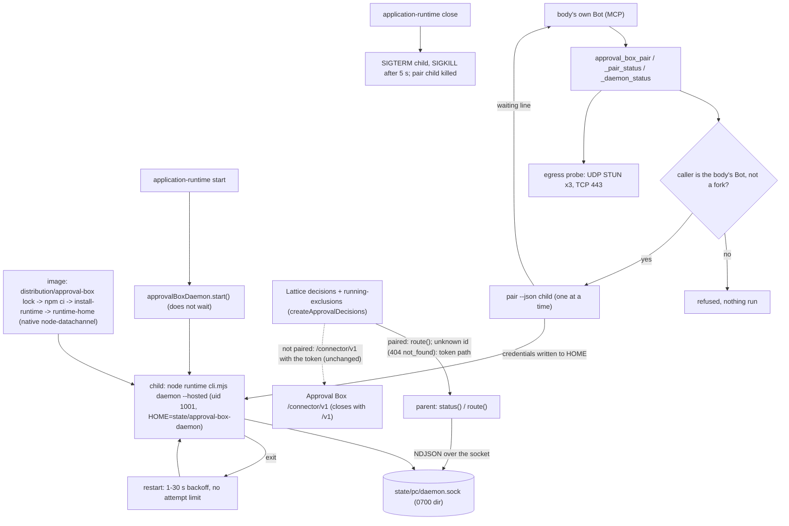
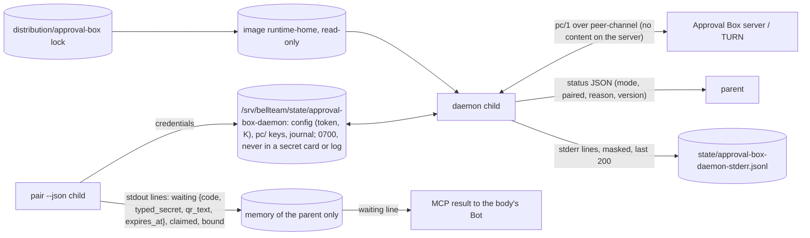
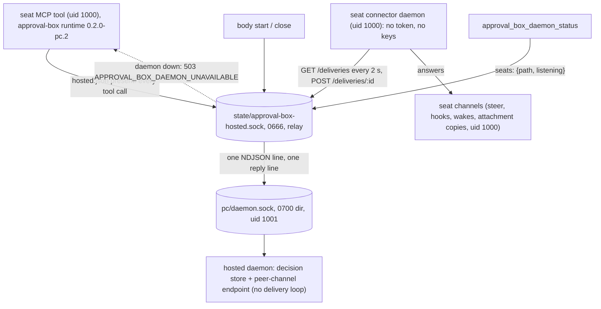
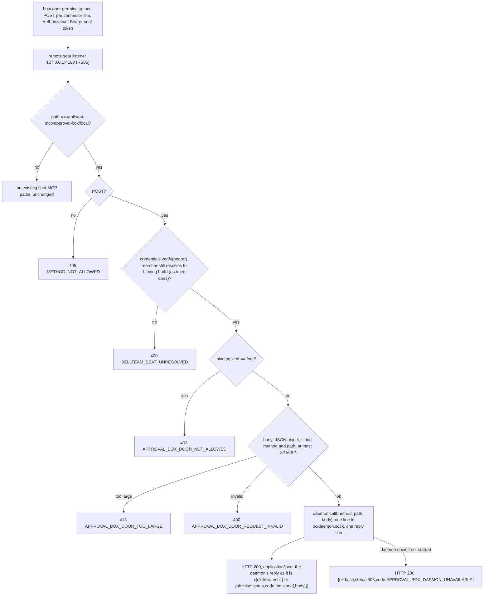
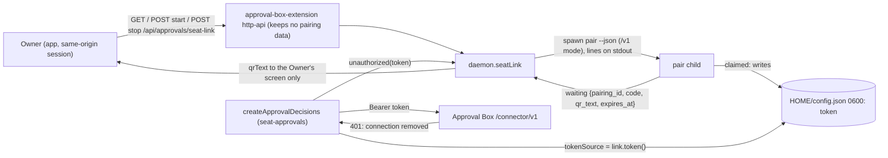

# Approval Box hosted connector daemon in the body (a490h, 2026-11-22)

Owner: Molly (body container). Design source: [peer-channel v0.2](../approval-box-extension/peer-channel-v0.2.md) sections 3-6 (Delta, a490e; Q3 answered there). Package contract: Nayuta, `approval-box@0.2.0-pc.4` (npm dist-tag `next`; pc.4 adds `pair --json --v1` for the seat link and leaves `daemon --hosted` and the existing paths unchanged, Nayuta; pc.2 is the version of the seats' door section below), `daemon --hosted`, local socket `GET /status`, `pair --json`, `pair status --json`.

## What this adds

The body hosts and supervises ONE connector daemon for the four server-side readers and pairs it once (design 5.4). In this change:

1. **Image**: the exact package from a lock (`distribution/approval-box/`), installed with its own `install-runtime` so the runtime copy has the native `node-datachannel` next to `cli.mjs` (the npm copy does not; checked). Runs from `/app/distribution/approval-box/runtime-home/runtime/0.2.0-pc.4/cli.mjs`.
2. **Child** `src/approval-box-daemon.mjs`: spawns `node cli.mjs daemon --hosted` as the body's own uid (1001), state under `/srv/bellteam/state/approval-box-daemon/` (0700, no new mount), restarts with the shared 1-30 s backoff, never blocks the body start.
3. **Local API** (parent side): `status()` and `route(method, path, body)` over the daemon's unix socket (`state/pc/daemon.sock`, NDJSON `{method,path,body}` -> `{ok,result|status,code,message}`). **a490f (reader switch)**: the two readers that share `createApprovalDecisions` (`src/lattice-approval.mjs`: the Lattice effects `decisions.file/read/cancel` and the running-exclusions check) ask `status()`; when the daemon is paired (`daemon.mode === 'pc'`, the answer is reused 3 s) they use `route()` for the decision routes, otherwise the token path on `/connector/v1`, unchanged. A read or cancel of an id the daemon never filed (status 404 code `not_found`, and only that) falls back to the token path, so a decision filed before the pairing is read until the close; `file()` lists the daemon, then looks once at the token-path list (best effort) so nothing is filed twice. `route()` now carries the box's structured error `body` (`{check_token, decisions}` of `confirm_required`, `{existing}`), which filing needs. Error codes (`*_UNAVAILABLE` 503, `*_REFUSED` 409) and the 5 s bound per request are as before (Flora). Both purposes now share the daemon's one connection (Nayuta's ruling; their `session_label`s do not overlap). `olrw-management-caller.mjs` verifies a decision of another connection and is not switched here (OLRW caller owner, chart a490q4).
4. **Pairing step** (design 5.4, Owner's one sitting): MCP tools `approval_box_pair`, `approval_box_pair_status`, `approval_box_daemon_status` for the body's own Bot only. They run `pair --json` and return the `waiting` line (code, typed_secret, qr_text, expires_at) so the Owner's phone step can be put in his card, then the claimed / bound lines.
5. **Egress check** (Q3: "UDP egress to be checked"): `approval_box_daemon_status {egress:true}` sends a STUN Binding request over UDP to `stun.cloudflare.com:3478`, `turn.cloudflare.com:3478` and `:443` and opens TCP 443 to the Approval Box server, each with a 3 s bound, and reports ok / timeout / error per target.

Not in this change: the link-engine feed route for app reports (Q5) and the reader base change; see "Open questions".

## Function map

## Data flow

`pair --json` lines carry secrets (valid 7 days; binding window 5 minutes after the Owner's claim, Nayuta): they are held in parent memory only, never written to the stderr log, diagnostics or the chart. The MCP result carries them to the one Bot that asked (the transcript of that seat keeps them; that is the accepted cost of the Owner's one sitting and why the waiting line is short-lived).

## State transitions

```mermaid
stateDiagram-v2
  [*] --> Absent
  Absent --> Starting: start() (package present)
  Absent --> Absent: package missing (dev/test image): start() is a no-op, status says unavailable
  Starting --> NotPaired: socket answers GET /status with mode not_paired
  Starting --> Backoff: no answer in 15 s, or the child exits
  NotPaired --> Pairing: approval_box_pair
  Pairing --> NotPaired: pair child ends without bound (expired, failed, killed)
  Pairing --> Paired: bound; the daemon loop (2 s) reads the new config and starts the peer channel
  NotPaired --> Paired: config already present (restart of a paired body)
  Paired --> Backoff: the child exits
  Starting --> Starting: GET /connection answers 401 (status reason connection_removed) or the server is unreachable (server_unreachable): the daemon's own loop pauses and tries again; mode stays starting
  Backoff --> Starting: 1, 2, 4, 8, 16, 30 s; a healthy minute resets (no attempt limit)
  Starting --> Closed: close()
  NotPaired --> Closed: close()
  Paired --> Closed: close()
  Backoff --> Closed: close()
  Closed --> [*]
```

Pair run (inside `Pairing`): `Idle -> Waiting` (waiting line read within 20 s; else the run is killed, `PAIR_NO_WAITING_LINE`) `-> Claimed -> Bound`; or `-> Ended` (child exit without bound, or the parent's cap reached: 7 days + 5 minutes after the run started, then killed; the pair child itself also ends when the server reports expired or rejected). A second `approval_box_pair` while `Waiting` returns the same waiting line; after `Ended` or `Bound` it starts a new run (`rebind` only when asked). Every state leaves by a child exit, a bounded wait or `close()`; none waits for an operator.

How each refusal is left: not the body's Bot, a fork seat, or no package: refused with a closed code, nothing started. A pair child that cannot start: `PAIR_FAILED`, state back to `NotPaired`, the daemon untouched.

## Seats on the hosted daemon (a514m, 2026-11-22)

Contract: Nayuta, [peer-channel-adoption section 7, "Seats on a hosted daemon"](https://github.com/kitepon/approval-box) (`approval-box@0.2.0-pc.2`, Tronie's ruling: one pairing for BellTeam, no second seat connector). The hosted daemon (uid 1001) now keeps only the decision store and the peer-channel endpoint and runs no delivery loop; each seat's own connector daemon (uid 1000, the shared `/home/bell/.approval-box`) delivers into the seat channels by polling `GET /deliveries` on the hosted socket every 2 s. The seat's MCP tools call the hosted socket once `approval-box use-hosted --socket <path>` has written `~/.approval-box/hosted.json`.

What the body adds (this change): the pin moves to `0.2.0-pc.2`, and **the seats' door**: a relay socket `/srv/bellteam/state/approval-box-hosted.sock` (mode 0666; `/srv/bellteam/state` is 0711, the daemon's own directory stays 0700) that passes one request line to the daemon's `state/pc/daemon.sock` and the one reply line back. It parses and keeps nothing; the daemon's protocol, 32 MiB cap and error shapes are unchanged. Daemon down: the seat gets `{ok:false,status:503,code:APPROVAL_BOX_DAEMON_UNAVAILABLE}`. Open to every user of the container on purpose: every local seat is uid 1000 with sudo and already shares one connector identity (a124 residual); the socket has no caller identity (Nayuta), so "who can open it" is exactly "who could read the shared `~/.approval-box` token today". At most 64 connections, 30 s idle.

Not done by the body (seat-side, uid 1000, the shared `/home/bell`, so a seat runs it at the sitting): installing the `0.2.0-pc.2` runtime into `~/.approval-box` (`npx -y approval-box@0.2.0-pc.2 install-runtime`; the E1 `~/.approval-box/bin/approval-box harness-entries --json` then names the new runtime and the next harness registration writes it into every seat's MCP and hook entries; without `hosted.json` a pc.2 connector still takes today's `/mcp` path, so this step may come first) and the switch itself.

Data flow: AI -> seat MCP -> door -> hosted LocalBox -> peer-channel -> device -> answer -> hosted `deliveries` -> seat daemon polls through the door -> seat channel -> AI. Request images go `POST /uploads` (base64, up to 32 MiB per line) and answer attachments `GET /decisions/:id/attachments/:aid` through the same door. The door holds nothing: no log of lines, no file but the socket. The decision content stays in the hosted store (`state/approval-box-daemon/state/pc/`, 0600 files, 0700 directory) and passes through the door in memory only.

```mermaid
stateDiagram-v2
  [*] --> NoDoor
  NoDoor --> Door: start() and the package is in the image (listen, chmod 0666)
  NoDoor --> NoDoor: no package (dev, tests): no door; or the listen failed: status seats.listening false, the seats keep their own connector (nothing was switched)
  Door --> Door: a request: relay one line and the reply; daemon down: 503 by name; idle 30 s: that connection is closed
  Door --> NoDoor: close() (the socket file is removed)
```

Sitting order (Tronie / Nayuta): (1) the body with this door is swapped in; (2) `approval_box_daemon_status` shows `seats.listening: true`; (3) the Owner's pairing (a490p) until the hosted daemon says `mode: pc`; (4) a seat installs the pc.2 runtime into `~/.approval-box` and runs `approval-box use-hosted --socket /srv/bellteam/state/approval-box-hosted.sock` (prints `approval-box.use-hosted.v1`; stops the running seat daemon, the next tool call restarts it in relay mode) and one harness registration pass; (5) `PC_OFFER` on. Never switch before (3): before the pairing the hosted daemon answers `503 not_paired` and every seat's request tool would fail. Roll back: `approval-box use-hosted --off` (the seat returns to its token path until the /v1 close).

How each state is left: the door never waits for an operator: it is created at start and removed at close; a failed listen leaves the seats untouched and visible in status.

Open: seats on other hosts (`remote-seat-ingress`) cannot open a unix socket of this container; they keep their own connector and its `/mcp` token path, which stops working at the Approval Box `/v1` close. Their route (a network door, or each host's own pairing) is not designed here; asked of Tronie and Nayuta.

## The door for seats on other hosts: the body route (a516m / a532b1m, 2026-11-23)

Seats on other hosts cannot open this container's socket. The host-side door (BellTeam terminals, Krust a532b1, [terminals README "Approval Box door on terminals"](../terminals/README.md)) carries the connector's request line over the seat's existing ssh reverse forward to the remote seat listener (`127.0.0.1:4183`, RS05) with the seat's bearer. This change is the body end of that line: `POST /api/seat-mcp/approval-box/local` on the same listener. No new port, no new secret: the seat's bearer is the credential.

Data flow: seat host connector daemon -> door (host) -> ssh -R -> this route -> `approvalBoxDaemon.call` -> hosted daemon socket -> reply back the same way. The route reads the body in memory only and keeps nothing: no log of the line or the reply, no file. A decision's content passes through memory as it does through the seats' door (a514m). `approvalBoxDaemon.call` is the raw form of `route()`: it returns the daemon's reply object as it is (the readers' `route()` throws on `ok:false`), with a 30 s bound and a reply bound of 64 MiB (an attachment reply is base64; `localCall`'s 1 MB reply bound stays for `route()` and `status()`).

State transitions: none added. Each request is stateless; every refusal is a closed code answered at once; a daemon that is down or not paired answers inside HTTP 200 and the door's connector retries on its own loop.

Trust: a bearer of any live MAIN seat opens the route, exactly as any local seat opens the seats' door. The daemon has no caller identity (Nayuta), so a seat can file, read, cancel and amend any decision of the one connection (the accepted a124 residual). A fork seat is refused. Order (terminals README): the route is live before the door and `doorHook` are proven end to end; an unpaired daemon's `503 not_paired` through the whole path is already proof of the line.

## Diagram check against the code (a490h)

Compared line by line with `src/approval-box-daemon.mjs` and the package's `startHosted` / `serveLocal` (read from the 0.2.0-pc.1 bundle, and `serveLocal` of 0.2.0-pc.2 re-read for a514m: one line in, one reply and end, cap 32 MiB, the added `/uploads` and attachment routes): status modes `not_paired | starting | pc`, the 2 s config poll, socket path `state/pc/daemon.sock`, request shape and error shape. Not run: a real pairing against production (Nayuta gives the go at the sitting).

## Not in the 0.2.0-pc.1 daemon (read from the bundle, a490h; not re-read for pc.2)

Once the peer channel is up (`mode: pc`), `startHosted` returns and the daemon has no loop back to `not_paired`: the bundle has no handling of the server closing the signal socket with 4401 `pass_ended` or 4403 `connection_removed` (no such code appears in `cli.mjs` or the chunks). So "paired but removed" after the channel is up is not shown by the daemon's status today. This is a question for Nayuta (daemon side of contract 0.5.8), not something the body can detect without reading the socket itself.

## Open questions (design section 6)

- **Q4** (K-3JM9PS answer): independent of hosting. Proposal: keep the already-read answer (no daemon dependency); the OLRW owner confirms before the close.
- **Q5** (the authenticated route for app reports, D7b): not part of hosting; belongs to the link-engine feed with the apps (Delta, Flora). This module exposes `route()` for the D7a feed (decisions the Lattice connector filed) when that PR comes.

## Seat link: the body's own QR pairing for seat-approval cards (seat-link-pair-body, 2026-11-24)

Contract: [seat-approval-card.md](../approval-box-extension/seat-approval-card.md) (Delta, #2538). The body pairs ONCE as a connector of the Owner's Approval Box account (the Owner scans a QR code in the Approval Box app), and the seat cards use the token that pairing leaves in `<daemon HOME>/config.json` directly on `/connector/v1`. This is a second, earlier pairing than the peer-channel one (a490p, unchanged; PC_OFFER stays off). The hosted daemon never reads it.

The daemon controller gains a `seatLink` slot (state in parent memory only; the token stays in `config.json`, 0600, and is read at call time):

| Call | What it does |
| --- | --- |
| `get()` | the view `{state, code?, qrText?, expiresAt?, reason?}`; adopts a token already in `config.json` (none -> linked) |
| `start()` | returns the running pairing's view, or starts one `pair --json` run in the `/v1` mode (`approval-box pair --json --v1`, approval-box 0.2.0-pc.4, `SEAT_LINK_ARGS`), waits up to 20 s for the `waiting` line |
| `stop()` | kills the run; `waiting -> none` |
| `token()` | `readPairedToken` for `createApprovalDecisions({ tokenSource })`: the token only while the state is `linked`, else null (nothing is filed) |
| `unauthorized(token)` | called by `createApprovalDecisions` when `/connector/v1` answers 401 for that token: `linked -> removed` (ignored when `config.json` already holds a newer token) |

```mermaid
stateDiagram-v2
  [*] --> none
  none --> linked: config.json holds a token (adopted by get/token/start)
  none --> waiting: start (run spawned, waiting line within 20 s)
  none --> failed: start and no waiting line in 20 s, spawn error, package missing, or an a490p pair run is active (reason unavailable / busy)
  waiting --> linked: claimed line (config.json is written just before it; there is no bound line), exit 0, and a NEW token is readable
  waiting --> failed: rejected | expired (the run is capped at expires_at, at most 5 min) | run ended without a token
  waiting --> none: stop (run killed)
  failed --> waiting: start
  linked --> removed: unauthorized(token) with the token still in config.json
  removed --> waiting: start (a new token must differ from the removed one)
  linked --> linked: start (returns the view, no run)
```

Every state leaves by the Owner's tap, the run ending or a bounded wait; `close()` kills the run. None waits for an operator.

The waiting line's `code` (the typed code) and `qr_text` are held in parent memory and returned only to the Owner's route; they are never logged, never in `status()`, diagnostics or the chart. The token is never copied to the secret store, a card, a log or a route answer.

Lines of `approval-box pair --json --v1` (Nayuta, 0.2.0-pc.4): `waiting {pairing_id, code, qr_text, expires_at}`; `claimed {connection_id, path:"v1"}` then exit 0; `failed {code: rejected|expired, message}` then exit 1 (no config written). `config.json`: `{server, token, connection_id, device_name, path:"v1"}`, `token` is the Bearer on `/connector/v1`. No daemon runs for seat cards (Tronie 2026-11-24): the hosted daemon slot stays what a490p uses; the pin moved to 0.2.0-pc.4 as its own change (the `--v1` run needs it; the hosted daemon and the seats' door run from the same package and were started and answered through the door on the real pc.4 runtime, 2026-11-24).
