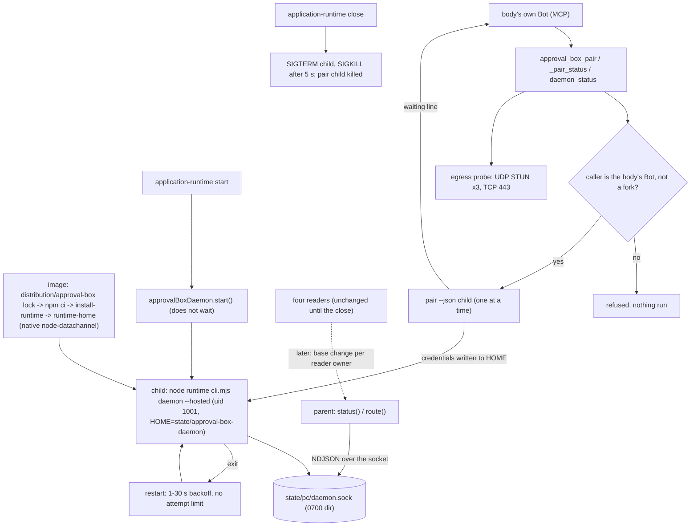
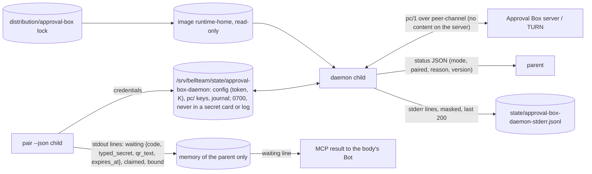

# Approval Box hosted connector daemon in the body (a490h, 2026-11-22)

Owner: Molly (body container). Design source: [peer-channel v0.2](../approval-box-extension/peer-channel-v0.2.md) sections 3-6 (Delta, a490e; Q3 answered there). Package contract: Nayuta, `approval-box@0.2.0-pc.1` (npm dist-tag `next`), `daemon --hosted`, local socket `GET /status`, `pair --json`, `pair status --json`.

## What this adds

The body hosts and supervises ONE connector daemon for the four server-side readers and pairs it once (design 5.4). In this change:

1. **Image**: the exact package from a lock (`distribution/approval-box/`), installed with its own `install-runtime` so the runtime copy has the native `node-datachannel` next to `cli.mjs` (the npm copy does not; checked). Runs from `/app/distribution/approval-box/runtime-home/runtime/0.2.0-pc.1/cli.mjs`.
2. **Child** `src/approval-box-daemon.mjs`: spawns `node cli.mjs daemon --hosted` as the body's own uid (1001), state under `/srv/bellteam/state/approval-box-daemon/` (0700, no new mount), restarts with the shared 1-30 s backoff, never blocks the body start.
3. **Local API** (parent side): `status()` and `route(method, path, body)` over the daemon's unix socket (`state/pc/daemon.sock`, NDJSON `{method,path,body}` -> `{ok,result|status,code,message}`). The four readers keep their current path (`/connector/v1` with their tokens) until the close; the parent can already forward to the socket. The reader base change is one PR per reader owner (design 5), not here.
4. **Pairing step** (design 5.4, Owner's one sitting): MCP tools `approval_box_pair`, `approval_box_pair_status`, `approval_box_daemon_status` for the body's own Bot only. They run `pair --json` and return the `waiting` line (code, typed_secret, qr_text, expires_at) so the Owner's phone step can be put in his card, then the claimed / bound lines.
5. **Egress check** (Q3: "UDP egress to be checked"): `approval_box_daemon_status {egress:true}` sends a STUN Binding request over UDP to `stun.cloudflare.com:3478`, `turn.cloudflare.com:3478` and `:443` and opens TCP 443 to the Approval Box server, each with a 3 s bound, and reports ok / timeout / error per target.

Not in this change: the link-engine feed route for app reports (Q5) and the reader base change; see "Open questions".

## Function map

## Data flow

`pair --json` lines carry secrets (valid 7 days; binding window 5 minutes after the Owner's claim, Nayuta): they are held in parent memory only, never written to the stderr log, diagnostics or the chart. The MCP result carries them to the one Bot that asked (the transcript of that seat keeps them; that is the accepted cost of the Owner's one sitting and why the waiting line is short-lived).

## State transitions

```mermaid
stateDiagram-v2
  [*] --> Absent
  Absent --> Starting: start() (package present)
  Absent --> Absent: package missing (dev/test image): start() is a no-op, status says unavailable
  Starting --> NotPaired: socket answers GET /status with mode not_paired
  Starting --> Backoff: no answer in 15 s, or the child exits
  NotPaired --> Pairing: approval_box_pair
  Pairing --> NotPaired: pair child ends without bound (expired, failed, killed)
  Pairing --> Paired: bound; the daemon loop (2 s) reads the new config and starts the peer channel
  NotPaired --> Paired: config already present (restart of a paired body)
  Paired --> Backoff: the child exits
  Paired --> NotPaired: server closes the socket 4401 pass_ended / 4403 connection_removed (daemon shows paired false, no silent fallback)
  Backoff --> Starting: 1, 2, 4, 8, 16, 30 s; a healthy minute resets (no attempt limit)
  Starting --> Closed: close()
  NotPaired --> Closed: close()
  Paired --> Closed: close()
  Backoff --> Closed: close()
  Closed --> [*]
```

Pair run (inside `Pairing`): `Idle -> Waiting` (waiting line read within 20 s; else the run is killed, `PAIR_NO_WAITING_LINE`) `-> Claimed -> Bound`; or `-> Ended` (child exit without bound, or `expires_at` + 5 minutes reached: killed). A second `approval_box_pair` while `Waiting` returns the same waiting line; after `Ended` or `Bound` it starts a new run (`rebind` only when asked). Every state leaves by a child exit, a bounded wait or `close()`; none waits for an operator.

How each refusal is left: not the body's Bot, a fork seat, or no package: refused with a closed code, nothing started. A pair child that cannot start: `PAIR_FAILED`, state back to `NotPaired`, the daemon untouched.

## Diagram check against the code (a490h)

Compared line by line with `src/approval-box-daemon.mjs` and the package's `startHosted` / `serveLocal` (read from the 0.2.0-pc.1 bundle): status modes `not_paired | starting | pc`, the 2 s config poll, socket path `state/pc/daemon.sock`, request shape and error shape. Not run: a real pairing against production (Nayuta gives the go at the sitting).

## Open questions (design section 6)

- **Q4** (K-3JM9PS answer): independent of hosting. Proposal: keep the already-read answer (no daemon dependency); the OLRW owner confirms before the close.
- **Q5** (the authenticated route for app reports, D7b): not part of hosting; belongs to the link-engine feed with the apps (Delta, Flora). This module exposes `route()` for the D7a feed (decisions the Lattice connector filed) when that PR comes.
