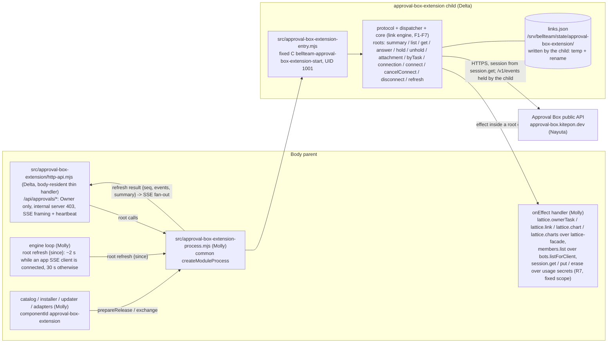

# approval-box-extension as an independently updated module child (parent side)

Owner of this page: Molly (parent side: process, assembly, effects, mount, update). Child, protocol, dispatcher/core, the body-resident HTTP handler and the app contract: Delta ([approval-box-extension](../approval-box-extension/README.md), contract/approvals-contract.md). Approval Box itself: Nayuta. Lattice facade: Molly (`lattice-child.md`, rows 10 and 14). Session store: Mika (R7). Ruling: Trony 2026-11-15 (R5, Owner-approved extension). This page agrees R5 with Delta (2026-11-15 17:3x JST); the code lands in the PRs listed under "Parent changes". Same shape as [lattice-child.md](lattice-child.md): that page is the pattern, only differences are written here.

## Function map

## Data flow

| Step | From → to | Data | Owner of the data |
| --- | --- | --- | --- |
| 1 | Owner client → http-api → child root | `GET/POST /api/approvals/*` per the contract; roots `summary {}`, `list {status[], origin?, cursor?, limit?}`, `get {id}`, `answer {id, optionId?, text?, version, idempotencyKey}`, `hold {id}`, `unhold {id}`, `attachment {id, aid}` (base64 on the channel, Approval Box caps a file at 20 MiB; a stream later if needed), `byTask {project, plan, task}`, `connection {}`, `connect {}`, `cancelConnect {}`, `disconnect {}` | Approval Box (decisions), links.json (ids and state only) |
| 2 | engine loop → root `refresh {since}` | The child reads Approval Box's changes (it holds `/v1/events` itself and buffers the last 200 events with a sequence number), runs the link rules (which need effects 3-7, so the tick must be a root call), and returns `{seq, events:[{type,id,version}], summary}`. The parent fans events out to `/api/approvals/events`. Cadence ~2 s while an app SSE client is connected, 30 s otherwise, so the link engine runs with no screen open | child memory |
| 3 | child → parent effect `lattice.ownerTask` (only inside a root call) | `{projectId: string, args: string[], input?: object}` → `{exitCode, result, stdout, stderr}`; refusal `LATTICE_OWNER_TASK_REFUSED` (403) from `facade.ownerTask` (a156, #1574) | Lattice |
| 4 | child → parent effect `lattice.link` | `{projectId, plan, taskId}` → `{schema, projectId, plan, taskId, linked: true}` from `facade.link` | Lattice |
| 5 | child → parent effects `lattice.chart` / `lattice.charts` (reads) | `{projectId}` → `{cards, edges}` (`facade.chart`); `{}` → `[{projectId, name, createdBy, coordinator}]` (`facade.charts`) | Lattice |
| 6 | child → parent effect `members.list` | `{}` → `[{id, name}]` over `bots.listForClient` (the requester check, R2) | members (read only) |
| 7 | child → parent effects `session.get` / `session.put` / `session.erase` (Delta's README R7 names, agreed with Mika; the parent maps them to usage `secrets.get` / `secrets.put` / `secrets.erase`) | `{}` → `{value}` or null; `{value}` → `{ok:true}`; `{}` → `{ok:true}`. The scope is fixed by the parent from Mika's R7 (usage secret, terminalId `approval-box-extension`, purpose `approval-box.session`); the child sends no scope. The value is a small JSON string `{token, expiresAt}`. Failures reach the child as fixed codes without a value | usage |
| 8 | child → Approval Box | the child calls the public API itself with the session from `session.get`; nothing of it in logs; entitlement cache: positive 5 min, negative 1 min (Bready R4); the child always runs and the gate is in-process: not entitled or not connected answers every data root with a fixed error (`not_entitled` / `not_connected`), while `connection` and `connect` still work | Approval Box |

Effects exist only inside a root call. No file, network or process effect is offered: the child writes its own `links.json` and makes its own HTTPS calls. The facade object is never handed to the child; the parent validates every effect name, parameter and result type before `onEffect`.

## Seam

- Child (Delta): `src/approval-box-extension-entry.mjs`, `src/approval-box-extension-protocol.mjs` (version `approval-box-extension.v1`, the root list and the effect list above), dispatcher/core, a complete `module.json` `source` list (a test checks it against the import graph; the packager's payload list must carry the same files, as `publish-lattice` just showed for `owner-task.mjs`), and the thin HTTP handler.
- Parent (Molly): the files below. State directory: the child creates `/srv/bellteam/state/approval-box-extension/` itself under the common state root (UID 1001, like lattice) and holds the common fixed-C writer lock; the parent writes nothing there.
- Ready probe of a new child (common `probeCandidate`): root `connection {}` (Delta, 11/15): answers `{state, entitled, entitlement}` from memory, never makes a network call, and needs no effect except the child's one-time `session.get` at start; unconnected it answers `{state:'not_connected', entitled:false, entitlement:{state:'none',...}}`. `summary` is a gated data root and is not the probe, so a slow or unreachable Approval Box cannot fail an exchange.
- Compatibility in the catalog: `{ nodeMajor: 26, parentProtocol: 1, stateSchema: null, containerUpdate: null, stateCompatibility: {state:'none'} }` unless Delta's `links.json` carries a format the parent must gate (then `{state:...}` with Delta's schema).
- A new effect method or route is a parent change and ships with a body image. The link rules, Approval Box calls and `links.json` format ship in the child asset only.

## Parent changes (planned PRs, in this order)

| Slice | Files | Carrier |
| --- | --- | --- |
| 1 | this page, `runtime/README.md`, `data-flow.md` row P12 (`module-ownership.md` is Delta's row in #1584) | docs only |
| 2 Fixed start | `scripts/approval-box-extension-start.c` (module-start.c, MODULE_NAME `approval-box-extension`), Dockerfile compile/install, publish-server-image path filter, `scripts/package-server.mjs` list | BODY |
| 3 Process and effects | `src/approval-box-extension-process.mjs`, `src/approval-box-extension-locks.mjs`; `module-process.mjs` / `module-locks.mjs` / `module-release.mjs` / `module-exchange-diagnostic.mjs` closed sets gain `approval-box-extension`; `application-services` / `bootstrap`: the process, the effect handler over lattice-facade, members and usage secrets, the engine loop; `application-runtime` and `http-server.mjs`: mount `src/approval-box-extension/http-api.mjs` | BODY |
| 4 Update | `update-module-catalog.mjs`, `update-module-adapters.mjs`, `update-center.mjs`, `update-center-contract.mjs` (`updateComponents` entry), `scripts/update_catalog.py`, `scripts/container-update-host.py` (MODULES + validator), `scripts/body-preflight.mjs` | BODY |
| 5 Distribution | `scripts/package-approval-box-extension.py`, `scripts/module_artifact_package.py` / `module_artifact_verifier.py` lists, `scripts/probe-approval-box-extension-runtime.mjs`, `.github/workflows/publish-approval-box-extension.yml`, `config/*-verification.json` | module row |

Slices 2-4 ship in one body train (with Delta's child as a module row after it); until then the HTTP routes answer 404 and nothing else changes.

## Failure handling

| Failure | Behavior | Self-exit |
| --- | --- | --- |
| Child not available (start, exchange, crash) | the handler answers 503 `APPROVALS_UNAVAILABLE`; the engine loop skips the tick | Shared `module-child-restart` lifecycle (1→30 s backoff, no limit) |
| `lattice.*` effect fails (child busy or old) | the effect returns the facade error (`LATTICE_OWNER_TASK_REFUSED` keeps its code); the link engine keeps its last handled version and retries at the next tick | Next tick |
| `session.get` fails | the child answers `not_connected` for data roots; no value in logs | Next call |
| Approval Box unreachable or not entitled | fixed errors (`not_connected` / `not_entitled`); last known entitlement kept, never lock | Cache expiry (5 min positive, 1 min negative) |
| An app SSE client disconnects | the loop returns to the 30 s cadence | Next tick |

No guard is added: every wait ends at the next tick or at the child's own timeout, and a refusal never persists across a tick.
