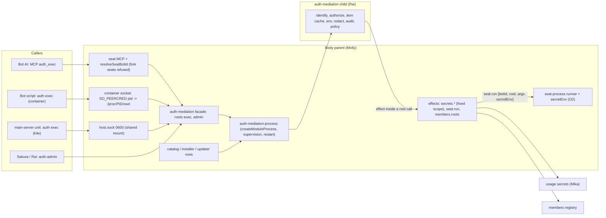
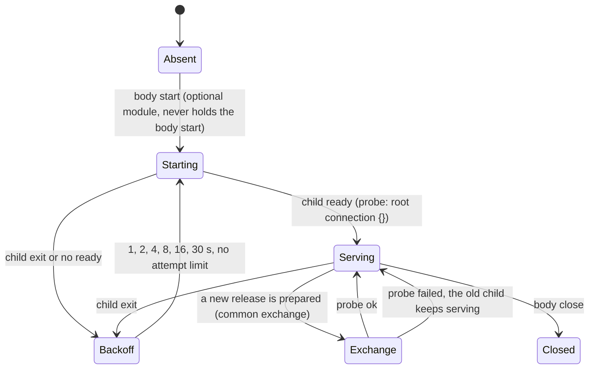

# auth-mediation (認証仲介) as an independently updated module child: the parent side

Owner of this page: Molly (parent side: process, assembly, effects, sockets' mount, supervision, packaging, seat MCP registration, the seat-process secret-environment port). Child, protocol, dispatcher, core, entry, the MCP tool's schema and the admin route: Rai ([auth-mediation](../auth-mediation/README.md), PR #2652). Secret custody: Mika (usage `secrets`, scope `{terminalId:'auth-mediation', purpose:'auth-mediation.op-read'}`, #2654). Chart: `bellteam/bellteam-dev-added/authmed-parent-side`. Status: design (diagrams first); code follows this page, as a body row of the next body train.

## What the parent does

| Piece | Where | Notes |
| --- | --- | --- |
| Process | `src/auth-mediation-process.mjs` (common `createModuleProcess`, like work-graph and approval-box-extension) | componentId `auth-mediation`; start never holds the body start; shared `module-child-restart` (1/2/4/8/16/30 s, no attempt limit); catalog / installer / updater rows like every module |
| Facade | `src/auth-mediation-facade.mjs` | roots `resolve`, `admin`, `status` (child protocol `src/auth-mediation-protocol.mjs`, Rai, #2657; admin verbs grant, revoke, stop, resume, show, flush, import, token.set, token.clear). The facade object is never handed to the child |
| Effects | `src/auth-mediation-effects.mjs` | `secret.get / put / erase` (fixed scope, system only; `get` answers `{value}` or `{unavailable:true}`), `seat.run`, `members.roots` (exactly the child's `AUTH_MEDIATION_EFFECTS`); every effect name, parameter and result is validated; no file, network or process effect beyond these |
| Container socket (T2a) | body, `/srv/bellteam/state/auth-mediation.sock` (relay-style, listens where seats uid 1000 can open it) | The parent reads the peer pid with SO_PEERCRED, resolves `/proc/PID/cwd`, passes **the peer's cwd** to the child as `resolve {via:'container-socket', cwd}`; the child matches the registered roots (`members.roots`) exactly. The parent keeps no policy |
| Host socket (T2b) | `/srv/bellteam/shared/tools/auth-mediation/host.sock`, mode 0600, host owner `kite` | Same JSON-lines protocol; identity is the client-sent folder (unit), passed as `resolve {via:'host-socket', cwd, unit}`. The socket is created by the body in the shared bind mount; no new mount |
| MCP tool `auth_exec` | Rai's `src/auth-mediation/mcp.mjs` (schema, description, dispatch), registered by the shared MCP list `src/mcp-tools.mjs` | Identity = the seat Bot ID from `resolveSeatBotId`; fork seats refused in the body before the root call |
| Seat registration | harness-entries E2 | Rai's `auth_exec` is a **body MCP tool** (the seat's existing BellTeam MCP entry already lists the shared tool list), so no new seat entry is needed unless Rai publishes a separate MCP entry; then it is an E2 item with a module E1 file at `/srv/bellteam/state/auth-mediation/harness-entries.json` (the boot pass runs before any module child, so a file, as for approval-box-extension) |
| Runner port O2 | `src/seat-process.mjs` + `src/run-seat-command.mjs` | below |

## O2: the seat runner takes a secret environment without argv or files

Today `createSeatProcessRunner` refuses `options.env` (`SEAT_DYNAMIC_ENV_UNWIRED`); the command's environment is built inside the seat by `run-seat-command.mjs` (`baseBotEnvironment` / env.sh), and `/usr/bin/env NAME=value` would put the value in argv (ps, /proc cmdline). `seat-exec.c` clears its own environment, `closefrom(3)` and leaves fds 0-2 alone, so stdin reaches the seat command untouched. New contract:

- Runner option `secretEnv: { NAME: 'value' }` (the only way an environment enters). Validation in the parent **and again** in `run-seat-command` (the privileged side does not trust the parent): names `^[A-Z][A-Z0-9_]{0,63}$`, string values, at most 32 names, at most 64 KiB of values in total; refused names: `PATH`, `HOME`, `LD_*`, `NODE_OPTIONS` and `BELLTEAM_*`, and any name the base environment already sets. A violation is `SEAT_SECRET_ENV_INVALID`; the command is **not started**.
- Transport: run-seat-command gets a new flag `--env-stdin` (a flag only, never a value, in argv). The parent writes one JSON line `{"NAME":"value",...}` first on the child's stdin. run-seat-command reads exactly that line byte by byte from fd 0 (it consumes nothing after the newline), validates it, merges it over the base environment for the command only, and starts the command. What follows on stdin is the command's own stdin; `input` of the runner after the line is passed through. For the MCP path Rai closes stdin after the line (EOF).
- Implemented in `validateSecretEnv` (`src/seat-command.mjs`, shared by the parent and run-seat-command); an environment already holding a name refuses it (`existing`); an unreadable, non-JSON, too long (128 KiB) or EOF line starts nothing and prints only `BELLTEAM_SEAT_COMMAND_FAILED` (never the line).
- Nothing else changes: group cancellation, the 250 ms KILL escalation, output caps and AbortSignal are as today; the runner adds no default time limit (Rai enforces 600 s default and 3600 s maximum, 64 KiB output caps and redaction).
- Known limit (stated, not removed here): the value is in the command's environment, so any process of the seat uid can read `/proc/<pid>/environ` while it runs (all seats are uid 1000). The Owner put that bypass on hold.

## Function map

## Data flow

| Step | From -> to | Data | Notes |
| --- | --- | --- | --- |
| P1 | caller -> parent | command words, ARGS, cwd, transport identity (seat Bot ID; peer pid and cwd; client folder) | The parent resolves the seat or reads the peer; the child never trusts a self-declared Bot ID. Admin only reaches the facade through the internal HTTP route (Rai) for an admin Bot |
| P2 | parent -> child root | `resolve {command, args?, cwd, via, botId?, unit?, timeoutSec?}`, `admin {botId, verb, args?}`, `status {}` (the child's protocol validates all three) | One root call per request. The reply is env (sockets) or a run result (MCP) or an admin result |
| P3 | child -> effect `secret.get` | scope fixed in the parent (not a parameter) -> `{value}` of the read-only 1Password token, or `{unavailable:true}` | The parent maps it to usage `secrets.withResolved` for the one scope and hands the value to the child for one request only; `secret.put {value}` / `secret.erase {}` for token.set / token.clear. Values never in DTOs, logs or diagnostics |
| P4 | child -> effect `members.roots` | `{}` -> `{roots: {botId: root}}` | Read only, for the container socket's peer-cwd match |
| P5 | child -> effect `seat.run` (MCP path only) | `{botId, cwd, argv, env, timeoutMs}` -> `{exitCode, stdout, stderr, truncated, timedOut}` (`exitCode` null when killed; the effect caps each output at 64 KiB and sets `truncated`; `timedOut` when its AbortSignal fired) | The child already refuses a `cwd` outside the Bot's project (clean path, realpath inside the root), so the parent adds no second check. The parent validates `env` by the O2 rules (it becomes the runner's `secretEnv`), aborts through an AbortSignal at `timeoutMs` (1000..3600000), and runs `createSeatProcessRunner(root, {environment:'base'})` with the secret environment on the stdin line. Redaction is the child's |
| P6 | parent -> socket client | env (sockets: the child's answer) | The parent relays the child's JSON line unchanged; it keeps nothing |
| P7 | child -> diagnostics | state transitions only | Through integration diagnostics, as other modules |

Secret values pass only: the child's memory, the `seat.run` effect, one stdin line to run-seat-command, the command's environment, and the socket reply to a granted caller. Never argv, files, DTOs of the parent log, audit or diagnostics.

## States (parent side)

| State | Sockets / MCP answer |
| --- | --- |
| Absent, Starting, Backoff | `auth_exec` and sockets answer "the authentication module is not running" (never a direct 1Password read); sockets stay listening so a client gets that answer, not a hang |
| Serving | normal |
| Closed | sockets removed |

Every state leaves by a child exit, the shared backoff or `close()`; none waits for an operator. Guards the parent adds: fork seats refused on `auth_exec` (secret exposure and project writes from read-only inquiries), `cwd` outside the Bot's project refused, a fixed scope for the secret effects (privilege escalation), the O2 validation (secret exposure into argv/files). The sockets are the only listeners; host.sock is 0600.

## Parent changes (planned slices, in this order)

| Slice | Files | Carrier |
| --- | --- | --- |
| 1 (this page) | docs only | main |
| 2 O2 (in code, abx PR "O2 runner") | `src/seat-command.mjs` (`validateSecretEnv`, spec flag `--env-stdin`), `src/seat-process.mjs` (option `secretEnv`), `src/run-seat-command.mjs` (reads exactly one stdin line, validates again, merges for the command only), `test/seat-process.test.mjs` | body |
| 3 facade, effects, process | `src/auth-mediation-facade.mjs`, `src/auth-mediation-effects.mjs`, `src/auth-mediation-process.mjs`, assembly in `application-services.mjs`, update adapters, `module.json` rows | body |
| 4 sockets | container socket and host socket mount | body |
| 5 MCP and registration | registration of Rai's `auth_exec` in the shared list; E2 item only if Rai publishes a separate entry | body (+ members row if the E2 list or common rules change) |

Everything above after slice 1 is a **body** change and rides one body train (one-release rule), with the module row. A new effect name or route is a parent change; policy, items, redaction and audit ship in the child asset only.

## Alignment with the child's protocol (2026-11-26, #2657)

The child's protocol file is the contract: methods `resolve`, `admin`, `status`; effects `members.roots`, `secret.get`, `secret.put`, `secret.erase`, `seat.run`. The names above follow it; the O2 runner option is still called `secretEnv` on the parent's side (the effect's `env` field is what the parent passes as `secretEnv`). A change to the effect list is a parent change and ships with a body image.

### Where the command runs (`seat.run` `cwd`)

The runner's `project` fixes the base environment (`PATH`, npm prefix and cache, `BELLTEAM_PROJECT` come from it) and the working folder. So the runner's project is the **Bot's project root** (`bots.projectPath(botId)`), and a `cwd` below it is applied with `/usr/bin/env --chdir=<cwd> -- <argv>` (the folder is an argument, not a secret; the secret environment still goes only through the stdin line). When `cwd` equals the root, the command is run directly. The value of `cwd` is exactly what the child sent.
