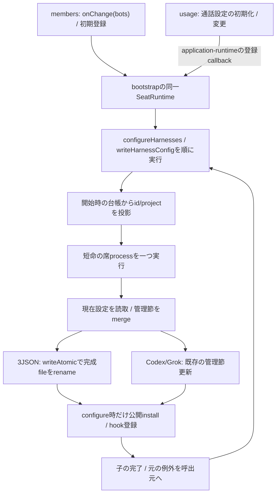
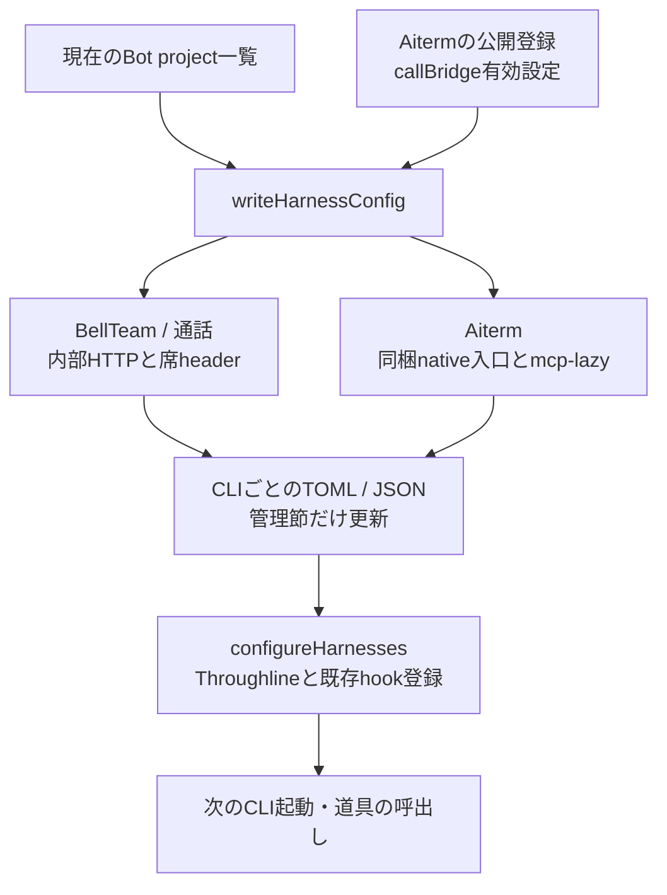
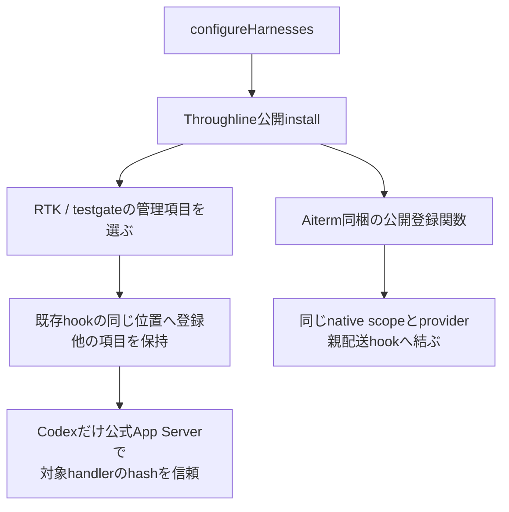

# CLI登録・共有設定の更新

責任者：エピネル。公開窓口は[runtime](README.md)の`cli-registration`。

[H1接続候補](resume.md)の対象では固定state baseを管理MCPへ登録し、relayで失わず、Codex/Cursorの任意env継承から分ける。通常launch/commandのBot env読込後も固定値を検証する。hookの公開setup/既scopeを使い、設定Promiseの成功を現在の全hook実適用へ補完しない。H1非対象の既存動的設定と管理外項目は保持する。

## writerの所有と完了

`SeatRuntime.configureHarnesses(bots, aiterm, callBridge)`はMCPとhookまで、`writeHarnessConfig`はMCP設定まで。両者は同じ本体実体のPromiseで順番を持ち、子の完了前に次の設定用子processを開始しない。メンバーの構造や記憶操作はこの順番へ入れない。先行失敗は呼出元へrejectし、その失敗で後続要求を止めない。待機中の台帳変更を古いproject一覧で上書きしないため、id/projectの投影は子の開始時に行う。

共有JSONは`.claude.json`、`.cursor/mcp.json`、`.gemini/config/mcp_config.json`。同じdirectoryへ0600で完成文書を書いてrenameし、既存読者に空や途中のJSONを見せない。BellTeam管理MCPと既存のproject trust以外の項目は既存merge規則で保持する。3file全部の同時公開や停電時のfsync完了を保証する契約にはしていない。

本番の所有実体はbootstrapの一つ。子入口`run-seat-runtime`の2操作と、低層`harness-config`の関数はその実行部。`application-features`の直接writer既定は席proxyなしの互換構成と隔離試験に残る。独立した複数SeatRuntimeや複数本体を同じhomeへ向ける排他は提供しない。新しい本番callerは同じ登録窓口へ接続し、低層writerを別processで直接呼ばない。

外部CLIや手動ツールによるread-modify-writeと排他する契約はない。外部writerによる途中JSON/更新消失まで今回の修理で解決したとは扱わない。不正な既存JSONは元例外を返し、空設定へ置換しない。Andersonの元例外のJSON名と競合相手は未確定のまま。

設定失敗時の削除結果はmembers所有。runtimeは既存のPromise/rejectとname/message/code/statusを保ち、削除cleanupの成否へ変換しない。HTTP/MCPの受付、本体設定文書の公開、既存CLIへの反映はそれぞれ別の結果である。

限定検証は`seat-harness-config`（非重複、現在台帳、先行失敗、他の席操作の独立）と`harness-config-atomic`（3JSONの旧読者、管理外項目、0600）。関連する既存登録形式と通話設定の試験を使う。本番configの実物変更・実席起動は不要。

## CLIごとの違いは登録箇所へ閉じ込める

| 段階 | 関数 | 差分と保持範囲 |
| --- | --- | --- |
| 起動準備 | `restoreBotEnvironmentsInBackground/restoreBotEnvironments/removeSeatClaudeCopies` | CLI写しの除去後、setupを背景で各Bot順に一回ずつ実行（bootstrapは待たず、先にlistenして/healthzへ答える）。一席の失敗・例外は報告して続行。除くCLI写しは既知packageとそれを指す入口に限定 |
| 席起動の待ち | `AitermClient.launchOptions` → `ready(project)` | 席のagent_launch（wake・再起動・起動時resume）は全てtransportがlaunchOptionsを先に呼ぶ。ここでそのBotのsetup終了（成功も失敗も）まで待つ。登録の無いBot（起動後のcreate_bot等）は即時。timeoutは置かず、出口はsetup実行の終了だけ |
| setup結果 | `run-seat-setup` | base環境でsetup.sh、本人setup.logへ出力。親へpresent/codeだけ返す。取消時の直子終了は150ms、外側group停止と役割が別 |
| MCP登録 | `writeHarnessConfig` | BellTeam/bridge/Aitermの管理項目。Codex/GrokはTOML、Claude/Cursor/AGYはJSON |
| CLI差異 | `tomlSeat/jsonSeat/aitermFor`等の局所関数 | Codex env_http_headers、Grok/Claude展開header、Cursor env参照、AGYはstdio中継。形式差を各機能serviceへ広げない |
| native遅延起動 | `relayedAiterm` | mcp-lazyは起動後idle停止なし。nativeでは旧profile/旧tool cache/wakeを使用しない。独立製品の実装は変えない |
| 管理節の置換 | `writeCodexConfig/writeGrokConfig/mergeMcpConfig` | BellTeam管理MCPと対象project trustを更新、他MCPを保持。無効MCPの扱いはplatform条件を維持 |
| hook登録 | `configureHarnesses` | Throughline install後、Cursor instructions/RTK/Aiterm hookを個別登録。後三者の失敗は報告し続行。Throughline installまで成功扱いに広げない |

全体指示はOwner/profile/rulesと製品規範、個別指示はBotのプロフィールと短期記憶という別の元データを持つ。CLI設定文書が変わったことと、既に起きているCLIが読み直したことを分ける。任意機能からの再設定は[利用支援](../../support-details.md)の背景反映へ接続する。

## hookは所有する登録項目だけを更新する

`configureRtk → setGroupHook/addCursorHook/ownedCommands`は、自分のdirect/gated commandだけを同じ位置で置換する。二重の自分の登録はどちらかを勝手に削除せずエラー。`writeGrokHook/grokHookConfig`は既存Grok専用入口、`trustCodexHook`はhooks/listのsourcePath/key/currentHashに一致したhandlerだけをconfig/batchWriteし読戻す。`codexAppServer`は設定用stdio接続をfinallyで終了し、thread/turnを作らない。

`aitermExecutionRegistration`はAitermの`localParentWorkerRuntime.scope`からstate root/socketを受け、BellTeam側で規則を複製しない。`configureAitermHooks`はnative登録ならその公開setup/argument parser、旧登録ならmergeClaudeParentHooks/mergeCursorParentHooks/ensureCodexParentSteerへ渡す。旧Codex登録の確認が一時的なCLI起動を含むことと、通常のBot起動を区別する。ここではいずれも実行していない。

実装：[application-runtime.mjs](../../../../src/application-runtime.mjs)、[bootstrap.mjs](../../../../src/bootstrap.mjs)、[seat-runtime.mjs](../../../../src/seat-runtime.mjs)、[harness-config.mjs](../../../../src/harness-config.mjs)、[rtk-hooks.mjs](../../../../src/rtk-hooks.mjs)、[aiterm-hooks.mjs](../../../../src/aiterm-hooks.mjs)。参照する確認先はapplication-runtime、seat-command/process/stream/stdio/memory、character-sheets、harness-config、bot-environment、runtime-home、rtk-hooks、aiterm-hooks。native長命実行は[配送詳細](../../delivery-details.md)、通常installer/backupは[供給詳細](../../distribution-details.md)へ接続する。
