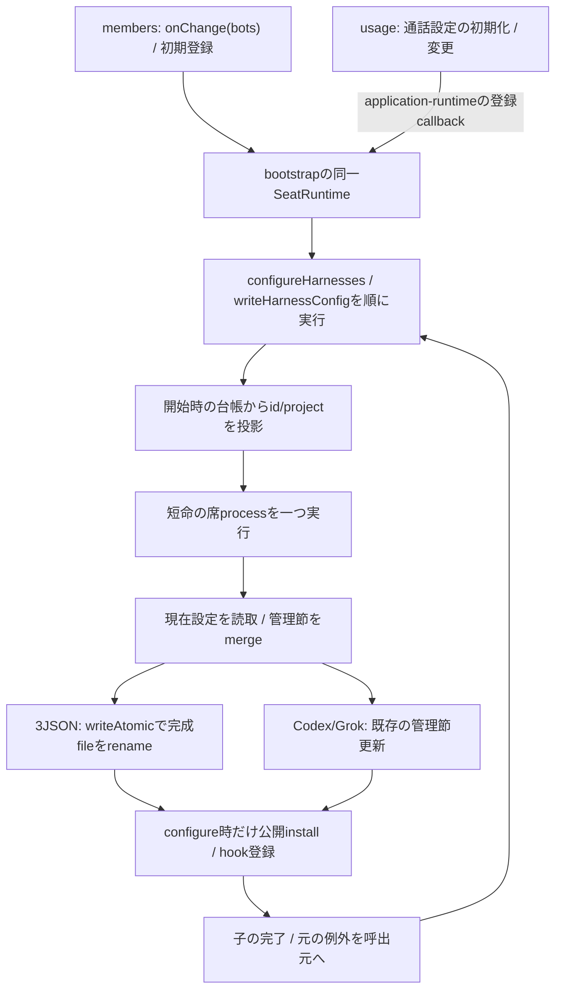
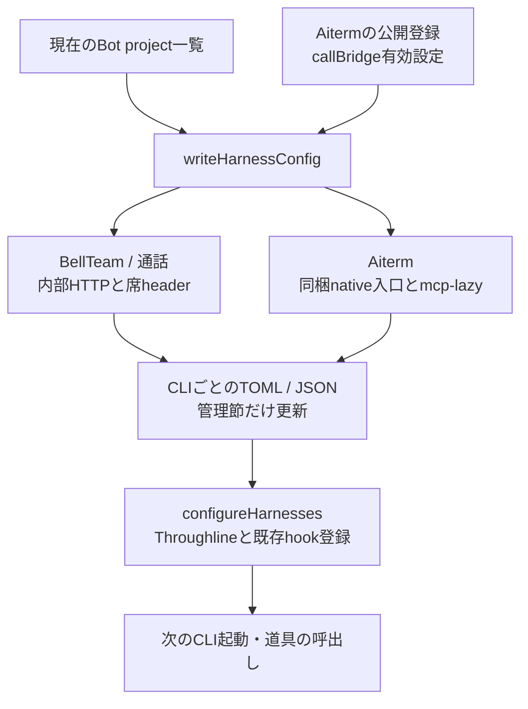
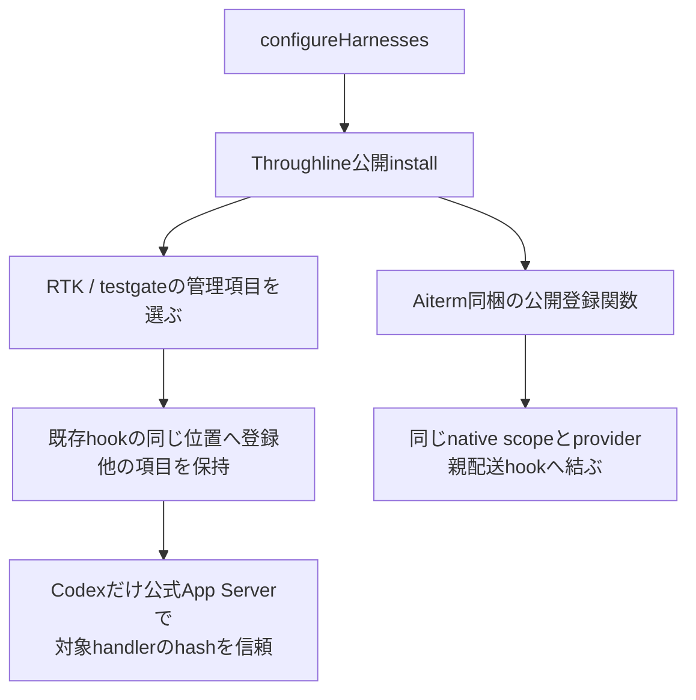
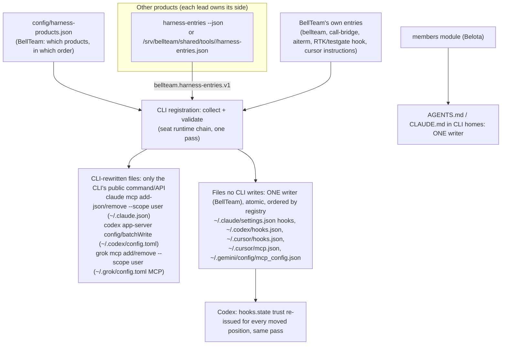

# CLI登録・共有設定の更新

Z-b2 keeps persistent MCP/hook registration descriptors on the original image Aiterm paths, because Aiterm updates only with the body image. Ordinary MCP remains setupNodeExecutable plus image dist/index.js, including the existing mcp-lazy wrapper recognised by Aiterm's sameRegistration; plain aiterm-setup therefore sees the same registered shape and this slice does not trigger replacement that drops BellTeam's Codex/Grok timeout. Native setup receives the image execution-native-server.js, scope and provider, and derives its image sibling hooks. A recover to previous-normal finds those same installation paths in the older image; no new /app adapter path is persisted and no older-body rewrite is required. Superseded PR adapters were never deployed or written to shared HOME. Functions, DFD and precise limits: [Aiterm consumer binding](runtime-updates.md#aiterm-consumer-binding-slice-c).

Per-connection MCP paths and handoff imports remain immutable. Codex/Cursor pass BELLTEAM_RUNTIME_GENERATION (including empty builtin), CODEX_BIN and CLAUDE_BIN; Cursor's bridge removes unresolved placeholders for these names. The non-native lazy wake helper remains the sibling of the original registered Aiterm entry. Codex hook setup uses the selected CLI capture; Aiterm setup/helper code remains image-owned. This does not certify additional Z-c state or vendor compatibility.

責任者：エピネル。公開窓口は[runtime](README.md)の`cli-registration`。

[H1接続候補](resume.md)の対象では固定state baseを管理MCPへ登録し、relayで失わず、Codex/Cursorの任意env継承から分ける。通常launch/commandのBot env読込後も固定値を検証する。hookの公開setup/既scopeを使い、設定Promiseの成功を現在の全hook実適用へ補完しない。H1非対象の既存動的設定と管理外項目は保持する。

## writerの所有と完了

`SeatRuntime.configureHarnesses(bots, aiterm, callBridge)`はMCPとhookまで、`writeHarnessConfig`はMCP設定まで。両者は同じ本体実体のPromiseで順番を持ち、子の完了前に次の設定用子processを開始しない。メンバーの構造や記憶操作はこの順番へ入れない。先行失敗は呼出元へrejectし、その失敗で後続要求を止めない。待機中の台帳変更を古いproject一覧で上書きしないため、id/projectの投影は子の開始時に行う。

共有JSONは`.claude.json`、`.cursor/mcp.json`、`.gemini/config/mcp_config.json`。Claudeの2ndアカウントroot（`$HOME/.bellteam-accounts/claude/<slot>/`）へは書かない。そこの`.claude.json`は1stの`$HOME/.claude.json`へのlinkで、ここでrenameすると link が通常fileに置き換わり、1stの`oauthAccount`を持つ別fileになる（execution/harness-accounts.md「Deployment order」、2026-11-09 #754）。同じdirectoryへ0600で完成文書を書いてrenameし、既存読者に空や途中のJSONを見せない。BellTeam管理MCPと既存のproject trust以外の項目は既存merge規則で保持する。3file全部の同時公開や停電時のfsync完了を保証する契約にはしていない。

端末での起動（一本の起動経路、2026-11-09 Owner裁定・トロニー伝達）: `launch.terminal`（`{ref, target, trustRevision, credentialRevision}`、terminalsの`connection.target`をそのまま）がある起動では、`src/run-seat-aiterm-launch.mjs`は従来どおりserver上の席project（`process.cwd()`）で動くが、`launch.cwd`は端末側の絶対pathを受け付ける。`env_vars`はstdin requestの`privateEnvNames`（1〜16個、変数名形式、重複なし）だけにし、server側のPATH/HOMEなどを端末へ送らない。`privateEnv`（stdinだけ、`privateEnvNames`に含まれる名前、空でない文字列、`CLAUDE_CODE_OAUTH_TOKEN`は不可でloginは従来の`claudeLogin`だけ）を自分のprocess envへ入れ、名前ごとに値があることを確かめてからAitermへ渡す。値はargv・file・logへ出ない。どれかが合わなければ`SEAT_LAUNCH_ARGUMENTS`でAitermを呼ばずに失敗する。`launch.terminal`の無い起動は従来どおり（`cwd`は席project、`privateEnv*`は不可）。

席の起動とClaudeアカウント（execution/harness-accounts.md「Login per slot」、2026-11-09 #756）: 親（execution）は`agent_launch`の起動に、使うloginのslot名（`claudeLogin: '2nd'`）だけを渡し、tokenは渡さない。席ユーザーで動く`src/run-seat-aiterm-launch.mjs`が、受け継いだ`CLAUDE_CODE_OAUTH_TOKEN`を消し、`claudeLogin`があればそのslotの`<BELLTEAM_HOME>/.bellteam-accounts/claude/<slot>/oauth-token`（席ユーザー0600）を読んで自分のprocess envへ入れ、`env_vars`には変数名だけを載せる。tokenが無い・形式違いならその起動は`ACCOUNT_LOGIN_UNAVAILABLE`で失敗し、1stのloginで起動しない。配布順: この本体（#756以上）が先に本番、その後に`claudeLogin`を送るexecution module。古い起動側は`claudeLogin`を無視して2ndの席を1stのloginで起動するため。

本番の所有実体はbootstrapの一つ。子入口`run-seat-runtime`の2操作と、低層`harness-config`の関数はその実行部。`application-features`の直接writer既定は席proxyなしの互換構成と隔離試験に残る。独立した複数SeatRuntimeや複数本体を同じhomeへ向ける排他は提供しない。新しい本番callerは同じ登録窓口へ接続し、低層writerを別processで直接呼ばない。

外部CLIや手動ツールによるread-modify-writeと排他する契約はない。外部writerによる途中JSON/更新消失まで今回の修理で解決したとは扱わない。不正な既存JSONは元例外を返し、空設定へ置換しない。Andersonの元例外のJSON名と競合相手は未確定のまま。

設定失敗時の削除結果はmembers所有。runtimeは既存のPromise/rejectとname/message/code/statusを保ち、削除cleanupの成否へ変換しない。HTTP/MCPの受付、本体設定文書の公開、既存CLIへの反映はそれぞれ別の結果である。

限定検証は`seat-harness-config`（非重複、現在台帳、先行失敗、他の席操作の独立）と`harness-config-atomic`（3JSONの旧読者、管理外項目、0600）。関連する既存登録形式と通話設定の試験を使う。本番configの実物変更・実席起動は不要。

## CLIごとの違いは登録箇所へ閉じ込める

| 段階 | 関数 | 差分と保持範囲 |
| --- | --- | --- |
| 起動準備 | `restoreBotEnvironmentsInBackground/restoreBotEnvironments/removeSeatClaudeCopies` | CLI写しの除去後、setupを背景で各Bot順に一回ずつ実行（bootstrapは待たず、先にlistenして/healthzへ答える）。一席の失敗・例外は報告して続行。除くCLI写しは既知packageとそれを指す入口に限定 |
| 席起動の待ち | `AitermClient.launchOptions` → `ready(project)` | 席のagent_launch（wake・再起動・起動時resume）は全てtransportがlaunchOptionsを先に呼ぶ。ここでそのBotのsetup終了（成功も失敗も）まで待つ。`AitermTransport.wake`と`resumePreviouslyActive`はmembers leaseを取る前に同じ`environmentReady(project)`を先に待ち、起動直後の一斉wakeがlease枠（64）を埋めない。登録の無いBot（起動後のcreate_bot等）は即時。出口はそのBotのsetup実行の終了。各setupは`SETUP_DEADLINE_MS`（600秒）の期限付きで、超えたら既存のseat runner signal → run-seat-setupのSIGTERM→SIGKILL回収で止め、`failed (deadline 600s)`として報告し、gateをfinallyで解く。固まったsetup.shが自分と後続Botの席を無期限に止めることはない |
| setup結果 | `run-seat-setup` | base環境でsetup.sh、本人setup.logへ出力。親へpresent/codeだけ返す。取消時の直子終了は150ms、外側group停止と役割が別 |
| MCP登録 | `writeHarnessConfig` | BellTeam/bridge/Aitermの管理項目。Codex/GrokはTOML、Claude/Cursor/AGYはJSON |
| CLI差異 | `tomlSeat/jsonSeat/aitermFor`等の局所関数 | Codex env_http_headers、Grok/Claude展開header、Cursor env参照、AGYはstdio中継。形式差を各機能serviceへ広げない |
| native遅延起動 | `relayedAiterm` | mcp-lazyは起動後idle停止なし。nativeでは旧profile/旧tool cache/wakeを使用しない。独立製品の実装は変えない |
| 管理節の置換 | `writeCodexConfig/writeGrokConfig/mergeMcpConfig` | BellTeam管理MCPと対象project trustを更新、他MCPを保持。無効MCPの扱いはplatform条件を維持 |
| Claude初回画面の省略（2026-11-12 a15） | `mergeMcpConfig`（`~/.claude.json`の`hasCompletedOnboarding: true`）、`acceptBypassPrompt`（`~/.claude/settings.json`の`skipDangerousModePermissionPrompt: true`） | Webでログインしただけの新しい環境では、Claude Codeを一度も手で起動していない。最初の席が初回案内（テーマ・Security notes）と「Bypass Permissions」の確認画面で止まり、配送が終わらない（Centi 95a8 lab）。BellTeamは全Claude席を`--dangerously-skip-permissions`で起こし、容器が隔離の境界なので、この2つをBellTeamが答える。他の項目は保持。利用規約の更新への回答は書かない（アカウントの持ち主が選ぶ。Aitermの`vendor_onboarding_required`案内のまま） |
| hook登録 | `configureHarnesses` | Throughline install後、Cursor instructions/RTK/Aiterm hookを個別登録。後三者の失敗は報告し続行。Throughline installまで成功扱いに広げない |

全体指示はOwner/profile/rulesと製品規範、個別指示はBotのプロフィールと短期記憶という別の元データを持つ。CLI設定文書が変わったことと、既に起きているCLIが読み直したことを分ける。任意機能からの再設定は[利用支援](../../support-details.md)の背景反映へ接続する。

## hookは所有する登録項目だけを更新する

`configureRtk → setGroupHook/addCursorHook/ownedCommands`は、自分のdirect/gated commandだけを同じ位置で置換する。二重の自分の登録はどちらかを勝手に削除せずエラー。`writeGrokHook/grokHookConfig`は既存Grok専用入口、`trustCodexHook`はhooks/listのsourcePath/key/currentHashに一致したhandlerだけをconfig/batchWriteし読戻す。`codexAppServer`は設定用stdio接続をfinallyで終了し、thread/turnを作らない。

`aitermExecutionRegistration`はAitermの`localParentWorkerRuntime.scope`からstate root/socketを受け、BellTeam側で規則を複製しない。`configureAitermHooks`はnative登録ならその公開setup/argument parser、旧登録ならmergeClaudeParentHooks/mergeCursorParentHooks/ensureCodexParentSteerへ渡す。旧Codex登録の確認が一時的なCLI起動を含むことと、通常のBot起動を区別する。ここではいずれも実行していない。

実装：[application-runtime.mjs](../../../../src/application-runtime.mjs)、[bootstrap.mjs](../../../../src/bootstrap.mjs)、[seat-runtime.mjs](../../../../src/seat-runtime.mjs)、[harness-config.mjs](../../../../src/harness-config.mjs)、[rtk-hooks.mjs](../../../../src/rtk-hooks.mjs)、[aiterm-hooks.mjs](../../../../src/aiterm-hooks.mjs)。参照する確認先はapplication-runtime、seat-command/process/stream/stdio/memory、character-sheets、harness-config、bot-environment、runtime-home、rtk-hooks、aiterm-hooks。native長命実行は[配送詳細](../../delivery-details.md)、通常installer/backupは[供給詳細](../../distribution-details.md)へ接続する。

## One writer per CLI file: product harness entries (bd14, Trony GO 2026-11-14)

Owner rule diagrams.product-boundary. The writer inventory (2026-11-14) found seven seat CLI files with four or more writers each: BellTeam, Throughline install, Approval Box setup, the Aiterm steer setup, typesafe/xarticle register-mcp, Caveat and its maintainer, the mcp-lazy wrap, and Peertable. They do unlocked read-modify-writes, several of them at container start in parallel with `configure(bots)`. Target:

| Step | From → to | Data | Owner |
| --- | --- | --- | --- |
| E1 | product → BellTeam | `{schema:'bellteam.harness-entries.v1', product, version, mcpServers:{<name>:{command,args,env}|{url,headers}}, hooks:{claude|codex|cursor|grok|gemini:{<event>:[{matcher, command, timeout?}]}}, settings:{codex?:{'features.hooks':true}}}`. Printed by the product's own CLI (`<product> harness-entries --json`, exit 0, stdout only) or placed by a shared tool as `/srv/bellteam/shared/tools/<id>/harness-entries.json`. Commands are absolute or `node <entry>`. No secret values: env values that are secrets are named, and the seat env supplies them. | the product |
| E2 | `config/harness-products.json` | the ordered list of products BellTeam reads and how (command or file). The order fixes hook positions, so Codex trust stays valid. | BellTeam |
| E3 | CLI registration → CLI files | MCP entries go through the CLI's public command or API (P1). Hooks and the MCP files no CLI writes go through BellTeam's single atomic writer (P2), merged by product tag; entries from a product absent from E2 are not touched. `settings` keys only from a fixed allowlist. | BellTeam |
| E4 | members → CLI homes | AGENTS.md / CLAUDE.md: one implementation (members-project-files.mjs); the body's global-instructions.mjs second writer retires. | members (Belota) |

Switchover, with no seat-visible change (Trony condition 2: every seat keeps the same MCP servers, hooks and rules): for each product, (1) the product publishes E1 with exactly the entries it writes today; (2) BellTeam adds it to E2 and applies it, and the resulting files are equal to today's; (3) the product removes its own writer, and its setup.sh stops writing CLI config. A product not yet switched keeps writing as today. Failure: an E1 that is missing, invalid, or that names a key another product owns is reported and leaves that product's current entries untouched (no partial removal); the next configure retries. No new guard: an invalid E1 keeps the last good state, which is the named protection against data loss and overwriting existing state, and the next pass leaves that state on its own.
