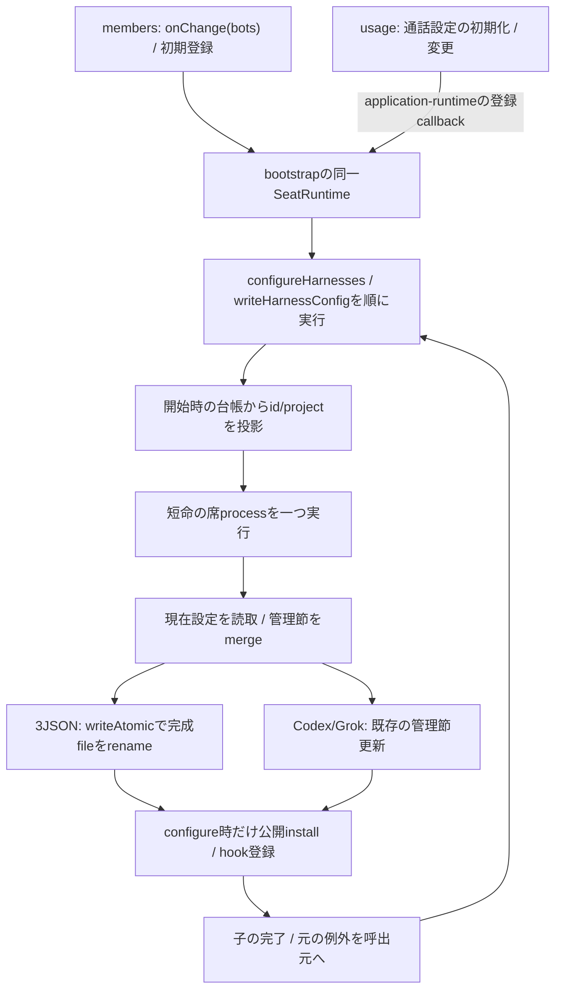
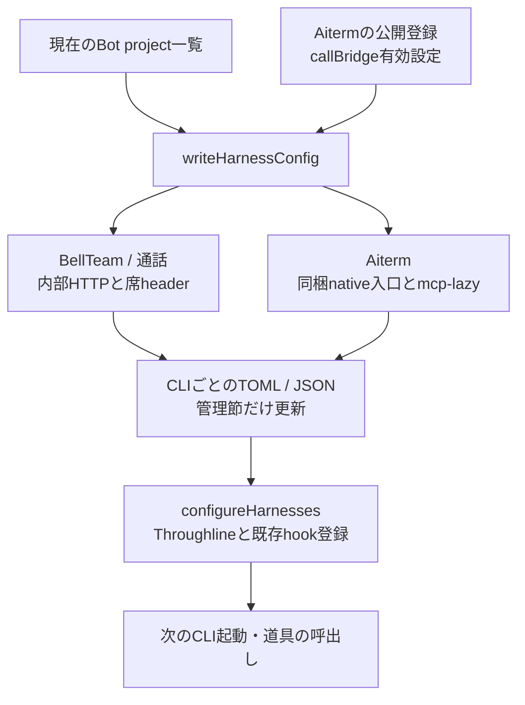
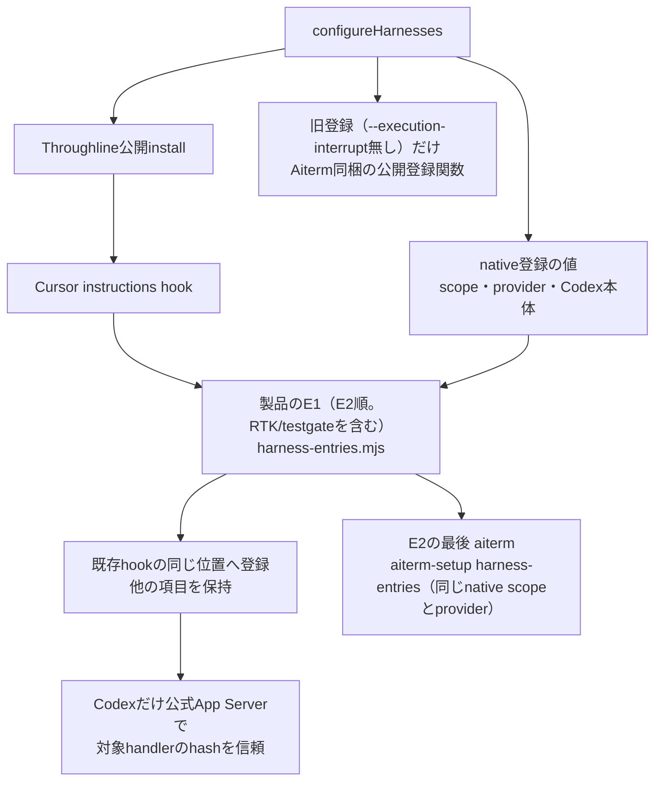
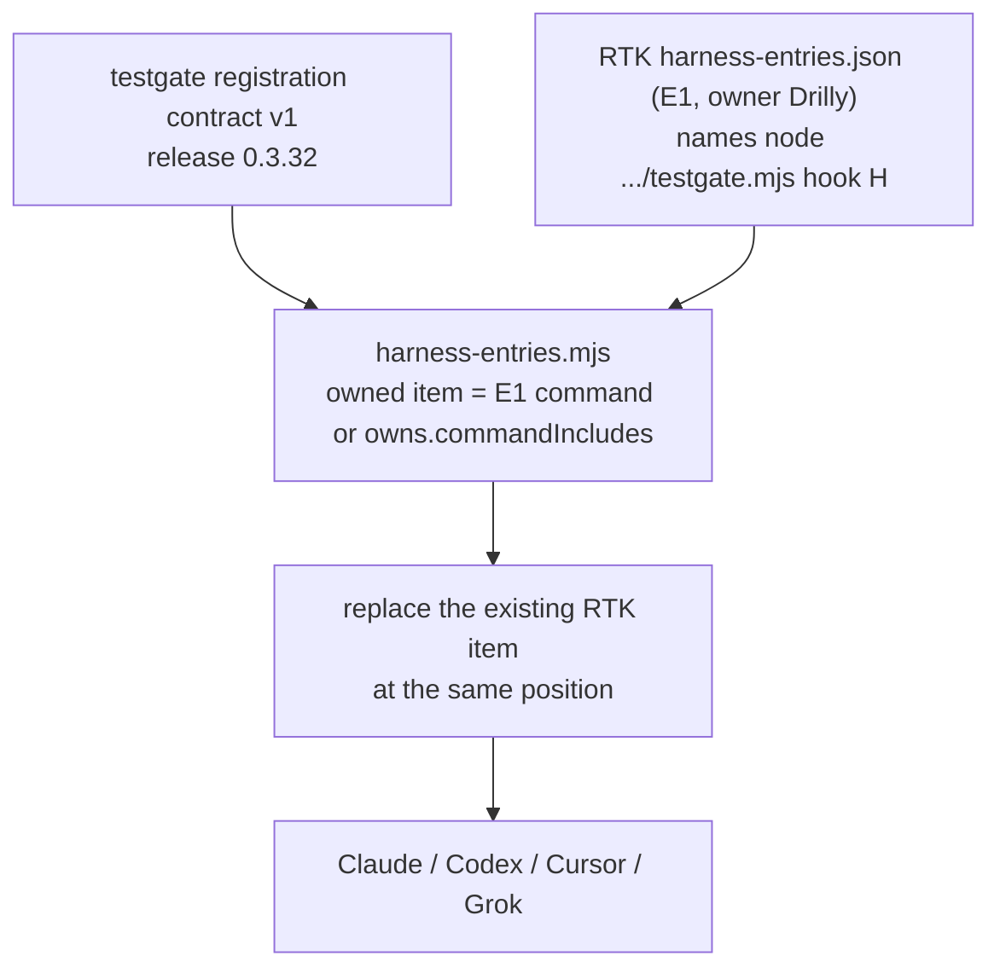
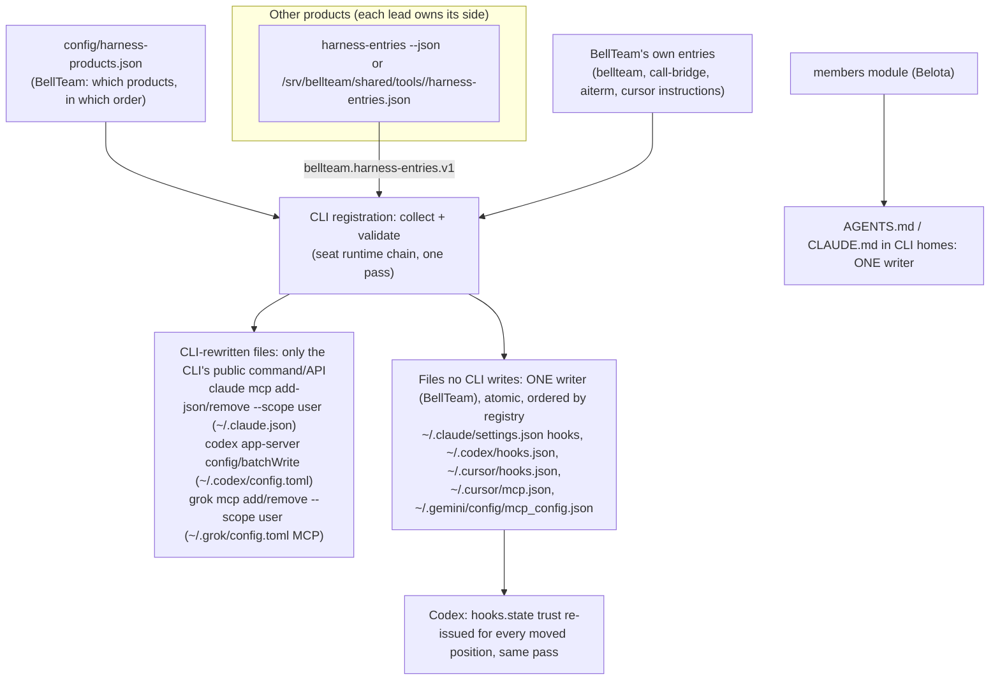

# CLI登録・共有設定の更新

Z-b2 keeps persistent MCP/hook registration descriptors on the original image Aiterm paths, because Aiterm updates only with the body image. Ordinary MCP is exactly the image Aiterm's `setup-node` entry `mcpRegistration()` (node plus that package's index.js; entries come only from the package.json `exports`, [Aiterm public entries](runtime-updates.md#aiterm-public-entries-bd05)), including the existing mcp-lazy wrapper recognised by Aiterm's sameRegistration; plain aiterm-setup therefore sees the same registered shape and this slice does not trigger replacement that drops BellTeam's Codex/Grok timeout. Native setup receives the image `execution-native-server` entry, scope and provider; hooks come from the image `execution-native-setup` / `setup-integrations` entries. A recover to previous-normal finds those same installation paths in the older image; no new /app adapter path is persisted and no older-body rewrite is required. Superseded PR adapters were never deployed or written to shared HOME. Functions, DFD and precise limits: [Aiterm consumer binding](runtime-updates.md#aiterm-consumer-binding-slice-c).

Per-connection MCP paths and handoff imports remain immutable. Codex/Cursor pass BELLTEAM_RUNTIME_GENERATION (including empty builtin), CODEX_BIN and CLAUDE_BIN; Cursor's bridge removes unresolved placeholders for these names. The non-native lazy wake helper remains the sibling of the original registered Aiterm entry. Codex hook setup uses the selected CLI capture; Aiterm setup/helper code remains image-owned. This does not certify additional Z-c state or vendor compatibility.

責任者：エピネル。公開窓口は[runtime](README.md)の`cli-registration`。

[H1接続候補](resume.md)の対象では固定state baseを管理MCPへ登録し、relayで失わず、Codex/Cursorの任意env継承から分ける。通常launch/commandのBot env読込後も固定値を検証する。hookの公開setup/既scopeを使い、設定Promiseの成功を現在の全hook実適用へ補完しない。H1非対象の既存動的設定と管理外項目は保持する。

## writerの所有と完了



`SeatRuntime.configureHarnesses(bots, aiterm, callBridge)`はMCPとhookまで、`writeHarnessConfig`はMCP設定まで。両者は同じ本体実体のPromiseで順番を持ち、子の完了前に次の設定用子processを開始しない。メンバーの構造や記憶操作はこの順番へ入れない。先行失敗は呼出元へrejectし、その失敗で後続要求を止めない。待機中の台帳変更を古いproject一覧で上書きしないため、id/projectの投影は子の開始時に行う。

共有JSONは`.claude.json`、`.cursor/mcp.json`、`.gemini/config/mcp_config.json`。Claudeの2ndアカウントroot（`$HOME/.bellteam-accounts/claude/<slot>/`）へは書かない。そこの`.claude.json`は1stの`$HOME/.claude.json`へのlinkで、ここでrenameすると link が通常fileに置き換わり、1stの`oauthAccount`を持つ別fileになる（execution/harness-accounts.md「Deployment order」、2026-11-09 #754）。同じdirectoryへ0600で完成文書を書いてrenameし、既存読者に空や途中のJSONを見せない。BellTeam管理MCPと既存のproject trust以外の項目は既存merge規則で保持する。3file全部の同時公開や停電時のfsync完了を保証する契約にはしていない。

端末での起動（一本の起動経路、2026-11-09 Owner裁定・トロニー伝達）: `launch.terminal`（`{ref, target, trustRevision, credentialRevision}`、terminalsの`connection.target`をそのまま）がある起動では、`src/run-seat-aiterm-launch.mjs`は従来どおりserver上の席project（`process.cwd()`）で動くが、`launch.cwd`は端末側の絶対pathを受け付ける。`env_vars`はstdin requestの`privateEnvNames`（1〜16個、変数名形式、重複なし）だけにし、server側のPATH/HOMEなどを端末へ送らない。`privateEnv`（stdinだけ、`privateEnvNames`に含まれる名前、空でない文字列、`CLAUDE_CODE_OAUTH_TOKEN`は不可でloginは従来の`claudeLogin`だけ）を自分のprocess envへ入れ、名前ごとに値があることを確かめてからAitermへ渡す。値はargv・file・logへ出ない。どれかが合わなければ`SEAT_LAUNCH_ARGUMENTS`でAitermを呼ばずに失敗する。`launch.terminal`の無い起動は従来どおり（`cwd`は席project、`privateEnv*`は不可）。

席の起動とClaudeアカウント（execution/harness-accounts.md「Login per slot」、2026-11-09 #756）: 親（execution）は`agent_launch`の起動に、使うloginのslot名（`claudeLogin: '2nd'`）だけを渡し、tokenは渡さない。席ユーザーで動く`src/run-seat-aiterm-launch.mjs`が、受け継いだ`CLAUDE_CODE_OAUTH_TOKEN`を消し、`claudeLogin`があればそのslotの`<BELLTEAM_HOME>/.bellteam-accounts/claude/<slot>/oauth-token`（席ユーザー0600）を読んで自分のprocess envへ入れ、`env_vars`には変数名だけを載せる。tokenが無い・形式違いならその起動は`ACCOUNT_LOGIN_UNAVAILABLE`で失敗し、1stのloginで起動しない。配布順: この本体（#756以上）が先に本番、その後に`claudeLogin`を送るexecution module。古い起動側は`claudeLogin`を無視して2ndの席を1stのloginで起動するため。

本番の所有実体はbootstrapの一つ。子入口`run-seat-runtime`の2操作と、低層`harness-config`の関数はその実行部。`application-features`の直接writer既定は席proxyなしの互換構成と隔離試験に残る。独立した複数SeatRuntimeや複数本体を同じhomeへ向ける排他は提供しない。新しい本番callerは同じ登録窓口へ接続し、低層writerを別processで直接呼ばない。

外部CLIや手動ツールによるread-modify-writeと排他する契約はない。外部writerによる途中JSON/更新消失まで今回の修理で解決したとは扱わない。不正な既存JSONは元例外を返し、空設定へ置換しない。Andersonの元例外のJSON名と競合相手は未確定のまま。

設定失敗時の削除結果はmembers所有。runtimeは既存のPromise/rejectとname/message/code/statusを保ち、削除cleanupの成否へ変換しない。HTTP/MCPの受付、本体設定文書の公開、既存CLIへの反映はそれぞれ別の結果である。

限定検証は`seat-harness-config`（非重複、現在台帳、先行失敗、他の席操作の独立）と`harness-config-atomic`（3JSONの旧読者、管理外項目、0600）。関連する既存登録形式と通話設定の試験を使う。本番configの実物変更・実席起動は不要。

## CLIごとの違いは登録箇所へ閉じ込める



| 段階 | 関数 | 差分と保持範囲 |
| --- | --- | --- |
| 起動準備 | `restoreBotEnvironmentsInBackground/restoreBotEnvironments/removeSeatClaudeCopies` | CLI写しの除去後、setupを背景で各Bot順に一回ずつ実行（bootstrapは待たず、先にlistenして/healthzへ答える）。一席の失敗・例外は報告して続行。除くCLI写しは既知packageとそれを指す入口に限定 |
| 席起動の待ち | `AitermClient.launchOptions` → `ready(project)` | 席のagent_launch（wake・再起動・起動時resume）は全てtransportがlaunchOptionsを先に呼ぶ。ここでそのBotのsetup終了（成功も失敗も）まで待つ。`AitermTransport.wake`と`resumePreviouslyActive`はmembers leaseを取る前に同じ`environmentReady(project)`を先に待ち、起動直後の一斉wakeがlease枠（64）を埋めない。登録の無いBot（起動後のcreate_bot等）は即時。出口はそのBotのsetup実行の終了。各setupは`SETUP_DEADLINE_MS`（600秒）の期限付きで、超えたら既存のseat runner signal → run-seat-setupのSIGTERM→SIGKILL回収で止め、`failed (deadline 600s)`として報告し、gateをfinallyで解く。固まったsetup.shが自分と後続Botの席を無期限に止めることはない |
| setup結果 | `run-seat-setup` | base環境でsetup.sh、本人setup.logへ出力。親へpresent/codeだけ返す。取消時の直子終了は150ms、外側group停止と役割が別 |
| MCP登録 | `writeHarnessConfig` | BellTeam/bridge/Aitermの管理項目。Codex/GrokはTOML、Claude/Cursor/AGYはJSON |
| CLI差異 | `tomlSeat/jsonSeat/aitermFor`等の局所関数 | Codex env_http_headers、Grok/Claude展開header、Cursor env参照、AGYはstdio中継。形式差を各機能serviceへ広げない |
| native遅延起動 | `relayedAiterm` | mcp-lazyは起動後idle停止なし。nativeでは旧profile/旧tool cache/wakeを使用しない。独立製品の実装は変えない |
| 管理節の置換 | `writeCodexConfig/writeGrokConfig/mergeMcpConfig` | BellTeam管理MCPと対象project trustを更新、他MCPを保持。無効MCPの扱いはplatform条件を維持 |
| Claude初回画面の省略（2026-11-12 a15） | `mergeMcpConfig`（`~/.claude.json`の`hasCompletedOnboarding: true`）、`acceptBypassPrompt`（`~/.claude/settings.json`の`skipDangerousModePermissionPrompt: true`） | Webでログインしただけの新しい環境では、Claude Codeを一度も手で起動していない。最初の席が初回案内（テーマ・Security notes）と「Bypass Permissions」の確認画面で止まり、配送が終わらない（Centi 95a8 lab）。BellTeamは全Claude席を`--dangerously-skip-permissions`で起こし、容器が隔離の境界なので、この2つをBellTeamが答える。他の項目は保持。利用規約の更新への回答は書かない（アカウントの持ち主が選ぶ。Aitermの`vendor_onboarding_required`案内のまま） |
| hook登録 | `configureHarnesses` | Throughline install後、Cursor instructions、製品のE1（RTK/testgate、native登録のAitermのhookを含む。下のbd14）、旧登録の時だけAitermの公開登録関数を個別登録。後三者の失敗は報告し続行。Throughline installまで成功扱いに広げない。製品E1の位置はRTK writerが走っていた所と同じで、各hookのevent順と配列順が変わらない |

全体指示はOwner/profile/rulesと製品規範、個別指示はBotのプロフィールと短期記憶という別の元データを持つ。CLI設定文書が変わったことと、既に起きているCLIが読み直したことを分ける。任意機能からの再設定は[利用支援](../../support-details.md)の背景反映へ接続する。

## hookは所有する登録項目だけを更新する



hookのファイルは、製品のE1を適用する`harness-entries.mjs`が一つの書き手として更新する（下のbd14）。RTK/testgateの項目はRTKのE1（E2の`rtk`）だけが運び、BellTeam自身のRTK writer（`configureRtk`）は退役した。`trustCodexHook`はhooks/listのsourcePath/key/currentHashに一致したhandlerだけをconfig/batchWriteし読戻す。`codexAppServer`は設定用stdio接続をfinallyで終了し、thread/turnを作らない（どちらも`rtk-hooks.mjs`に残る）。

## Testgate PreToolUse registration (bd13)

BellTeam's registration follows the [testgate registration contract v1, release 0.3.32](https://github.com/kitepon/testgate/blob/v0.3.32/docs/registration-contract.md). Testgate owns hook behavior and its release lifecycle; Epinel owns the BellTeam container registration. Since the bd14 second switch the item reaches the seat through RTK's E1 (`rtk` in E2), which always names the testgate entry: BellTeam no longer chooses between testgate and `rtk hook H`, so the unreadable-path fallback below is retired with `configureRtk`. Terminal registration belongs to Drilly and uses the terminal's own installation root. This section documents only the BellTeam side of the boundary.



| From → to | Data and rule | Owner |
| --- | --- | --- |
| Testgate contract → RTK E1 → BellTeam registration | For `H` in `claude`, `codex`, `cursor`, `grok`, RTK's E1 carries `node /srv/bellteam/shared/tools/testgate/current/bin/testgate.mjs hook H`; BellTeam writes it as given. | Testgate owns the v1 entry contract; Epinel owns the container registration. |
| `harness-entries.mjs` → harness hook file | Replace the single existing PreToolUse RTK item in place. Never add a second item. The stable v1 path, argv, stdin/stdout behavior, and passthrough on internal failure remain unchanged; testgate never exits 2. | BellTeam owns its item and position. |
| Testgate release → next hook invocation | A release updates the `current` link only; it needs no hook re-registration or Codex re-trust. A v2 change is announced to Epinel and Drilly with a v1 compatibility period. | Testgate owns release/distribution; BellTeam consumes the stable entry. |

`aitermExecutionRegistration`はAitermの`localParentWorkerRuntime.scope`からstate root/socketを受け、BellTeam側で規則を複製しない。`configureAitermHooks`はnative登録ならその公開setup/argument parser、旧登録ならmergeClaudeParentHooks/mergeCursorParentHooks/ensureCodexParentSteerへ渡す。旧Codex登録の確認が一時的なCLI起動を含むことと、通常のBot起動を区別する。ここではいずれも実行していない。

実装：[application-runtime.mjs](../../../../src/application-runtime.mjs)、[bootstrap.mjs](../../../../src/bootstrap.mjs)、[seat-runtime.mjs](../../../../src/seat-runtime.mjs)、[harness-config.mjs](../../../../src/harness-config.mjs)、[rtk-hooks.mjs](../../../../src/rtk-hooks.mjs)、[aiterm-hooks.mjs](../../../../src/aiterm-hooks.mjs)。参照する確認先はapplication-runtime、seat-command/process/stream/stdio/memory、character-sheets、harness-config、bot-environment、runtime-home、rtk-hooks、aiterm-hooks。native長命実行は[配送詳細](../../delivery-details.md)、通常installer/backupは[供給詳細](../../distribution-details.md)へ接続する。

## One writer per CLI file: product harness entries (bd14, Trony GO 2026-11-14)

Owner rule diagrams.product-boundary. The writer inventory (2026-11-14) found seven seat CLI files with four or more writers each: BellTeam, Throughline install, Approval Box setup, the Aiterm steer setup, typesafe/xarticle register-mcp, Caveat and its maintainer, the mcp-lazy wrap, and Peertable. They do unlocked read-modify-writes, several of them at container start in parallel with `configure(bots)`. Target:



| Step | From → to | Data | Owner |
| --- | --- | --- | --- |
| E1 | product → BellTeam | `bellteam.harness-entries.v1` (v1.1 below), printed by the product's own CLI (`<product> harness-entries --json`, read-only: no init, no network, no file write (one narrow exception: Aiterm's `aiterm-setup harness-entries` writes only Aiterm's own `~/.config/aiterm-mcp/codex-parent-hooks/config.json`, which its Codex hook reads; every CLI file stays BellTeam's); may take `--home <seat home>` and the product's own scope flags) or placed by a shared tool as `/srv/bellteam/shared/tools/<id>/harness-entries.json` (atomic, its own file). | the product |
| E2 | `config/harness-products.json` | the ordered list of products BellTeam reads and how (command or file). The order fixes hook positions, so Codex trust stays valid. | BellTeam |
| E3 | CLI registration → CLI files | MCP entries go through the CLI's public command or API (P1). Hooks and the MCP files no CLI writes go through BellTeam's single atomic writer (P2), merged by product tag; entries from a product absent from E2 are not touched. `settings` keys only from a fixed allowlist. | BellTeam |
| E4 | members → CLI homes | AGENTS.md / CLAUDE.md: one implementation (members-project-files.mjs); the body's global-instructions.mjs second writer retires. | members (Belota) |

E1 v1.1 (2026-11-14, from the leads' answers: Moran, Elegg, Nayuta, Drilly, Noah, Shiratsuru, Rapunzel):

```
{ schema: 'bellteam.harness-entries.v1', product, version,
  mcpServers:  { <name>: { <harness>: <native entry, exactly as that CLI stores it> } },
  hooks:       { claude|codex: { <event>: [ <native group: {matcher?, hooks:[<native item>]}> ] },
                 cursor: { <event>: [ <native item> ] },
                 grok: <the whole native content of ~/.grok/hooks/<product>.json> },
  permissions: { cursor: { allow: [ 'Mcp(<server>:<tool>)', ... ] } },
  settings:    { codex: { 'features.hooks': true } },
  owns:        { commandIncludes: [ '<substring>', ... ] } }
```

- Native and verbatim. A harness key that is present is a target; an absent key means no entry for that CLI (for example no Gemini). BellTeam copies each native entry, group and item as given, with no field allowlist inside it, so `type`, `asyncRewake`, `timeout` (the CLI's own unit), `shell`, `env` (non-secret literals), `startup_timeout_sec`, `enabled`, `headersHelper`, `env_vars` (names only), `version` and Windows command forms stay as today. Secret values never appear: a value is named (`env_vars`) or read by the product's own helper.
- Merge inside an item (Noah, 2026-11-14). For an MCP entry, the keys E1 declares are the product's and win (`command`, `args`, `type`, `url`, ...). Existing keys E1 does not declare stay as they are: user env keys, `enabled`/`disabled`, startup and tool timeouts, unknown fields. `env` merges key by key; on a conflicting key E1 wins, and `env:{}` clears nothing. The merged whole entry goes through the provider's command or API (Codex: `config/batchWrite` with `upsert`). For a hook item matched as the product's, E1's declared fields replace the existing ones, undeclared fields and the native group metadata stay, and the `command` string is E1's exactly. A product that needs a command prefix publishes it in its command.
- Patch only what the product owns. BellTeam records, per product and file, the items it wrote last time (its own state, `<seat home>/.bellteam-cli-registration/applied.json`: the seat user writes it, `{ <product>: { version, entries: ["<harness>:<server>"] } }`). On the first switch, the product's items are those equal to its E1 items or whose command contains one of `owns.commandIncludes`; they are replaced in place, at the same position. Everything else stays untouched: other products, user fields, unknown fields and group metadata.
- MCP: through the CLI's public command or API (`claude mcp add-json --scope user`, codex app-server `config/batchWrite`, `grok mcp add --scope user`) with the native entry. Cursor and Gemini MCP files, the hook files and `~/.cursor/cli-config.json` `permissions.allow` (merged by product; `deny` and other entries kept) go through BellTeam's single atomic writer.
- `settings` comes from a fixed allowlist. `codex features.hooks: true` is set only when the key is absent, and never flips an explicit false.
- One owner per item. The RTK/testgate PreToolUse item is published by RTK only (Drilly; testgate agreed, Shiratsuru 2026-11-14): `rtk` is in E2 and `testgate` is not. Peertable needs no seat registration (Rapunzel) and is not in E2.
- Transform step (mcp-lazy, Leona). For each E2 entry marked `wrap: 'mcp-lazy'` (today: `approval-box` for claude, cursor, codex and grok), BellTeam sends the raw native MCP entry per client through `mcp-lazy wrap-entry --json --relay <BellTeam's relay path> --env MCP_LAZY_CACHE_DIR=$HOME/.cache/mcp-lazy/approval-box-<client> --env MCP_LAZY_IDLE_STOP=0` and writes the returned entry. This is a pure stdin-to-stdout transform: it keeps no metadata and writes no file. Rolling back means re-applying the raw E1. The relay path is BellTeam's (the image's mcp-lazy install). The existing "Aiterm >= 0.51.0" gate stays BellTeam's: it skips the transform below that version, as reapply-approval-box.sh does today. The old reapply script, its setup.sh lines and its state retire through their owner (bot-7b140b27) after Molly's E2 equality ("applied") message.
- Third-party CLIs (Owner ruling 2026-11-14, via Trony). Claude Code, Codex, Grok, Cursor and Antigravity cannot give BellTeam a contracted interface. Where one of them has a public command or API, BellTeam uses it (P1). Where none exists (the hook files, `~/.cursor/mcp.json`, `~/.cursor/cli-config.json`, `~/.gemini/config/mcp_config.json`, Claude's `settings.json` keys), the access is confined to ONE place, BellTeam's CLI registration (`harness-config.mjs` and its single writer), and is marked as a **third-party, unofficial dependency** on that CLI's file format: it can break when the CLI changes, and that is fixed here only. BellTeam's own products (Aiterm, Throughline, Approval Box, Lattice, call bridge, testgate, RTK) use contracted interfaces only (E1).
- Order: products in E2 order, items in E1 order. Codex `hooks.state` trust is re-issued by BellTeam for every moved position in the same pass.

Switchover, with no seat-visible change (Trony condition 2: every seat keeps the same MCP servers, hooks and rules): for each product, (1) the product publishes E1 with exactly the entries it writes today, and E1 alone changes nothing; (2) BellTeam adds the product to E2 in a body PR, applies it, and verifies in Centi's lab that the seat files are byte-equal to today's; (3) after that body is LIVE, Molly sends the product's lead ONE "applied" message, and only then does the product retire its writer for BellTeam seat homes (managed deployment only; standalone install and uninstall stay the product's own). Until (3) ends, both sides write identical content. Startup maintainers owned by another Bot (for example Trony's caveat maintainer and mcp-lazy reapply) retire through their owner, in the same serialized order. A product not yet switched keeps writing as today. Failure: an E1 that is missing, invalid, or that names a key another product owns is reported and leaves that product's current entries untouched (no partial removal); the next configure retries. No new guard: an invalid E1 keeps the last good state, which is the named protection against data loss and overwriting existing state, and the next pass leaves that state on its own.

First slice (MCP, 2026-11-14) and second switch (hooks, RTK, 2026-11-14): E2 is [config/harness-products.json](../../../../config/harness-products.json) (shipped in the image through `scripts/package-server.mjs`; a missing E2 is reported as an error, never a silent no-op, after the Z4 lab found it absent) (today `xarticle`, `typesafe`, `throughline`, `rtk`: a shared-tool `harness-entries.json` for xarticle, typesafe and rtk, and for `throughline` a command, `["throughline", "harness-entries", "--json", "--home", "{home}"]`, run through the injectable `run` with the seat environment, `{home}` replaced by the seat home, stdout parsed as the E1; a failed command or unreadable output is the same "E1 unusable, keep current state" report as a bad file, through `safeMessage`). Third switch (Throughline): `throughline` sits before `rtk`, where `throughline install` (which still runs first and still writes the same hooks) and the RTK pass put them, so each event, key and array order is unchanged and an in-place replacement finds the items `install` wrote. Code: [harness-entries.mjs](../../../../src/harness-entries.mjs), called from `configureHarnesses` where the RTK writer ran, after Throughline install and the Cursor instructions and before the Aiterm hooks (try/catch + report like Aiterm; `productEntries`, `run` and the app-server are injectable). That position keeps every hook event's key and array order as it was: RTK's PreToolUse group lands after Throughline's events and before Aiterm's, in each file. The hooks tests freeze the bytes the old `configureRtk` wrote (`test/fixtures/rtk-switch.json`) and assert the new pass reproduces them and writes nothing on a seat that already has them. Tests: [harness-entries.test.mjs](../../../../test/harness-entries.test.mjs).

Fourth switch (Aiterm, 2026-11-14): `aiterm` is the last E2 item, a command `["aiterm-setup", "harness-entries", "--json", "--home", "{home}", "--state-root", "{stateRoot}", "--socket", "{socket}", "--steer-provider", "{steerProvider}", "--codex-binary", "{codexBinary}", "--clients", "claude,cursor,codex"]` (Aiterm >= 0.70.58, the image's global `aiterm-setup`, the same root as `AITERM_ROOT`). Last, because the Aiterm hooks were written after every product: each event's key and array order stays. `configureHarnesses` gives `productEntries` the values (`vars`) of the native registration it already reads: `parseNativeExecutionArguments` (Aiterm's `execution-native-server` export) of the registration args gives `stateRoot`/`socket`/`steerProvider`, and the codex binary is the selected CLI capture's `runtime-codex` bin (as `configureAitermHooks` did). A command part with a `{name}` that has no value makes that product's E1 unusable (reported, current state kept), so a seat without a native registration keeps its hooks. Aiterm owns and writes only its own `~/.config/aiterm-mcp/codex-parent-hooks/config.json` inside `harness-entries`; BellTeam writes the CLI files and the Codex trust (the general Codex trust row below). `configureAitermHooks` keeps only the old (non-native) registration branch (`mergeClaudeParentHooks`/`mergeCursorParentHooks`/`ensureCodexParentSteer`); with a native registration `configureHarnesses` no longer calls it. What leaves with Aiterm's writer: the `restart_required` report (Aiterm's `stale_processes` list is `[]` from `harness-entries`; hooks change only with a new image, which restarts every seat), and Aiterm's own vacated-trust cleanup (items are replaced in place, so no position is vacated). Proof: the hook files `configureNativeExecutionHooks` writes (real Aiterm 0.70.58 and Codex app-server on temp homes, from an empty seat, a seat holding the Aiterm hooks and a seat holding every other product but not Aiterm) are frozen as `test/fixtures/aiterm-switch.json` with the E1 `aiterm-setup harness-entries` printed; the new pass reproduces the Claude and Cursor files and Aiterm's `codex-parent-hooks/config.json` byte for byte, writes nothing on a seat that has them, and writes the Codex `hooks.json` with the same content in BellTeam's 2-space format (Aiterm's own writer printed it as one compact line; a file that already holds the items is not rewritten).

| Function | Role |
| --- | --- |
| `parseEntries(product, value)` | E1 v1.1 check: schema, product name, `mcpServers` shape, five harness keys. `hooks` (claude, codex, cursor, grok), `settings` (object of objects), `owns.commandIncludes`; a product with non-empty permissions throws (Approval Box slice, later) and is reported and skipped. |
| settings | Fixed allowlist: `codex` `features.hooks: true` only. Inside the codex app-server pass, `config/read` shows the key; only when it is absent (not `false`) `config/batchWrite` `features.hooks` `true` (`upsert`, `~/.codex/config.toml`) is sent. An explicit false stays false and is not recorded. Any other settings key or value is reported and skipped; the rest of the product still applies. Recorded as `codex:settings:features.hooks` in `applied.json`. |
| `mergeEntry(current, entry)` | The E1 merge rule: E1's declared keys win, existing undeclared keys stay, `env` merges by key (E1 wins), `env:{}` clears nothing. claude/grok/cursor/gemini write the merged whole entry. |
| `configureHarnessEntries(home, deps)` | Per product (E2 order) and per (server, harness): read the seat's current entry, write only when it differs, then record `harness:server` in `applied.json`. An invalid or missing E1 leaves that product's state and record untouched (a missing file is reported as missing, not as a schema error). A failed entry is reported and not recorded; the rest continue. Reports are the seat child's stderr lines; `SeatRuntime.call` forwards them to the body log (docker logs), stdout carries only the JSON answer (Z8 lab (4), 2026-11-14). Because these lines reach docker logs, a report never quotes a failed CLI call's message or a JSON parse error (both can carry entry tokens/headers/env): `safeMessage` gives product, harness, program and exit code only; `codexAppServer` errors carry only the exit code (`CODEX_APP_SERVER_EXITED: <code>`, stderr is drained, never kept) or the JSON-RPC error code (`CODEX_APP_SERVER_ERROR: <code>`), and every `configureHarnesses` report (products MCP and hooks, Cursor, Aiterm) goes through `safeMessage`. |
| claude | read `~/.claude.json` `mcpServers[name]`; write `claude mcp remove <name> --scope user` (only if present) then `claude mcp add-json <name> <json> --scope user` If that add fails after the remove, the previous entry is added back the same way (`replaceOrRestore`), and the error is reported. The same holds for grok's remove/add. The seat never loses the server. |
| codex | `codexAppServer` (exported from rtk-hooks.mjs): `config/read` compares only the keys E1 declares (env: only E1's env keys); write `config/batchWrite` `mcp_servers.<name>`, `upsert` (undeclared keys stay), then read back. |
| grok | read `grok mcp list --json` (scope `user`); write `grok mcp remove` then `grok mcp add --scope user` for `command`/`args`/`url`/`env`/`headers`/`enabled: true`. `grok mcp add` has no flag for `startup_timeout_sec` (or any other key): a differing entry with such a key is reported, never hand-edited into the TOML. An identical entry (today's xarticle, `startup_timeout_sec: 60`) is verified and written nothing. |
| cursor, gemini | `~/.cursor/mcp.json` and `~/.gemini/config/mcp_config.json`: `mcpServers[name]` merged through `writeAtomic`, every other key kept. |
| claude, codex hooks | `~/.claude/settings.json` `hooks.<event>` and `~/.codex/hooks.json` `hooks.<event>`: arrays of native groups. An existing item is the product's when its `command` equals an E1 command or contains an `owns.commandIncludes` substring. The i-th existing item is replaced in place by the i-th E1 item (`{...existing, ...E1}`: E1's declared fields win, undeclared item fields and the group's `matcher`/metadata stay); E1 items beyond that are appended as E1 groups. More existing items than E1 items reports an error for that harness and writes nothing. Written through `writeAtomic` only when the content differs. |
| cursor hooks | `~/.cursor/hooks.json` `hooks.<event>`: arrays of native items, same matching and replacement; `version: 1` is added when the file is written and has none. |
| grok hooks | The whole E1 `hooks.grok` content is `~/.grok/hooks/<product>.json` (one writer per product, same 2-space JSON + newline as before), written only when the bytes differ. |
| Codex trust | After the codex hook pass, for each E1 codex command `trustCodexHook` reads `hooks/list` and writes `hooks.state.<key>.trusted_hash/enabled` through `config/batchWrite` only for an untrusted or disabled handler, then reads back. Items are only replaced in place or appended, so no other handler's position moves. An unchanged, trusted seat gets `hooks/list` only. |
| applied.json (hooks) | `<harness>:hooks:<event>` per applied event (`grok:hooks` for the grok file) under the product. Ownership of existing items is decided by the rule above, not by this record. |
