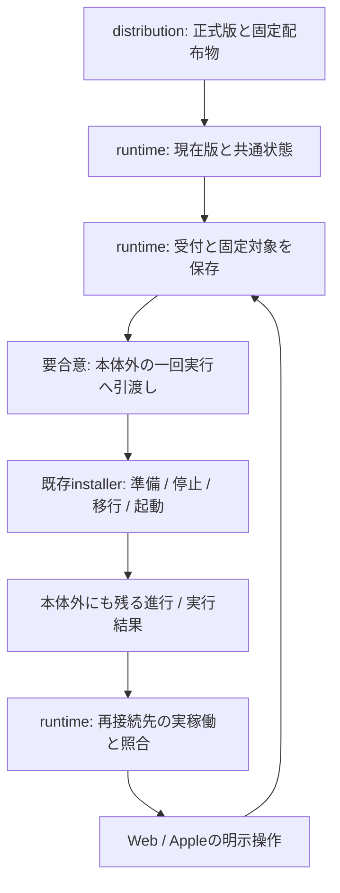
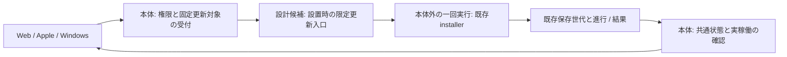

# 商用更新の受付・実行・結果確認案

状態：設計案。API形式・保存先・本体停止を跨ぐ起動経路の合意前で、新機能コードは未実装。

[6機能定義](/srv/bellteam/bots/bot-7b140b27/docs/commercial-container-update-functions-20261102.md)、[Web案](/srv/bellteam/bots/bot-1f622329/work/BellTeam-web-ownership-20261102/docs/architecture/modules/web/update-notice-design.md)、[runtime公開窓口](README.md)、[配布の現行図](../../distribution-details.md)へ接続する。全体の現行接続は不変で、この案を実装済みの接続としてmodule.jsonへ追加しない。

## 6機能の所有

| 機能 | runtimeの入力・出力と責任 |
| --- | --- |
| 1 発行 | distributionが正式な版・不変の配布物・変更内容を提供。runtimeは独自の候補探索や版発行をしない |
| 2 状態取得 | 実稼働版/配布物と正式公開版→本体共通の比較結果、観測時点、利用可否と理由 |
| 3 表示 | Web/Appleへ同じ状態を提供。表示/ロゴ右の操作は各アプリが所有 |
| 4 受付 | 選ばれた版と配布物、設置対象→対象を固定した保存済み受付又は未受付理由 |
| 5 実行 | 固定対象と設置設定→既存installerによる準備/入替/起動の進行、実行結果。停止を跨ぐ実行主体と結果保存はruntimeの責任 |
| 6 確認 | 保存済み対象/実行結果と再接続先の実稼働→確認済み完了、明確な失敗、確認不能 |

版番号とdigest/sourceの対応はセンチ、設置と結果の意味はエピネル、共通HTTP/SSE登録と全体契約はトロニー。Webはアドミ、Apple/Windowsは各ベル。Hostの設定変更をこの担当で引き受けない。

## 現行sourceから確認した接点と不足

2026-11-02、基準source086＋担当図のbranchを読取確認した。以下は新機能の実装済み契約ではない。

| 現行の接点 | 確認できること | 新機能へ必要な契約 |
| --- | --- | --- |
| `scripts/package-server.mjs`のdistribution.json | `schema/sourceCommit/profile`。同一sourceからの異なるbuildを区別する商用版番号はない | 正式版と不変の配布物の対応をdistributionから受ける。package.jsonの0.1.0を商用公開版として流用しない |
| `promote-server-image.mjs` | 採用source/index digestを確認しlatest/previewへ同じ実物をpromotionする | mutableなtag名を要求対象の本人性に使わず、正式版に対応するdigestを固定する |
| HTTP `/healthz` | `status:ok`とHTTP成功。実稼働版や配布物の照合情報は返さない | image内の版/source情報と、installer側が観測する実image/稼働先を対応付ける。health成功だけで要求版完了にしない |
| installerの保存世代 | image解決後に`.bellteam-compose.*`を作りnormal/maintenance/旧modelを固定する | 保存世代は受付前から存在する要求相関ではない。受付と、実際に作られた世代を結ぶ引渡しが必要 |
| 内部deploy adapter | `setsid/nohup`のHost一回実行とdeploy-exit記録 | 内部本番用のSSH/固定Host/権限を商用設置へそのまま移さない。公開操作からの起動経路は別に合意する |
| `http-request-log.mjs` | API path/受付時刻/応答又はabortedを記録する | 同じ版の要求を厳密に識別する永続受付参照を提供していない。ログ時刻だけで同一要求を確定しない |

container自身に後から自身のindex digestを埋め直すとimageが変わるため、自己digestを版情報へ埋めれば解決するとはしない。imageに含む版/sourceと、公開版対応表・Host側が観測した配布物の対応を別の入力として設計する。現行sourceファイル、公開tag、保存済み配布採否の文字列を、実稼働の確認の代用にしない。

## 停止を跨ぐ責任

現行installerは設置HostのCLIで動くため、本体containerの停止を跨いで処理できる。image/正規化Composeを固定し、旧modelを保存して停止後の移行と起動を行う。一方、現行公開本体からこのHost CLIを起動して受付と結ぶ経路は未実装。アプリの操作受付だけを追加しても機能5は成立しない。

候補は、既存installerを呼ぶ一回実行の設置処理を本体外で所有すること。新しい常駐サービス・配送queue・Botの会話や予定へ処理を載せることは決定していない。本体へDocker socket/Host権限を新たに渡す配置も決定していない。既存の配布構成とアプリから利用できる起動経路をセンチ/ベルと確認し、責任・保存先・起動の可否を合わせてから具体化する。未提供の設置は実行不可の理由を返し、操作buttonを有効にしない。

受付とinstallerの進行・実行結果は、停止・置換されるcontainerの書込層やアプリのメモリに置かない。既存の保存世代とserver専用の永続状態を利用できるか確認する。設置Host側の結果の正本、本体に公開する参照、UID/読書権限、保存期間は配置設計で決定する。Host側の設置fileをBotが直接読む構造にしない。設置file、token、秘密の環境値は公開結果へ含めない。

### writerを分ける案

既存公開構成では、`/srv/bellteam/state`はserver-stateのsubpathで、本体UID1001の状態を置く。一方、Hostの`runtime/server-only`はdata/homeとは別の場所で、公開本体がそのまま読み書きするmountではない。Host専用の保存世代も本体へ直接公開しない。

最小案は、受付の確定は本体が所有し、実行進行/結果は本体外の一回実行が所有すること。受付対象は確定後に書き換えず、実行者は別の結果文書を更新する。読取は二つを既存の相関で結び、本体が実稼働確認を加えて共通状態を返す。同じJSONへ複数のwriterがread-modify-writeする形を避ける。これは新queueや複数の設定正本を追加する案ではない。

具体path、結果の読取/公開方法、Host実行者がprivate volumeへ触れる窓口と実行UIDは未合意。本体にroot権限やDocker socketを付けることや、専用の新しいHost補助を設置することを前提にしない。既存state-maintenanceのflockはオフライン移行用であり、稼働中の更新受付の排他・結果配送へ流用した扱いにしない。旧世代へのrecoverで新しい受付参照を読めなくなる場合の扱いも配置契約へ含める。

### 受付と引渡しで止まった時

| 最後に確認できた工程 | 本体が返す意味 | 自動で進めないこと |
| --- | --- | --- |
| 保存前に入力/権限/実行経路を拒否 | 未受付と理由 | 停止・installer起動 |
| 固定受付の保存まで | 受付済み、実行引渡しは未確認 | 引渡し未確認を実行中/完了へ補完 |
| 引渡しが明確に失敗 | 受付対象を保持した開始失敗 | 対象を差し替えた再起動/再送 |
| 引渡しの応答を失った | 開始したか確認できない | 二重起動を避けるための推測による再送 |
| installerが実行結果を保存 | 実行終了又は明確な失敗、確認状態を別に返す | 終了0を実稼働確認へ変換 |
| 対象版/配布物と稼働先を照合 | 初めて更新完了を返せる | 別サーバーや旧世代のhealthを成功根拠に使用 |

保存済み受付があるだけで無期限に「更新中」と表示しない。引渡し/結果が確認できないことを公開し、既存の設置・復旧手順で照合できる参照を残す。新しい自動再送や常駐の監視工程をここで決めない。

## 公開状態の意味

URL/新ID/JSON field名は未確定。以下はアプリと合わせる意味の契約で、実装schemaではない。

| 軸 | 区別して返す状態 |
| --- | --- |
| 提供可否 | 商用更新を提供する設置、非商用のため対象外、実行経路を提供できない設置 |
| 元情報 | 正常に取得した現在版/公開版、正式公開版なし、取得失敗、版や配布物の対応が不明で比較不能 |
| 比較 | 更新あり、更新なし、比較できない。取得失敗を更新なしへ変えない |
| 受付 | 保存済みの固定対象と受付時点、未受付の理由。応答喪失による不明はクライアントが保持する通信の状態 |
| 進行 | 受付済み、準備、入替、起動、実稼働の確認。利用者が選んだ対象は途中の公開版変更で差し替えない |
| 実行結果 | 処理中、実行終了、明確な失敗、結果を取得できない。installer終了0だけを更新完了へしない |
| 稼働確認 | 未確認、対象版/配布物と正常稼働を確認、要求と不一致、確認不能。旧版へ接続できたことを要求版の起動成功にしない |

更新状態・受付対象・実行結果・稼働確認は同じサーバーを使う全アプリで共通にする。状態GETは現在版と現在/直前の更新結果を返し、変更通知はその再取得を促す。SSEの本文だけから成功を判断しない。別アプリによる開始も同じ結果に現れる。

Appleとの接点はトロニーが中継する。localチームMac席のためlist_botsにいないことを、担当不在と解釈しない。他席に紐付くbridge/sessionは操作しない。Apple要求は、停止中も失わない受付状態のGET、固定したstate列挙、ISO8601の時刻、権限判定を本体へ集約すること。受付応答が不明なら再POSTせずGETを一回行い、接続ready/foregroundへ戻った時にも読み直す。状態の意味をアプリごとに推測しない。具体的なenum/fieldのschemaは統合と合わせる。

接続先を変える操作は表示対象の変更で、元サーバーの更新を取り消さない。切替前の要求を切替後の結果と結び付けない。狭い画面でロゴ右が無い時の帯表示はAppleの未合意案で、runtimeの確定契約には含めない。

## 受付の保存と応答不明

保存前の拒否は未受付で、保存済みか分からない通信を未受付へ変えない。受付済みを返す前に、利用者が選んだ版・不変の配布物・設置対象・受付時点を停止後も参照できる場所へ確定する。保存済み受付と一回実行への引渡しの間に停止しても、後から「実行した」「実行していない」を推測して再送しない。

同一サーバーで複数の更新を同時実行しない。進行中の要求はその受付対象をGETで返し、別対象の新規開始は理由付きで受け付けない。同じ対象が見えたことだけを、応答を失った個別要求の同一性の証拠にしない。受付参照は既存設置世代/要求相関を再利用できるかを統合と確認する。新ID体系は決めない。

Web案の「応答不明で再POSTしない」「再接続して共通結果を読む」は維持する。結果を要求と結び付けられない時は確認不能を残し、新しい実行を自動開始しない。準備中/停止中/起動後のどこで止まったかを公開できる限り返す。明確な実行失敗と確認経路の不通を分ける。

## 次に合わせることと検証

### 起動経路の設計候補

2026-11-02 10:40 UTCのmain `e15795b`まで、上のpackage/promote/HTTP log/public Compose/installer/maintenance構成の対象sourceに変更が無いことを確認した。現在の制約で、公開本体から設置Hostのinstallerを起動する既存窓口は見つかっていない。内部main-serverのSSHや他席bridgeを一般設置の接点とする案は採らない。

一般のWeb/Apple/Windowsアプリが同じ接続先を更新する要件を満たす候補は、**設置時に用意する限定更新入口が、本体外の一回実行へ引き渡す構成**。更新入口は任意commandを受けず、正式配布物を固定して既存installerを動かす接点に限る。本体の操作権限を通した要求だけを受け、受付・引渡し・結果を同じ設置対象へ結ぶ。具体的な入口、起動方法、権限の配置は未合意。

この入口を新しい常駐Host補助やsocket activation等で実装する場合は、現行の配置を変える提案になる。現行AGENTSの「常時起動は実装しない」「必要だと考えた時は、実装せずオーナーへ提案だけ」に従い、担当者間の同意だけで新設しない。ここでは候補を提示し、Host設定・daemon・socket・更新コードを作っていない。

| 比較する構成 | 要件への適合 | 合意が必要な点 |
| --- | --- | --- |
| 限定更新入口→本体外の一回実行（検討の第一候補） | 全アプリが同じ本体の操作受付を使い、停止を跨ぐ実行主体を分けられる | 入口の供給/起動、設置時の利用可否、誰がHost権限を持つか、結果を本体へ公開する方法 |
| 本体からDocker操作へ直接接続 | 本体が生きている間に本体外の一回実行を起動できる構成は考えられる | 現行公開本体へDocker接点/操作権限を増やす配置変更。第一候補より本体の権限範囲が広く、採用は未決定 |

既存の手動installerは残るが、手動実行や同一Hostのnativeアプリだけで代行する方法を、遠隔のWeb/iPhoneからの明示更新が完成した結果にはしない。実行入口を提供できない設置では、理由を示して操作を無効にする契約を維持する。

### 保存と要求相関の具体化候補

- 現在/直前のサーバー全体の更新状態を全アプリに返す。受付のPOSTを送ったアプリ固有の履歴を新たに正本としない。新しい配送queueや要求ID体系は決めない。
- 本体が公開する受付対象は正式版/不変の配布物/設置対象/ISO8601の受付時点。権限判定と対象再照合は本体が行い、受付時に公開版が変わっても別対象へ読み替えない。
- 実行側は既存installerの保存世代を生成した後、その世代と受付対象を結んだ結果を返す案。保存世代のHost絶対pathや秘密をそのままアプリへ返さない。受付前に存在しない世代を既存の相関として利用済みとは扱わない。
- 受付と結果が別文書の場合、同じ版/受付時刻だけで誤った結果を結び付けない。現在のHTTP logだけでは相関は不足する。既存世代の生成を受付確定前の準備へ含められるか、又は既存の相関を引渡しで保存できるかを入口の設計と同時に決める。
- 応答不明のアプリがGETで見つけた状態は、同一サーバーの共通状態として表示できる。同じ対象だから自分のPOSTが受理されたと断定する必要はなく、個別受付の確認不能は残す。新しいPOSTを自動で発行しない。
- 少なくともcontainer置換/再接続を跨いで現在/直前の受付・実行結果を保持し、次の明示更新との扱いを定める。古い結果を破棄する時期や復旧時の読取可否を未定のまま実装へ進まない。

保存先を選ぶための候補は次のとおり。新しいpathを作成したり、実データを移動したりはしていない。

| 文書 | 保存先候補 | writerと読取の範囲 |
| --- | --- | --- |
| 固定受付 | 既存private stateの`state/updates/accepted.json` | 本体UID1001。アプリには認証済みの状態APIだけを公開。Bot project/HOMEへ置かない |
| 実行結果の正本 | 既存installer保存世代内の`update-result.json` | 本体外のinstaller実行者。既存privateな保存世代の所有者/umaskを維持。Host絶対path/設置設定をアプリへ出さない |
| 本体が読む結果 | 限定更新入口から既存stateへ公開する結果、又は同入口の限定読取 | 読取方法とwriterは入口の採否と同時に選ぶ。主本体とinstallerが同じJSONを更新する案にしない |

進行中一件と直前の完了済み一件を保持する案とし、次の明示更新の完了までは直前結果を残す。これは待ち行列を設ける案ではない。旧世代へrecoverした時の読取可否と、その際に確認不能を表示する契約も合わせる。private volumeに新しい結果writerを接続する場合、既存の全writer停止確認/オフラインflockと干渉しない工程を定め、判定条件を緩和して通さない。

この候補の判断依頼は、新規の起動接点をどこへ置けるかという製品設計のもの。本番/一般配布の保留解除を再申請するものではない。起動経路の採否が決まる前は、実装できると補完せず、配布/統合担当と必要な提案範囲を合わせる。

- センチ：正式版と固定imageの公開入出力、現在稼働版の信頼できる元情報、既存設置CLIから一回実行へ接続する方法、保存世代の参照。
- ベル/アドミ：全アプリ共通の状態表現、サーバー切替と要求対象の対応、受付不明時の表示、接続復旧後の読取。
- トロニー：受付/実行引渡しの完了条件、保存場所とwriter、既存相関/世代の再利用、HTTP/SSEの公開登録。

合意すべき順序は、(1)distributionの正式版→不変配布物とimage内版情報、(2)本体外の一回実行を起動する既存経路の有無、(3)受付・結果を別writerで保持して相関する場所/窓口、(4)全アプリ共通の固定state/fieldと権限、(5)限定実装と隔離検証。現行に経路がない項目はないと返し、公開版・実行可能・実稼働成功を補完しない。

2026-11-02の依存状況：センチへの設計確認はsendmessageがAGENT_RESUME_UNCONFIRMEDで本文未送信となり、再送していない。トロニー/アドミでも同系統の未達があり、キロへ既に引き継がれている。get_botの保存済みプロフィールからnative稼働や復帰を確定しない。正式版/digestの公開形式、起動経路、保存世代参照は未達依存として残す。確認不能を新しいdaemonや共有Host操作で補わない。

設計合意後の有限な試験は、固定対象の保存/拒否、POST応答喪失、停止前後の異常終了、進行中の別要求、旧版への再接続、実行失敗と確認不能、正式版なし/取得失敗/非商用。既存installerの会話・file・設定保持を使い、UIの成功表示で代用しない。

source086/image6042の採用は維持。本番/一般配布保留を維持し、この案からHost変更や実停止を始めない。
