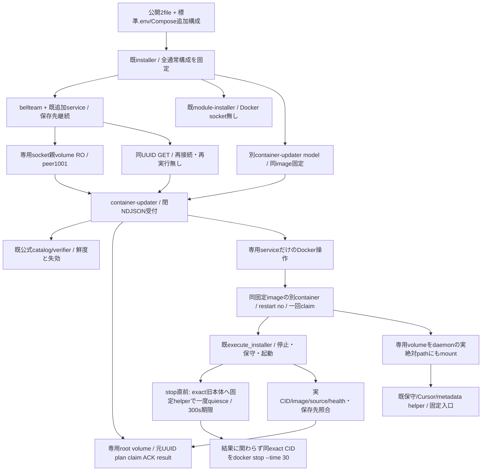
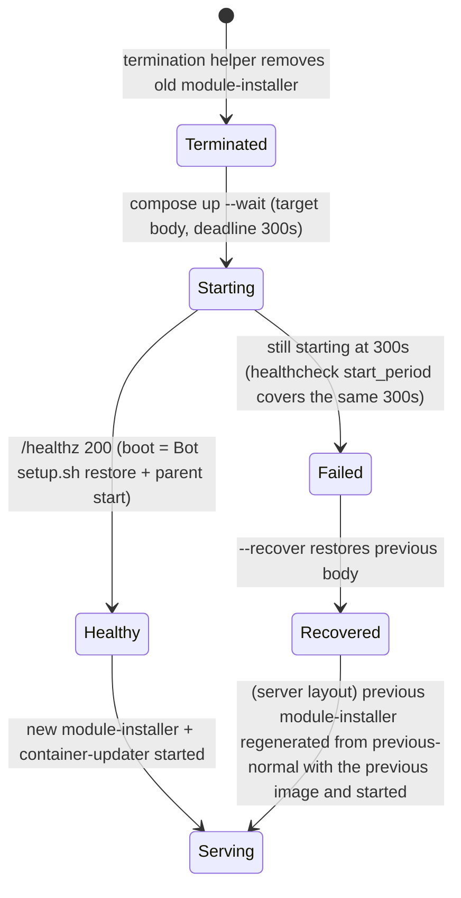
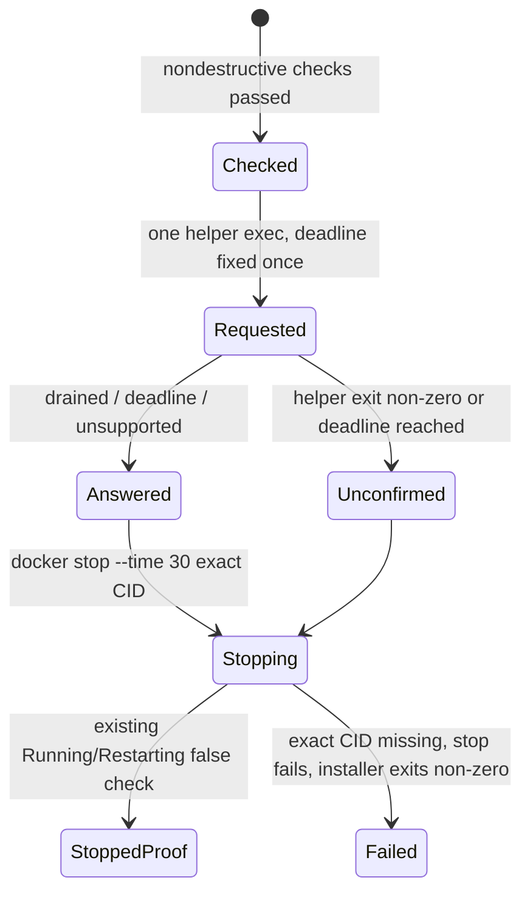
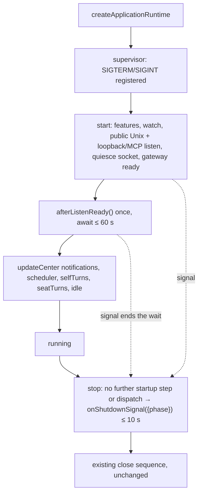
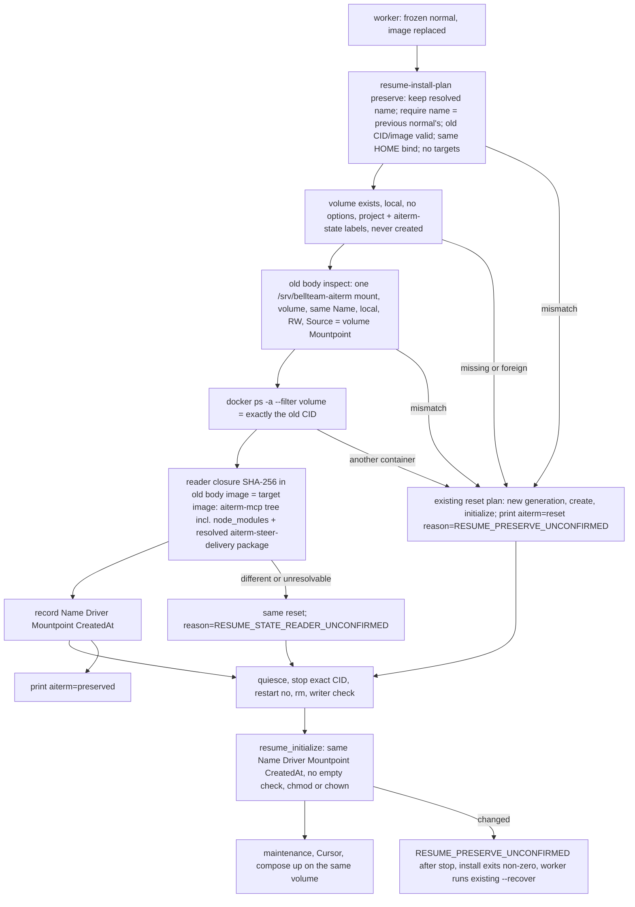
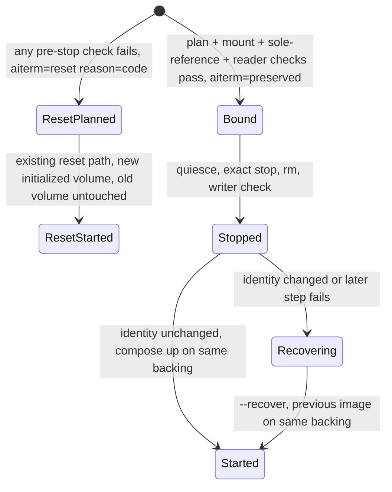
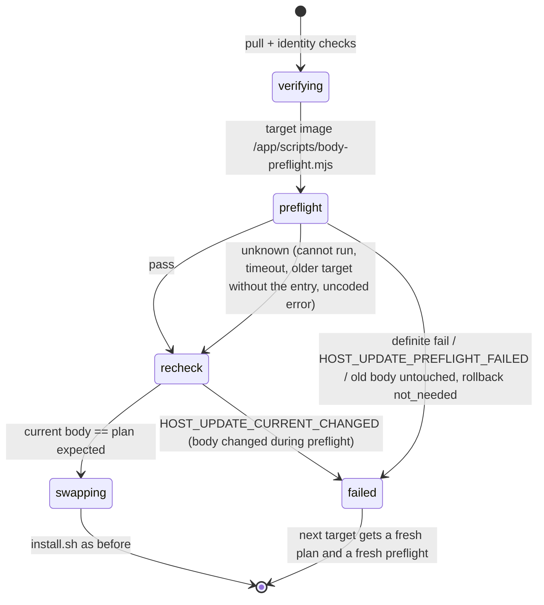

# 公開箱の本体更新serviceと独立worker

所有エピネル。公開受付/親ledger/DIは[integration](../integration/README.md)、正式target/catalogは[distribution](../distribution/update-catalog.md)、既Hostの同protocolは[container-update](container-update.md)。Rootの2026-11-04専用service裁定内のsource実装。本番導入/公開Docker製品受入は別結果へ結ぶ。



## 公開入力と権限

既Owner認証済みGET/plan/start/get、元UUID、明示containerRestart確認、既NDJSONの64KiB/5秒/16接続を維持。任意shell/path/env/URL/image/Docker引数やDocker API proxyを公開しない。container targetは既正式catalogのOCI index/source/platform/containerUpdate1だけ。module catalog/planは専用module backendへ残す。

`container-update-compose.mjs`はnormalのbellteam image ID/projectから別modelを作る。normalへ専用socket親をRO mountし、module socketを維持。専用serviceだけrootでDocker socketと専用root/socket volumeを持つ。任意利用者environment/mount/port/service/entryを転送せず、readonly image・cap drop ALL/CHOWN/DAC_OVERRIDE/FOWNER・no-new-privileges・固定resource上限・TCP公開無し。古い明示Host socket構成は既Hostを維持し、この別serviceを重複導入しない。

Docker socket保持はHost相当の強い権限を持つ。閉RPCでその権限自体が弱くなるとは扱わない。本体/Bot/module-installerにはDocker socketを与えない。Docker公式CLIとCompose pluginを同imageへ収録するため、Hostへの追加package/systemd/daemon変更や手SSHは不要。本番でこの権限を新設する判断はRootが既Owner条件で行う。

## 状態所有と起動

専用root volume `<project>-container-updater` は凍結normal/config、公式catalog、plan/operation/claim/ACK、結果、作業用世代を持つ。socketは別volume `<project>-container-socket`。normal/config/logは秘密を含み得るためroot private fileのまま、公開DTOへ自由本文や環境値を投影しない。

installerは本体とmodule backendの正常起動後、選択imageの`--configure`へ最終normalをstdinで渡す。実project/CID/image/source/healthy/mount bindingと、固定名local/no-options/Compose所属の専用volumeを照合してからconfig/normalを保存。専用service起動/healthまで待ち、失敗は`CONTAINER_UPDATER_START_FAILED`で非0。本体の到達点と保存世代を保持する。

workerは固定image/entry/元UUIDの別Docker containerとして起動し、restart no/自動除去を指定。保存intent後だけ一回起動、実container ID/image/StartedAt/固定project・UUID labelを記録し、排他claimと永続ACKの後だけaccepted。本体/受付の置換から寿命を分ける。新しい受付imageからも保存済みworkerの旧image/ID/出生を照合し、更新中workerを誤って消失扱いしない。terminal保存後のworkerはDockerが自己回収する。

作業世代は専用volumeの`installation/work`。workerはそのvolumeを固定prefixに加えてDocker inspectの実Mountpointへもmountする。TMPDIR/保存世代をdaemonにも同じ絶対pathで見せ、container内だけの/tmpをHost bind元へ渡さない。data/home/runtime/private stateをworkerへ直接mountしない。runtime directory作成とpathのcanonical化は既固定Docker helperへ委ね、既全writer検査と保守lockをそのまま通す。workerの存在をwriter検査の例外にしない。

`execute_installer`は既code_root差し替えを使ってimage内の固定installerを実行し、追加serviceを含むnormalを保持する。旧Host側のcode_root/trust/root closureは既定のまま。新normalの保存と実source/image/healthy/storage本人性確認後だけcompleted、起動失敗/recover/cleanup分離は既実装を維持し追加戻し機能は作らない。

## 再接続・後続の公開installer

`createUpdateClients()`とMolly親DIはcontainer専用socketと既module socketを分ける。専用mountが無い旧Hostのみ同clientへ戻り、専用service起動待ちや通信欠測で別backendへfallbackしない。保存UUIDのGETだけを再開し、worker不在/未受領/作用不明を推測で再起動しない。

画面更新後の現normalが専用volume内にある場合、後続公開installerは`read-container-update-normal.mjs`を固定imageで実行する。実CIDのCompose labels、同projectのlocal専用volume/実Mountpointと保存世代pathを照合し、専用volumeだけRO mountして旧normalを読む。任意Host fileを読む窓口にはしない。その後は既Compose hash/profile/保存先検査へ接続し、Host利用者にroot権限付与を要求しない。元の設置file/.env/overrideや旧世代は上書きしない。

通常本体更新は停止→新実行世代で、data/home/Cursor/private state/Throughline/profile/購読、旧normal/元unknownを保持。AI state volumeは[slice 3](#same-backing-aiterm-state-on-a-bundled-body-swap-z-c-slice-3-2026-11-08)の検証が通れば同一backingをそのまま使い、停止前に通らなければ従来のresetで新volumeへ切替え、結果行を出す。同native自動resume/未保存ACKの継続を成功条件へ足さず、旧要求/本文/applyを再送しない。

## 確認範囲

生成modelの権限分離/追加設定非転送、既writer検査を通る専用stateと拒否されるdata mount、固定Docker launcher/worker identity・一回claim/ACK/同ID照会・新受付imageと旧worker・喪失unknown、image code_rootでの追加service保持、公開installerのconfigure順序/失敗非0・専用volume旧normal取得・workerのdaemon path接続を局所確認。公式署名/各module内部・旧成功群は継承し再走しない。実Dockerでの公開導入→本体Update一回→再接続同ID/実稼働の確認はCentiの正式供給後の担当工程。

## Body readiness deadline and installer restore on recovery (B-2, 2026-11-08)



One deadline judges the swap: install.sh's `--wait-timeout 300`. `container-update-compose.mjs` (run from the target image on every bundled swap, and bound by `--configure`) sets the body healthcheck `start_period` to 300s, so a body that is still booting stays `starting` and cannot turn `unhealthy` before that deadline. `distribution/server/compose.yaml` and `compose.yaml` carry the same value for new installs. Cause: the body runs every Bot's `setup.sh` in order before it listens (about 150s for 67 Bots on 2026-11-08), so boot took about 170s, while the bound healthcheck (`start_period` 120s + 5 × 10s) marked it unhealthy at about 163s and `compose up --wait` failed at once. Production request 804be36d: target dcebdf56 turned unhealthy at 02:44:35 JST, became healthy 11s later, and had already been rolled back. Z-e (2026-11-08): the body now starts every Bot's `setup.sh` in the background (same order, one run each, per-Bot failure isolation) and listens first, so `/healthz` no longer depends on the Bot count. A Bot's seat launch waits in `AitermClient.launchOptions` until that Bot's setup has finished; see [cli-registration](cli-registration.md).

Recovery returns the module-installer that the forward run removed. When the saved generation has `module-installer.json` and recovery returns to the server layout, `--recover` regenerates the installer model from `previous-normal.json` with the previous image's own `module-update-compose.mjs`, saves it as `previous-module-installer.json` and starts it with the same wait. A legacy-layout or generator-less previous generation had no installer, so nothing starts. A start failure exits non-zero with `MODULE_INSTALLER_RESTORE_FAILED`, and the body stays recovered. No guard is added. `install.sh` runs from the worker (current) image, so this recovery step applies to swaps started from an image that contains it. Older generations need the host to start the installer once from its saved model.

## Pre-stop quiesce of the exact old body (Z-c slice 1, 2026-11-08)

Owner Molly. Contract: [Epinel's runtime contract](/srv/bellteam/bots/bot-0b867848/docs/z-c-runtime-quiesce-supervisor-contract-20261107.md) adopted by Trony on 2026-11-08 with two decisions: (a) the authority is a fixed helper exec'd as UID1001 into the exact validated old body, reaching a Unix socket in a UID1001-only 0700 directory, with no token, Host port or Docker access for the body; (b) budget 300 s drain + `docker stop --time 30` + 300 s body start = 630 s < the worker's 1800 s. Kiro's design: [Z-c sections 4-6](/srv/bellteam/bots/bot-09e6225c/docs/z-c-seat-survival-design-20261107.md).

```mermaid
flowchart LR
  Checks[All nondestructive install checks / module-installer termination] --> Request[install.sh: requestId = saved generation name, exact old CID, deadline = now+300s capped by budget]
  Request --> Exec["docker exec -i --user 1001:1001 &lt;exact CID&gt; node /app/scripts/body-quiesce-helper.mjs"]
  Exec --> Socket[/run/bellteam-server/quiesce/quiesce.sock, dir 0700 UID1001]
  Socket --> Handler["quiesce({requestId, deadline}) supplied at assembly; default unsupported"]
  Handler --> Answer[one JSON line or none by the deadline]
  Answer --> Log[installer log line quiesce=drained, deadline, unsupported or unconfirmed]
  Log --> Stop[docker stop --time 30 exact CID, then existing stop proof]
```

| Element | Owner | Input → output |
| --- | --- | --- |
| `src/body-quiesce.mjs` `listenBodyQuiesce` | runtime (Molly) | `{path, quiesce}` → listening socket; per connection one line ≤ 4096 bytes `{requestId, containerId, deadline}` → one line `{...handlerResult, requestId}` or `{error:'QUIESCE_REQUEST_INVALID'}` / `{error:'QUIESCE_FAILED'}`. Exactly these three keys; requestId `[A-Za-z0-9._-]{1,128}`; containerId 64 hex; deadline integer epoch ms ≤ now + 305 s. 5 s to send the line. |
| Assembly | runtime (Molly) | `supervisor.mjs` passes `quiesceSocket` = the fixed path; `createApplicationRuntime.start()` listens after the internal listener, before the gateway; `close()` stops accepting and removes the socket first, without waiting for an in-flight request. Tests and other callers pass nothing and open no socket. |
| `scripts/body-quiesce-helper.mjs` | runtime (Molly) | stdin request → stdout `{requestId, result}` exit 0; invalid stdin exit 2; refused/closed/invalid/no answer by the deadline exit 75. Never retries. |
| `install.sh` call | runtime (Molly) | Forward runs only, after every nondestructive check and the module-installer termination, immediately before the stop; recovery (`--recover`) never quiesces. **Answer → SIGTERM bound: 30 s.** After the helper returns, the installer writes one log line and issues `docker stop --time 30` to the same CID (SIGTERM at its start); nothing else runs in between. If that stop fails, the install fails and recovery leaves the old body serving. Kiro's hold therefore expires at answeredAt + STOP_WINDOW (> 30 s, Kiro's value) and releases itself, so an aborted update never keeps the hold. |
| Execution hold behind `quiesce` | Kiro (not wired) | Until wired the default handler answers `unsupported`, so this slice changes no running behaviour except the 30 s stop grace. |

Authority: Node exposes no SO_PEERCRED for Unix sockets, so the 0700 directory owned by UID1001 is the only access control. The listener refuses to start (`BODY_QUIESCE_DIRECTORY_UNSAFE`) when the directory is not a directory owned by its own UID with no group/other bits. Seats run as UID1000 and cannot traverse `/run/bellteam-server` (tmpfs `uid=1001,mode=0700`). A failed listen is written as `BODY_QUIESCE_UNAVAILABLE` and the body keeps serving: the installer then records `unconfirmed` and stops as already approved.

| Observed by install.sh | Log line | Next |
| --- | --- | --- |
| helper exit 0, `result:"drained"` | `quiesce=drained` | `docker stop --time 30` exact CID |
| helper exit 0, `result:"deadline"` | `quiesce=deadline` | same stop |
| helper exit 0, `result:"unsupported"` (default handler) | `quiesce=unsupported` | same stop |
| exit 2/75, exec failure (old image without helper, container not running), no answer by the deadline | `quiesce=unconfirmed` | same stop; nothing is inferred about hold markers |
| exact CID gone or replaced | `quiesce=unconfirmed` | the stop of that exact CID fails and the installer exits non-zero; a replacement is never stopped by name (existing `SERVER_STATE_GENERATION_CHANGED` binding checks run earlier) |



The deadline is `now + 300 s`, capped at installer start + 1800 − 330 s so the stop grace and body start still fit the worker's budget; the helper ends at that deadline on its own, so the wait is bounded without a separate timer in sh. `stop_grace_period: 30s` is set on the body service in `compose.yaml`, `distribution/server/compose.yaml` and by `container-update-compose.mjs` on every bundled swap; `module-update-compose.mjs` leaves the body service as is. The legacy host-socket layout keeps its model unchanged, and the explicit `--time 30` covers its installer stop.

Next runtime slices, not in this one: the durable execution hold/drain that replaces the default handler (Kiro); the `afterListenReady` recovery hook and early signal registration (done in [slice 2](#lifecycle-contact-points-z-c-slice-2-2026-11-08)); the same-backing preserve update mode (done in [slice 3](#same-backing-aiterm-state-on-a-bundled-body-swap-z-c-slice-3-2026-11-08)).

## Lifecycle contact points (Z-c slice 2, 2026-11-08)

Owner Molly; contract sections 2 and 3 above. Runtime supplies two contacts and their order only; their content is Kiro's (execution) and N102's (conversation). Behaviour is unchanged until the execution assembly returns `lifecycle`.



| Contact | Supplied by | Called | Bound and exit |
| --- | --- | --- | --- |
| `afterListenReady()` | `execution.lifecycle.afterListenReady` → `services.lifecycle` | once per `start()`, after both listeners and gateway readiness, before ordinary dispatch | awaited ≤ 60 s. Throw → `LIFECYCLE_CONTACT_FAILED afterListenReady`; timeout → `LIFECYCLE_CONTACT_TIMEOUT afterListenReady`; both then start dispatch, so one unavailable seat never keeps listeners or other seats down. Kiro's hold self-release rule covers anything still held. A stop during the wait → `LIFECYCLE_CONTACT_INTERRUPTED`, no dispatch. |
| `onShutdownSignal({phase})` | `execution.lifecycle.onShutdownSignal` → `services.lifecycle` | first step of `stop()` on SIGTERM/SIGINT, after the startup gate is closed and before any close step | awaited ≤ 10 s, leaving ~20 s of the 30 s grace to close. Throw/timeout logged, close runs anyway. `phase:'starting'` means startup/recovery did not finish: execution keeps the durable hold and original unknowns and nothing is reported as drained. `phase:'running'` is the normal stop. |

Exits: a signal during startup makes `start()` reject `STARTUP_INTERRUPTED` after the step in flight (a step is not cancelled), the supervisor does not print `BellTeam ready`, and `stop()` runs the same `close()`. A signal before `createApplicationRuntime` returns keeps Node's default termination, as before. If close exceeds the grace Docker kills the body and the installer records the stop; restart recovery keeps uncertainty. Pending: Kiro's `lifecycle` handlers (hold, held redelivery, R-resume, gap summary, final markers) and the move of today's pre-listen `directMessages.start()` behind `afterListenReady`. The same-backing preserve update mode is [slice 3](#same-backing-aiterm-state-on-a-bundled-body-swap-z-c-slice-3-2026-11-08).

## Same-backing Aiterm state on a bundled body swap (Z-c slice 3, 2026-11-08)

Owner Molly. Contracts: [Epinel section 4](/srv/bellteam/bots/bot-0b867848/docs/z-c-runtime-quiesce-supervisor-contract-20261107.md) and [Elegg's caller shape B / retained stores](/srv/bellteam/bots/bot-c2adbe04/docs/aiterm-runtime-replacement-contract-20261107.md#agreed-caller-shape-b). Kiro's B replaces only the body and keeps the same actual Aiterm state backing, HOME and state/config paths; no H1 copy, no empty-volume initialization.

Before this slice, every installer run named a new Aiterm volume `<resolved name>-bellteam-compose.<generation>` (in `resume-install-plan.mjs`), created it, and after the stop emptied-checked and chowned it (`resume_initialize`). The old volume was retained untouched but no longer mounted, so a bundled swap left every seat's native state behind.

Selection is fixed, not caller input: the bundled worker already runs `install.sh --no-pull` with `BELLTEAM_CONTAINER_UPDATE_WORKER=1` and a frozen normal whose image alone changed. `resume_prepare` tries preserve exactly when that marker is set and no `BELLTEAM_RESUME_TARGETS_FILE` is given. Owner decision 2026-11-08: preserve never blocks a body swap. Any check that fails before the stop takes today's reset path (new generation name, create, normal initialization; the old volume stays untouched) and the installer prints `aiterm=reset reason=<code>`; success prints `aiterm=preserved`. The worker keeps both lines in its installer log. Manual/public installs, the legacy Host updater and H1 targets keep the reset or copy paths unchanged. `install-resume-state.sh` and `resume-install-plan.mjs` come from the target image, so preserve applies from the first swap *to* an image with this slice; the old body's `install.sh` already supplies `stopped_container` and `current-runtime.json`.



| Element | Input → output | Protection and exit |
| --- | --- | --- |
| `planResumeInstall(..., preserve)` | new normal, previous normal, previous runtime, targets null → plan with `state_volume = source_volume`, normal with no `BELLTEAM_RESUME_GENERATION` | Wrong target backing. A throw (stderr suppressed) makes `resume_prepare` rerun the planner in reset mode from the saved input normal, before any Docker mutation. |
| `resume_preserve_bind` | `current-runtime.json` (old body inspect), `docker volume inspect`, `docker ps -a --filter volume` → `aiterm-backing` identity line | Dual writers / wrong backing. Failure → reset path with `reason=RESUME_PRESERVE_UNCONFIRMED`. Volume identity is Name + Driver + Mountpoint + CreatedAt; Docker refuses to remove a volume while any container references it, and a recreate changes CreatedAt. Device/inode is not read: it needs a privileged mount and adds nothing over CreatedAt for local volumes. |
| `resume_reader` | each image → SHA-256 over the sorted `aiterm-mcp` tree including `node_modules` (path, mode, symlink target, bytes), plus `aiterm-steer-delivery` resolved by Node's resolver from `aiterm-mcp/dist` (Elegg 2026-11-08: it reads/writes retained Codex/Cursor hook/delivery HOME state). Its location relative to the tree is hashed, and its package directory is hashed again when it lies outside the tree. Unresolvable in either image → reset with `RESUME_STATE_READER_UNCONFIRMED`. | A different Aiterm state reader opening retained records. Aiterm publishes no reader-compatibility range (Elegg), so only an identical tree preserves; anything else resets with `reason=RESUME_STATE_READER_UNCONFIRMED` until Elegg decides reader compatibility. This also makes `--recover` safe: the previous body reads records written by the same reader. |
| `resume_initialize` (preserve) | recorded identity → recheck only | Recreated volume between `rm` and `up`. Still refuses: after the stop a reset would mount something nobody validated. The install exits non-zero with the old body removed; the worker's existing `--recover` restarts the previous image from `previous-normal.json` on that volume name. |

Recovery: `--recover <generation>` is unchanged. After a preserved swap its `previous-normal.json` names the same volume, so it remounts the retained backing with no create or initialization, after the existing writer check that includes that volume. After a reset swap the old volume is retained under the existing previous-normal policy (never deleted, overwritten or cleaned up), and `--recover` mounts that recorded previous backing, not the new one. Unchanged: `resume_stopped`/`resume_capture` (no targets), the writer check, the stop proof, HOME/data/Cursor/private-state handling, and H1 checkpoint/restore. Residual: between the recheck and `compose up` a Host root actor could still swap the volume; not covered.



## Target-image preflight before the swap (class fix, Trony 2026-11-09)

Why: four production body swaps (11/8 01:44, 02:47, 11:53, 11/9 19:15) failed because target-image code first met production's accumulated state inside the real install: module-updater ledger history, an installer container from an older generation, and adopted module releases. Nothing before `swapping` ran target code against that state. What it protects: the running body from a doomed stop/restart and the turns that would be cut. It refuses only a definite failure; unknown never blocks.

`execute_installer` (container-update-host.py), after the pull and the existing `verifying` checks, runs `/app/scripts/body-preflight.mjs` from the **target** image once. The container is `--rm --network none --read-only --cap-drop ALL --cap-add DAC_READ_SEARCH` (to read the UID 1001 and root 0600 records), with normal.json on stdin. Its mounts are all read-only: module-updater volume, server-state volume (as `/srv/bellteam-private` and `/run/bellteam-maintenance`), and the `/srv/bellteam` data bind. The Docker socket is also mounted with the readonly flag. A socket file's mount flag does not restrict Docker API calls: the Docker side stays read-only because the dry-run code issues only `container ls/inspect` and `volume inspect` and returns before any lock or change. The volumes are inspected first, so the run never creates one.

| Check | Target code | Definite fail (blocks) | Warning / report (never blocks) |
| --- | --- | --- | --- |
| Termination bridge | `module-worker-termination.py --dry-run`: the real `Switch.switch` ledger walk and the installer `service()` shape check, stopped before the first lock | a coded `HOST_*` error other than the catch-all `HOST_MODULE_TERMINATION_UNCONFIRMED` | catch-all / uncoded / cannot run = unknown |
| Adopted releases | every `state/<c>-release.json` current/previous manifest through the target's own manifest validators | current release of members/memory/execution/notifications/web-gateway rejected; any rejection other than `<C>_STATE_INCOMPATIBLE` for usage/diagnostics/conversation/work-graph | `<C>_STATE_INCOMPATIBLE` for those four (#822 builtin fallback); previous of the other five; an uncoded validator exception (unknown) |
| Boot | Bot count | — | reported with start_period |

Result `preflight.json` in the operation directory: `{result: pass|fail, failures[], warnings[], report}`.



Scope: this runs in the updater that the **current** body carries. Swaps away from a body without it (7c54e0e0, abe262ad) are covered by Molly's manual read-only preflight instead (integrations/abe262ad-manual-preflight-20261109).
