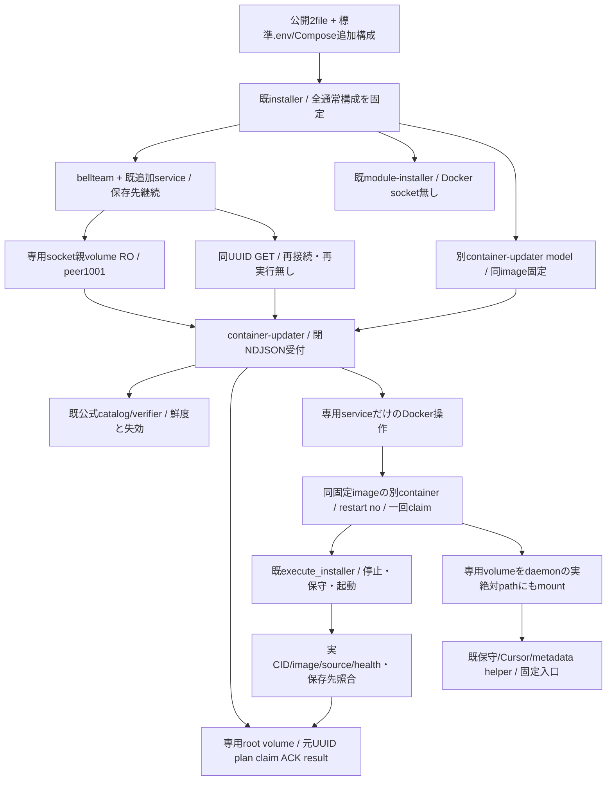

# 公開箱の本体更新serviceと独立worker

所有エピネル。公開受付/親ledger/DIは[integration](../integration/README.md)、正式target/catalogは[distribution](../distribution/update-catalog.md)、既Hostの同protocolは[container-update](container-update.md)。Rootの2026-11-04専用service裁定内のsource実装。本番導入/公開Docker製品受入は別結果へ結ぶ。

## 公開入力と権限

既Owner認証済みGET/plan/start/get、元UUID、明示containerRestart確認、既NDJSONの64KiB/5秒/16接続を維持。任意shell/path/env/URL/image/Docker引数やDocker API proxyを公開しない。container targetは既正式catalogのOCI index/source/platform/containerUpdate1だけ。module catalog/planは専用module backendへ残す。

`container-update-compose.mjs`はnormalのbellteam image ID/projectから別modelを作る。normalへ専用socket親をRO mountし、module socketを維持。専用serviceだけrootでDocker socketと専用root/socket volumeを持つ。任意利用者environment/mount/port/service/entryを転送せず、readonly image・cap drop ALL/CHOWN/DAC_OVERRIDE/FOWNER・no-new-privileges・固定resource上限・TCP公開無し。古い明示Host socket構成は既Hostを維持し、この別serviceを重複導入しない。

Docker socket保持はHost相当の強い権限を持つ。閉RPCでその権限自体が弱くなるとは扱わない。本体/Bot/module-installerにはDocker socketを与えない。Docker公式CLIとCompose pluginを同imageへ収録するため、Hostへの追加package/systemd/daemon変更や手SSHは不要。本番でこの権限を新設する判断はRootが既Owner条件で行う。

## 状態所有と起動

専用root volume `<project>-container-updater` は凍結normal/config、公式catalog、plan/operation/claim/ACK、結果、作業用世代を持つ。socketは別volume `<project>-container-socket`。normal/config/logは秘密を含み得るためroot private fileのまま、公開DTOへ自由本文や環境値を投影しない。

installerは本体とmodule backendの正常起動後、選択imageの`--configure`へ最終normalをstdinで渡す。実project/CID/image/source/healthy/mount bindingと、固定名local/no-options/Compose所属の専用volumeを照合してからconfig/normalを保存。専用service起動/healthまで待ち、失敗は`CONTAINER_UPDATER_START_FAILED`で非0。本体の到達点と保存世代を保持する。

workerは固定image/entry/元UUIDの別Docker containerとして起動し、restart no/自動除去を指定。保存intent後だけ一回起動、実container ID/image/StartedAt/固定project・UUID labelを記録し、排他claimと永続ACKの後だけaccepted。本体/受付の置換から寿命を分ける。新しい受付imageからも保存済みworkerの旧image/ID/出生を照合し、更新中workerを誤って消失扱いしない。terminal保存後のworkerはDockerが自己回収する。

作業世代は専用volumeの`installation/work`。workerはそのvolumeを固定prefixに加えてDocker inspectの実Mountpointへもmountする。TMPDIR/保存世代をdaemonにも同じ絶対pathで見せ、container内だけの/tmpをHost bind元へ渡さない。data/home/runtime/private stateをworkerへ直接mountしない。runtime directory作成とpathのcanonical化は既固定Docker helperへ委ね、既全writer検査と保守lockをそのまま通す。workerの存在をwriter検査の例外にしない。

`execute_installer`は既code_root差し替えを使ってimage内の固定installerを実行し、追加serviceを含むnormalを保持する。旧Host側のcode_root/trust/root closureは既定のまま。新normalの保存と実source/image/healthy/storage本人性確認後だけcompleted、起動失敗/recover/cleanup分離は既実装を維持し追加戻し機能は作らない。

## 再接続・後続の公開installer

`createUpdateClients()`とMolly親DIはcontainer専用socketと既module socketを分ける。専用mountが無い旧Hostのみ同clientへ戻り、専用service起動待ちや通信欠測で別backendへfallbackしない。保存UUIDのGETだけを再開し、worker不在/未受領/作用不明を推測で再起動しない。

画面更新後の現normalが専用volume内にある場合、後続公開installerは`read-container-update-normal.mjs`を固定imageで実行する。実CIDのCompose labels、同projectのlocal専用volume/実Mountpointと保存世代pathを照合し、専用volumeだけRO mountして旧normalを読む。任意Host fileを読む窓口にはしない。その後は既Compose hash/profile/保存先検査へ接続し、Host利用者にroot権限付与を要求しない。元の設置file/.env/overrideや旧世代は上書きしない。

通常本体更新は停止→新実行世代で、data/home/Cursor/private state/Throughline/profile/購読、旧AI原volume/旧normal/元unknownを保持。同native自動resume/未保存ACKの継続を成功条件へ足さず、旧要求/本文/applyを再送しない。

## 確認範囲

生成modelの権限分離/追加設定非転送、既writer検査を通る専用stateと拒否されるdata mount、固定Docker launcher/worker identity・一回claim/ACK/同ID照会・新受付imageと旧worker・喪失unknown、image code_rootでの追加service保持、公開installerのconfigure順序/失敗非0・専用volume旧normal取得・workerのdaemon path接続を局所確認。公式署名/各module内部・旧成功群は継承し再走しない。実Dockerでの公開導入→本体Update一回→再接続同ID/実稼働の確認はCentiの正式供給後の担当工程。
