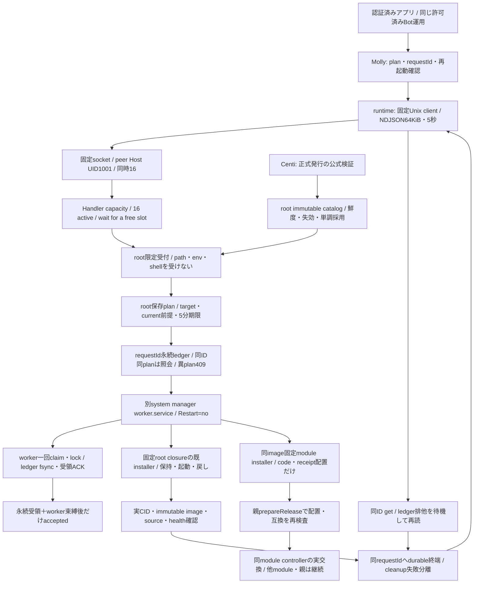
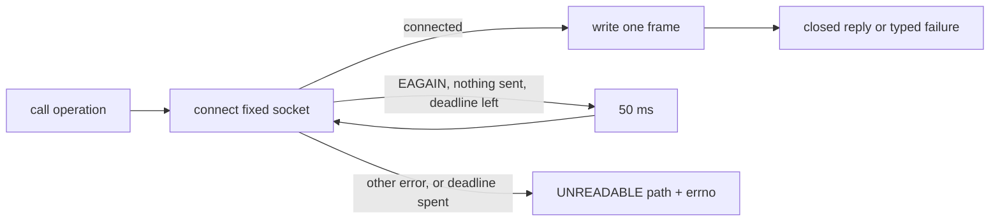
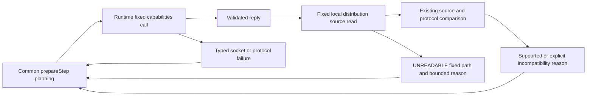
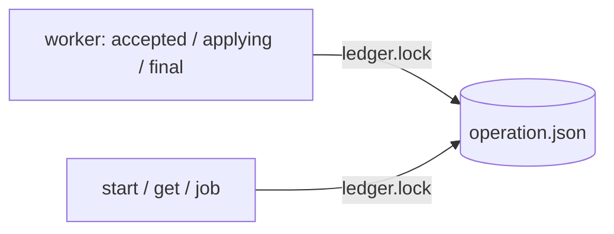

# container更新の限定受付と停止を跨ぐworker

runtime所有エピネル。Root container-update-host-contract/update-center-api/update-catalog-root-contract（2026-11-03）を実装する。OS条件はEmma container-update-host-source-conditions-20261103。この文書はHost版source契約で、各設置先の配置・稼働は固定版の導入原本で確認する。

標準の公開installerに同梱するmodule導入経路は[箱同梱module導入](module-installer.md)が正本。以下は既Host機構およびcontainer全体更新を跨ぐworkerの契約であり、標準導入にHost構築を要求するものではない。

## 固定配置と公開機構

公開箱の専用service/Docker独立worker・状態所有・導入は[箱同梱の本体更新](container-update-bundled.md)が正本。`createUpdateClients()`と親DIはcontainer専用socketと既module socketを分け、専用mountの無い旧Hostだけ同clientを双方へ使う。以下は既Host/system manager版の契約であり、公開箱へ別Host構築を要求しない。

Host prefixは `/srv/bellteam/shared/tools/bellteam-container-update-host`。releases/SHAにroot-owned全code/import/既installer closure、catalogに信頼済catalog、state0700/通常file0600、socket親root:1001/0750とupdate.sock0660。各祖先まで非symlink/root管理/非特権write禁止。実Hostの既shared祖先が成立しなければ権限を奪わず設置拒否する。normalへsocket親だけRO bindし `/run/bellteam-updater/update.sock` へ接続する。state/code/catalog/Docker socketをnormalへ渡さない。同1001子とのOS隔離とOwner本人性をpeer UIDだけで保証しない。

`src/container-update-client.mjs:createContainerUpdateClient()` がcapabilities()/catalog(componentId)/plan({planId,catalogSha256,versionId})/start({requestId,planId,confirmContainerRestart})/operation(requestId)を提供する。checkCatalog()は閉操作`checkCatalog`（params `{}`）で、Host内の公式catalog取得`refresh_catalog`を要求時にも実行し、結果の`catalog/refresh.json`記録`{status,checkedAt,error}`を返す。取得失敗はstatus:failedの記録として返し503にしない。`refresh_catalog`はモジュール内一つの`threading.Lock`で直列化し、背景の15分thread・要求・同一process内の他要求が同時に二つのcatalogを入れ替えない（実行中なら待つ。`with`が戻り/例外で解放する）。このcheckCatalogだけclient timeoutを6分とし（取得3回×15秒＋検証120秒×待ち一回分）、他callは5秒のまま。requestIdとplanIdは共通API UUIDv4。planは正式catalogのcontainer/platform/versionを選択し現CID/image/sourceを固定、5分期限。startは再起動確認と現前提を再検証し、同ID異plan/別ID並行を拒否。送信後の期限・応答欠測はunknownとして同ID GETへ戻し、自動再発行しない。

`container-update-host.py`のCLIは引数無し受付、固定--worker UUID、root限定--probe/--refresh-catalog/--install-catalogだけ。operationはcapabilities/catalog/checkCatalog/plan/start/getの閉集合、一接続一frame、JSON UTF8 64KiB/5秒/同時16、未知key/型/偽peerを作用前拒否。callerに任意entry/path/URL/env/Docker引数を供給させない。root stateにintentをfsyncしてから別worker serviceを起動し、workerの一回claim・PID出生/unit・永続ACK後だけaccepted。daemon再起動でunknownを再発行しない。

別workerはsystem managerのserviceでType=exec/Restart=no/固有requestId unit、受付・本体へのPartOf/BindsTo無し。setsidだけで同cgroupを残す方式やKillMode=none/processを使わない。受付はAF_UNIX/空capabilities/strict filesystem/固定write state+socket、Docker socketを隠す。workerは既installerのclosureへ必要な固定アクセスを別unitへ定義し、受付制限を機械コピーしない。

## 実行・保存と異常

root管理のnormalモデルと固定設置先を使い、現在CID/source/imageを照合して既public installerの保持/停止/新起動を呼ぶ。新imageは正式catalogのimmutable OCI refだけ。workerはselected local image IDと再起動後の実image/source/healthを照合し、実稼働までcompletedにしない。起動失敗は保存世代の既recoverへ戻す。cleanup失敗は正常本体を戻さず別結果に保持する。

受付intentとworker受領の間、又は副作用中に失った処理はunknownを保持し、同ID又は別IDへ自動再発行しない。current/previousはledgerへの参照だけで、同target/時刻を要求同一性に使わない。root正常log/公開結果に要求自由本文/秘密/Host絶対pathを返さない。旧ledger/active codeを世代pruneで消さない。 期限切れplanのpruneはcurrent/previous pointerと未終端(unknown)operationが参照するplanを残す（reconciliation/終端bridgeが読む）。

getはworkerの短い台帳公開と競合した時、既ledger排他の解放を待ってから最新原本を読む。worker消失の判定・unknown保存も同じ排他内に保つ。clientの5秒通信期限、受付/workerの非待機排他と一回claimは維持する。通信期限や実worker消失は引き続きunknownとして扱い、設置completedを親の交換成功へ補完しない。

保存済みphase unknownはgetでworker消失へ再分類せず、元error/updatedAt/原本bytesを保持する。実行例外のHOST_UPDATE_EXECUTION_UNKNOWNを、正常にworkerが終了した後のgetでHOST_UPDATE_WORKER_LOSTへ上書きしない。適用中に本人性を失ったworkerは従来どおり一回unknownを保存する。unknownをTERMINAL集合へ追加せず、新規要求/並行実行の既拒否と同UUIDの非再実行を維持する。保存原本に無い過去の原因や配置成否を復元したとは扱わない。

catalog root保存はCentiの専用公式verifier成功後のみ。初回固定期待値と正式自動発行元からの検証供給を分ける。鮮度/失効/過去採用拒否はCenti一正本へ合わせ、未供給/期限切れ/失効ではpublished不明・実行capability false、現在稼働は保持。UIの旧版選択をcatalog巻戻しへ読み替えない。

## 導入と確認

固定source/closure、全実行file/権限、socket/mount/unit、起動停止/削除/旧release戻し、active/unknown保持と実測をRootへ一式返す。root常駐の実Host登録はこのsource差分から発行しない。socket親inodeは維持しleafだけ再作成。codeは別root release＋固定unit pin、参照中codeとledgerを保持、ledger snapshotへ巻戻し無し。

直接試験は偽peer/未知key/過大frame/任意target拒否、同ID再送0/異plan409/並行409、永続受領・worker境界、daemon/本体消失でもworker継続、同ID結果再読、失敗戻しとcleanup分離、root ancestor拒否。人工executorの成功をDocker/Host/署名/実停止へ加算せず、通常main後の隔離実物は別結果で結ぶ。

## 実装の追加境界

Rootコード公開はinstall-container-update-code.pyで固定14fileのimagePath/installPathと最終bytes/hashを検証し、停止したままの一時image containerからだけ取り出す。Source SHA別immutable dir/完全inventory/受入recordを起動前に再検証する。OS toolはPython>=3.11・canonical Node/Docker/Compose/system manager・/usr/bin/ghの公式必要flagsを前提とする。

Host planのexpectedには実mount/specをtarget順で正規化したstorageBinding hashを持つ。生のHostpathをAPIへ返さず、worker受領前/新起動後にprivate normalと実bind/volume名/RO/subpathを照合する。新imageのlocal ID/source/healthyと保存先本人性の確認までcompletedにしない。

catalog(componentId)はHost nativeの選択1recordだけを64KiB以内で返す。publication status/checkedAt/errorはfeed取得確認を表し、catalog署名受入/期限と実稼働版から分ける。定期供給の失敗を更新なしへ置換しない。署名済失効unionを耐久保持、古いcatalog採用/同時刻別digestを拒否、catalog資材公開後にactivation保存が失敗した場合もplanを止めて同資材のrepairでだけ解消する。

専用のtest/helpers/container-updater-systemd.pyは、disposable root/systemd環境で実peer1001/別service cgroup/受付停止後worker継続/同ID再照会/socket親inode保持を確認する入口。engine・署名は人工なのでその証明へ加算しない。本coding環境はUID1000/systemd tools無しで未実行、供給側native VMへ接続する。

## 未配置module archiveの設置

既Unix受付/別workerを再利用する。`moduleInstallCapabilities()`はHostの`moduleInstallProtocol:1`を要求し、旧Host・正式catalog未供給はfalse。`planModuleInstall({planId,catalogSha256,componentId,versionId})`は固定8componentの正式catalog/native platformだけを選ぶ。`startModuleInstall({requestId,planId})`は同startへ`confirmContainerRestart:false`、結果は既`operation(requestId)`へ。任意URL/path/envやrestart指定を増やさない。Mollyの公開operation UUIDは一つ、各install stepは耐久保存した別UUIDをstart/getへ一貫使用する。

plan/start/workerでcatalog鮮度・選択target・実親CID/image/source/volume bindingを再検査する。worker受領前に現在のimmutable imageをnetwork none/UID1001/no-mountで起動し、実Node26/platform・固定installer存在・そのimageの業務互換exportと既mount plannerを確認する。helperへ渡すnormal投影はmount/name/imageとAITERM_STATE_BASEだけで、親の資格環境を渡さない。固定Docker helperは--interactiveでこのJSON投影のstdinを接続する（TTYは使わない）。返るprivate volume名も実normalのRO control mount本人と一致させる。helperのComposeモデルをroot実行へ転用しない。

archive/bundleは正式GitHub release URLだけからroot管理`state/module-incoming/<component>/<SHA>`へsize/hash付きで取得する。redirectも公式HTTPS閉集合、未知origin/port/user情報は拒否。file400・一時dirからNOREPLACE公開・親fsync、再利用時も完全inventory/size/hashを再確認する。現在の同imageで固定`install-<component>-release.py`を実行し、同componentのincoming親をRO公開し、既installerがその下の固定SHAを開く。RW公開は同private volumeだけ。既installerの公式署名/source/runtime/full inventoryとcode→receipt最後の公開をそのまま使う。親serviceのstop/restart/replaceはこのHost工程に含めず、配置完了後に親のprepareRelease→実controllerへ渡す。

containerのcurrent/previous参照は保持し、module設置は別`module-current.json`で同UUID ledgerを参照する。両方とも同ledger/worker lockで排他し、unknownは次要求で越えない。期限・helper非0・結果欠測はunknownを保持し同UUIDで再実行しない。Docker client期限でも実helper終了を推定せず、その設置は要解決として保持する。正常公開後だけ入力cacheを自己回収し、回収失敗は配置成功と分ける。未確定cacheは各module最大4組を保持し、先に原operationを解決する。

初回はこのHost code/現在image内固定installer・socket mountを導入する必要がある。登録済みmodule交換を後発Host口待ちにせず、未配置をprepare成功へ補完しない。新7Python境界（正式選択/入力拒否・同UUID・container排他・限定mount・資格非移送・unknown再送0）とclient/planner3境界は人工I/Oで確認した。実Host/systemd/Docker/署名・対象moduleだけの実交換成立は別の本人受入へ結ぶ。

## Socket capacity and diagnostics

The shared Server used by Host, module-installer and bundled container-updater keeps at most 16 active handlers. A connected request waits for a free slot on the accept thread; remaining connections stay in the bounded socket backlog. Catalog fan-out must not silently discard an install start/get request. The existing client five-second deadline still applies; no delivered request is retried or replayed (connect-stage EAGAIN below is not a delivery). Peer/frame validation and worker/ledger ownership remain unchanged. Unexpected Handler exceptions emit only HOST_UPDATE_REQUEST_FAILED and the exception class to stderr; exception messages, request bodies, paths and credentials are omitted.

The source-local capacity contact confirms the seventeenth request is dispatched once after a slot is released. This fixes a demonstrated silent-drop defect; the original ff55 public failure has no saved handler-count or exception trace, so this change does not attribute that historical failure to saturation.

### Full backlog at connect (2026-11-09)

Production 481e8d18, 06:52 JST: with all 16 handlers busy the bounded backlog filled, and Linux refused the AF_UNIX connect with EAGAIN. The client mapped it to `UNREADABLE/EAGAIN`; inside the executor's install poll (`moduleHost.operation`) that ended web-gateway job af88fe02 as `UPDATE_MODULE_ABORTED` after the Host had completed the install, leaving the operation unknown. The same EAGAIN hit a plain operation GET. That abort was a give-up: a busy socket is not data loss or a wrong target.

| Step | Data | Owner |
| --- | --- | --- |
| Connect | fixed socket path → connected socket, or connect error before any byte is written | runtime client |
| Connect refused with EAGAIN | nothing sent → wait 50 ms, connect again (any operation, `start` included) while the call's existing deadline (5 s, checkCatalog 360 s) lasts | runtime client |
| Send / read | one frame out, one closed reply in; failure after connect stays typed UNREADABLE, never resent | runtime client |

Exit: the backlog drains as handlers finish, so the next connect is accepted and the call continues; the executor's poll then reads the completed install and goes on to apply. Only an EAGAIN that outlasts the call's own deadline surfaces as before. Other connect errors (ENOENT, ECONNREFUSED: no updater listening) and every post-connect failure are unchanged.

The 2026-11-07 durable job / real readiness / restart-limit contract is canonical in [update-jobs.md](update-jobs.md). It supersedes unknown-as-job-state and worker-bound-only acceptance text for new jobs. Legacy historical receipts remain unchanged.

## Module capability acquisition failures (Z-a3)

`moduleInstallCapabilities()` is a read-only runtime client contact. Its only current production caller is common `prepareStep(planning=true)`. A successful capabilities reply is checked against the running distribution source and protocol; explicit incompatibility still returns `{supported:false,reason}`. A failed capabilities exchange rejects with the existing typed socket/protocol error, including its fixed path/reason, rather than inventing an unsupported capability. Local `/app/distribution.json` read/parse failures reject as UNREADABLE with that fixed path and bounded errno or DISTRIBUTION_INVALID. No free exception message, environment or file bytes are returned. Common owns projecting the returned capability reason and typed acquisition failure into the plan result; neither result launches an installer/job or retries a call.

| Function | Input → output | Owner |
| --- | --- | --- |
| Acquire module capability | fixed Unix capabilities read → validated reply OR original typed acquisition failure | runtime client |
| Bind local source | fixed distribution read/parse + reply source → supported/source mismatch OR typed local UNREADABLE | runtime client |
| Expose planning outcome | capability reason or thrown acquisition error → common plan failure | integration |

The failure path leaves the read immediately and releases its socket through the existing finish path. A later explicit plan can read again after the concrete connection/file problem is repaired; no persistent gate or retry is added. Same-source enforcement remains unchanged. Historical generic refusals cannot be retrospectively labeled timeout or source mismatch because their subreason was discarded.

## operation.json has one lock for every replace (2026-11-09 JST)

Cause (found from intermittent `test_durable_acceptance…` errors): `read_json` opens the file and then compares the open file with `lstat` of the path; a concurrent `atomic` rename between the two makes the check fail with `HOST_UPDATE_TRUST`, which `read_operation` reports as `UNREADABLE`. Readers (`start`, `get`, `job`) hold `state/ledger.lock`, but the worker wrote `phase: applying` without it. A `start`/`get` arriving at that moment returned an error for a healthy operation.

Every write of `operations/<id>/operation.json` now happens under `state/ledger.lock` (the `applying` write was the only one outside it), so a locked reader never overlaps a rename. No field, state or failure output changes.

