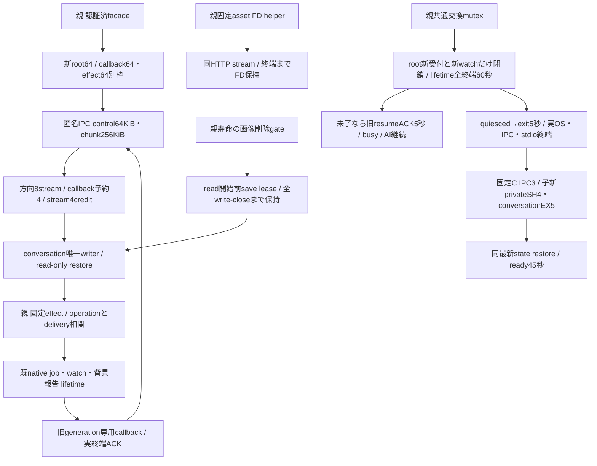

# 会話子の固定起動・通信・終端

runtime所有。Root conversation-update-contract-20261103.md v1（133222cf）に従う。既業務DTO/唯一writerはconversation、親実job/observer lifetimeはexecution、認証facade/両入場/交換mutexはintegration。

固定entryはsrc/conversation-entry.mjs、builtin /app又は/run/bellteam-maintenance/conversation/releases/SHA/payload。非特権C UID/GID1001、空envから定数だけ、任意path/UID/command禁止。親lock非継承。conversation.lockを子だけがEX保持、OSclose以前のnewwriter0。Node匿名IPCは固定advanced serializationでBuffer chunkを運び、dataは256KiB以下、controlは本文無しJSON64KiB以下。各方向control1MiBと未消費8MiBは別管理、send callbackをawaitしNode queueに先積みしない。

同stream連番/重複・欠落・終端後data/宣言size不一致は拒否。creditは消費済chunkに対してだけ返し、endとresource-close ACKは別。root/exportは4streamまで、callback/continuationに残り4を予約。JSON全体検証前の新業務0、UTF8をsplitしても境界を保持。全件historyは作者の同snapshot AsyncIterableを逐次encodeし、IPCのために全体の第二JSON文字列を作らない。子>64KiB再構成は同時1、payload96MiB+metadata64KiB、無進行60秒。総RSS保証へ拡張しない。

親asset FDは固定root/state/bots/<id>/messages/assets又はowner/messages/assetsと既owner/fileだけから導出、O_RDONLY/O_NOFOLLOW・regular・25MiB・mime検査。任意path/flags/root無し。HTTP終端/error/切断でclose、交換中も既FDを読了可。FDをwireへ渡さず、親FDstreamは子drainを塞がない。readImageBytes純粋export/席runtime接点は保持する。

save gateは親一実体でmembers削除/再開と結合。beginSaveがreadImage前に権利捕捉、actual completionを送信前登録、callerunknown/断線ではreleaseせず親read・旧writer OSclose/全write終端確認後だけ解放。prepareRemovalは新save閉鎖と全既save終端を待つ。cancelは同opaque leaseとfresh active/noIntent/noRetiredだけ。他Bot/userは継続。新子の空Mapで権利を作らない。

root slotと受付済delivery lifetimeは別。AIが長ければ60秒drain失敗→旧維持/busy、旧RAM回答所有を新子へ移さず、abort/再送無し。既sharedobserverは継続し新watchだけ閉じる。現世代operationに束縛した専用callback、非awaitafterTurnと一回派生reportの実終端まで追跡。Molly共通交換mutexでmembers交換と直列、作用前両入場と旧context継続を合わせる。

署名runtime互換は作者CONVERSATION_STATE_COMPATIBILITYの厳密7key（配列順含む）、stateSchema:null、protocol1、Node26。catalogはconversationのみ厳密5key、readerとarchiveと現consumer一致を計画/交換直前に検査。readrestoreの実state検証とは別。readyでJev/外部effect/observer/migration/cleanup/新予定発行0。通常bootstrapとrestoreを分離。

## 初期sourceの検証範囲

stream/親FD・save gate/固定C/署名reader・roothelper・installer selectorを先着実装。CはcurrentUIDのcompile-time path fixtureによる実kernel flock・Buffer advanced IPC・空env・旧OS終了後再起動を確認し、本番root1001成立へ補完しない。実Node IPCの試験は既waitNotificationsChildClose（OS exit＋IPC断＋stdio close）を使う。親disconnect時にNode26のcloseイベント単独が発火しない事象をAstra有限再現で切り分け、通信往復自体は正常だった。

本sourceだけではdispatcher/業務channel/controller/lifetime/認証context/通常main/署名・native成立は未完。作者の固定公開I/Fへ接続してから一実体へ組む。root helperは固定conversation分岐でCenti公式verifierとmanifest7値/nullへ接続し、旧componentのCLIを維持する。root配置試験はcurrentUID/receipt stubでcrypto/root試験を代用しない。

Owner共通同時数64の境界としてcallbackも65件目は送信前not_acceptedで返す。未送信callbackをpendingへ積まず、飽和時にもcontrolは独立して進む。
