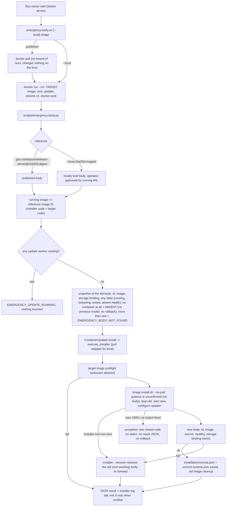
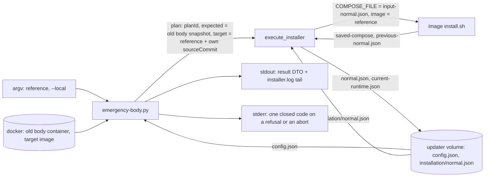

# Emergency body path: put a body in when the body cannot start (a505, 2026-11-22)

Owner: Molly (body container / swap). Related: [bundled updater and worker](container-update-bundled.md), [host updater](container-update.md), [recovery](recovery.md).

## Why

2026-11-22 08:26-09:59 JST the body could not start. Every supported way in needed a running body:

| Path | Why it failed with the body down |
| --- | --- |
| App Update (`plan/start` on the updater socket) | the only peer of the updater socket is the body (uid 1001); an Owner-authenticated request cannot reach it |
| `scripts/deploy.sh` | needs a running container (`BELLTEAM_ORIGINAL_CONFIG_UNAVAILABLE`), saves the queue with `docker exec bellteam curl .../api/queue`, and is the internal-box path (main-server), not the public box |
| `execute_installer` check `inspect_current() == plan.expected` | requires the old body running and healthy |

The box owner had to build an image by hand and recreate the container from a copy of the updater model.

## Shape

One host command, no running body needed, same installer as App Update:

`sh emergency-body.sh [--local] <image>` (file `distribution/server/emergency-body.sh`, also inside every image at `/app/distribution/server/emergency-body.sh`).

It starts the TARGET image itself as a short-lived root container laid out exactly like the update worker (updater volume at its prefix and at its host mountpoint, Docker socket, same caps, read-only root). Inside, `scripts/emergency-body.py` runs the existing `ContainerUpdater.install` -> `execute_installer` -> the target image's own `install.sh`. Nothing else is new.

## Packaging (a506m2)

The image is built from the public package, not from the whole repository: `scripts/package-server.mjs` archives an explicit file list, rebuilds `distribution/` from named files only, and `publish-server-image.yml` builds on pushes to its `paths` list (`test/server-image-paths.test.mjs` keeps the two aligned). `scripts/emergency-body.py` is in both lists and `distribution/server/emergency-body.sh` is copied into the rebuilt `distribution/server/` (test: `test/server-distribution.test.mjs`). Z172 lab found both files missing from image `dfe6686f` for this reason.

## Data flow

State ownership is unchanged: the updater volume stays root-private; the data/home/Aiterm state volumes are untouched by this entry (the image's `install.sh` handles Aiterm state exactly as in App Update). No queue backup is taken: with no body there is no queue API, and the state volume is not touched.

## State transitions of one run

One `emergency-body.sh` run is one container and one pass; there is no state kept between runs except what the installer already keeps (operation directory and `installation/normal.json`). Every path of the diagram ends in exactly one of: refused (nothing swapped), aborted by an exception, swapped and verified, or failed with the old model restored or not restorable. No refusal waits for anything: each exits at once with a closed code (the wrapper's own checks exit 2 with a message), so the next run starts from whatever the previous one left.

```mermaid
stateDiagram-v2
  [*] --> Wrapper
  Wrapper --> Refused: emergency-body.sh: usage, BELLTEAM_PROJECT invalid, or published image not ghcr.io/kitepon/bellteam-server@sha256 (exit 2, message only)
  Wrapper --> WrapperPull: published reference
  Wrapper --> Resolving: --local, image id read from the local image
  Wrapper --> Refused: --local image not found (docker image inspect fails, exit 1, docker's message)
  WrapperPull --> Refused: docker pull fails (docker's own error; no time bound of ours, the operator can stop it)
  WrapperPull --> Resolving
  Resolving --> Refused: updater volume not found (docker volume inspect fails)
  Resolving --> Parsing: docker run of the target image starts emergency-body.py
  Parsing --> Refused: reference not a pinned ghcr digest, or local without --local (EMERGENCY_REFERENCE_INVALID)
  Parsing --> Loading
  Loading --> Refused: config.json, updater volume binding or host checks fail (HOST_UPDATE_CONFIG_INVALID, HOST_UPDATE_STORAGE_BINDING, HOST_UPDATE_ROOT_REQUIRED, HOST_UPDATE_TRUST)
  Loading --> Identity
  Identity --> Refused: running image is not the reference image (EMERGENCY_IMAGE_MISMATCH)
  Identity --> Exclusive
  Exclusive --> Refused: an update worker of this project is running (EMERGENCY_UPDATE_RUNNING)
  Exclusive --> OldBody
  OldBody --> Refused: more than one bellteam container (EMERGENCY_BODY_NOT_FOUND)
  OldBody --> Planned: snapshot taken in any state (running, restarting, exited)
  OldBody --> Planned: no bellteam container at all (a run aborted after the installer removed the old body); there is then no previous model, so no rollback
  Planned --> Pulling: published reference
  Planned --> Verifying: local image, no pull
  Pulling --> Verifying: image already local, pull is a no-op
  Verifying --> Refused: image id, source or old body changed meanwhile (HOST_UPDATE_IMAGE_INVALID, HOST_UPDATE_CURRENT_CHANGED)
  Verifying --> Aborted: a docker command fails (EMERGENCY_BODY_STOPPED)
  Verifying --> Preflight
  Preflight --> Failed: target image preflight answers fail (HOST_UPDATE_PREFLIGHT_FAILED); old body untouched
  Preflight --> Refused: the body changed during the preflight (second check, HOST_UPDATE_CURRENT_CHANGED); no swap yet
  Preflight --> Swapping: pass or unknown
  Swapping --> Aborted: installer runs over 1800 s or floods its output (HOST_UPDATE_INSTALL_TIMEOUT, HOST_UPDATE_INSTALL_OUTPUT_LIMIT): process group killed, the exception leaves, no rollback is attempted
  Swapping --> RollingBack: installer exit non-zero
  Swapping --> Confirming: installer exit 0
  Confirming --> RollingBack: new body not running and healthy, other image or source, or storage binding differs (an inspection error is retried 3 x 10 s; an unhealthy answer is not, the installer already waited for readiness)
  Confirming --> Saving: confirmed
  Saving --> Cleaning: installation/normal.json and current-runtime.json saved
  Saving --> Aborted: a write fails (installation/normal.json or current-runtime.json); the new body is running and verified, the saved model is not updated
  Cleaning --> Succeeded: old image removed
  Cleaning --> Succeeded: cleanup failed, kept as HOST_UPDATE_CLEANUP_FAILED
  Cleaning --> Failed: the installer reported the Aiterm state step failed (HOST_UPDATE_AITERM_STATE_FAILED); the new body is kept
  RollingBack --> Failed: installer --recover run; rollback is succeeded only when the old body is healthy again, otherwise failed
  RollingBack --> Failed: no saved previous model (rollback unavailable)
  Refused --> [*]: exit 1 (exit 2 for the wrapper's own checks), a code or message on stderr, nothing swapped
  Aborted --> [*]: exit 1, one code on stderr, no result JSON; operation directory and installer.log are kept
  Failed --> [*]: exit 1, JSON result and installer log tail
  Succeeded --> [*]: exit 0, JSON result
```

How each end is left:

| End | What exists afterwards | Next step for the operator |
| --- | --- | --- |
| Refused (before `Planned`) | no operation directory, no container touched | fix the cause named by the code and run again |
| Aborted at `Swapping` or `Verifying` (installer timeout or output flood, a docker command failing, or the operator's Ctrl-C: EMERGENCY_BODY_STOPPED) | operation directory with `installer.log`; no rollback was attempted. Depending on where the installer stopped: the old body still there (stopped or not), a new body created or running, or no body at all (`install.sh` removes the old body before it starts the new one). The state volumes and the saved model are untouched | run the same command again: one container is treated as the old body in whatever state it is; none starts a body from the saved model with the new image (no rollback exists then). Two things can still stop the rerun: a state-maintenance container the killed installer left running (the installer's own writer check refuses; stop that container, then rerun) and more than one `bellteam` container (`EMERGENCY_BODY_NOT_FOUND`; remove the extra one) |
| Aborted at `Saving` (a write of the model fails) | operation directory; the new body runs and is verified, but `installation/normal.json` and `current-runtime.json` still describe the old body | do not treat as complete; fix the cause named by the code (disk, permission) and run again with the same image |
| Refused at `Verifying` / `Preflight` (a changed body) / Failed at `Preflight` | an operation directory (empty or with the preflight record); old body untouched | read the code, run again (an image change needs a new reference) |
| Failed after `Swapping`, rollback succeeded | old model restored (the old body may itself be down) | run again with a body that starts |
| Failed, rollback failed or unavailable | operation directory with `installer.log` and `recover.log`; the project may have no running body | run again; the result JSON carries the installer log tail |
| Failed at `Aiterm state` | new body kept and healthy, Aiterm state step reported failed | decide with the Aiterm owner; do not treat as complete |
| Succeeded | new body healthy, model saved, old image removed | none; a cleanup failure is only reported |

Self-exit: every state in the container leaves by a closed code or a bounded wait (pull 900 s, preflight 120 s, installer 1800 s, inspection retries 3 x 10 s, cleanup of the old image 600 s, whose failure is only reported); no state waits for an operator, a peer or a running body. The one wait without a bound of ours is the wrapper's own `docker pull` of a published image before the container starts; it ends by docker's network errors or by the operator stopping it, and it changes nothing on the box.

## The Aiterm state step and the absent body (a507d)

Compared by reading `distribution/server/install.sh` and `install-resume-state.sh` (not by running them):

- `resume_prepare` (worker mode) tries to keep the old body's Aiterm backing: it needs the old body present and the only container referencing that volume. Any mismatch takes the reset path and prints `aiterm=reset reason=RESUME_PRESERVE_UNCONFIRMED`. With no old body (the absent case above) preserve cannot apply, so a run from no body is a reset run: seats' Aiterm sessions start fresh. This is the same rule App Update already follows when preserve is unconfirmed.
- `resume_initialize` -> `resume_apply` failing prints `aiterm-state-apply=failed` and the installer goes on; `execute_installer` then reports `verification: failed` with `HOST_UPDATE_AITERM_STATE_FAILED` after the swap succeeded. This is the `Cleaning --> Failed` edge. `resume_initialize` itself refusing (for example `RESUME_PRESERVE_UNCONFIRMED`) returns non-zero, `install.sh` exits non-zero, and the run goes to `RollingBack` (or ends as a failed install when there is no previous model).
- In the absent case `install.sh` saves no `previous-runtime.json`, so `execute_installer`'s old-image cleanup raises and reports `HOST_UPDATE_CLEANUP_FAILED`; there is no old image to clean, so `emergency-body.py` reports `cleanup: not_needed` and no error (Z174 lab: every no-container run printed the false failure).
- A run from no body starts a new Aiterm generation; the previous generation's Aiterm volume stays on the box, unreferenced (not copied, not deleted).
- Not run on a box with no container: the absent-body start and its Aiterm reset path are covered by unit tests with a fixture installer only; Centi's lab has to run it once (stop the body, remove the container, run the wrapper).

## Contract

- Input: one reference. Published: `ghcr.io/kitepon/bellteam-server@sha256:<64 hex>`. Local: `--local sha256:<64 hex>` (an image ID the operator built, e.g. `docker build -t bellteam-local . && docker image inspect --format '{{.Id}}' bellteam-local`). Running the command is the approval; there is no catalog, signature or ledger check (the signed catalog is the normal path; this one exists for when it cannot be used).
- The container runs from the target image, so the installer code is the target's. The entry refuses when the running image ID differs from the reference image ID (`EMERGENCY_IMAGE_MISMATCH`).
- One swap at a time: any running update worker for the project refuses the entry (`EMERGENCY_UPDATE_RUNNING`).
- The old body may be in any state, even absent health, or absent altogether (an aborted earlier run); at most one `bellteam` container of the project may exist, and its mounts must match the saved model, as in App Update. With no container the new body is started from the saved model and the existing state volumes, without a rollback.
- `config.json` `release` need not equal the target source: the updater service may be older than the body being put in. The swap's own `install.sh --configure` step recreates the updater service from the new image.
- Rollback restores the old model; if the old body could not start, that body is also down. The result says so; the fix is another emergency swap with a body that starts.
- Result: stdout JSON `{result: {execution, verification, cleanup, rollback, error}, previous: {state}, installerLog}`; exit 0 only when `verification == 'succeeded'`.

## Verification (changed range only)

`test/emergency-body.test.py`: reference forms and `--local` rule; image mismatch refusal; running worker refusal; old body in `exited` / `restarting` state yields a stable expected snapshot and the swap succeeds through the real `execute_installer` with a fixture `install.sh`; a new body that is not healthy fails verification; exit codes. Real Docker is covered by the lab (Centi) as one disposable-box run: stop the body, run the command with the fixed image.
